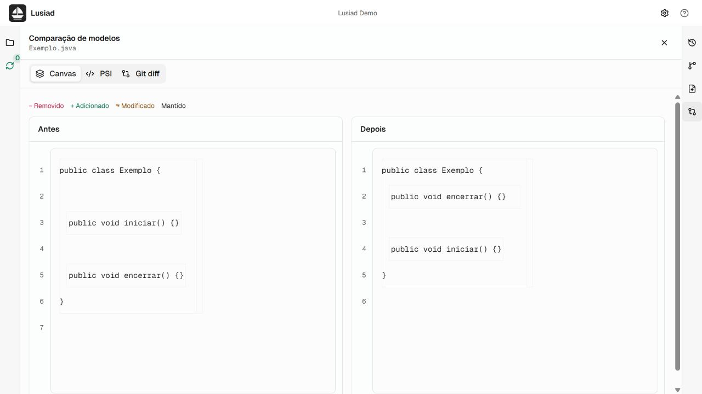

# Lusiad

[English](README.en.md) · [Documentação](docs/pt-BR/index.md) · [Instalação](docs/pt-BR/instalacao.md) · [Avaliação](docs/pt-BR/avaliacao.md)

O Lusiad é um ambiente para programação Java baseada em modelos e acompanhamento de mudanças. Um plugin do IntelliJ IDEA fornece a análise estrutural do código e uma API local. A interface web permite editar o modelo, consultar o código gerado e navegar pelo histórico. Os registros de mudanças combinam elementos estruturais do programa, estados de arquivos, commits Git e dados em MySQL.

Este repositório reúne o [plugin e serviço local](lusiad-backend/), a [interface web](lusiad-frontend/), a [documentação](docs/pt-BR/index.md) e os [artefatos públicos da avaliação](evaluation/README.md). Os materiais referem-se às revisões identificadas em [VERSIONS.md](VERSIONS.md).

## Lusiad em ação

Em um projeto Java criado só para esta demonstração, `Exemplo.java` continha `iniciar()` antes de `encerrar()`. Na interface real, o usuário selecionou `encerrar()` no modelo e o arrastou para antes de `iniciar()`. O código Java passou a refletir a nova ordem. Em seguida, registrou o commit **Mover encerrar antes de iniciar**, abriu a mudança individual no histórico e comparou esse commit com **Preparar dois métodos**. As capturas mostram a revisão demonstrada em [VERSIONS.md](VERSIONS.md), distinta da revisão avaliada ainda não confirmada.

*1. Estado anterior: biblioteca, modelo e código de `Exemplo.java`.*

*2. A posição dos métodos mudou no modelo e no arquivo Java.*

*3. A comparação de versões mostra os estados anterior e posterior.*

O [manual ilustrado](docs/pt-BR/manual.md) mostra o histórico, o evento individual, o diff Git e a árvore PSI.

## Instalar e executar

Consulte os [pré-requisitos e passos de instalação](docs/pt-BR/instalacao.md) para instalar o plugin a partir do ZIP da release ou compilá-lo do código, preparar o MySQL e iniciar a interface. O [guia de primeiros passos](docs/pt-BR/primeiros-passos.md) acompanha a criação de um projeto, uma edição e a consulta ao histórico.

## Como o projeto está organizado

| Pasta | Responsabilidade |
| --- | --- |
| `lusiad-backend/` | Plugin IntelliJ, API local, serviços PSI, persistência e migrações SQL. |
| `lusiad-frontend/` | Interface Next.js, operações Git e consultas ao banco. |
| `docs/pt-BR/`, `docs/en/` | Manuais, arquitetura, implementação, prototipação e avaliação. |
| `evaluation/` | Instrumentos aplicados, cenário e resultados agregados liberáveis. |

Leia a [arquitetura](docs/pt-BR/arquitetura.md), a [representação de uma mudança](docs/pt-BR/implementacao.md) e a [história dos protótipos](docs/pt-BR/prototipacao.md). O [protocolo](docs/pt-BR/avaliacao.md) informa como foi conduzida a avaliação e delimita o alcance dos resultados. [Informações sobre versão, citação e conteúdo do pacote](VERSIONS.md).

## Citação, licença e dados

O código e a documentação deste repositório são disponibilizados sob a [licença MIT](LICENSE). O DOI informado para o depósito no Zenodo é [10.5281/zenodo.24266445](https://doi.org/10.5281/zenodo.24266445); ele é tratado aqui como reservado até a confirmação da publicação do registro. Para citar uma versão publicada, use o identificador da release e o DOI correspondente. Os materiais de participantes disponibilizados neste repositório são agregados.
