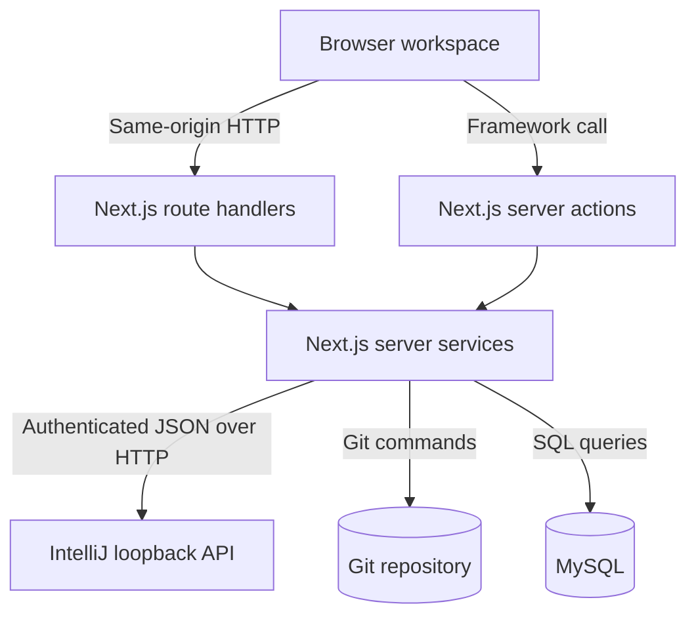
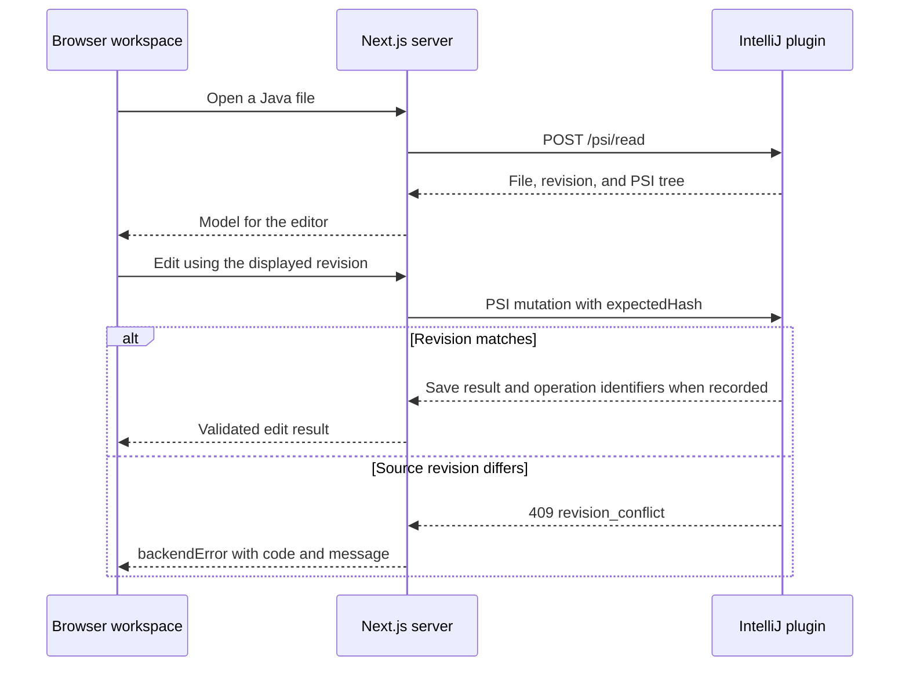
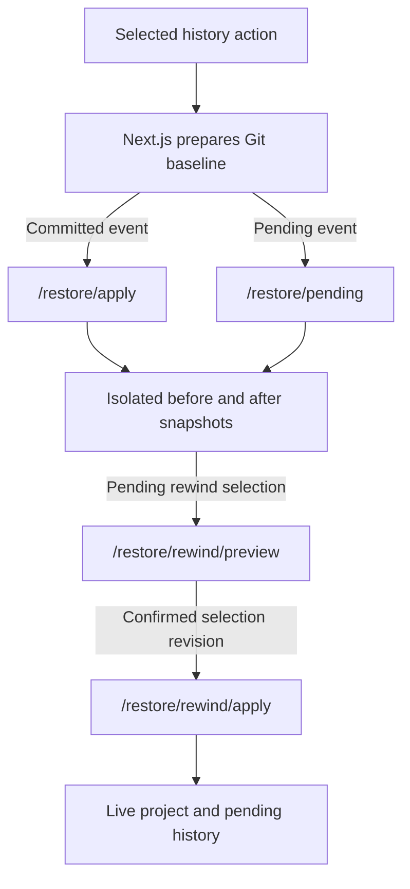

# `Lusiad` – API reference

**🇺🇸 English** · [🇧🇷 Português (Brasil)](../pt-BR/referencia-da-api.md)

Lusiad exposes HTTP interfaces at two points. The browser calls the Next.js application, which provides route handlers and server actions. The Next.js server calls the local IntelliJ plugin API for operations that require the IDE, the Java project, or its filesystem. Git and SQL operations can also run directly on the Next.js server. The tables below follow the routes registered in the repository.

### On this page

> [1. Addresses and request conventions](#addresses-and-request-conventions)<br>
> [2. Next.js routes and server actions](#nextjs-routes-and-server-actions)<br>
> [3. PSI and source editing](#psi-and-source-editing)<br>
> [4. Files and directories](#files-and-directories)<br>
> [5. Java diagnostics, execution, and UML](#java-diagnostics-execution-and-uml)<br>
> [6. Undo and redo](#undo-and-redo)<br>
> [7. Historical previews and restoration](#historical-previews-and-restoration)<br>
> [8. Project registration and runtime checks](#project-registration-and-runtime-checks)<br>
> [9. Responses and errors](#responses-and-errors)<br>
> [Documentation index](#documentation-index)

---

## Addresses and request conventions

| Interface | Default base URL | Callers and conventions |
| --- | --- | --- |
| Next.js | `http://localhost:3000` | Browser requests use the same-origin `/api/lusiad/` routes. React components also call Next.js server actions. |
| IntelliJ plugin | `http://127.0.0.1:8765` | The server listens on loopback. Next.js sends `X-Lusiad-Token` from its server-side configuration. POST requests use `Content-Type: application/json`. |

The plugin checks the local host and configured port, and checks the frontend origin when an `Origin` header is supplied. Plugin POST handlers parse UTF-8 JSON objects with a 4 MiB body limit. In the test profile, the Next.js client also supplies the test run and configuration headers to the plugin's operational routes. The plugin responds to accepted CORS preflight requests with HTTP 204. The tables list the methods used to call each operation. The two base URLs are configurable. The [installation guide](installation.md) describes the local setup. [Operational configuration](../../lusiad-frontend/src/lib/config/operational-config.ts) · [Plugin access checks](../../lusiad-backend/src/main/java/com/lusiad/backend/config/LocalApiAccess.java) · [Common HTTP handler](../../lusiad-backend/src/main/java/com/lusiad/backend/handler/BaseHandler.java) · [Next.js plugin configuration](../../lusiad-frontend/src/lib/config/backend.ts)



`projectId`, `changeId`, and `branchId` refer to SQL records. Operational routes generally use a positive `projectId`. The plugin accepts known integer fields as JSON integers or integer strings. Paths for operations on the registered project are usually relative to its working directory. Project-path handlers resolve and validate them against the allowed roots. Line and column coordinates for PSI requests are 1-based, and offsets are 0-based UTF-16 code units. The [data model](data-model.md) explains revisions and identifiers. [Request validation](../../lusiad-backend/src/main/java/com/lusiad/backend/handler/ApiJson.java) · [Path resolution](../../lusiad-backend/src/main/java/com/lusiad/backend/handler/BaseHandler.java)

## Next.js routes and server actions

| Method | Route | Request fields | Behavior |
| --- | --- | --- | --- |
| `GET` | `/api/lusiad/settings` | — | Read shared UI preferences. Returns `status` and `preferences`. |
| `POST` | `/api/lusiad/settings` | `language`, `changeTextLanguage`, `theme`, or `palette` | Merge the supplied preferences from the top-level JSON object. Returns the merged `preferences`. Limit of 16 KiB. |
| `GET` | `/api/lusiad/projects/presence` | — | Read the IDE and web workspace presence snapshot. |
| `POST` | `/api/lusiad/projects/presence` | `projectId`, `tabId` | Refresh tab presence. Set `close: true` to remove that tab. Limit of 4 KiB. |
| `POST` | `/api/lusiad/java` | `projectId`, `action` | Dispatch Java context, diagnostics, revision checks, and cancellation. Limit of 4 MiB. |
| `POST` | `/api/lusiad/run` | `projectId`, `action` | List main classes or start, inspect, and stop a Java run. Limit of 4 KiB. |
| `POST` | `/api/lusiad/undo` | `projectId`, `action` | Dispatch undo and redo operations. Actions other than `status` use fields in `cursor`. Limit of 4 MiB. |
| `GET` | `/api/lusiad/runtime` | — | Check the database and the plugin connection in normal mode. Returns `version`, `apiAccessVersion`, `apiPort`, and `databaseId`. |
| `GET` | `/api/lusiad/test-context` | — | Report read-only frontend readiness in the test profile. Returns 404 outside that profile. |

The Java route accepts the actions `context`, `analyze`, `proposal`, `check`, and `cancel`. It forwards them to `/java/context`, `/java/analyze`, `/java/analyze-edit`, `/java/check`, and `/java/cancel`, respectively. In the browser request, `proposal` takes `path`, `content`, `revision`, `requestId`, and an `operation` object containing the edit. The Next.js service forwards `content` as `sourceContent`, `revision` as `expectedHash`, and the edit fields at the top level. The `check` action takes `revision` and forwards it as `contextRevision`. The run route forwards `list`, `start`, `status`, and `stop` to the corresponding `/run/` routes. [Next.js Java route](../../lusiad-frontend/src/app/api/lusiad/java/route.ts) · [Java diagnostic service](../../lusiad-frontend/src/lib/services/java-diagnostics/java-diagnostics.service.ts) · [Next.js run route](../../lusiad-frontend/src/app/api/lusiad/run/route.ts) · [Route sources](../../lusiad-frontend/src/app/api/lusiad)

Example browser request for the state of the latest run in project `1`. The response below applies when the service has no run for that project.

```http
POST /api/lusiad/run
Content-Type: application/json

{"projectId":1,"action":"status"}
```

```json
{"status":"ok","state":"idle"}
```

Other browser operations use server actions. `loadModelController` obtains a PSI model, `loadWorkspaceTreeController` loads the explorer tree, and `loadChangeHistoryController` queries the recorded history. `commitChangesController` coordinates the Git and SQL work of recording a version. These are TypeScript entry points invoked by the application. [Run response contract](../../lusiad-frontend/src/lib/services/java-run/java-run-contract.ts) · [Model controller](../../lusiad-frontend/src/controllers/model-editor/model-editor.controller.ts) · [Explorer controller](../../lusiad-frontend/src/controllers/file-explorer/file-explorer.controller.ts) · [History controller](../../lusiad-frontend/src/controllers/change-history/change-history.controller.ts) · [Commit controller](../../lusiad-frontend/src/controllers/commit-menu/commit-menu.controller.ts)

## PSI and source editing

Every route in this group requires `projectId` in addition to the fields shown.

| Method | Route | Request fields | Behavior |
| --- | --- | --- | --- |
| `POST` | `/psi/read` | `path` | Read a Java file and return `file`, `revision`, and its PSI `tree`. |
| `POST` | `/psi/parse` | `fileName`, `content` | Parse supplied Java text in memory. Returns `file` and `tree`. |
| `POST` | `/psi/diagnose` | `path`, `content` | Check PSI syntax. Optionally supply `startOffset`, `endOffset`, and `newContent` together to check a proposed replacement. |
| `POST` | `/psi/diagnose-edit` | `path`, `sourceContent`, `expectedHash`, `operation` + edit fields | Preview a create, update, move, or delete in memory. Returns syntax diagnostics and `proposedContent`. |
| `POST` | `/psi/create` | `path`, `expectedHash`, `line`, `content` | Insert Java text at the destination. |
| `POST` | `/psi/update` | `path`, `expectedHash`, `startOffset`, `endOffset`, `newContent` | Replace a range in the source. |
| `POST` | `/psi/move` | `path`, `expectedHash`, `startOffset`, `endOffset`, `line` | Move an in-file range to the destination. |
| `POST` | `/psi/delete` | `path`, `expectedHash`, offset range or line and column range | Remove a range. The alternate form uses `startLine`, `startColumn`, `endLine`, and `endColumn`. |
| `POST` | `/psi/recover` | — | Reconcile prepared edit intents with the saved files. Returns `status` and the `recovered` count. |

For `create` and `move`, `column` and `lineEnd` are alternative destination qualifiers. When supplied, `lineEnd` must equal `line + 1`. Live edits require a 64-character lowercase hexadecimal `expectedHash` from the source revision. On a successful write, the response includes `saved: true` and `formatting.status`. A recorded change also returns `revision`, `operationId`, `operationOrder`, `changeId`, and `recordVersion`. A no-op can return `noOp: true` and the current revision without creating a history event. [PSI router](../../lusiad-backend/src/main/java/com/lusiad/backend/router/psi/PsiRouter.java) · [PSI handlers](../../lusiad-backend/src/main/java/com/lusiad/backend/handler/psi/PsiGenericHandlers.java) · [Mutation response validation](../../lusiad-frontend/src/lib/services/backend-response.ts)

The following example sends Java text to the plugin's in-memory parser. Use the configured local token in the header. The response contains the file name and a serialized PSI tree for the supplied text.

```http
POST /psi/parse
Host: 127.0.0.1:8765
Content-Type: application/json
X-Lusiad-Token: <local-token>

{"projectId":1,"fileName":"Counter.java","content":"class Counter {}"}
```



## Files and directories

| Method | Route | Request fields | Behavior |
| --- | --- | --- | --- |
| `POST` | `/fs/directory-picker` | `requestId`, `operation`, `locale` | Open, poll, or cancel the native folder picker with `start`, `status`, or `cancel`. Optional `path` sets the initial folder. Returns `requestId`, `state`, and the selected `path` when available. |
| `POST` | `/fs/reveal` | `projectId`, `path` | Reveal an authorized item in the system file explorer. Returns `status` and `mode`. |
| `POST` | `/fs/file/create` | `projectId`, `path`, `name` | Create a `.java` file inside the parent directory at `path`. Optional `content` provides the initial text. |
| `POST` | `/fs/file/delete` | `projectId`, `path` | Delete the file. The `safe` option participates in the resource capture used for undo. |
| `POST` | `/fs/file/rename` | `projectId`, `path`, `name` | Rename the file in its current directory. |
| `POST` | `/fs/file/move` | `projectId`, `sourcePath`, `destPath` | Move the file into the destination directory. Accepts `overwrite` when replacement is intended. |
| `POST` | `/fs/dir/create` | `projectId`, `path`, `name` | Create a directory inside its parent at `path`. |
| `POST` | `/fs/dir/delete` | `projectId`, `path` | Delete a directory. `recursive` enables removal of its contents. |
| `POST` | `/fs/dir/rename` | `projectId`, `path`, `name` | Rename a directory in its current parent. |
| `POST` | `/fs/dir/move` | `projectId`, `sourcePath`, `destPath` | Move a directory into a destination parent directory. |

In create calls, `path` identifies the parent directory. In move calls, `destPath` identifies the destination directory. An empty path represents the project root in the parent and destination fields that allow it. The explorer tree itself is loaded by the Next.js server. [Filesystem router](../../lusiad-backend/src/main/java/com/lusiad/backend/router/fs/FsRouter.java) · [File handlers](../../lusiad-backend/src/main/java/com/lusiad/backend/handler/fs/FsFileHandlers.java) · [Directory handlers](../../lusiad-backend/src/main/java/com/lusiad/backend/handler/fs/FsDirHandlers.java) · [Workspace explorer](../../lusiad-frontend/src/controllers/file-explorer/file-explorer.controller.ts)

## Java diagnostics, execution, and UML

Every route in this group also requires `projectId`.

| Method | Route | Request fields | Behavior |
| --- | --- | --- | --- |
| `POST` | `/java/context` | — | Return project Java settings, readiness, and revisions. A settings update sends `settings` and `configurationRevision` together. |
| `POST` | `/java/analyze` | `requestId` | Analyze the saved project sources using `javac`. |
| `POST` | `/java/analyze-edit` | `requestId`, `path`, `sourceContent`, `expectedHash`, `operation` + edit fields | Analyze an in-memory proposal against the saved project context. Returns diagnostics and the proposed text. |
| `POST` | `/java/check` | `contextRevision` | Check that the sources, dependencies, and Java settings still match the analysis context. |
| `POST` | `/java/cancel` | `requestId`, `channel` | Cancel the matching analysis in the `saved` or `proposal` channel. |
| `POST` | `/run/list` | — | Return `mains` and the `contextRevision` for the saved project. |
| `POST` | `/run/start` | `main`, `contextRevision` | Start compiling and running the selected main class. Returns the run state and its `id`. |
| `POST` | `/run/status` | — | Return the latest run state for the project, or `idle`. Non-idle responses include the run identity and output fields. |
| `POST` | `/run/stop` | `runId` | Stop the identified run. Supply the `id` returned by the service as `runId`. |
| `POST` | `/uml/current` | `files`, `locale` | Render a UML diagram from the supplied Java files. Returns `engine`, `diagram`, and `fileCount`. |
| `POST` | `/uml/render` | `beforeFiles`, `afterFiles`, `operation`, `locale` | Render a UML comparison. Optional `beforeFocus` and `afterFocus` identify the affected locations. |

The PSI syntax response identifies its source as `psi-syntax` and includes the file, base and result revisions, and diagnostics. Compiler responses identify their source as `javac` and include `requestId`, `contextRevision`, files, and diagnostics. A non-empty diagnostics list is a valid analysis result. A Java run exposes job states such as `compiling`, `running`, `succeeded`, and `failed`. UML accepts source entries with `path` and `content` and a locale of `en` or `pt-BR`. The plugin derives the diagrams and returns SVG data. [Syntax response](../../lusiad-frontend/src/lib/services/syntax-diagnostics/syntax-contract.ts) · [Compiler handler](../../lusiad-backend/src/main/java/com/lusiad/backend/handler/diagnostics/JavaDiagnosticsHandler.java) · [Java run router](../../lusiad-backend/src/main/java/com/lusiad/backend/router/run/JavaRunRouter.java) · [UML service](../../lusiad-backend/src/main/java/com/lusiad/backend/service/uml/UmlService.java)

## Undo and redo

Plugin routes in this group require `projectId`. The cursor uses `direction` (`undo` or `redo`), `epoch`, `revision`, and `requestId`. The browser sends the cursor nested under `cursor` to `/api/lusiad/undo`. Next.js sends its fields at the top level to the plugin. [Undo route](../../lusiad-frontend/src/app/api/lusiad/undo/route.ts) · [Cursor and responses](../../lusiad-frontend/src/lib/services/undo/undo-contract.ts) · [Plugin undo router](../../lusiad-backend/src/main/java/com/lusiad/backend/router/undo/UndoRouter.java)

| Method | Route | Request fields | Behavior |
| --- | --- | --- | --- |
| `POST` | `/undo/status` | — | Return the undo and redo steps, counts, `epoch`, and `revision`. |
| `POST` | `/undo/preview` | `direction`, `epoch`, `revision`, `requestId` | Return the affected files and their proposed states. |
| `POST` | `/undo/analyze` | Same cursor as `/undo/preview` | Check the proposal with PSI or, with `semantic: true`, the Java compiler. |
| `POST` | `/undo/apply` | Same cursor as `/undo/preview` | Apply the current proposal. Accepts `corrections` by path and an optional `contextRevision`. |
| `POST` | `/undo/receipt` | Same cursor as `/undo/preview` | Look up the confirmed operation receipt for the request. |
| `POST` | `/undo/cancel` | `requestId` | Cancel analysis associated with the request. |

## Historical previews and restoration

| Method | Route | Request fields | Behavior |
| --- | --- | --- | --- |
| `POST` | `/restore/apply` | `changeId`, `snapshotId` | Reconstruct the before and after states of a committed change in a prepared preview directory. |
| `POST` | `/restore/pending` | `projectId`, `changeId`, `snapshotId`, `branchId`, `gitId`, `pendingRevision` | Reconstruct a pending change from the selected branch's committed baseline. |
| `POST` | `/restore/rewind/preview` | Same identity as `/restore/pending` | List the pending changes and paths to be discarded, and return `selectionRevision`. |
| `POST` | `/restore/rewind/apply` | Same identity as `/restore/pending`, plus `requestId` and `selectionRevision` | Apply the verified rewind to the live project and discard the later pending changes. |
| `POST` | `/restore/commit/check` | `projectId` | Check the project for unsaved IntelliJ documents before a Git-based restoration. |
| `POST` | `/restore/commit/refresh` | `projectId` | Refresh the project's IntelliJ Virtual File System after the restoration. |

Next.js resolves the selected change and prepares its Git baseline under the temporary comparison directory. The `snapshotId` uses the form `compare-<UUID>`. The plugin replays the selected change into `working-copy-prev` and `working-copy`. For pending history, `branchId`, `gitId`, and `pendingRevision` identify the selected history state. Applying a rewind requires the `selectionRevision` returned by its preview. [Restore router](../../lusiad-backend/src/main/java/com/lusiad/backend/router/restore/RestoreRouter.java) · [Preview orchestration](../../lusiad-frontend/src/lib/services/restore/restore.service.ts) · [Pending rewind](../../lusiad-backend/src/main/java/com/lusiad/backend/service/restore/PendingRewindService.java)



## Project registration and runtime checks

| Method | Route | Request fields | Behavior |
| --- | --- | --- | --- |
| `POST` | `/projects/read` | `projectId` | Read the registered project and its `revision`. Send it as `registryRevision` when updating the registration. |
| `POST` | `/projects/update` | `projectId`, `registryRevision`, `name` | Update the registration name and optional `description`. |
| `POST` | `/projects/preview` | `projectId`, `adminAction` | Preview `remove`, `delete`, `relink`, or `move`. `relink` and `move` require `newPath`. |
| `POST` | `/projects/apply` | Preview fields, `registryRevision`, `confirmation`, `requestId` | Apply the confirmed project administration action. |
| `POST` | `/projects/operations` | — | List outstanding project operation records. |
| `POST` | `/projects/recover` | `projectId`, `requestId` | Recover or confirm the identified project operation. |
| `POST` | `/ide/projects` | `action` | `status` returns the presence snapshot. `presence` uses `projectId`, `tabId`, and optional `close`. |
| `GET` | `/_lusiad/runtime` | — | Return the API and database identity in normal mode after checking the database connection. |
| `GET` | `/_lusiad/test-context` | — | Return plugin readiness and test context in the test profile. |

To apply a project administration action, use the `revision` returned by `/projects/preview` as `registryRevision` and the registered project name as `confirmation`. The Next.js runtime route checks the plugin identity and verifies that both services use the same database, and the test-context routes report readiness for an isolated run. [Project management router](../../lusiad-backend/src/main/java/com/lusiad/backend/router/project/ProjectManagementRouter.java) · [Project administration service](../../lusiad-backend/src/main/java/com/lusiad/backend/service/project/ProjectManagementService.java) · [Project presence router](../../lusiad-backend/src/main/java/com/lusiad/backend/router/project/ProjectPresenceRouter.java) · [Plugin HTTP server](../../lusiad-backend/src/main/java/com/lusiad/backend/HttpServer.java) · [Next.js runtime route](../../lusiad-frontend/src/app/api/lusiad/runtime/route.ts)

## Responses and errors

Plugin mutation responses normally contain `status: "ok"`. PSI read and parse return the model object directly. The common JSON error body contains `status: "error"`, a machine-readable `code`, and an `error` string. Some readiness and test responses have their own shape. [Plugin JSON boundary](../../lusiad-backend/src/main/java/com/lusiad/backend/handler/ApiJson.java) · [Next.js response decoder](../../lusiad-frontend/src/lib/services/backend-response.ts)

| Plugin HTTP status | Examples |
| --- | --- |
| 400 | `invalid_request` for malformed fields or JSON, and `path_not_authorized` for a path outside the permitted roots. |
| 403 | `client_not_authorized` for rejected access checks. |
| 404 | `psi_file_not_found` for a missing Java file on `/psi/read`. |
| 405 | `method_not_allowed` for a request with the wrong HTTP method on a POST handler. |
| 409 | `revision_conflict`, `operation_pending`, and other operation-specific conflicts. |
| 413 / 415 | `body_too_large` or `unsupported_media_type`. |
| 422 | Service-level errors that the common response adapter classifies as operation failures. |
| 500 / 503 | Invalid service response or internal failures, or a required service or configuration being unavailable. |

The Next.js Java, run, and undo route handlers can return an expected operation failure as `backendError` in an HTTP 200 response. The caller reads that field to get the error code and localized message. Errors raised by the route handler itself can produce HTTP 400, 413, or 503. The server-side plugin transport keeps one deadline for the response headers and body. A timeout can occur while the plugin is still processing the request. The transport leaves reconciliation to the operation's recovery or receipt flow before another attempt. [Server action result](../../lusiad-frontend/src/lib/services/backend-action-result.ts) · [Plugin transport](../../lusiad-frontend/src/lib/services/backend-transport.ts)

```typescript
export interface BackendActionFailure { backendError: { code: string; message: string } }
export type BackendActionResult<T> = T | BackendActionFailure
```

---

<table width="100%">
<tr>
<td align="left"><a href="data-model.md">⬅️ Previous page</a></td>
<td align="center"><a href="../../README.md#documentation-index">1️⃣3️⃣ API reference</a></td>
<td align="right"><a href="interaction-diagrams.md">Next page ➡️</a></td>
</tr>
</table>

### Documentation index

**[📖 Overview](../../README.md)**

- [🖥️ User guide](manual.md)

**[⚙️ Installation](setup.md)**

- [🔧 Installation guide](installation.md)
- [🚀 First steps](first-steps.md)

**[📐 Project](project.md)**

- [📋 Requirements](requirements.md)
- [✏️ Prototyping](prototyping.md)

**[💻 Implementation](implementation.md)**

- [🏗️ Architecture](architecture.md)
- [📂 Directory structure](directory-structure.md)
- [🧰 Technology stack](technology-stack.md)
- [🗃️ Data model](data-model.md)
- [🔌 API reference](api-reference.md) 👈
- [🔀 Interaction diagrams](interaction-diagrams.md)
- [🧭 Design decisions](design-decisions.md)
- [🔍 Notable implementation elements](notable-implementation-elements.md)

**[📊 Evaluation](evaluation.md)**

- [📋 Planning](evaluation-planning.md)
- [🧪 Execution](evaluation-execution.md)
- [📈 Results](evaluation-results.md)
- [💬 Discussion](evaluation-discussion.md)
- [📂 Materials and data](evaluation-data.md)
- [🗂️ Evaluation files](../zenodo/)
