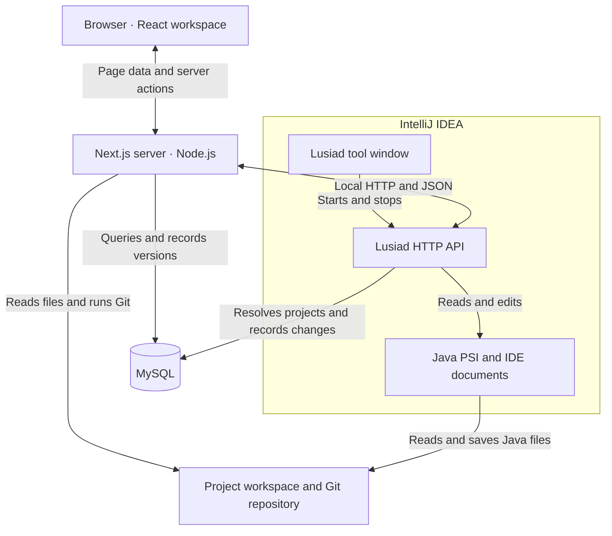
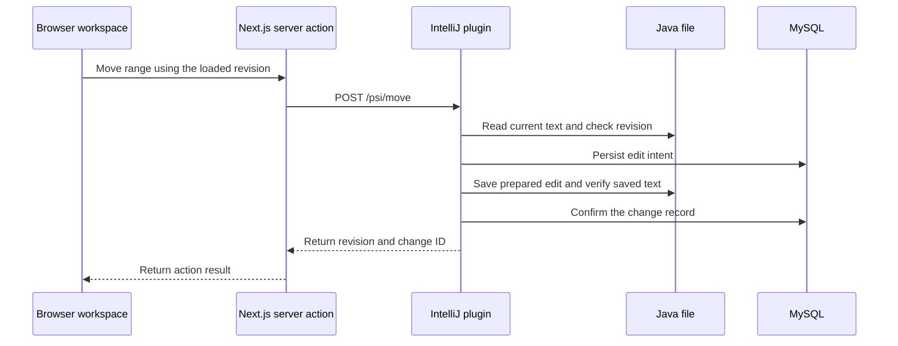
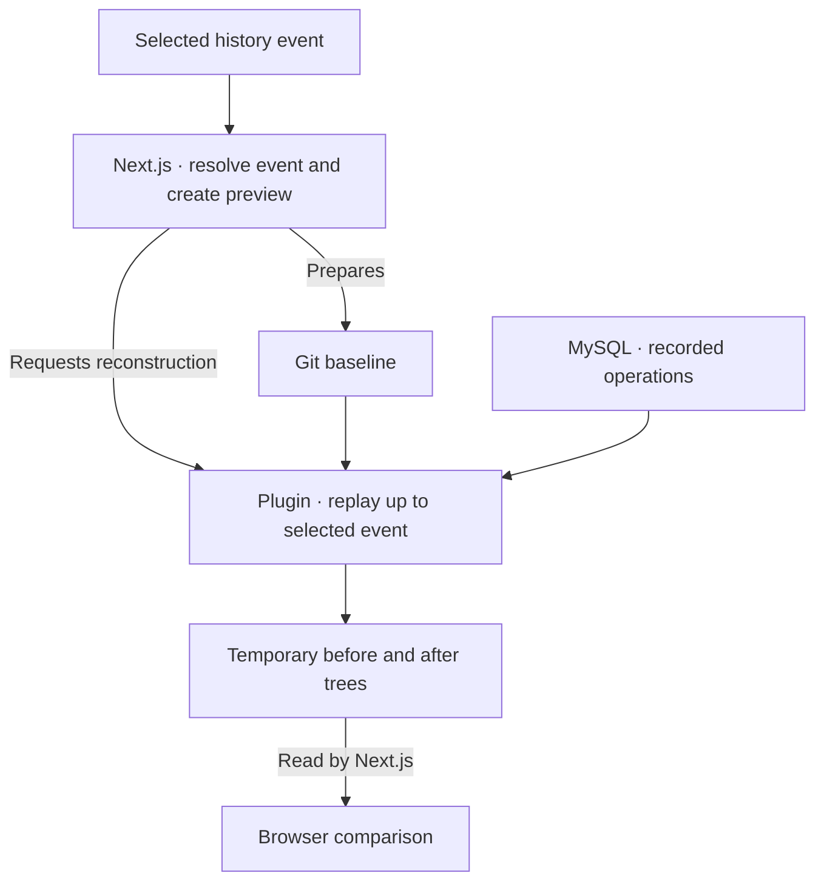

# `Lusiad` – Architecture

**🇺🇸 English** · [🇧🇷 Português (Brasil)](../pt-BR/arquitetura.md)

### On this page

> [1. Runtime components](#runtime-components)<br>
> [2. Frontend organization](#frontend-organization)<br>
> [3. IntelliJ plugin and local API](#intellij-plugin-and-local-api)<br>
> [4. From a Java file to a recorded edit](#from-a-java-file-to-a-recorded-edit)<br>
> [5. Git, MySQL, and historical previews](#git-mysql-and-historical-previews)<br>
> [6. Reading the architecture figure](#reading-the-architecture-figure)<br>
> [Documentation index](#documentation-index)

---

<a name="components"></a>

## Runtime components

Lusiad implements the client–server architecture proposed in design decision DD2. The IntelliJ plugin exposes operations that require access to the IDE and Java PSI (Program Structure Interface). The Next.js application presents the modeling workspace and change history. Within that application, React handles interaction in the browser, and the Next.js server coordinates access to the plugin, Git, the filesystem, and MySQL. In DD2, Next.js is the plugin’s client. From the browser’s perspective, it is the web server.



| Execution context | Responsibility | Entry point |
| --- | --- | --- |
| Browser | Displays the file explorer, model canvas, properties, and history. Captures selections and drag-and-drop interactions. | [`ProjectWorkspace`](../../lusiad-frontend/src/components/project-workspace.tsx) |
| Next.js server | Loads the workspace, runs server actions, translates requests and responses to and from the plugin, and coordinates Git and SQL. | [`src/app`](../../lusiad-frontend/src/app) and [`src/controllers`](../../lusiad-frontend/src/controllers) |
| IntelliJ plugin | Hosts the local API and native tool window. Resolves project files, generates the PSI representation, applies edits, and replays recorded changes for previews. | [`plugin.xml`](../../lusiad-backend/src/main/resources/META-INF/plugin.xml) and [`HttpServer.java`](../../lusiad-backend/src/main/java/com/lusiad/backend/HttpServer.java) |

The two server-side components work against the same registered project. They use its working directory for the files being edited and its separately configured temporary directory for isolated historical previews. The Next.js server invokes Git against the project repository. The plugin reads and saves Java source through IntelliJ’s virtual files, documents, and PSI. Both connect to MySQL, where the project registration ties those resources to the history records.

## Frontend organization

The App Router page for `/project/[projectId]` runs on the Next.js server. It parses the route parameter, loads the project record with `findProjectById`, and builds the initial explorer tree with `loadFileTree`. That tree comes from filesystem enumeration in `directory-tree.ts`, using `node:fs/promises`. Selecting a Java file triggers a separate request for its PSI tree. The route passes the project data and initial file tree to the client component `ProjectWorkspace`. [Project route](../../lusiad-frontend/src/app/project/%5BprojectId%5D/page.tsx) · [Directory tree](../../lusiad-frontend/src/lib/services/file-explorer/directory-tree.ts)

| Directory | Role in the implemented application |
| --- | --- |
| [`src/app`](../../lusiad-frontend/src/app) | Page entry points and HTTP route handlers for facilities such as settings, project presence, Java diagnostics, running Java, and undo. |
| [`src/components`](../../lusiad-frontend/src/components) | React panels, workspace state, and interaction modules such as `model-editor.interactions.ts`, which collects edit parameters and updates the interface. |
| [`src/controllers`](../../lusiad-frontend/src/controllers) | Server-action entry points for operations such as loading a model, moving a range, and creating a commit. They validate input and delegate to features or directly to server-side services, depending on the operation. |
| [`src/features`](../../lusiad-frontend/src/features) | Use-case functions. The model editor delegates PSI operations to its API service and normalizes the results returned to the controller. |
| [`src/lib/models`](../../lusiad-frontend/src/lib/models) | Data and helpers for interpreting the model tree, working with selection and drop targets, and navigating history. |
| [`src/lib/services`](../../lusiad-frontend/src/lib/services) | Integration and orchestration for the plugin API, filesystem, Git, synchronization, and history reconstruction. |
| [`src/lib/repositories`](../../lusiad-frontend/src/lib/repositories) | MySQL queries for projects, branches, commits, changes, and other history data, backed by a server-only `mysql2` connection pool. |

The model-loading action illustrates the boundary crossed by an interaction. The component calls `loadModelController` and receives a serializable result. The `"use server"` directive places the controller on the Next.js server, where the action can call `readModelFeature` and ultimately the plugin client. The excerpt below preserves the source’s Portuguese validation message. [Model editor controller](../../lusiad-frontend/src/controllers/model-editor/model-editor.controller.ts#L1-L13) · [Model-loading action](../../lusiad-frontend/src/controllers/model-editor/model-editor.controller.ts#L130-L136)

```typescript
export async function loadModelController(projectId: number, path: string): Promise<BackendActionResult<JavaModel>> {
  return backendAction(async () => {
    const trimmedPath = requireValidPath(path, "Selecione um arquivo no explorador")
    return readModelFeature(projectId, trimmedPath)
  })
}
```

## IntelliJ plugin and local API

The plugin descriptor registers a native **Lusiad** tool window through `MyToolWindowFactory`. The panel offers controls for the API and settings, shows the status of the web application and database connection, and can open the web workspace in the browser. `LusiadPluginService` manages the API lifecycle. The web workspace provides the model editor and history views. [Plugin descriptor](../../lusiad-backend/src/main/resources/META-INF/plugin.xml) · [Tool window](../../lusiad-backend/src/main/java/com/lusiad/toolwindow/LusiadToolWindowPanel.java) · [Plugin service](../../lusiad-backend/src/main/java/com/lusiad/toolwindow/LusiadPluginService.java)

The plugin’s `HttpServer` creates a JDK HTTP listener bound to `127.0.0.1`. Its routers register endpoint families for PSI, files, project management, diagnostics, Java execution, undo, UML, and restoration. The Next.js server sends JSON requests through its server-side client, which supplies the shared `X-Lusiad-Token` header. The browser submits workspace actions to Next.js. [HTTP server](../../lusiad-backend/src/main/java/com/lusiad/backend/HttpServer.java) · [API access](../../lusiad-backend/src/main/java/com/lusiad/backend/config/LocalApiAccess.java) · [HTTP transport](../../lusiad-frontend/src/lib/services/backend-transport.ts)

| Plugin layer | Example for moving a block |
| --- | --- |
| Router | [`PsiRouter`](../../lusiad-backend/src/main/java/com/lusiad/backend/router/psi/PsiRouter.java) registers `/psi/move`, applies the access checks, and dispatches to `handleMove`. |
| Handler | [`PsiGenericHandlers.handleMove`](../../lusiad-backend/src/main/java/com/lusiad/backend/handler/psi/PsiGenericHandlers.java#L182-L195) requires a POST, parses the body, resolves the registered project, and validates the file path against its root. |
| Service | [`PsiService`](../../lusiad-backend/src/main/java/com/lusiad/backend/service/psi/PsiService.java) computes and applies the change with IntelliJ’s Java and document APIs. [`EditCoordinator`](../../lusiad-backend/src/main/java/com/lusiad/backend/service/psi/EditCoordinator.java) coordinates the saved file and the operation record. |
| Repository | [`EditOperationStore`](../../lusiad-backend/src/main/java/com/lusiad/backend/repository/change/EditOperationStore.java) persists the edit intent and confirms the event in MySQL using JDBC. |

The router checks access before dispatching the request. [`PsiRouter`](../../lusiad-backend/src/main/java/com/lusiad/backend/router/psi/PsiRouter.java#L48-L51)

```java
server.createContext("/psi/move", exchange -> {
    if (handleCors(exchange)) return;
    PsiGenericHandlers.handleMove(project, exchange);
});
```

<a name="change-flow"></a>

## From a Java file to a recorded edit

For a live read, the `readPsiModel` service resolves the project and asks the plugin to reconcile pending PSI edits before calling `POST /psi/read`. The plugin refreshes the file from disk and enters a read action. It serializes the Java PSI as a tree with node types, source positions, and leaf text. The response also carries `revision`, a SHA-256 hash of the document text. React uses the tree to render the blocks, and the revision identifies the source from which their offsets were derived. [PSI API service](../../lusiad-frontend/src/lib/services/model-editor/psi-api.service.ts) · [PSI read and serialization](../../lusiad-backend/src/main/java/com/lusiad/backend/service/psi/PsiService.java)

When a user moves a block within a Java file, the editor interaction passes the source range, the destination line and optional column, and the loaded model’s revision as `expectedHash`. The controller delegates to `moveRangeFeature`, whose API service submits `POST /psi/move`. The plugin calculates the proposed edit, checks the revision, and rejects stale offsets if the underlying text has changed. [Model editor interactions](../../lusiad-frontend/src/components/panels/model-editor/model-editor.interactions.ts#L576-L588) · [Model editor feature](../../lusiad-frontend/src/features/model-editor/model-editor.feature.ts)



The sequence describes a successful move that changes the file. `EditCoordinator` first persists a recoverable intent, then applies the prepared edit and verifies the text read back from disk before confirming the event. A no-op exits before preparing an intent. If confirmation is interrupted, recovery compares the file with the prepared states. It can confirm the event if the file contains the after state, abort the intent if it contains the before state, or report a conflict if the file matches neither. The operation intent connects the file write to its SQL record across the two storage systems. [Edit coordination and recovery](../../lusiad-backend/src/main/java/com/lusiad/backend/service/psi/EditCoordinator.java#L40-L103)

## Git, MySQL, and historical previews

### Recording a version

Git stores the file tree for a commit. MySQL stores the project and branch identities, commit metadata, individual change records, and the associations required to find a change within a version.

| Record | What it identifies |
| --- | --- |
| `projects` and `branches` | The registered project, its paths, and its branch records. |
| `commits` | A recorded version. `git_id` connects its SQL record to the corresponding commit in the project repository. |
| `changes` | Individual events. An event with a null `commit_id` is pending until it is associated with a version. |
| `commit_change_sets` | The association between a Git commit ID and the individual changes included in that version, with project and branch context. |
| `lusiad_edit_operations` and `lusiad_git_operations` | Durable operation intents used to reconcile file edits and Git updates with their database records. |

The commit menu calls `commitChangesController` on the Next.js server. The recording service checks the selected branch and pending events, prepares the Git tree and commit, and stores the operation intent before updating the Git reference. It then records the commit and links the captured events in a SQL transaction. If the reference moves and SQL confirmation is interrupted, the saved plan gives the recording service the Git state and event identities needed to reconcile that operation. `simple-git` is used for operations such as status. The coordinated version-recording path uses `GitOperation`, which invokes Git through Node’s `execFile`. [SQL schema](../../lusiad-backend/db/lusiad.sql) · [Commit controller](../../lusiad-frontend/src/controllers/commit-menu/commit-menu.controller.ts) · [Git recording](../../lusiad-frontend/src/lib/services/commit-menu/git-recording.service.ts) · [Git command execution](../../lusiad-frontend/src/lib/services/commit-menu/git-operation.ts)

### Opening the before and after of an event

The history preview needs the state immediately before and after a selected event, which can fall between two commits. Next.js resolves the event’s SQL context, creates a request-specific directory under the project’s temporary root, and prepares a baseline from Git. For a committed event, the baseline is normally the recorded commit’s first parent. For a root commit, the archive service reconstructs the initial baseline from the root tree and recorded events. For a pending event, it uses the verified current Git commit. [Baseline preparation](../../lusiad-frontend/src/lib/services/restore/change-archive.service.ts)



The plugin’s `RestoreService` reads the replay inputs from MySQL and delegates to `HistoricalReplay`. The replay writes `working-copy-prev` and `working-copy` under the preview directory, with the real project working tree outside that directory. Next.js validates the returned context and publishes the preview after reading both trees. When the developer opens a Java file in the preview, Next.js sends the snapshot text to `/psi/parse`, so the plugin can build a PSI tree in memory without opening the live file. The [implementation walkthrough](notable-implementation-elements.md) follows what is recorded for an individual method move. [Preview orchestration](../../lusiad-frontend/src/lib/services/restore/restore.service.ts) · [Replay service](../../lusiad-backend/src/main/java/com/lusiad/backend/service/restore/RestoreService.java) · [Snapshot reader](../../lusiad-frontend/src/lib/services/restore/snapshot-reader.ts)

<a name="code-map"></a>

## Reading the architecture figure

The architecture figure from the thesis shows the UI components and their interaction layer, the Java API's routing and persistence layers, and the shared database.


| Figure label or relationship | Corresponding implementation |
| --- | --- |
| `page.tsx` labeled “Electron: Next.js” | The implemented interface is a Next.js web application with React client components running in a browser. |
| `Client [frontend]` boundary | The figure groups React and Next.js together. Server actions, plugin HTTP calls, Git commands, and SQL access execute in the Next.js server process. |
| `Feature.ts` instantiates `Model.ts` | The model-loading feature calls `readPsiModel` and returns a typed `JavaModel`. Models in `src/lib/models` also include functions for navigation, display, and editing rules. |
| `simple-git` and `fs-extra` | The frontend declares `simple-git`. Filesystem operations in the paths described here use `node:fs/promises`, and version recording invokes Git with `execFile`. [Frontend dependencies](../../lusiad-frontend/package.json) |
| MySQL attached to both sides | The Next.js server uses `mysql2`, and the plugin uses JDBC. The project’s Git repository provides a separate store for versioned file states. [Next.js connection pool](../../lusiad-frontend/src/lib/repositories/database.ts) · [Plugin connection factory](../../lusiad-backend/src/main/java/com/lusiad/backend/repository/sql/SqlConnectionFactory.java) |

---

<table width="100%">
<tr>
<td align="left"><a href="implementation.md">⬅️ Previous page</a></td>
<td align="center"><a href="../../README.md#documentation-index">9️⃣ Architecture</a></td>
<td align="right"><a href="directory-structure.md">Next page ➡️</a></td>
</tr>
</table>

### Documentation index

**[📖 Overview](../../README.md)**

- [🖥️ User guide](manual.md)

**[⚙️ Installation](setup.md)**

- [🔧 Installation guide](installation.md)
- [🚀 First steps](first-steps.md)

**[📐 Project](project.md)**

- [📋 Requirements](requirements.md)
- [✏️ Prototyping](prototyping.md)

**[💻 Implementation](implementation.md)**

- [🏗️ Architecture](architecture.md) 👈
- [📂 Directory structure](directory-structure.md)
- [🧰 Technology stack](technology-stack.md)
- [🗃️ Data model](data-model.md)
- [🔌 API reference](api-reference.md)
- [🔀 Interaction diagrams](interaction-diagrams.md)
- [🧭 Design decisions](design-decisions.md)
- [🔍 Notable implementation elements](notable-implementation-elements.md)

**[📊 Evaluation](evaluation.md)**

- [📋 Planning](evaluation-planning.md)
- [🧪 Execution](evaluation-execution.md)
- [📈 Results](evaluation-results.md)
- [💬 Discussion](evaluation-discussion.md)
- [📂 Materials and data](evaluation-data.md)
- [🗂️ Evaluation files](../zenodo/)
