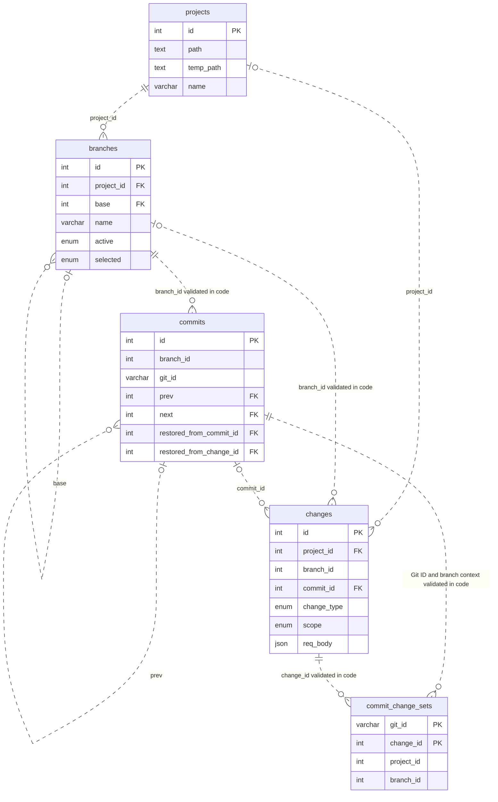
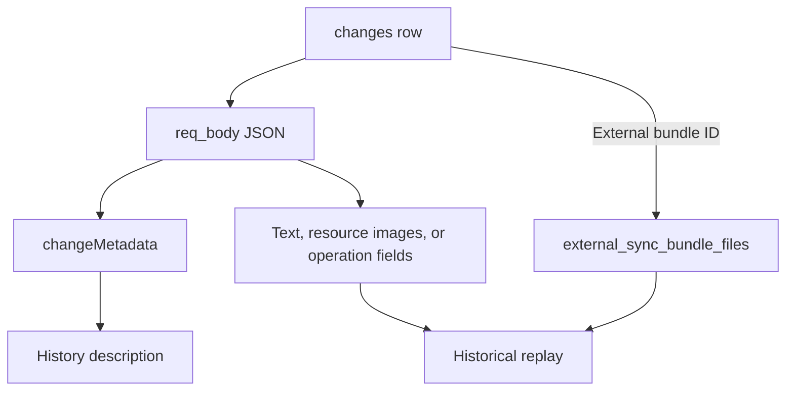
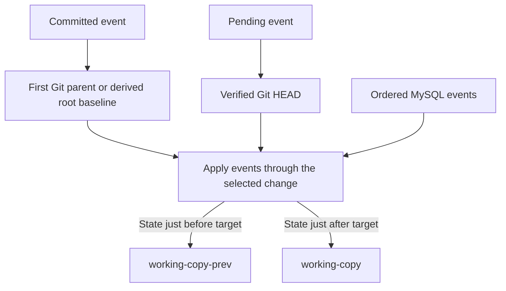

# `Lusiad` – Data model

**🇺🇸 English** · [🇧🇷 Português (Brasil)](../pt-BR/modelo-de-dados.md)

Lusiad's data model connects source files, Git snapshots, and MySQL events. The IntelliJ plugin derives the visual model from the working Java source. Git stores versioned file trees, while MySQL stores the identities, events, and operation records that make individual changes traceable. A historical preview combines a Git baseline with the events recorded in MySQL.

### On this page

> [1. Representations and identifiers](#representations-and-identifiers)<br>
> [2. Relational model](#relational-model)<br>
> [3. Change records](#change-records)<br>
> [4. Synchronization, tags, and operation journals](#synchronization-tags-and-operation-journals)<br>
> [5. Data used in historical previews](#data-used-in-historical-previews)<br>
> [Documentation index](#documentation-index)

---

## Representations and identifiers

| Representation | What it contains | Where it lives |
| --- | --- | --- |
| Working source | The current file and directory state of a registered Java project. | The workspace at `projects.path`. |
| Visual model | The file path, an optional source revision, and a recursive tree of Java PSI nodes. | Produced by the plugin and rendered as blocks by the frontend. |
| Versioned state | Git commits with file trees and parent references. | The Git repository of the registered project. |
| Change history | Project and branch identities, recorded versions, individual changes, and their associations. | MySQL. |
| Historical preview | A baseline and the states immediately before and after a selected event. | A request-specific directory under `projects.temp_path`. |

The frontend's `JavaModel` contains the serialized `PsiNode` tree. Internal nodes contain children and leaves contain source text. In document-backed reads, the serializer includes offsets measured in UTF-16 code units and 1-based line and column positions. The offset range is start-inclusive and end-exclusive. The end line and column describe the last character for a non-empty range. Node positions are meaningful within the specific source revision. A live read supplies `revision` as a SHA-256 hash of the IntelliJ document text, which the edit request can send back as `expectedHash`. [PSI serialization](../../lusiad-backend/src/main/java/com/lusiad/backend/service/psi/PsiService.java#L540-L580) · [Edit revision check](../../lusiad-backend/src/main/java/com/lusiad/backend/service/psi/EditCoordinator.java#L40-L46)

```typescript
export interface PsiNode {
  type: string
  text?: string
  startOffset?: number
  endOffset?: number
  startLine: number
  startColumn: number
  endLine: number
  endColumn: number
  children?: PsiNode[]
}

export interface JavaModel {
  revision?: string
  file: string
  tree: PsiNode
}
```

The TypeScript definitions describe what the editor receives. The editor can recover the source text of a node by concatenating the text of its leaves in tree order. [Frontend types](../../lusiad-frontend/src/lib/types.ts#L1-L17) · [Leaf text reconstruction](../../lusiad-frontend/src/lib/models/model-editor/model-tree.model.ts#L1-L14)

The SQL ID of a commit identifies a history row. Its `git_id` addresses the commit object in the project's Git repository. An edit's `operationId` identifies its journal entry, and the `changes.id` assigned on confirmation identifies the event shown in the history. These IDs also differ from a preview's `snapshotId`, which addresses a temporary reconstruction. [SQL schema](../../lusiad-backend/db/lusiad.sql) · [Edit journal](../../lusiad-backend/src/main/java/com/lusiad/backend/repository/change/EditOperationStore.java) · [Preview identity](../../lusiad-frontend/src/lib/services/restore/preview-snapshot.ts)

## Relational model

The diagram shows the core history tables. Lines labeled “validated in code” represent logical links. The keys marked `FK` correspond to constraints declared in the checked-in MySQL schema. [Schema](../../lusiad-backend/db/lusiad.sql) · [Git recording service](../../lusiad-frontend/src/lib/services/commit-menu/git-recording.service.ts)



| Table | Identity and relationships |
| --- | --- |
| `projects` | One registration has an internal `id`, the working directory `path`, an optional `temp_path`, and a name and description. |
| `branches` | Each row belongs to a project. `base` points to the parent branch, and `active` and `selected` describe branch state in Lusiad. |
| `commits` | The row stores a Git object ID, a branch ID, descriptive fields, and the date. `prev` records the first parent for commits written by the current recording service. `next` is a same-branch successor link, which cannot express every edge in a Git graph. |
| `changes` | An event has a `change_type` such as `move`, `dir_rename`, or `external_bundle`, and a `scope` of `file`, `dir`, or `project`. A null `commit_id` means the event is pending. The schema also allows null project and branch IDs. The history queries scope events to a project and accept null branch IDs in specific legacy paths. |
| `commit_change_sets` | Associates a Git commit ID with each included change, recording project and branch context. Its composite primary key is `(git_id, change_id)`. The recording service checks membership and writes it in the transaction that attaches the event to the SQL commit. |

`commits.branch_id` and `changes.branch_id` carry branch IDs without SQL foreign keys in the checked-in schema. The application checks project and branch agreement when recording and querying history. For merges recorded by Lusiad, the graph query reads the second parent from the applied Git operation's plan. On a restoration commit, `restored_from_commit_id` and, when present, `restored_from_change_id` record the source of the restored content. The new commit's Git parent still follows the branch's commit history. [Commit graph query](../../lusiad-frontend/src/lib/repositories/commit-history/commit-history.repository.ts) · [Version recording and restoration](../../lusiad-frontend/src/lib/services/commit-menu/git-recording.service.ts) · [Legacy branch backfill](../../lusiad-backend/db/migrations/lusiad-change-branch-backfill.sql)

## Change records

A change combines SQL fields with a JSON payload. `summary`, `description`, and `date_time` provide the history entry's text and time. `req_body` holds fields that depend on the operation and its record format. For edits written through `EditOperationStore`, `operationOrder` comes from the journal's autogenerated row ID. The committed replay query walks the selected commit's events in `changes.id` order. [Edit journal](../../lusiad-backend/src/main/java/com/lusiad/backend/repository/change/EditOperationStore.java) · [Event serialization](../../lusiad-backend/src/main/java/com/lusiad/backend/service/psi/EditCoordinator.java#L106-L143) · [Replay query](../../lusiad-backend/src/main/java/com/lusiad/backend/repository/restore/RestoreRepository.java)

| Payload | Data used to reconstruct the change |
| --- | --- |
| Text edit, `recordVersion: 2` | `beforeText` and `afterText` hold the full before and after document text. `beforeHash` and `afterHash` verify these values. For these text records, the replay checks that the baseline file contains the expected before text. |
| Resource-backed edit | `resources.before` and `resources.after` hold affected roots and entries by relative path. Files have Base64-encoded bytes, directories have explicit entries, and an affected root can be absent in one state. Resource-based records are written as version 3, and version 2 edits can also carry resource images. Replay uses the resource pair when available. |
| External bundle | The event describes the group of paths in JSON. `external_sync_bundle_files` holds the before and after kinds and bytes for each path. |
| Legacy operation | When no newer format applies, replay supports older filesystem operation fields and delegates supported older code edits to a PSI adapter. |

This example shows the replay fields from a version 2 text edit. The values describe a change in the return value of `Counter.value()`. Both hashes correspond to the complete texts shown, including their final newline. [Event serialization](../../lusiad-backend/src/main/java/com/lusiad/backend/service/psi/EditCoordinator.java#L106-L143) · [Replay dispatch](../../lusiad-backend/src/main/java/com/lusiad/backend/service/restore/HistoricalReplay.java) · [Resource image](../../lusiad-backend/src/main/java/com/lusiad/backend/service/undo/ResourceImage.java)

```json
{
  "path": "src/Counter.java",
  "recordVersion": 2,
  "operationId": "3afe2909-30bc-4824-a98e-c40be5588291",
  "operationOrder": 28,
  "beforeHash": "8d13cf56c189f6e6d10a7c5cf19e38d057ed0be2a5363577a7ded0d20e05258d",
  "afterHash": "f81aaaac8e30a4e1dbc14b7a8846c6b05b6befa5e1580dd09204e2d9c1875956",
  "beforeText": "class Counter {\n  int value() {\n    return 1;\n  }\n}\n",
  "afterText": "class Counter {\n  int value() {\n    return 2;\n  }\n}\n"
}
```

`req_body.changeMetadata` has its own version. It describes the affected element for display, with an action, a kind, optional before and after sides, and a list of detected differences. Each side can describe a relative path, a range, an element such as a method, and the containing elements. A creation can omit the before side and a deletion can omit the after side. A range describes a location in the corresponding source state. Replay obtains file contents from the recorded edit data. [Metadata producer](../../lusiad-backend/src/main/java/com/lusiad/backend/service/change/ChangeMetadata.java) · [Frontend metadata contract](../../lusiad-frontend/src/lib/models/change-history/change-metadata.ts)



## Synchronization, tags, and operation journals

| Table | Purpose |
| --- | --- |
| `external_sync_projects` | Tracks whether external synchronization has been initialized for a project and identifies its pending bundle, if present. |
| `external_sync_files` | Holds the synchronization baseline, keyed by `(project_id, path)`, with the kind, file content when applicable, and a SHA-256 digest. |
| `external_sync_bundle_files` | Holds accepted external changes, keyed by `(change_id, path)`. A null before kind denotes a resource that did not yet exist, and a null after kind denotes a removed resource. |
| `lusiad_history_tags` | Stores a display name and a normalized `name_key` unique per project. A check constraint requires exactly one target, a commit or a change. |
| `lusiad_edit_operations` | Keeps an edit's prepared state and payload before the file write. A confirmed operation links to `changes.id` and clears the prepared payload. This lets the same operation be recognized after a retry. |
| `lusiad_git_operations` | Holds the prepared or applied Git plan and the SQL commit ID when confirmed. The applied plan also provides provenance for merges. |
| `lusiad_sync_operations` | Records preparation and confirmation of external synchronization decisions across disk and SQL. |
| `lusiad_project_operations` | Tracks removal, deletion, relinking, and movement of registered projects. It has no project foreign key so an operation receipt can survive deletion of the registration. |

The journals bridge operations that write to the filesystem or Git and then confirm records in SQL. For example, an edit first persists its prepared intent. After verifying the write, the store inserts the pending change and marks the intent applied in the same SQL transaction. The history receives a distinct change ID only at confirmation. [Edit coordinator](../../lusiad-backend/src/main/java/com/lusiad/backend/service/psi/EditCoordinator.java) · [Edit confirmation](../../lusiad-backend/src/main/java/com/lusiad/backend/repository/change/EditOperationStore.java)

The checked-in schema defines the tables for a fresh database. The migration directory contains individual updates for existing databases, including changes to restoration references, tags, and operation journals. [Base schema](../../lusiad-backend/db/lusiad.sql) · [Migrations](../../lusiad-backend/db/migrations) · [External synchronization](../../lusiad-frontend/src/lib/services/external-sync/external-sync.service.ts) · [Tag naming and targets](../../lusiad-frontend/src/lib/models/history-tags/history-tags.model.ts)

## Data used in historical previews

The baseline depends on the selected event. A committed event normally starts from the first Git parent of its commit. For a root commit, the service derives the initial baseline from the stored Git tree and recorded events. A pending event starts from the verified current Git commit for its branch. Each path yields a baseline in the preview directory, and the replay query supplies ordered events up to the selected one. [Baseline preparation](../../lusiad-frontend/src/lib/services/restore/change-archive.service.ts) · [Replay inputs](../../lusiad-backend/src/main/java/com/lusiad/backend/repository/restore/RestoreRepository.java)



The replay copies the working snapshot to `working-copy-prev` immediately before it applies the selected event. It leaves the result in `working-copy`. The preview metadata records the project and change IDs and, for a pending preview, the branch, Git commit, and pending revision. The frontend uses this identity to verify that the preview still belongs to the selected state. [Snapshot replay](../../lusiad-backend/src/main/java/com/lusiad/backend/service/restore/HistoricalReplay.java) · [Preview metadata](../../lusiad-frontend/src/lib/services/restore/preview-snapshot.ts)

---

<table width="100%">
<tr>
<td align="left"><a href="technology-stack.md">⬅️ Previous page</a></td>
<td align="center"><a href="../../README.md#documentation-index">1️⃣2️⃣ Data model</a></td>
<td align="right"><a href="api-reference.md">Next page ➡️</a></td>
</tr>
</table>

### Documentation index

**[📖 Overview](../../README.md)**

- [🖥️ User guide](manual.md)

**[⚙️ Installation](setup.md)**

- [🔧 Installation guide](installation.md)
- [🚀 First steps](first-steps.md)

**[📐 Project](project.md)**

- [📋 Requirements](requirements.md)
- [✏️ Prototyping](prototyping.md)

**[💻 Implementation](implementation.md)**

- [🏗️ Architecture](architecture.md)
- [📂 Directory structure](directory-structure.md)
- [🧰 Technology stack](technology-stack.md)
- [🗃️ Data model](data-model.md) 👈
- [🔌 API reference](api-reference.md)
- [🔀 Interaction diagrams](interaction-diagrams.md)
- [🧭 Design decisions](design-decisions.md)
- [🔍 Notable implementation elements](notable-implementation-elements.md)

**[📊 Evaluation](evaluation.md)**

- [📋 Planning](evaluation-planning.md)
- [🧪 Execution](evaluation-execution.md)
- [📈 Results](evaluation-results.md)
- [💬 Discussion](evaluation-discussion.md)
- [📂 Materials and data](evaluation-data.md)
- [🗂️ Evaluation files](../zenodo/)
