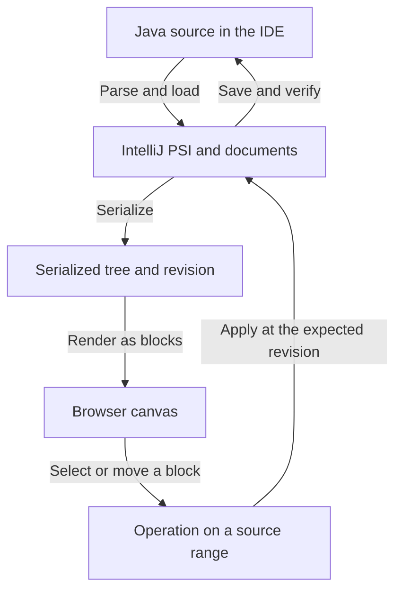
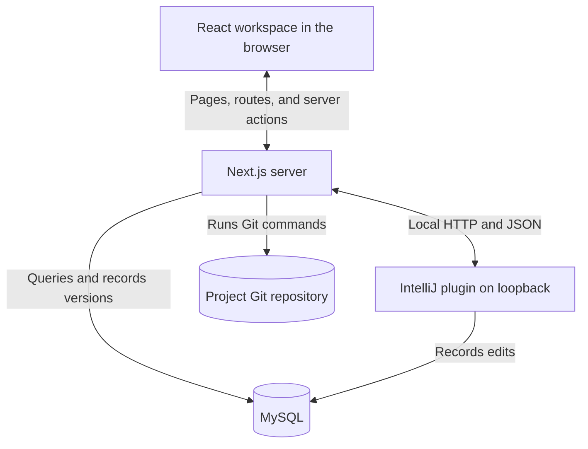
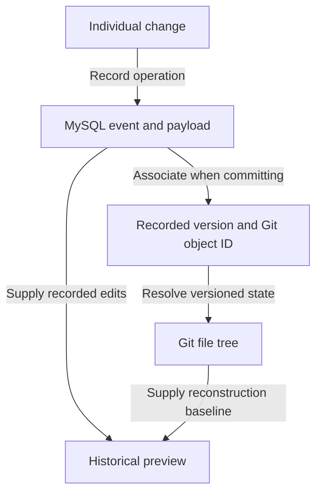

# `Lusiad` – Design decisions

**🇺🇸 English** · [🇧🇷 Português (Brasil)](../pt-BR/decisoes-de-projeto.md)

The six decisions below follow the numbering in the article. Each records the reason for the choice and shows how it appears in the implemented system. The [requirements](requirements.md) describe the operations and quality attributes that motivated the design.

### On this page

> [DD1. IntelliJ IDEA plugin as the system's foundation](#dd1)<br>
> [DD2. Client–server architecture](#dd2)<br>
> [DD3. Backend language](#dd3)<br>
> [DD4. Frontend language](#dd4)<br>
> [DD5. Database](#dd5)<br>
> [DD6. Libraries](#dd6)<br>
> [Documentation index](#documentation-index)

---

<a name="dd1"></a>

## DD1. IntelliJ IDEA plugin as the system's foundation

Lusiad needs to display Java classes, methods, and statements as nested blocks and let the developer edit them. The design uses IntelliJ's Program Structure Interface (PSI) as the metamodel for these operations. PSI gives the plugin the syntactic and semantic representation of Java files and links the elements to ranges in the source. Lusiad integrates with the platform through the plugin SDK to access this structure and the IDE's document and file APIs. This decision underlies the visualization and editing requirements US02–US05. [JetBrains PSI documentation](https://plugins.jetbrains.com/docs/intellij/psi.html) · [Modeling requirements](requirements.md#12-modeling-canvas) · [Plugin declaration](../../lusiad-backend/src/main/resources/META-INF/plugin.xml)

The implementation serializes the PSI tree with node types, text, offsets, and child nodes. The frontend turns that tree into the canvas representation. When the user moves or edits a block, the operation refers to a range in a known source revision. The plugin prepares the document change and verifies the saved file. The panel inside IntelliJ controls the service and its configuration, and the browser hosts the editor. [PSI service](../../lusiad-backend/src/main/java/com/lusiad/backend/service/psi/PsiService.java) · [Edit coordinator](../../lusiad-backend/src/main/java/com/lusiad/backend/service/psi/EditCoordinator.java) · [Canvas](../../lusiad-frontend/src/components/panels/model-editor/model-canvas.tsx) · [IDE panel](../../lusiad-backend/src/main/java/com/lusiad/toolwindow/LusiadToolWindowPanel.java)



The same PSI representation supports live editing and inspection of historical source. For inspection, the plugin can parse supplied text in memory and return its tree. The choice ties the Java modeling and edit services to IntelliJ's PSI, document lifecycle, and supported IDE build. [Parsing supplied source](../../lusiad-backend/src/main/java/com/lusiad/backend/service/psi/PsiService.java#L78-L94) · [IntelliJ target](../../lusiad-backend/build.gradle.kts)

<a name="dd2"></a>

## DD2. Client–server architecture

The article identifies the constraints of building the entire modeling interface inside an IntelliJ plugin. Lusiad therefore adopts a client–server architecture. The plugin exposes an API for operations that require the IntelliJ platform, and a web application supplies the richer workspace with the canvas, properties, explorer, and history. The architectural terminology follows Bass, Clements, and Kazman. [Software Architecture in Practice, 3rd ed.](https://www.sei.cmu.edu/library/software-architecture-in-practice-third-edition/) · [Interface prototyping](prototyping.md)

The deployed arrangement gives the Next.js server two roles. It serves the browser and acts as the client of the plugin's local HTTP server. It also coordinates Git and the frontend's MySQL queries. The browser calls Next.js routes or server actions. The server-side client authenticates requests to the loopback API, and the plugin uses PSI to carry out the requested operation. [Architecture](architecture.md) · [HTTP server](../../lusiad-backend/src/main/java/com/lusiad/backend/HttpServer.java) · [Server-side client](../../lusiad-frontend/src/lib/services/backend-client.ts) · [API reference](api-reference.md)



This separation lets the workspace and IDE integration evolve through an explicit request and response boundary. Operating the interface requires the Next.js process and, for IDE-dependent requests, a running plugin with matching configuration. Each side checks the data it receives. A client timeout can occur while the plugin is still processing a request, so prepared operations and receipts support recovery when an acknowledgement is lost. [Transport and timeout handling](../../lusiad-frontend/src/lib/services/backend-transport.ts) · [Response validation](../../lusiad-frontend/src/lib/services/backend-response.ts) · [Interaction diagrams](interaction-diagrams.md)

<a name="dd3"></a>

## DD3. Backend language

Java was chosen for the IntelliJ plugin because it is compatible with the platform SDK and the author already knew the language. The SDK supports development in Java and Kotlin. Java is used for the runtime plugin code, including the HTTP handlers, PSI services, and JDBC repositories. [JetBrains SDK requirements](https://plugins.jetbrains.com/docs/intellij/plugin-required-experience.html) · [Plugin source](../../lusiad-backend/src/main/java/com/lusiad)

The Gradle build targets IntelliJ IDEA 2025.2.4 with its bundled Java plugin. These settings define the platform against which Lusiad compiles and tests its IDE integration. The Kotlin DSL defines the Gradle build, including the Java source and bytecode target. The following declaration is from the build script. [Plugin build](../../lusiad-backend/build.gradle.kts)

```kotlin
tasks {
    // Set the JVM compatibility versions
    withType<JavaCompile> {
        sourceCompatibility = "21"
        targetCompatibility = "21"
    }
}
```

The Java target applies to the plugin. For a registered project's own code, compiler diagnostics use the project's configured release, and execution uses the configured project JDK. [Java compiler diagnostics](../../lusiad-backend/src/main/java/com/lusiad/backend/service/diagnostics/JavaCompilerDiagnostics.java) · [Java execution](../../lusiad-backend/src/main/java/com/lusiad/backend/service/run/JavaRunService.java)

<a name="dd4"></a>

## DD4. Frontend language

TypeScript was chosen to catch type inconsistencies before execution and make contracts easier to track as the client grows. The original discussion cites Gao, Bird, and Barr's study of bugs that static type systems can detect in JavaScript. In Lusiad, the same TypeScript codebase contains the browser components and the Next.js server services. The configuration enables strict type checking, and the workspace shares types for the PSI tree, commits, and changes. [Gao, Bird, and Barr, ICSE 2017](https://discovery.ucl.ac.uk/id/eprint/10064729/) · [TypeScript configuration](../../lusiad-frontend/tsconfig.json) · [Shared types](../../lusiad-frontend/src/lib/types.ts)

The HTTP boundary also needs runtime checks. The server-side client takes a validator appropriate to the operation and passes it to the transport. The PSI validator checks the returned tree, and the edit and restoration validators check the fields needed to accept the result. A schema change can therefore affect both the shared types and the runtime validators that consume it. [Server-side client](../../lusiad-frontend/src/lib/services/backend-client.ts) · [Response validation](../../lusiad-frontend/src/lib/services/backend-response.ts)

```typescript
export async function postBackendJson<T>(
  endpoint: string,
  body: unknown,
  context: string,
  validate: (body: Record<string, unknown>, context: string) => T,
): Promise<T> {
  return requestBackendJson(backendConnection(), endpoint, body, context, validate)
}
```

<a name="dd5"></a>

## DD5. Database

The history needs to associate heterogeneous data with one another. A change belongs to a project and may be attached to a recorded commit. A commit has branch context, and a history tag points to a commit or change. These relationships motivated a relational database. The author's familiarity with MySQL guided the choice of database engine. This design supports version control and individual change inspection, particularly US10–US17, and the requirement to preserve operation history in RNF05. [Version control requirements](requirements.md#14-version-control) · [Change history requirements](requirements.md#15-change-history) · [Quality requirements](requirements.md#-2-quality-requirements) · [MySQL schema](../../lusiad-backend/db/lusiad.sql)

The implementation uses relational keys for identities and associations. It stores operation-specific data in `changes.req_body` as JSON. The contents can include affected paths, descriptive metadata, before and after text, or resource images, depending on the format. Git stores the versioned file trees, and `commits.git_id` connects each recorded version to its Git object. This pairing lets the history show an individual edit even when several edits share one commit. [Data model](data-model.md) · [Event serialization](../../lusiad-backend/src/main/java/com/lusiad/backend/service/psi/EditCoordinator.java) · [Git recording](../../lusiad-frontend/src/lib/services/commit-menu/git-recording.service.ts)



An edit confirmation spans the saved file and the SQL event. Version recording spans the Git reference and the SQL membership records. The implementation persists operation plans before applying those changes and confirms the resulting records in SQL after verification. This adds coordination to the write paths and gives later recovery a record of the intended operation. [Edit operation store](../../lusiad-backend/src/main/java/com/lusiad/backend/repository/change/EditOperationStore.java) · [Git operation journal](../../lusiad-frontend/src/lib/services/commit-menu/git-recording.service.ts)

<a name="dd6"></a>

## DD6. Libraries

The article identifies the libraries that support the interface, Git, database access, message exchange, formatting, and diagrams. The table ties each library to the task it performs in the current source. The [technology stack](technology-stack.md) lists versions, build tools, and additional dependencies.

| Library | Role in the implementation |
| --- | --- |
| React | Composes the canvas, properties, file explorer, history, and comparison panels. It manages interactive state in the browser. [Project workspace](../../lusiad-frontend/src/components/project-workspace.tsx) |
| simple-git | Provides a Git client for operations such as status. The version-recording service uses its own Git command wrapper for publishing a prepared commit and recovering that operation. [Git client](../../lusiad-frontend/src/lib/config/test-git.ts) · [Recording wrapper](../../lusiad-frontend/src/lib/services/commit-menu/git-operation.ts) |
| mysql2 | Provides the server-side connection pool used by the TypeScript repositories. [Connection pool](../../lusiad-frontend/src/lib/repositories/database.ts) |
| Gson | Encodes PSI responses and parses JSON on the plugin side. The HTTP adapter applies field and response validation around the JSON exchange. [PSI serialization](../../lusiad-backend/src/main/java/com/lusiad/backend/service/psi/PsiService.java) · [HTTP JSON adapter](../../lusiad-backend/src/main/java/com/lusiad/backend/handler/ApiJson.java) |
| MySQL Connector/J | Supplies JDBC connections for the plugin's project lookup, operation recording, and historical reconstruction queries. [Connection factory](../../lusiad-backend/src/main/java/com/lusiad/backend/repository/sql/SqlConnectionFactory.java) |
| google-java-format | Formats the prepared Java text. Formatting status is reported separately from save verification, so a formatting rejection can be displayed alongside a confirmed edit. [Formatting and save verification](../../lusiad-backend/src/main/java/com/lusiad/backend/service/psi/PsiEditPersistence.java) · [Edit preparation](../../lusiad-backend/src/main/java/com/lusiad/backend/service/psi/PsiService.java) |
| PlantUML | Renders diagrams from the Java class structure extracted through PSI. Lusiad generates the diagram description and uses Smetana to lay out the SVG shown in the interface. [Structure extraction](../../lusiad-backend/src/main/java/com/lusiad/backend/service/uml/UmlStructure.java) · [Diagram description](../../lusiad-backend/src/main/java/com/lusiad/backend/service/uml/UmlDiagram.java) · [SVG renderer](../../lusiad-backend/src/main/java/com/lusiad/backend/service/uml/PlantUmlRenderer.java) |

The [implementation walkthrough](notable-implementation-elements.md) follows a method move through these decisions, from the selected PSI range to the recorded change and its historical preview.

---

<table width="100%">
<tr>
<td align="left"><a href="interaction-diagrams.md">⬅️ Previous page</a></td>
<td align="center"><a href="../../README.md#documentation-index">1️⃣5️⃣ Design decisions</a></td>
<td align="right"><a href="notable-implementation-elements.md">Next page ➡️</a></td>
</tr>
</table>

### Documentation index

**[📖 Overview](../../README.md)**

- [🖥️ User guide](manual.md)

**[⚙️ Installation](setup.md)**

- [🔧 Installation guide](installation.md)
- [🚀 First steps](first-steps.md)

**[📐 Project](project.md)**

- [📋 Requirements](requirements.md)
- [✏️ Prototyping](prototyping.md)

**[💻 Implementation](implementation.md)**

- [🏗️ Architecture](architecture.md)
- [📂 Directory structure](directory-structure.md)
- [🧰 Technology stack](technology-stack.md)
- [🗃️ Data model](data-model.md)
- [🔌 API reference](api-reference.md)
- [🔀 Interaction diagrams](interaction-diagrams.md)
- [🧭 Design decisions](design-decisions.md) 👈
- [🔍 Notable implementation elements](notable-implementation-elements.md)

**[📊 Evaluation](evaluation.md)**

- [📋 Planning](evaluation-planning.md)
- [🧪 Execution](evaluation-execution.md)
- [📈 Results](evaluation-results.md)
- [💬 Discussion](evaluation-discussion.md)
- [📂 Materials and data](evaluation-data.md)
- [🗂️ Evaluation files](../zenodo/)
