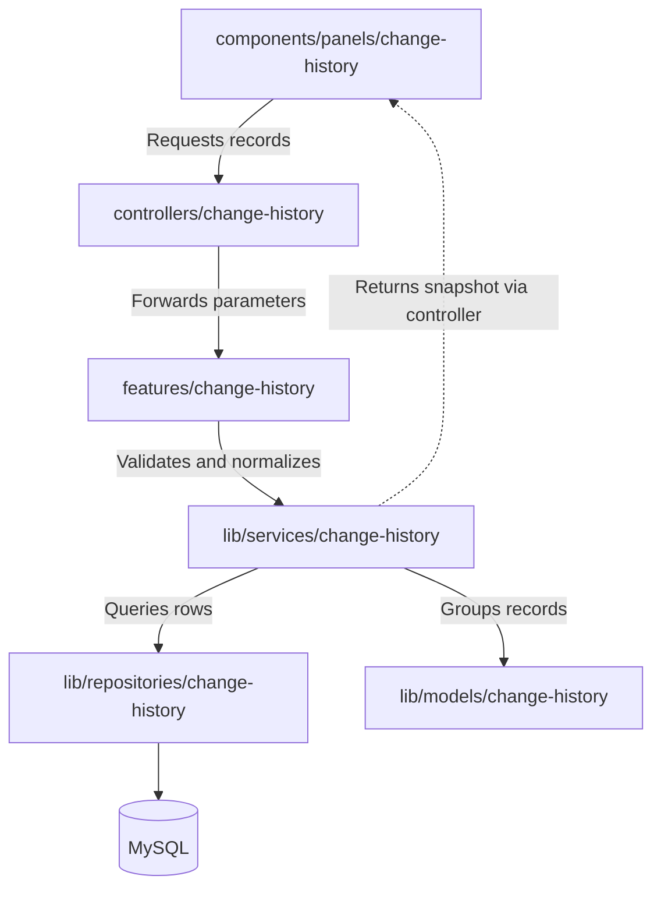
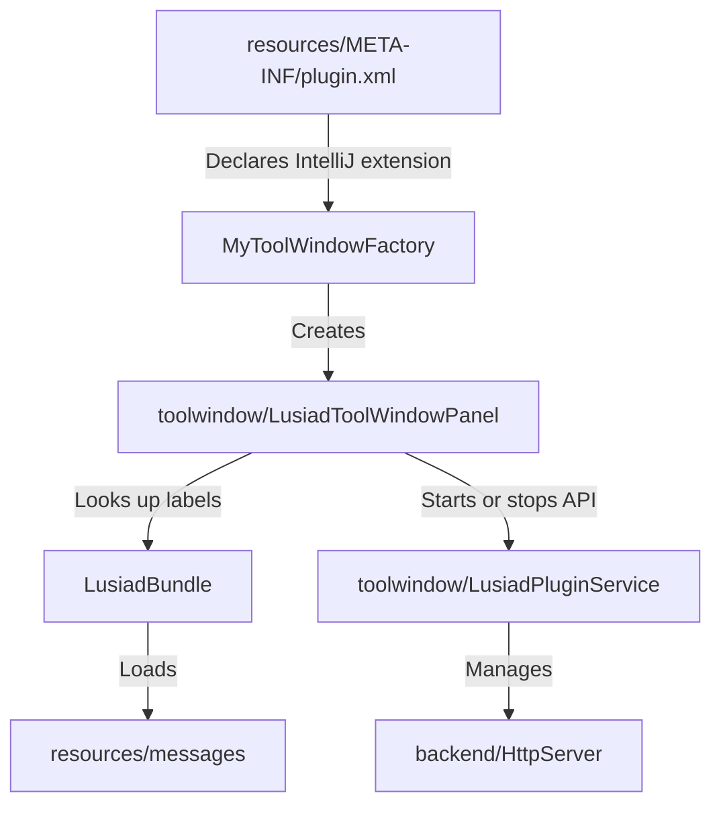
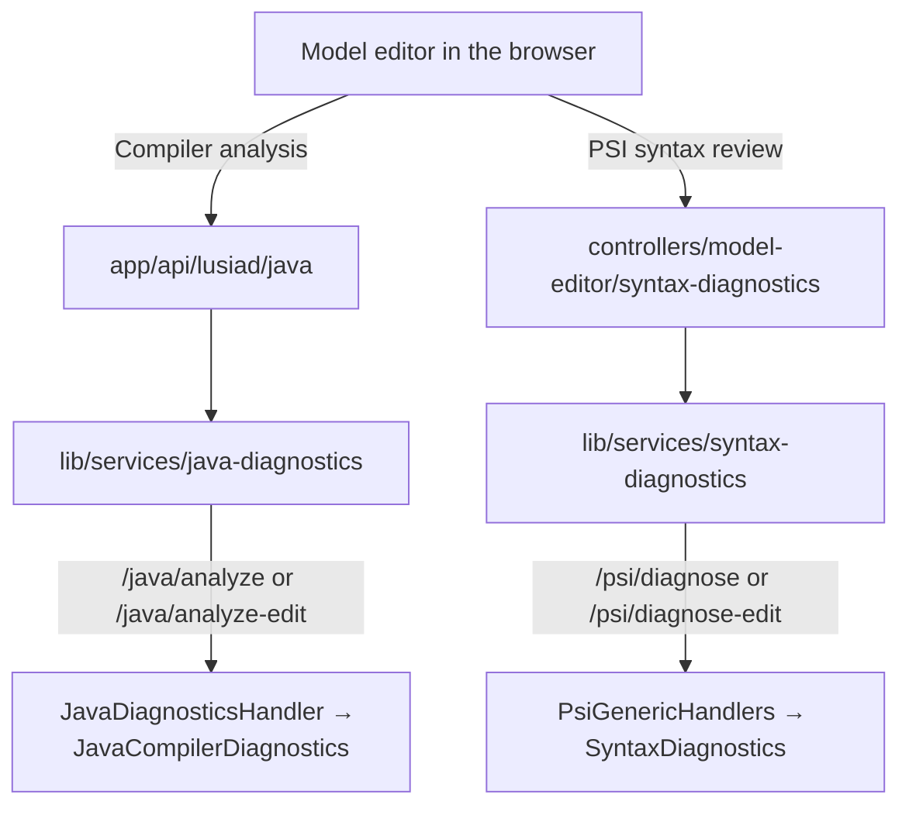

# `Lusiad` – Directory structure

**🇺🇸 English** · [🇧🇷 Português (Brasil)](../pt-BR/estrutura-de-diretorios.md)

## Directory tree

The tree shows directories that contain files in the Lusiad repository or in the documentation being prepared alongside it. Paths are relative to the repository root. Generated directories such as `node_modules/`, `.next/`, and Gradle’s `build/` are created locally. The Java projects opened in Lusiad and their working and temporary directories are configured separately.

```text
📦 lusiad/
├── 📚 docs/
│   ├── 🖼️ assets/
│   │   ├── 🎨 prototyping/
│   │   └── 📖 user-guide/
│   ├── 🇺🇸 en/
│   └── 🇧🇷 pt-BR/
├── 🔌 lusiad-backend/
│   ├── 🗃️ db/
│   │   └── 🧾 migrations/
│   ├── 🛠️ gradle/
│   │   └── ⚙️ wrapper/
│   └── 💻 src/
│       ├── 📁 main/
│       │   ├── ☕ java/
│       │   │   └── 📁 com/
│       │   │       └── 📦 lusiad/
│       │   │           ├── 📁 backend/
│       │   │           │   ├── ⚙️ config/
│       │   │           │   ├── 📨 handler/
│       │   │           │   │   ├── 📁 diagnostics/
│       │   │           │   │   ├── 📁 fs/
│       │   │           │   │   ├── 📁 psi/
│       │   │           │   │   ├── 📁 restore/
│       │   │           │   │   └── 📁 uml/
│       │   │           │   ├── 🗄️ repository/
│       │   │           │   │   ├── 📁 change/
│       │   │           │   │   ├── 📁 project/
│       │   │           │   │   ├── 📁 restore/
│       │   │           │   │   └── 📁 sql/
│       │   │           │   ├── 🧭 router/
│       │   │           │   │   ├── 📁 diagnostics/
│       │   │           │   │   ├── 📁 fs/
│       │   │           │   │   ├── 📁 project/
│       │   │           │   │   ├── 📁 psi/
│       │   │           │   │   ├── 📁 restore/
│       │   │           │   │   ├── 📁 run/
│       │   │           │   │   ├── 📁 uml/
│       │   │           │   │   └── 📁 undo/
│       │   │           │   ├── ⚙️ service/
│       │   │           │   │   ├── 📁 change/
│       │   │           │   │   ├── 📁 diagnostics/
│       │   │           │   │   ├── 📁 fs/
│       │   │           │   │   ├── 📁 project/
│       │   │           │   │   ├── 📁 psi/
│       │   │           │   │   ├── 📁 restore/
│       │   │           │   │   ├── 📁 run/
│       │   │           │   │   ├── 📁 uml/
│       │   │           │   │   └── 📁 undo/
│       │   │           │   └── 📁 util/
│       │   │           └── 🪟 toolwindow/
│       │   └── 📦 resources/
│       │       ├── 📜 licenses/
│       │       ├── 💬 messages/
│       │       └── 📋 META-INF/
│       └── 🧪 test/
│           └── ☕ java/
│               └── 📁 com/
│                   └── 📦 lusiad/
│                       ├── 📁 backend/
│                       │   ├── ⚙️ config/
│                       │   ├── 📨 handler/
│                       │   ├── ⚙️ service/
│                       │   │   ├── 📁 change/
│                       │   │   ├── 📁 diagnostics/
│                       │   │   ├── 📁 fs/
│                       │   │   ├── 📁 project/
│                       │   │   ├── 📁 psi/
│                       │   │   ├── 📁 restore/
│                       │   │   ├── 📁 run/
│                       │   │   ├── 📁 uml/
│                       │   │   └── 📁 undo/
│                       │   └── 📁 util/
│                       └── 🪟 toolwindow/
└── 🖥️ lusiad-frontend/
    ├── 📚 docs/
    ├── 🌐 public/
    ├── 🛠️ scripts/
    ├── 💻 src/
    │   ├── 🌐 app/
    │   │   ├── 🔌 api/
    │   │   │   └── 📦 lusiad/
    │   │   │       ├── ☕ java/
    │   │   │       ├── 📁 projects/
    │   │   │       │   └── 📁 presence/
    │   │   │       ├── 📁 run/
    │   │   │       ├── 📁 runtime/
    │   │   │       ├── 📁 settings/
    │   │   │       ├── 📁 test-context/
    │   │   │       └── 📁 undo/
    │   │   ├── 🔤 fonts/
    │   │   └── 📁 project/
    │   │       └── 📁 [projectId]/
    │   ├── 🧩 components/
    │   │   ├── 🖼️ panels/
    │   │   │   ├── 🕒 change-history/
    │   │   │   ├── 📁 commit-menu/
    │   │   │   ├── 📁 diff-menu/
    │   │   │   ├── 📁 external-sync/
    │   │   │   ├── 📂 file-explorer/
    │   │   │   ├── 🔎 model-comparison/
    │   │   │   ├── ✏️ model-editor/
    │   │   │   └── 📁 track-control/
    │   │   ├── 📁 projects/
    │   │   ├── 📁 tutorials/
    │   │   └── 📁 ui/
    │   ├── 🧭 controllers/
    │   │   ├── 📁 change-diff/
    │   │   ├── 🕒 change-history/
    │   │   ├── 🕒 commit-history/
    │   │   ├── 📁 commit-menu/
    │   │   ├── 📁 current-uml/
    │   │   ├── 📁 external-sync/
    │   │   ├── 📂 file-explorer/
    │   │   ├── 📁 history-tags/
    │   │   ├── 🔎 model-comparison/
    │   │   ├── ✏️ model-editor/
    │   │   ├── 📁 projects/
    │   │   ├── 📁 restore/
    │   │   ├── 📁 settings/
    │   │   └── 📁 track-control/
    │   ├── 🧩 features/
    │   │   ├── 📁 change-diff/
    │   │   ├── 🕒 change-history/
    │   │   ├── 📂 file-explorer/
    │   │   ├── ✏️ model-editor/
    │   │   └── 📁 restore/
    │   ├── 📁 hooks/
    │   ├── 📁 lib/
    │   │   ├── ⚙️ config/
    │   │   ├── 📁 data-example/
    │   │   ├── 🌐 i18n/
    │   │   ├── 🧱 models/
    │   │   │   ├── 📁 change-diff/
    │   │   │   ├── 🕒 change-history/
    │   │   │   ├── 📂 file-explorer/
    │   │   │   ├── 📁 history-tags/
    │   │   │   ├── ✏️ model-editor/
    │   │   │   └── 📁 projects/
    │   │   ├── 🗄️ repositories/
    │   │   │   ├── 🕒 change-history/
    │   │   │   ├── 🕒 commit-history/
    │   │   │   ├── 📁 history-tags/
    │   │   │   ├── 🔎 model-comparison/
    │   │   │   ├── 📁 restore/
    │   │   │   └── 📁 track-control/
    │   │   └── ⚙️ services/
    │   │       ├── 📁 change-diff/
    │   │       ├── 🕒 change-history/
    │   │       ├── 🕒 commit-history/
    │   │       ├── 📁 commit-menu/
    │   │       ├── 📁 external-sync/
    │   │       ├── 📂 file-explorer/
    │   │       ├── 📁 java-diagnostics/
    │   │       ├── 📁 java-run/
    │   │       ├── 🔎 model-comparison/
    │   │       ├── ✏️ model-editor/
    │   │       ├── 📁 project-management/
    │   │       ├── 📁 project-temp/
    │   │       ├── 📁 project-workspace/
    │   │       ├── 📁 restore/
    │   │       ├── 📁 syntax-diagnostics/
    │   │       └── 📁 undo/
    │   └── 🎨 styles/
    └── 🧪 tests/
        └── 📋 fixtures/
            └── ☕ java/
                └── 📁 basic/
                    └── 💻 src/
                        └── 📁 main/
                            └── ☕ java/
                                └── 📁 example/
```

### On this page

- [Repository root and documentation](#repository-root-and-documentation)
- [Next.js application](#nextjs-application)
- [IntelliJ plugin](#intellij-plugin)
- [Database, build, and tests](#database-build-and-tests)
- [Where to start for a change](#where-to-start-for-a-change)
- [Documentation index](#documentation-index)

## Repository root and documentation

| Directory | Contents |
| --- | --- |
| [`docs/`](..) | Documentation for installing, using, and understanding Lusiad. The root [English README](../../README.md) and [Portuguese README](../../README.pt-BR.md) introduce the project. |
| [`docs/en/`](.) and [`docs/pt-BR/`](../pt-BR) | The English and Brazilian Portuguese versions. The architecture page describes runtime responsibilities. This page maps those responsibilities to source paths. |
| [`docs/assets/`](../assets) | Shared figures and screenshots. [`prototyping/`](../assets/prototyping) holds the design mockups. [`user-guide/`](../assets/user-guide) holds screenshots captured for the user guide. |
| [`lusiad-frontend/`](../../lusiad-frontend) | Next.js application, browser UI, server-side integration, and TypeScript tests. |
| [`lusiad-backend/`](../../lusiad-backend) | IntelliJ plugin, HTTP API, Java tests, and MySQL schema files. |

## Next.js application

### Routes and interface

| Directory | Contents |
| --- | --- |
| [`src/app/`](../../lusiad-frontend/src/app) | Next.js App Router. `page.tsx` is the projects home, `layout.tsx` installs providers and global styles, and [`project/[projectId]/page.tsx`](../../lusiad-frontend/src/app/project/%5BprojectId%5D/page.tsx) loads the registered project and its initial file tree. |
| [`src/app/fonts/`](../../lusiad-frontend/src/app/fonts) | Geist fonts loaded locally by the application layout. |
| [`src/app/api/lusiad/`](../../lusiad-frontend/src/app/api/lusiad) | Next.js route handlers. `java/` and `run/` handle diagnostics and Java execution. `projects/presence/` records or reads web workspace presence. `settings/` serves shared interface preferences, `runtime/` checks service configuration, `test-context/` reports the test environment, and `undo/` handles undo operations. |
| [`src/components/`](../../lusiad-frontend/src/components) | Composes the project workspace and shared React providers and controls. `projects/` contains the projects home and project management UI. `tutorials/` contains guided help and its state. `ui/` contains reusable controls such as dialogs, tabs, and menus. |
| [`src/components/panels/`](../../lusiad-frontend/src/components/panels) | Workspace panels, many with a companion `*.interactions.ts` module. `file-explorer/` navigates files, and `model-editor/` contains the canvas, component palette, properties, and Java controls. `change-history/` lists recorded changes and tags. `track-control/`, `commit-menu/`, `diff-menu/`, and `model-comparison/` provide versioning and comparison controls. `external-sync/` displays and reviews edits made outside Lusiad. |
| [`src/hooks/`](../../lusiad-frontend/src/hooks) and [`src/styles/`](../../lusiad-frontend/src/styles) | Shared React hooks and a standalone stylesheet. The active global stylesheet is imported from `src/app/` by [`layout.tsx`](../../lusiad-frontend/src/app/layout.tsx). |
| [`public/`](../../lusiad-frontend/public) | Static assets served by Next.js, including the browser and Apple touch icons. |

### Controllers, features, and shared modules

| Directory | Contents |
| --- | --- |
| [`src/controllers/`](../../lusiad-frontend/src/controllers) | Server-action entry points grouped by operation. `file-explorer/`, `model-editor/`, `projects/`, and `settings/` support workspace interaction. `change-history/`, `commit-history/`, `history-tags/`, `commit-menu/`, and `track-control/` expose history and version-control operations. `change-diff/`, `current-uml/`, `model-comparison/`, `restore/`, and `external-sync/` expose inspection, comparison, recovery, and synchronization. |
| [`src/features/`](../../lusiad-frontend/src/features) | Use-case functions for `change-diff/`, `change-history/`, `file-explorer/`, `model-editor/`, and `restore/`. A feature can validate parameters, apply defaults, and prepare data for a service. Controllers can also call services directly, as the commit controller does. |
| [`src/lib/config/`](../../lusiad-frontend/src/lib/config), [`i18n/`](../../lusiad-frontend/src/lib/i18n), and [`data-example/`](../../lusiad-frontend/src/lib/data-example) | Configuration for the plugin connection, database, temporary storage, and test environment. Localization contains messages and browser/server locale handling. The example directory contains sample model trees for inspection. |
| [`src/lib/models/`](../../lusiad-frontend/src/lib/models) | Data types and transformations. `model-editor/` handles PSI tree navigation, edit context, and drop targets. `file-explorer/` and `projects/` describe explorer views and directory selection. `change-history/`, `change-diff/`, and `history-tags/` shape history records, comparisons, and labels. |
| [`src/lib/repositories/`](../../lusiad-frontend/src/lib/repositories) | SQL queries backed by `database.ts`. `change-history/`, `commit-history/`, and `history-tags/` read or update history data. `model-comparison/` supplies available comparison references, `restore/` looks up reconstruction context, and `track-control/` handles project and branch records. |
| [`src/lib/services/`](../../lusiad-frontend/src/lib/services) | Integration with the filesystem, Git, MySQL, and the plugin API. The modules at this level include the shared HTTP transport and error handling. |

The service folders are grouped by the work they perform. Several panel, controller, and service names match because they participate in the same functionality at different execution points.

| Folders under `src/lib/services/` | Responsibility |
| --- | --- |
| `file-explorer/`, `model-editor/` | Build the filesystem explorer and text previews, submit PSI requests, and recover pending PSI edits. |
| `change-history/`, `commit-history/`, `change-diff/` | Assemble change and commit lists and build previews for a selected change. |
| `commit-menu/`, `external-sync/` | Coordinate recording Git versions and reconciling external file changes with the project history. |
| `model-comparison/`, `restore/` | Resolve comparison references, prepare Git and PSI snapshots, reconstruct historical states, and handle restoration. |
| `java-diagnostics/`, `syntax-diagnostics/`, `java-run/` | Send compiler-diagnostic, PSI syntax, and Java execution requests. Each has a separate request contract. |
| `project-management/`, `project-temp/`, `project-workspace/`, `undo/` | Define project-management request contracts, locate or prepare temporary directories, load workspace data, and coordinate undo. |

### Example: where a history page gets its data

The history panel calls `loadChangeHistoryController` to load change records. In this path, the controller forwards parameters and the feature validates the project ID and caps the page size. The service chooses which queries to run, then turns repository rows into the grouped result consumed by the panel. The browser can display the result without invoking the plugin to read Java files. [History interaction](../../lusiad-frontend/src/components/panels/change-history/change-history.interactions.ts) · [Controller](../../lusiad-frontend/src/controllers/change-history/change-history.controller.ts) · [Service](../../lusiad-frontend/src/lib/services/change-history/change-history.service.ts) · [Repository](../../lusiad-frontend/src/lib/repositories/change-history/change-history.repository.ts)



For example, the feature applies the pagination policy in one place. Its defaults are 250 records, with explicit limits bounded to 1–2,000. [`change-history.feature.ts`](../../lusiad-frontend/src/features/change-history/change-history.feature.ts#L4-L23)

```typescript
function normalizeLimit(limit?: number): number {
  if (typeof limit !== "number" || !Number.isFinite(limit)) {
    return DEFAULT_LIMIT
  }

  return Math.max(1, Math.min(MAX_LIMIT, Math.trunc(limit)))
}
```

## IntelliJ plugin

### Java packages and plugin resources

| Directory | Contents |
| --- | --- |
| [`src/main/java/com/lusiad/`](../../lusiad-backend/src/main/java/com/lusiad) | Plugin entry classes. `MyToolWindowFactory` creates the IDE panel, and `LusiadBundle` loads localized messages. |
| [`toolwindow/`](../../lusiad-backend/src/main/java/com/lusiad/toolwindow) | The native panel, API lifecycle, IDE configuration and preferences, and project-presence information. |
| [`backend/`](../../lusiad-backend/src/main/java/com/lusiad/backend) | The embedded `HttpServer` and the packages it registers. `config/` holds operational, runtime, and local API settings. `util/` contains JSON utilities shared by plugin code. |
| [`backend/router/`](../../lusiad-backend/src/main/java/com/lusiad/backend/router) | Registers the endpoint families in `diagnostics/`, `fs/`, `project/`, `psi/`, `restore/`, `run/`, `uml/`, and `undo/`. The router is the starting point for locating a plugin endpoint. |
| [`backend/handler/`](../../lusiad-backend/src/main/java/com/lusiad/backend/handler) | Provides common request/response handling through `BaseHandler` and `ApiJson`, plus handlers in `diagnostics/`, `fs/`, `psi/`, `restore/`, and `uml/`. Some routers, including the run router, handle the request inside the router class. |
| [`backend/repository/`](../../lusiad-backend/src/main/java/com/lusiad/backend/repository) | JDBC operations. `change/` handles change records and prepared edit intents. `project/` resolves or updates project records, `restore/` reads replay inputs, and `sql/` builds connections and loads their settings. |
| [`src/main/resources/`](../../lusiad-backend/src/main/resources) | Resources packaged with the plugin. `META-INF/` declares the plugin and tool window, `messages/` contains localized bundles, and `licenses/` contains third-party notices. |

The Java packages below `backend/service/` carry out the operations requested by the routers and handlers.

| Package | Responsibility |
| --- | --- |
| `psi/` and `change/` | Reads and edits Java PSI and documents, coordinates persistence of edits, and constructs change records and descriptive metadata. |
| `fs/` and `project/` | Handles project paths, files, and native file or directory selection. Manages project lifecycle and Java settings. |
| `diagnostics/` and `run/` | Runs Java compiler analysis, manages analysis requests, discovers entry points, and launches supported Java programs. PSI syntax checks live in `psi/`. |
| `restore/` and `undo/` | Replays recorded changes to reconstruct earlier states, handles pending rewind, and manages the resource images and session state used by undo. |
| `uml/` | Extracts UML structure and renders diagrams through PlantUML. |

### Example: how the tool window is wired

The descriptor in `resources/META-INF/` connects IntelliJ’s tool-window extension to `MyToolWindowFactory`. The factory creates the Swing panel in `toolwindow/`, which calls `LusiadPluginService` for start and stop actions and uses localized strings from the bundles in `resources/messages/`. [Plugin descriptor](../../lusiad-backend/src/main/resources/META-INF/plugin.xml#L28-L33) · [Factory](../../lusiad-backend/src/main/java/com/lusiad/MyToolWindowFactory.java) · [Panel](../../lusiad-backend/src/main/java/com/lusiad/toolwindow/LusiadToolWindowPanel.java) · [Lifecycle service](../../lusiad-backend/src/main/java/com/lusiad/toolwindow/LusiadPluginService.java)

```xml
<toolWindow id="Lusiad"
            anchor="right"
            icon="AllIcons.Webreferences.Server"
            factoryClass="com.lusiad.MyToolWindowFactory"/>
```



### Example: two entry points for Java diagnostics

The browser uses a Next.js route handler for compiler diagnostics. A request to `/api/lusiad/java` goes through `java-diagnostics.service.ts` and reaches a route registered by `JavaDiagnosticsRouter`. The handler can run analysis on saved sources or add a proposed edit as an overlay. For PSI syntax review, the editor calls a server action in `syntax-diagnostics.controller.ts`, which delegates to the PSI syntax service. Its requests reach `PsiRouter` and the syntax analyzer in `backend/service/psi/`. [Browser client](../../lusiad-frontend/src/lib/services/java-diagnostics/java-client.ts) · [Next.js route](../../lusiad-frontend/src/app/api/lusiad/java/route.ts) · [Compiler handler](../../lusiad-backend/src/main/java/com/lusiad/backend/handler/diagnostics/JavaDiagnosticsHandler.java) · [PSI syntax controller](../../lusiad-frontend/src/controllers/model-editor/syntax-diagnostics.controller.ts) · [PSI syntax service](../../lusiad-frontend/src/lib/services/syntax-diagnostics/syntax-diagnostics.service.ts)



## Database, build, and tests

| Directory or entry file | Contents |
| --- | --- |
| [`lusiad-backend/db/`](../../lusiad-backend/db) | `lusiad.sql` defines the application schema. `migrations/` includes updates for change and Git operation journals, history tags, synchronization, project management, and restoration. It also contains the separate test schema used by the isolated test runner. |
| [`lusiad-backend/gradle/wrapper/`](../../lusiad-backend/gradle/wrapper) | Wrapper files for the Gradle version used by the plugin. `gradlew` and `gradlew.bat` are at the plugin root, and [`build.gradle.kts`](../../lusiad-backend/build.gradle.kts) defines platform dependencies, the Java target, and test settings. |
| [`lusiad-backend/src/test/java/com/lusiad/`](../../lusiad-backend/src/test/java/com/lusiad) | JUnit and IntelliJ Platform tests. `toolwindow/` covers native-panel services and settings. Under `backend/`, `config/`, `handler/`, and `util/` cover configuration, HTTP contracts, and JSON. Test packages under `service/` cover change metadata, diagnostics, filesystem and project operations, PSI, replay, running Java, UML, and undo. |
| [`lusiad-frontend/package.json`](../../lusiad-frontend/package.json) and [`lusiad-frontend/scripts/`](../../lusiad-frontend/scripts) | Commands for running, building, and verifying the frontend. Scripts start Next.js, exercise synchronization and database-backed history operations, and manage a disposable MySQL instance for the test lab. |
| [`lusiad-frontend/tests/`](../../lusiad-frontend/tests) | Node tests for TypeScript modules and integration contracts. `fixtures/` contains saved PSI trees and a minimal Java project at `java/basic/`. Within that fixture, `src/main/java/example/` contains the example `Calculator.java`. |
| [`lusiad-frontend/docs/`](../../lusiad-frontend/docs) | Developer notes on external synchronization and the frontend and plugin verification baseline. |

The tests often identify the best starting point for a subsystem. For example, [`history-pagination.test.ts`](../../lusiad-frontend/tests/history-pagination.test.ts) exercises the graph’s real parent references and page boundaries. [`EditCoordinatorTest.java`](../../lusiad-backend/src/test/java/com/lusiad/backend/service/psi/EditCoordinatorTest.java) exercises the plugin’s edit coordination, while [`EditSqlIntegrationTest.java`](../../lusiad-backend/src/test/java/com/lusiad/backend/service/psi/EditSqlIntegrationTest.java) covers the SQL-backed path.

## Where to start for a change

| Task | Start here |
| --- | --- |
| Change how the project screen arranges its panels | [`project-workspace.tsx`](../../lusiad-frontend/src/components/project-workspace.tsx). |
| Change how a block’s drop destination is computed | [`canvas-drop.model.ts`](../../lusiad-frontend/src/lib/models/model-editor/canvas-drop.model.ts) and its [regression tests](../../lusiad-frontend/tests/canvas-drop.test.ts). |
| Trace a Java file save inside IntelliJ | [`PsiService.java`](../../lusiad-backend/src/main/java/com/lusiad/backend/service/psi/PsiService.java) and [`PsiEditPersistence.java`](../../lusiad-backend/src/main/java/com/lusiad/backend/service/psi/PsiEditPersistence.java). |
| Trace how a commit is recorded and linked to changes | [`git-recording.service.ts`](../../lusiad-frontend/src/lib/services/commit-menu/git-recording.service.ts) and the [Git operations migration](../../lusiad-backend/db/migrations/lusiad-git-operations-migration.sql). |
| Trace how a historical preview is reconstructed | The Next.js [restore service](../../lusiad-frontend/src/lib/services/restore/restore.service.ts) and the Java [replay implementation](../../lusiad-backend/src/main/java/com/lusiad/backend/service/restore/HistoricalReplay.java). |

[Architecture](architecture.md) explains why the operations run in these components. [Notable implementation elements](notable-implementation-elements.md) follows the record and reconstruction of an individual method move.

---

<table width="100%">
<tr>
<td align="left"><a href="architecture.md">⬅️ Previous page</a></td>
<td align="center"><a href="index.md">1️⃣1️⃣ Directory structure</a></td>
<td align="right"><a href="technology-stack.md">Next page ➡️</a></td>
</tr>
</table>


### Documentation index

**[📖 Overview](../../README.md)**

- [🖥️ User guide](manual.md)
- [🎬 Demo](demo.md)

**[⚙️ Installation](setup.md)**

- [🔧 Installation guide](installation.md)
- [🚀 First steps](first-steps.md)

**[📐 Project](project.md)**

- [📋 Requirements](requirements.md)
- [✏️ Prototyping](prototyping.md)

**[💻 Implementation](implementation.md)**

- [🏗️ Architecture](architecture.md)
- [📂 Directory structure](directory-structure.md) 👈
- [🧰 Technology stack](technology-stack.md)
- [🗃️ Data model](data-model.md)
- [🔌 API reference](api-reference.md)
- [🔀 Interaction diagrams](interaction-diagrams.md)
- [🧭 Design decisions](design-decisions.md)
- [🔍 Notable implementation elements](notable-implementation-elements.md)
