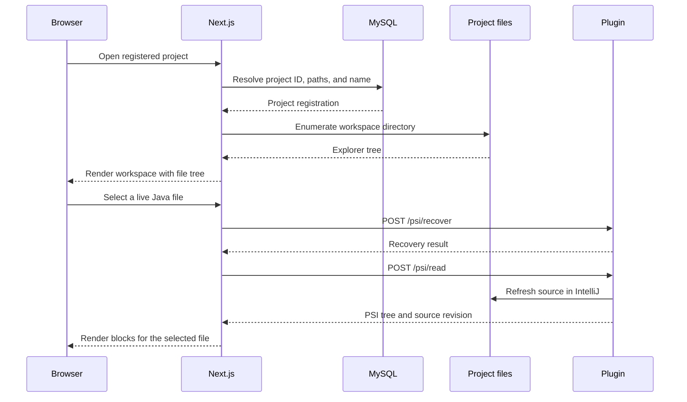
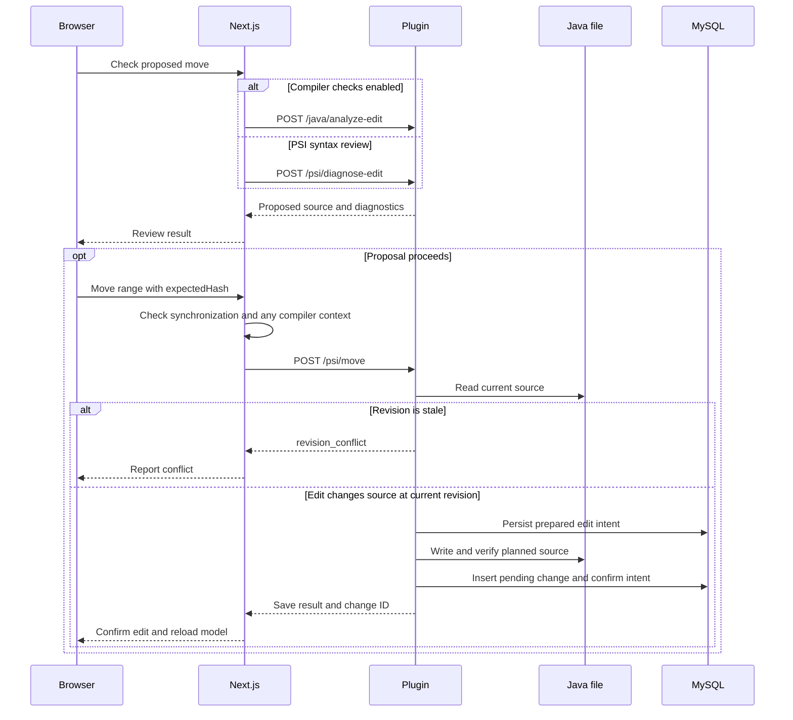
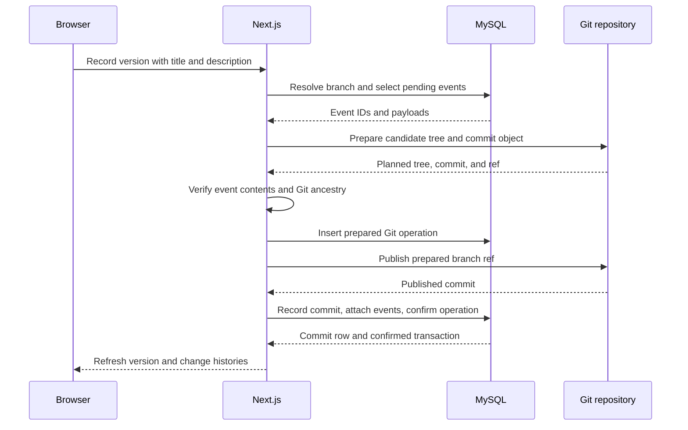
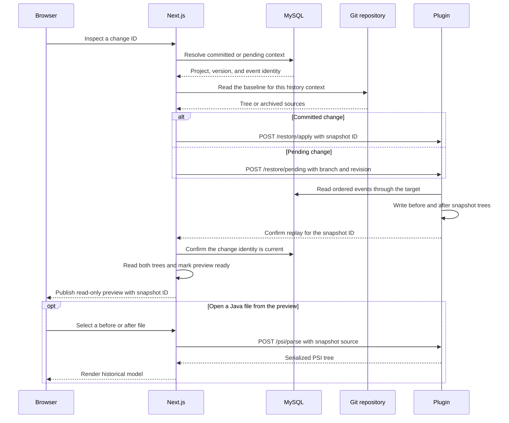
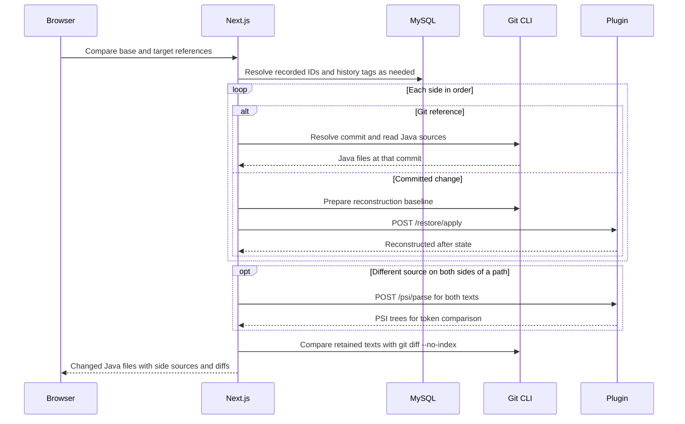
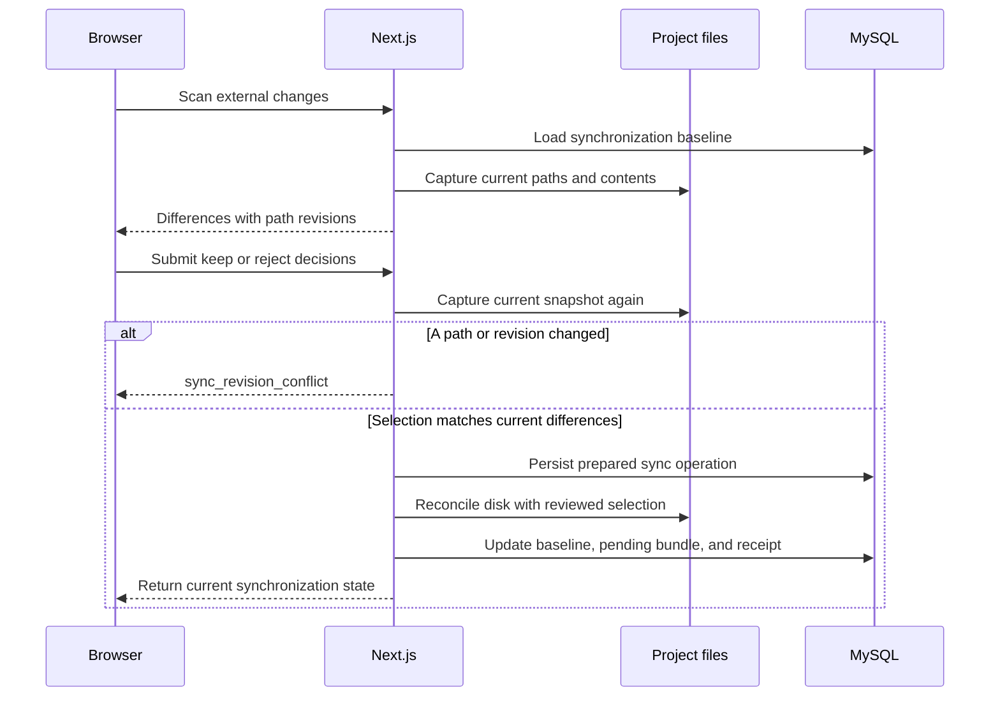
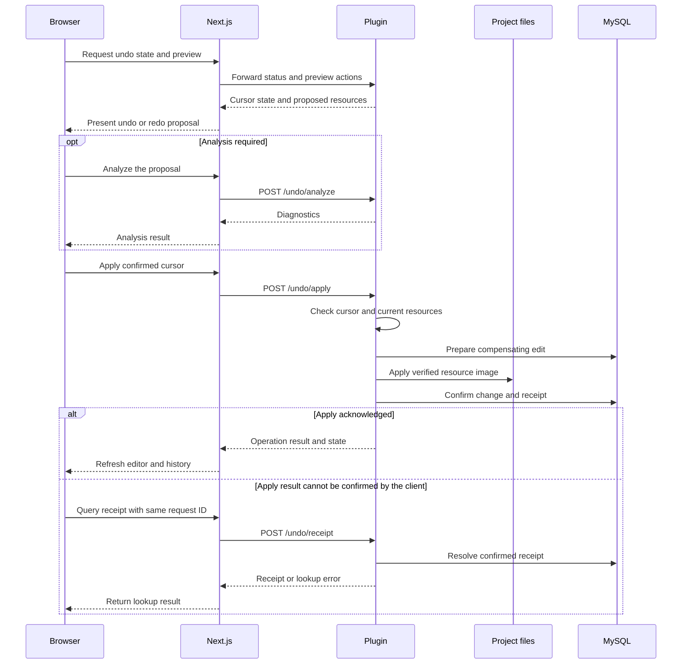
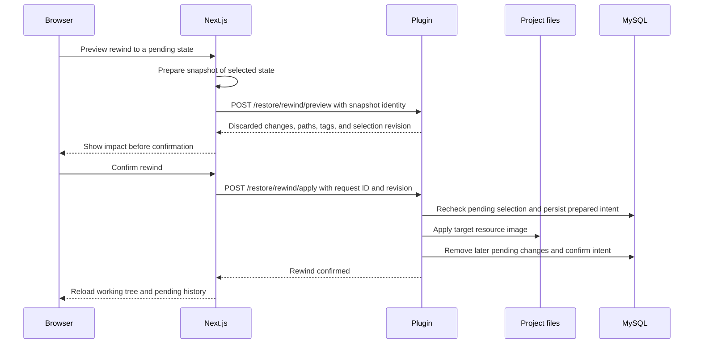
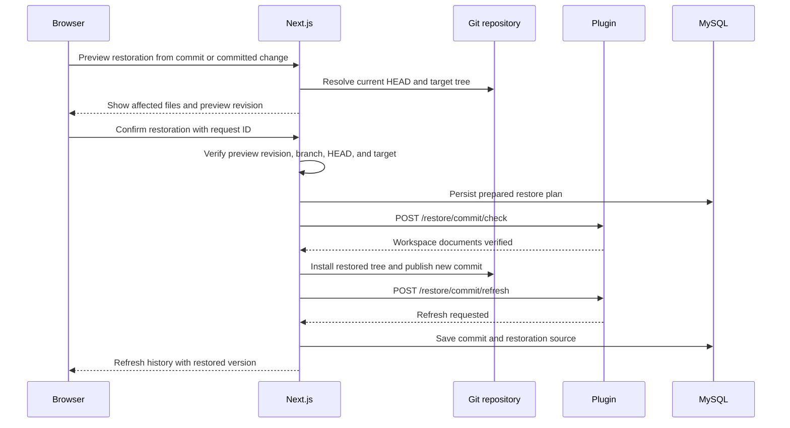
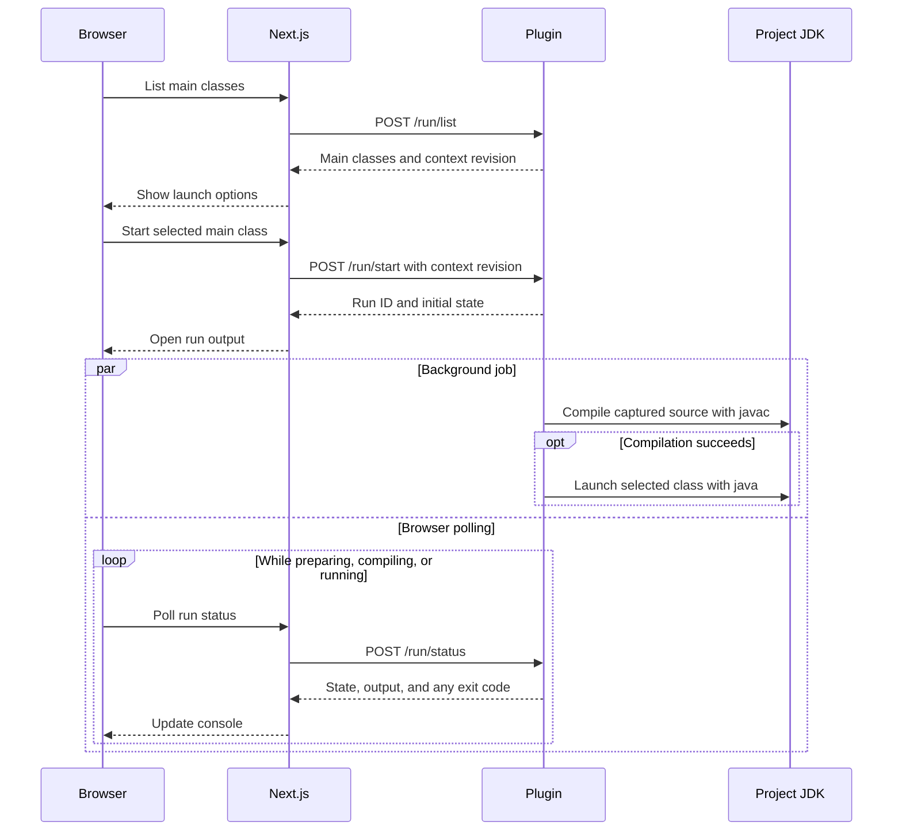

# `Lusiad` – Interaction diagrams

**🇺🇸 English** · [🇧🇷 Português (Brasil)](../pt-BR/diagramas-de-interacao.md)

These sequence diagrams trace operations from the browser to the component that owns each step. `Next.js` includes the server actions, route handlers, and their services. `Plugin` represents the local API and IntelliJ services. The [API reference](api-reference.md) lists request fields and response codes, and the [data model](data-model.md) describes the identifiers and durable records used in the diagrams.

### On this page

> [1. Open a project and load its model](#open-a-project-and-load-its-model)<br>
> [2. Review and apply a source edit](#review-and-apply-a-source-edit)<br>
> [3. Record a Git version](#record-a-git-version)<br>
> [4. Open an individual historical change](#open-an-individual-historical-change)<br>
> [5. Compare two references](#compare-two-references)<br>
> [6. Review external file changes](#review-external-file-changes)<br>
> [7. Undo or redo an edit](#undo-or-redo-an-edit)<br>
> [8. Restore a project state](#restore-a-project-state)<br>
> [9. Compile and run Java](#compile-and-run-java)<br>
> [Documentation index](#documentation-index)

## Open a project and load its model

Opening the project page loads the registration and the file tree. Selecting a live Java file then loads its PSI tree through the plugin. The server asks the plugin to reconcile prepared edits before reading the current file. The returned `revision` identifies the text to which the model offsets refer. [Project page](../../lusiad-frontend/src/app/project/%5BprojectId%5D/page.tsx) · [Model controller](../../lusiad-frontend/src/controllers/model-editor/model-editor.controller.ts) · [Live PSI service](../../lusiad-frontend/src/lib/services/model-editor/psi-api.service.ts)



## Review and apply a source edit

Moving a block produces a source range and destination. The editor checks a proposal in memory using PSI syntax analysis or compiler analysis, depending on the project's options. If the proposal proceeds, the controller enters the external synchronization guard and checks the compiler context again when one was supplied. The plugin validates the source revision before preparing the write. [Editor interactions](../../lusiad-frontend/src/components/panels/model-editor/model-editor.interactions.ts) · [Edit controller](../../lusiad-frontend/src/controllers/model-editor/model-editor.controller.ts) · [Edit coordinator](../../lusiad-backend/src/main/java/com/lusiad/backend/service/psi/EditCoordinator.java)



On confirmation, the plugin writes the change and updates the edit journal in a single SQL transaction. An edit that preserves the text can return `noOp` without creating a change event. If a write is interrupted, recovery compares the file with the recorded states to confirm, abort, or flag the prepared intent for inspection. [Edit coordination and recovery](../../lusiad-backend/src/main/java/com/lusiad/backend/service/psi/EditCoordinator.java) · [SQL confirmation](../../lusiad-backend/src/main/java/com/lusiad/backend/repository/change/EditOperationStore.java)

## Record a Git version

The commit action checks the selected branch and the external synchronization state. The recording service captures the pending events and prepares a Git tree and commit object. It records the plan before publishing the branch reference. The SQL transaction that follows connects the Git commit to those exact events, updates their `commit_id`, and marks the operation applied. [Commit controller](../../lusiad-frontend/src/controllers/commit-menu/commit-menu.controller.ts) · [Git recording service](../../lusiad-frontend/src/lib/services/commit-menu/git-recording.service.ts) · [Git publication](../../lusiad-frontend/src/lib/services/commit-menu/git-operation.ts)



If publication succeeds and SQL confirmation is interrupted, the prepared plan remains available. The next recording operation under the project lock first reconciles outstanding plans. Publication verifies the branch ref against the plan, including the case where it already points to the prepared commit. [Recording lock and recovery](../../lusiad-frontend/src/lib/services/commit-menu/git-recording.service.ts#L224-L257) · [Publication checks](../../lusiad-frontend/src/lib/services/commit-menu/git-operation.ts#L199-L219)

## Open an individual historical change

The history action resolves the change and creates a private preview directory. A committed change normally uses the first Git parent of its version as the baseline. A pending change uses the verified branch HEAD. The root-commit case derives its baseline from the recorded Git tree and events. The plugin replays the ordered changes through the selected event. Next.js rechecks the identity, reads both trees, and marks the preview ready. [Preview service](../../lusiad-frontend/src/lib/services/restore/restore.service.ts) · [Baseline preparation](../../lusiad-frontend/src/lib/services/restore/change-archive.service.ts) · [Replay inputs](../../lusiad-backend/src/main/java/com/lusiad/backend/repository/restore/RestoreRepository.java)



The before tree is written immediately before the target event is applied. The Java replay loop resets `working-copy-prev` from the current preview working tree at that point. [Replay implementation](../../lusiad-backend/src/main/java/com/lusiad/backend/service/restore/HistoricalReplay.java#L35-L42) · [Historical model reader](../../lusiad-frontend/src/lib/services/restore/snapshot-reader.ts)

```java
if (row.id == target)
  SnapshotFiles.reset(
      temp, working, ContainedPaths.resolve(temp, "working-copy-prev", false));
```

## Compare two references

Each side of the comparison resolves independently to a set of Java sources. A commit, branch, Git tag, or SHA can identify a Git commit. A Lusiad history tag points to a recorded commit or change. When a reference selects a committed change, the server reconstructs that event's after state in a temporary directory. The comparison then visits the combined set of Java paths. When a file exists on both sides and the text differs, it compares PSI tokens before including the Git diff. [Reference resolution](../../lusiad-frontend/src/lib/services/model-comparison/comparison-reference.model.ts) · [Comparison service](../../lusiad-frontend/src/lib/services/model-comparison/model-comparison.service.ts) · [Git snapshots and diffs](../../lusiad-frontend/src/lib/services/model-comparison/git-snapshot.ts)



An empty reference supplies an empty snapshot. Added or removed files can go directly to the textual comparison. PSI trees are compared when both sides have a different text for the same path. [Comparison service](../../lusiad-frontend/src/lib/services/model-comparison/model-comparison.service.ts)

## Review external file changes

A scan compares the project on disk with the stored synchronization baseline. The user chooses which changes to keep. The next server action compares the submitted path revisions with a fresh snapshot and prepares a plan. Accepted changes of the baseline can be grouped into a pending `external_bundle`, while rejected differences are reconciled on disk. [Synchronization service](../../lusiad-frontend/src/lib/services/external-sync/external-sync.service.ts) · [Selection and revision checks](../../lusiad-frontend/src/lib/services/external-sync/sync-plan.ts)



A scan can recover outstanding operations before producing its result. The SQL confirmation records the reviewed baseline and bundle together. A retained bundle can then be included in a recorded version. [Synchronization journal](../../lusiad-frontend/src/lib/services/external-sync/external-sync.service.ts) · [Bundle linkage at commit](../../lusiad-frontend/src/lib/services/commit-menu/git-recording.service.ts)

## Undo or redo an edit

The browser reads the undo state and builds a cursor containing `direction`, `epoch`, `revision`, and `requestId`. The plugin previews the affected resources. The browser can request syntax or compiler checks before applying the proposal. An applied change is recorded through the edit coordinator and updates the undo state. [Undo controls](../../lusiad-frontend/src/components/panels/model-editor/undo-controls.tsx) · [Next.js undo service](../../lusiad-frontend/src/lib/services/undo/undo.service.ts) · [Plugin undo service](../../lusiad-backend/src/main/java/com/lusiad/backend/service/undo/UndoService.java)



The browser client's recovery branch queries the receipt for the same request ID. If the lookup fails, it surfaces the original error. [`undo-client.ts`](../../lusiad-frontend/src/lib/services/undo/undo-client.ts#L13-L20)

```typescript
export async function undoApply(projectId: number, cursor: UndoCursor, contextRevision?: string) {
  try { return requireUndoResult(await call(projectId, 'apply', cursor, false, contextRevision), 'Undo/redo', cursor) }
  catch (original) {
    // A lost HTTP/SQL acknowledgement does not permit a second mutation. Query only its same-id receipt.
    try { return requireUndoReceipt(await call(projectId, 'receipt', cursor), 'Undo/redo recovery', cursor.requestId) }
    catch { throw original }
  }
}
```

## Restore a project state

| Operation | Effect on the project and history |
| --- | --- |
| Inspect a historical state | Creates isolated before and after trees for a preview. |
| Rewind pending changes | Updates the working files and removes pending changes after the selected point. The committed branch remains at the same HEAD. |
| Restore a recorded state | Writes the restored tree as a new child of the current Git HEAD and records its source in the history. |

### Rewind pending changes

Next.js prepares a snapshot for the selected pending event. The plugin returns the pending changes, paths, and tags affected by the rewind plus a `selectionRevision`. On confirmation, the plugin compares that revision with the current plan, journals the affected resources, applies the target state, and confirms the history update. Discarding all pending changes uses the verified committed HEAD as the virtual target. [Pending rewind service](../../lusiad-frontend/src/lib/services/restore/pending-rewind.service.ts) · [Plugin rewind coordinator](../../lusiad-backend/src/main/java/com/lusiad/backend/service/restore/PendingRewindService.java)



### Restore a recorded state as a new version

Restoring a commit uses its Git tree. Restoring the state after a committed change uses the reconstructed snapshot. The preview captures the target tree and the current branch and HEAD. On confirmation, Next.js revalidates them, asks the plugin to check unsaved IntelliJ documents, and publishes the restore commit. The plugin refreshes IntelliJ's file view, and the SQL transaction records the version and its origin. [Restoration preview and confirmation](../../lusiad-frontend/src/lib/services/restore/commit-restoration.service.ts) · [Git restore recording](../../lusiad-frontend/src/lib/services/commit-menu/git-recording.service.ts) · [IDE check and refresh](../../lusiad-backend/src/main/java/com/lusiad/backend/handler/restore/RestoreHandlers.java)



## Compile and run Java

The browser lists main classes through the run route. Listing returns a context revision for the saved sources and Java configuration. Starting a run passes that revision back with the selected class. The plugin runs compilation and execution as a background job. The browser polls the last run for the project and can stop it using the returned run ID. [Run controls](../../lusiad-frontend/src/components/panels/model-editor/java-run-controls.tsx) · [Next.js run route](../../lusiad-frontend/src/app/api/lusiad/run/route.ts) · [Java run service](../../lusiad-backend/src/main/java/com/lusiad/backend/service/run/JavaRunService.java)



---

<table width="100%">
<tr>
<td align="left"><a href="api-reference.md">⬅️ Previous page</a></td>
<td align="center"><a href="../../README.md#documentation-index">1️⃣5️⃣ Interaction diagrams</a></td>
<td align="right"><a href="design-decisions.md">Next page ➡️</a></td>
</tr>
</table>

### Documentation index

**[📖 Overview](../../README.md)**

- [🖥️ User guide](manual.md)
- [🎬 Demo](demo.md)

**[⚙️ Installation](setup.md)**

- [🔧 Installation guide](installation.md)
- [🚀 First steps](first-steps.md)

**[📐 Project](project.md)**

- [📋 Requirements](requirements.md)
- [✏️ Prototyping](prototyping.md)

**[💻 Implementation](implementation.md)**

- [🏗️ Architecture](architecture.md)
- [📂 Directory structure](directory-structure.md)
- [🧰 Technology stack](technology-stack.md)
- [🗃️ Data model](data-model.md)
- [🔌 API reference](api-reference.md)
- [🔀 Interaction diagrams](interaction-diagrams.md) 👈
- [🧭 Design decisions](design-decisions.md)
- [🔍 Notable implementation elements](notable-implementation-elements.md)

**[📊 Evaluation](evaluation.md)**

- [📋 Planning](evaluation-planning.md)
- [🧪 Execution](evaluation-execution.md)
- [📈 Results](evaluation-results.md)
- [💬 Discussion](evaluation-discussion.md)
- [📂 Materials and data](evaluation-data.md)
