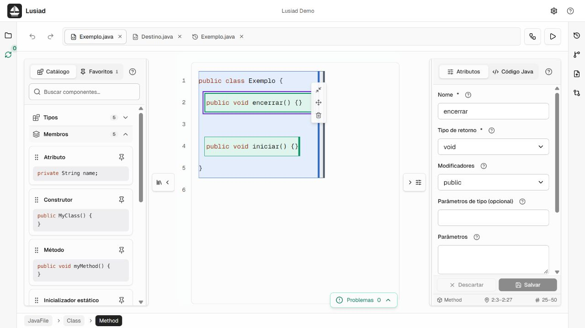
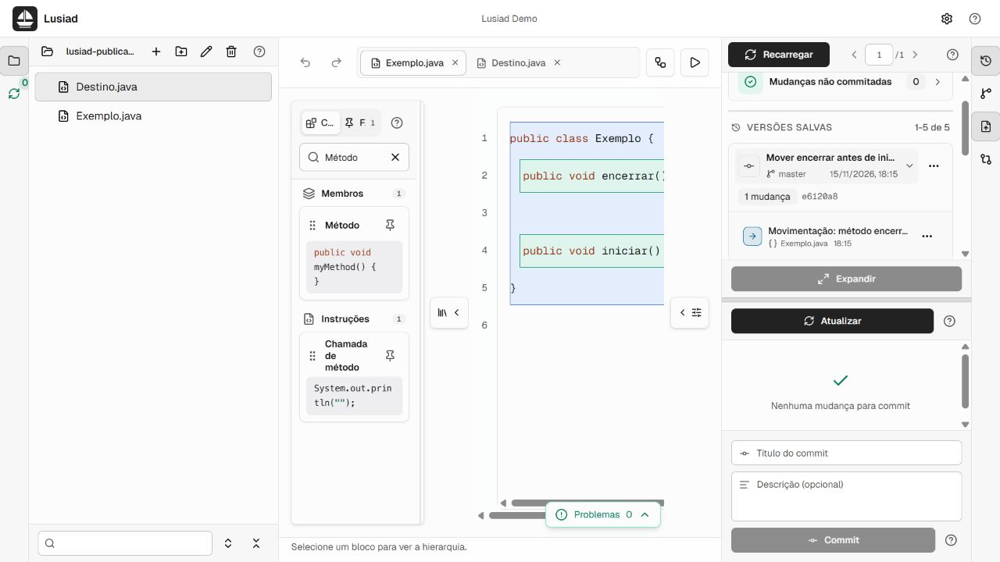
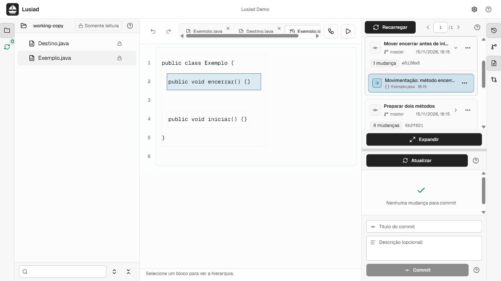
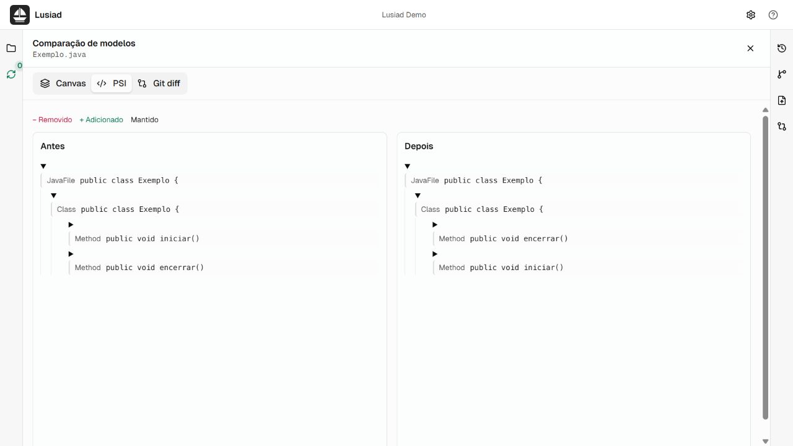

# User guide

## On this page

- [Plugin panel](#plugin-panel)
- [Projects and editor](#projects-and-editor)
- [History and comparison](#history-and-comparison)
- [Screens](#screens)

## Plugin panel

Open **Lusiad** in IntelliJ's tool window. The panel starts and stops the local service, checks MySQL connectivity, configures the frontend URL, adjusts preferences, and provides tutorials. Keep the IDE open while using the web interface.

## Projects and editor

The project page registers a directory, selects a project, and opens the workspace. In the explorer, open a Java file. The central area shows the editable structure and corresponding code. The library supplies components for insertion. Select an element to edit its properties. Undo and redo controls sit beside file tabs. Help icons open guided instructions for the main areas.

## History and comparison

Initialize Git through the interface and create a commit. In the history, select a branch and commit. Open an individual event to inspect its record. Version comparison lets you choose base and target. Before restoring a state, check the selected branch and version in the UI. The [first steps guide](first-steps.md) gives a short walkthrough.

## Screens

These screenshots came from the live interface and a disposable project. The demonstrated backend is `851120d` and frontend `d2f9326`; their correspondence to the evaluated version is still uncertain.

*Model and library before the move.*

*Model and Java after the move.*

*Library, model, and properties in one screen.*

*Commit and individual event in history.*

*Selected event view.*

*Canvas comparison of the two commits.*

*Git diff of the same operation.*

*Structural representation before and after.*

The IntelliJ plugin panel was not open during capture. To complete it, install the release ZIP in a disposable IDE, open the demo project, display **View → Tool Windows → Lusiad**, hide paths and credentials, and save a screenshot as `docs/assets/08-painel-plugin.png`. Insert it here after visual review.

---

[← First steps](first-steps.md) · [Index](index.md) · [Architecture →](architecture.md) · [Português](../pt-BR/manual.md)
