# `Lusiad` – User guide

**🇺🇸 English** · [🇧🇷 Português (Brasil)](../pt-BR/manual.md)

Use this guide to find a control or complete a task in Lusiad. For setup, follow the [installation guide](installation.md). For a short walkthrough from editing to history, see [First steps](first-steps.md).

The screenshots show Lusiad in both supported interface languages. This guide uses the English labels.

### On this page

> [1. IntelliJ plugin](#plugin-panel) 
> [2. Projects](#projects) 
> [3. Modeling workspace and file explorer](#workspace) 
> [4. Canvas and block controls](#canvas) 
> [5. Library and component creation](#library) 
> [6. Properties and edit confirmation](#properties) 
> [7. Undo and redo](#undo-redo) 
> [8. Java configuration, checks, and execution](#java) 
> [9. Commit](#commit) 
> [10. History, tags, and UML](#history) 
> [11. Branches and merge](#branches) 
> [12. Version comparison](#comparison) 
> [13. External synchronization](#synchronization) 
> [14. Rewind and restoration](#restoration) 
> [15. Preferences and troubleshooting](#settings) 
> [Documentation index](#documentation-index)

---

## 1. IntelliJ plugin

Open **View → Tool Windows → Lusiad** in IntelliJ IDEA. Keep the IDE running while using the browser interface. The plugin serves the local API that reads Java files, builds their model, and applies edits.

| IntelliJ tab | What you can do |
| --- | --- |
| **Running** | Use **Start server** or **Stop server**. Under **Database**, use **Check connection**. Under **Web interface**, use **Check interface** or **Open in browser**. The three status areas help distinguish a stopped API, database connection failure, and a frontend that has not started. |
| **Projects** | Refresh the registrations and choose one from the list, or keep the launcher set to the Projects page. The panel indicates which projects are open in IntelliJ or Lusiad and offers a way to open a registered folder in the IDE. |
| **Settings** | Set the web interface URL and frontend folder when configurable. Use **Save URL and folder** to keep those launcher settings. Use the shared interface preferences for language and appearance. |
| **Environment** | Inspect or edit operational settings such as the local endpoints, database connection, and temporary storage. Process and IDE Run overrides take precedence. Restart the IDE session and the frontend after changing database or API settings. |
| **Tutorials** | Read the frontend startup instructions or use **Copy startup command** to get the command to run in a terminal. The browser has its own guided tours under **?**. |

### IntelliJ panel screenshots

Running

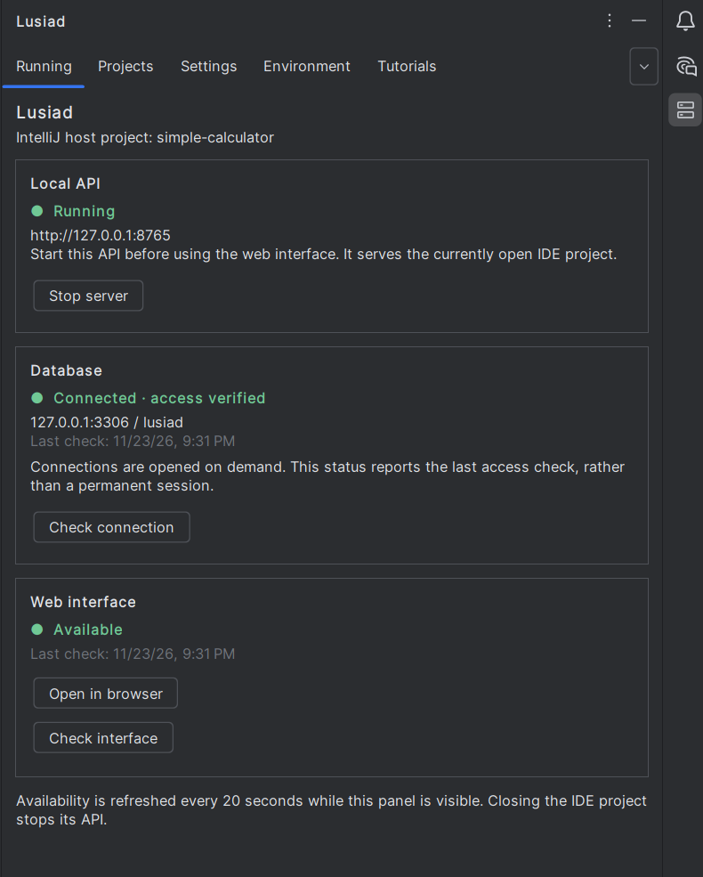

Projects

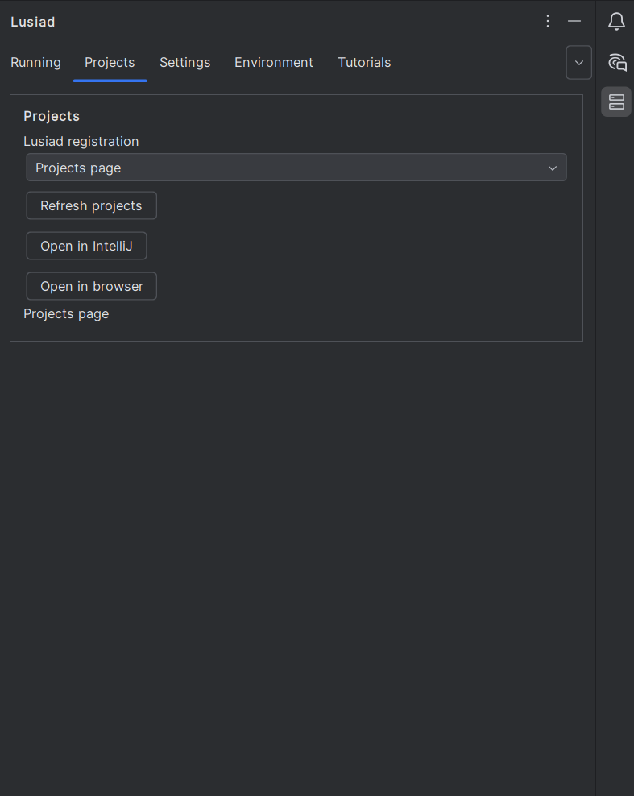

Settings

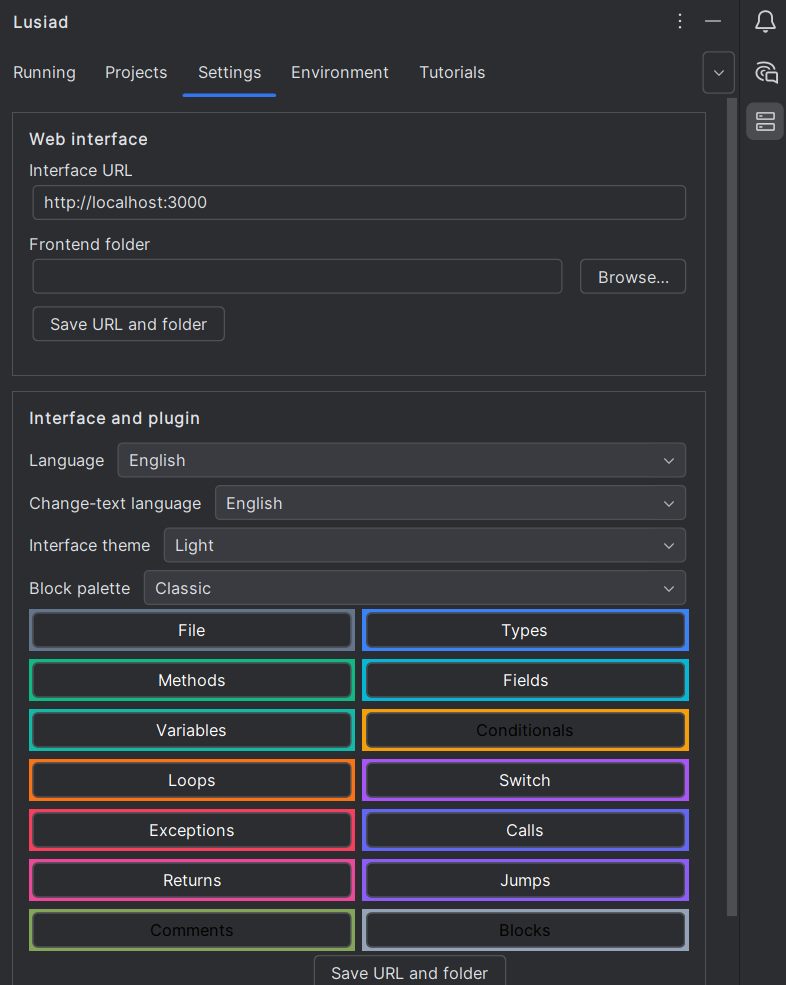

Environment

Tutorials

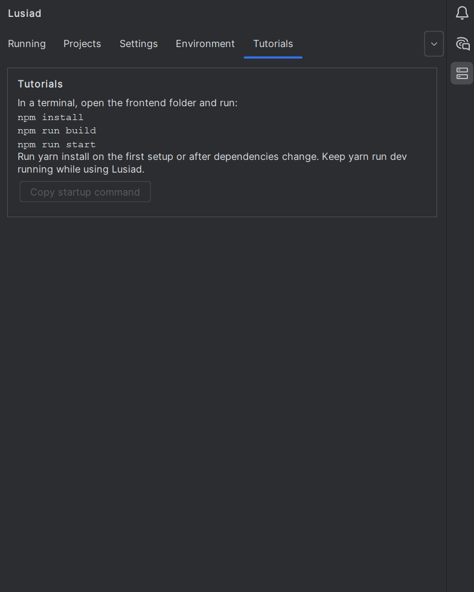

## 2. Projects

The start page lists folders registered with Lusiad. Search by name, description, or path. Click a project to see the summary on the right, then click **Open project** to enter the workspace. Hover over the project name in the workspace header to see its description. Use the Lusiad logo to return to the list.

### Register a folder

1. Choose **New project** and enter a name.
2. Enter the path of your Java project or use **Select folder**. The folder picker opens through the IntelliJ plugin. Complete or cancel that window before opening the picker again.
3. Add a description if useful, choose **Create project**, then select the registration and check its path. If a project is already open in IntelliJ without a Lusiad registration, the page can show it in a separate notice.

### Inspect or manage a registration

The summary shows the project path and counts for commits, changes, pending work, and tags. The **Project UML** shows the structure of saved Java files. Use the zoom controls or scroll within the diagram. Use **Refresh** to check newer source or metadata.

| Summary action | Effect |
| --- | --- |
| **Edit registration** | Changes the stored name and description. |
| **Move project folder** | Moves the folder with its Git repository and preserves the Lusiad history and tags. Resolve pending work first. Choose a parent directory on the same drive with no conflicting folder, then review the path and file count. |
| **Locate moved folder** | Points the existing registration and history to a compatible folder that you already moved. Review the old and new paths. |
| **Remove registration** | Removes the Lusiad registration, history, tags, and references. Source files and Git stay on disk. Registering the folder again starts a new Lusiad history. |
| **Delete folder and registration** | Permanently deletes the project folder, including ignored files and `.git`, and removes the registration. Review the path and preview before typing the exact project name to confirm. |

If Lusiad reports an interrupted move or removal, return to the Projects page and check the recovery entry for that operation before retrying. The preview also identifies any retained snapshot location.

## 3. Modeling workspace and file explorer

Open a `.java` file in the explorer to load the model. The outer rails open the project and history panels. The inner controls beside the canvas show or hide the library and properties.

| Where | Controls |
| --- | --- |
| Header | Lusiad logo for the Projects page, current project name, settings gear, and help. |
| Left rail | **File explorer** and **External synchronization**. The sync badge reports detected changes. |
| Central toolbar | Undo and redo, open files and preview tabs, current UML, and Java execution. |
| Center and lower edge | Java canvas, library and properties toggles, **Problems**, and the breadcrumb for the selected block. |
| Right rail, top to bottom | **Change history**, **Branches**, **Commit**, and **Compare versions**. |

### File explorer

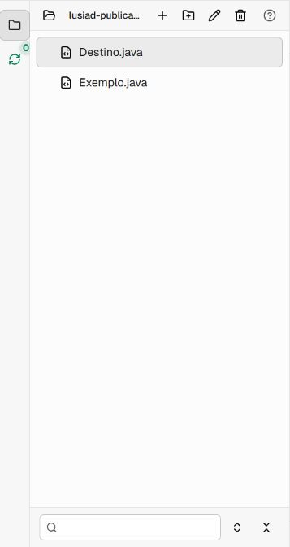

- **Browse.** Expand a folder, then double-click a file or select it and press **Enter**. Java files open in the model. Other files that support text preview open read-only. Use the tabs to switch files or close a view. The explorer becomes read-only in a historical preview.
- **Create.** Select the parent folder and use **New file** or **New folder**. Enter a name. New Java files receive the `.java` extension automatically when omitted. Clear the selection to work from the project root.
- **Rename, move, or delete.** Use the top controls or the row's right-click or three-dot menu. Drag an entry onto a destination folder to move it. For a deletion, check the named entry and confirm. File and folder operations can affect later history and comparisons.
- **Find and navigate.** Use the search field and **Expand all** or **Collapse all**. Hover over the project folder name for the full path, click the name to copy it, or use the folder icon to open it in the system file manager.

## 4. Canvas and block controls

The canvas shows saved Java source with nested boxes over structural elements such as classes, methods, fields, and statements. Click a box to select the element. The breadcrumb shows its path through the enclosing elements. Use a breadcrumb to select an ancestor.

| Action | How to use it |
| --- | --- |
| **Browse with the keyboard** | With focus on the canvas, use **Up** and **Down** to navigate, **Home** and **End** to reach the first or last block, **Enter** or **Space** to select, and **Esc** to clear selection. |
| **Collapse / Expand** | Use the selected block's control to hide or show its descendants while reviewing a file. |
| **Move** | Drag the four-arrow handle beside the selected block. Follow the insertion indicator to a valid location and release. The move applies within the open file. Check the resulting source and history entry. |
| **Delete** | Select the intended block and use its trash icon. Check its range before confirming. The canvas can also select and remove a blank line. |
| **Edit** | Open the properties panel to edit attributes or Java code for the selected span. |

The insertion marker can point to a blank line, a gap between lines, a valid column in an empty one-line body, or the end of the file. If a drop target does not appear, try a boundary appropriate to the element, such as a position inside the class for a method or inside a method body for a statement. A pending edit or a file changed from another editor can require reloading or completing synchronization before retrying.

## 5. Library and component creation

Open the library on the left of the canvas. **Catalogue** lists the templates by group. Search by name or related term, and use the pin to add a template to **Favorites**. Favorites are stored in the browser.

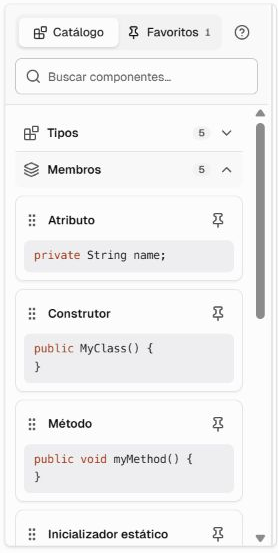

| Group | Templates |
| --- | --- |
| Types | Class, interface, enum, record, and annotation declaration. |
| Members | Field, constructor, method, static initializer, and instance initializer. |
| Statements | Local variable, method call, and expression or assignment. |
| Conditions and control | `if` / `else`, `switch` / `case`, `synchronized`, and `assert`. |
| Loops | `for`, enhanced `for`, `while`, and `do` / `while`. |
| Return and jumps | `return`, `break`, `continue`, and `yield`. |
| Exceptions | `try` / `catch` / `finally` and `throw`. |
| Packages and imports | Package declaration, single import, and wildcard import. |
| Comments and spacing | Line comment, block comment, Javadoc, and blank line. |

1. Open a Java file and drag a template card to the intended container. The preview indicates where the code would be inserted. An incompatible context prevents placement.
2. In the creation dialog, enter the attributes. For a method, review its name, return type, modifiers, parameters, and body. For a field, confirm its type, name, and initial value. The available fields depend on the template.
3. Inspect the generated **Java code** and edit it directly if needed. Use **Create component**, review any diagnostics, and confirm. Use **Cancel** to leave the file as it was.

## 6. Properties and edit confirmation

Select a block and open **Properties** on the right. The footer identifies the element type, lines, and source range. If the wrong element is selected, choose the correct block or use the breadcrumb before entering changes.

| Tab or action | Use |
| --- | --- |
| **Attributes** | Edit the supported fields for the selected element. Changing a declaration's name here edits that range. Update its references separately if needed. |
| **Java code** | Edit the selected source as a draft. After manual changes, use the option to inspect the draft when available so Lusiad can recover structured fields. The draft remains in the code editor when it cannot be mapped. |
| **Discard** | Drops the pending edits in this form. |
| **Save** | Checks the proposal in the context of the full file and applies it after any required confirmation. An applied edit is written to disk and appears in the pending history. |

If the confirmation shows syntax errors, **Correct** returns to the draft, **Cancel** aborts the apply action, and **Continue anyway** explicitly applies the proposal with the reported problems. The diagnostics can also include errors already present in the file. If Java checking on proposals is enabled, review compiler messages or the explanation of why the check could not finish before continuing.

## 7. Undo and redo

Use the curved arrows beside the file tabs for confirmed project operations. Outside editable fields, **Ctrl/⌘+Z** undoes and **Ctrl/⌘+Shift+Z** redoes. **Ctrl+Y** also redoes. Inside an input or code editor, these shortcuts act on the local draft.

Undo reinstates the state before a supported operation. Redo reapplies it. Each confirmed action appears in the history. Close or finish a pending draft before using the project controls. If the proposed undo or redo introduces errors, review the diagnostics and use **Correct** to inspect or adjust the proposed state when offered.

The stack belongs to the running plugin session. Operations such as a commit, branch creation or merge, and accepting external changes end the current stack. Large resource changes can exceed undo storage. When Lusiad offers **Operation without undo**, continuing applies that operation without a corresponding undo entry.

## 8. Java configuration, checks, and execution

### Configure the Java context

Open **Settings → Java** and select a registered project, or use the configuration button in **Java run** or **Java checks**. Choose the JDK directory or **Use the Run JDK**. Confirm the Java release and enter one path per line for production source roots, test roots, classpath dependencies, and module-path dependencies, as applicable. Save. The dialog reports the runtime/compiler used by the plugin and whether the context is available.

### Check a file or the project

1. Open **Problems** at the lower edge of the canvas. Choose **Current file** or **Project**. **Syntax (PSI)** reports parsing problems and their locations. In project scope, you can review diagnostics across files and choose one to navigate to it.
2. Choose **Check Java with the compiler** to check configured sources with `javac`. Read the number of files analyzed, diagnostic locations, and any incomplete or outdated status. A result of zero compilation errors applies to the configured scope, JDK, and dependencies.
3. To check changes before saving, enable **Check Java when confirming edits (this session)** in the Java panel or the Java settings. The proposal review can check the resulting file or project state before it is saved.

### Compile and run

1. Click the **Run Java code** triangle beside the file tabs. Select the main class if prompted. Lusiad looks for `public static void main(String[] args)` in the configured Java sources.
2. Start the run. Lusiad compiles and runs a copy of the saved source, including saved edits that are still pending. Apply property drafts first if you intend to run them.
3. Read **Output**, **Errors**, and the exit code. **Stop** ends an active run. **Run again** uses the current saved input. **Refresh runnable classes** searches again after a change to files or configuration.

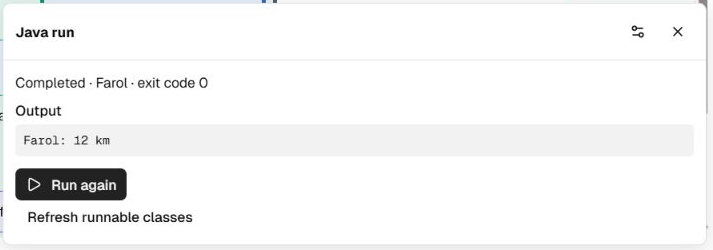

If no main is listed, check the production roots and the method signature. If the compiler reports missing packages, check the dependency paths. A compile error stops before execution. A runtime exception appears after compilation and can include output produced before the failure.

## 9. Commit

Open **Commit** on the right rail. When Git has not been initialized, choose **Initialize repository**. If Git exists and Lusiad shows **Finish initialization**, complete the initial snapshot to register the baseline used by the history and external synchronization.

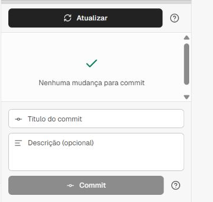

1. Use **Refresh** if the file list is stale. Review the affected files by change type and filter by file name if needed. If the panel requests external review, complete [synchronization](#synchronization).
2. Enter a **Commit title** and optional **Description**. Check the active branch in **Branches**.
3. Click **Commit** and wait for confirmation. The version becomes available in the history and graph, with its individual events grouped under it. Committing ends the current undo/redo stack.

The commit panel also offers a trash action for discarded pending work when available. Review its confirmation carefully. See [Rewind and restoration](#restoration) for how it differs from recording a new version.

## 10. History, tags, and UML

### Find a version or event

Open **Change history**. **Uncommitted changes** lists the current pending events. **Saved versions** lists commits. Use **Reload**, search by summary, file, or tag, and filter for merges, branch creation, or tagged versions as needed. Use the page arrows, page-size selector, or page number field to navigate more results.

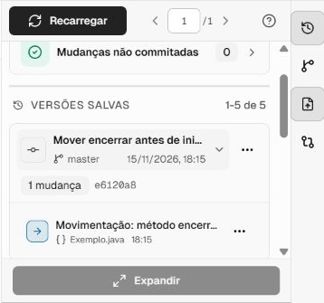

Expand a commit card to see its events. Select an event to open its **Before/After** preview, then choose **Expand** for the details. The larger view brings together the code or UML, the event timeline, metadata, and the snapshot explorer. Change colors identify additions, deletions, modifications, and moves. Select **Before** or **After** in the snapshot explorer to inspect matching files and paths.

Opening a preview is read-only. If a pending preview becomes stale after another project operation, reopen the event from the refreshed history. Committed external bundles can provide a file-level list and before/after text for affected Java files.

### Mark or reuse a reference

Use the three-dot or context menu on a commit or event to **Manage tags**. Add a short name, rename a tag, or confirm its removal. Tag names start with a letter or digit and can contain letters, numbers, spaces, dots, underscores, slashes, and hyphens, up to 80 characters. Filter by tags in history, look for them in the graph, or select them as references in comparison. Use **Copy reference** to reuse a commit, event, or tag where supported.

### Inspect class structure

| Where to open UML | Scope |
| --- | --- |
| **Projects → Project UML** | Saved structure of the selected project before opening its workspace. |
| **Current UML** beside the workspace tabs | Saved structure of the open Java file or the project overview. Use the scope toggle and zoom or scroll through the diagram. |
| **History → Expand → UML** | Before and after class diagrams of the selected event. Use **File** or **Overview** where available. The interface can show movement origin and destination or indicate that the structure is equivalent. |

For a body-only change or method reorder, use the code view to inspect the edit itself. The class diagram describes declarations and relationships.

## 11. Branches and merge

Open **Branches**. The header identifies the current working branch. Click a branch label or commit node to inspect it in the lower panel. Click a change-tag marker to inspect the linked event. Use **View in history** to open a matching commit or change. If a link is outside the loaded part of the graph, refresh or load more entries.

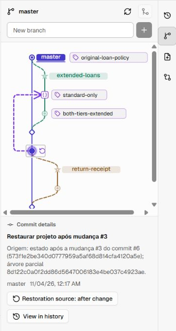

1. **Create a branch.** Resolve pending work first. Enter a name in **New branch** and use the plus button. The branch starts from the current branch and becomes the working branch.
2. **Inspect its history.** The graph identifies branch creation, regular commits, merges, and restorations. A restoration link points back to its origin so you can inspect that version or event.
3. **Merge into the base.** Commit the work on the current branch and check its base in the branch details. Click **Merge into base** when available. After the merge, review the result and active branch in the graph. If integration is blocked, read the panel's message before retrying.

Clicking a graph label opens details. Use the working-branch indicator in the header to confirm where a new commit or restoration will be recorded.

## 12. Version comparison

Open **Compare versions** on the right rail. Use **Base** for the starting side and **Target** for the side you want to compare against it. The swap button reverses the direction and, therefore, the meaning of added and removed lines.

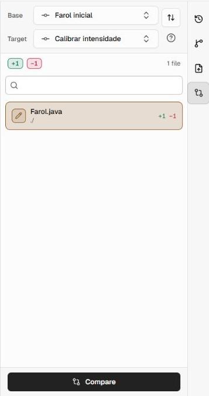

1. Open the reference picker on each side. Search or filter by saved commits, committed changes, Lusiad tags, or Git references. You can also enter a supported reference such as `sha:...`, `branch:...`, or `tag:...`. **Empty project state** lets you compare against a baseline with no files. A committed event points to the state right after it. An external bundle points to its full commit.
2. Choose **Compare**. Review the summary counts, filter the affected files, and click a file to open the comparison.
3. Switch between **Canvas**, **PSI**, and **Git diff**. Close the central preview with its **×** to return to the editor.

| View | Use |
| --- | --- |
| **Canvas** | Inspect Before and After with boxes and source highlights. Useful for checking a change in its enclosing Java element. |
| **PSI** | Expand syntax nodes on each side to inspect declarations, statements, and descendants structurally. |
| **Git diff** | Read removed and added lines and their surrounding context. Use the file counts in the comparison panel to locate larger changes. |

Canvas, PSI, and Git diff screenshots

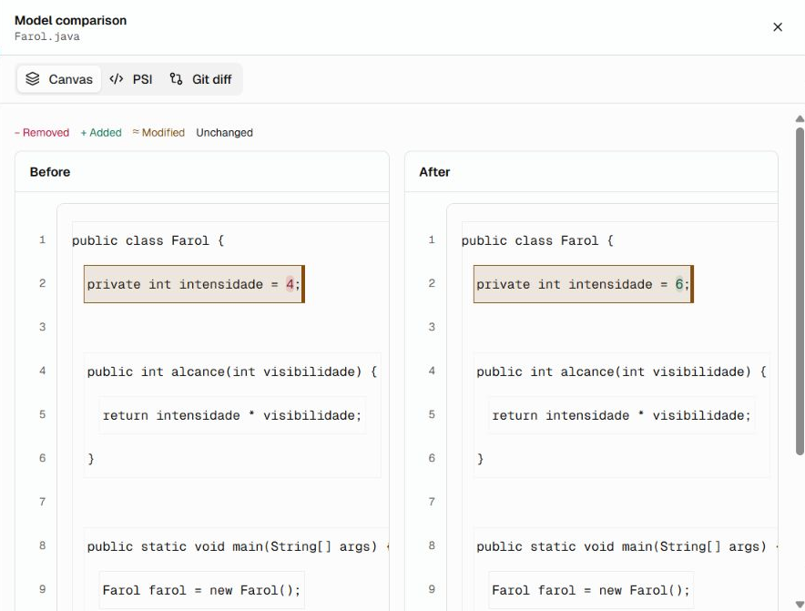

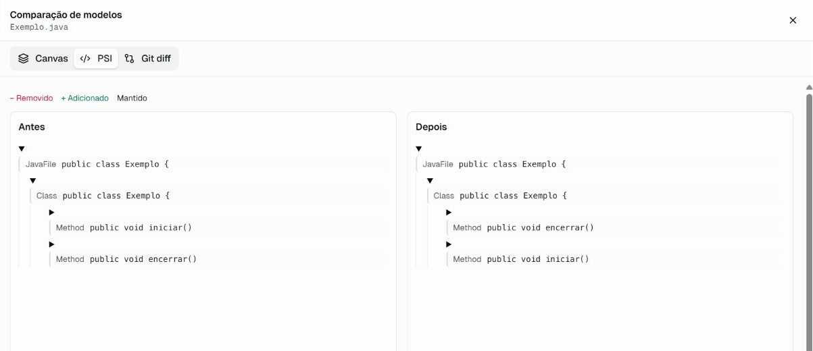

Comparison works from the selected references without changing the project on disk. Use [restoration](#restoration) when you want to apply a historical state to the working project.

## 13. External synchronization

After the initial commit, edits made in IntelliJ, another editor, or the system file manager can appear under **External synchronization**. Open the circular-arrows panel on the left and use **Refresh**. The editor can pause Lusiad changes until the external differences are resolved.

1. Open an affected path to review its preview. For eligible Java files, each line is shown against its tracked state. Directories, binary files, and paths that cannot show a text diff still appear in the review list.
2. Check each path you intend to keep. **Apply selection** accepts checked changes and restores the tracked state for unchecked paths. **Reject all** restores the tracked state for the entire list. Review the selection before applying it.
3. If changes were accepted, open **Commit** and record the resulting external bundle before resuming normal editing. **Cancel adopted changes** is available before that commit if you want to discard the accepted bundle. Refresh and review again if a newer disk edit invalidates the selection.

The history groups the accepted external changes as a bundle. You can inspect the affected files after committing it.

## 14. Rewind and restoration

Use [History](#history) to locate the event or version. Choose the action based on which work you want to keep.

| Goal | Action and effect |
| --- | --- |
| Keep the pending work through a specific event | In **Uncommitted changes**, open the selected event's menu and choose **Return to this change**. Review the later events, paths, and any tags that would be removed. Confirm **Discard and return**. The state after the selected event becomes the current state. |
| Abandon all pending work | Choose **Discard all pending changes** in history or the available discard control in Commit. Review and confirm. The working files return to the last commit and the pending entries are removed. |
| Restore a saved version | Open the menu on the saved commit and choose **Restore project to this commit**. Review the active branch and the file changes, then choose **Restore and commit**. |
| Restore the state just after an individual committed change | Open the event's menu and choose **Restore project after this change**. Check the event and enclosing commit, review the affected files, then choose **Restore and commit**. |

Rewind and discard remove pending work without creating a version. Restoration creates a **new commit on the current branch**, with a link to the older commit or event. Resolve pending or external work before restoring. After confirmation, check the graph or history for the new commit and open the relevant files to verify the resulting state.

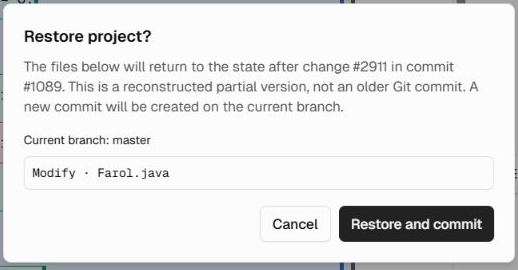

## 15. Preferences and troubleshooting

Use the top-right gear from Projects or the workspace.

| Web settings tab | Controls |
| --- | --- |
| **Interface** | Select English or Brazilian Portuguese, independently choose the language of system-generated change text, set the theme to Light, Dark, or Follow system, and select or customize the block palette. Use the reset button to return to the default palette. User-entered titles and descriptions keep their original wording. |
| **Java** | Select the project to configure its JDK, release, source roots, and dependencies. Enable compiler checks on proposed edits for the current session when useful. |
| **Environment** | Check the operational profile, endpoints, database connection information, and default temporary root. Saving a new default root applies to new registrations. Existing projects retain their temporary folders. Managed settings are read-only where the process or test profile supplies their values. |

Shared language and appearance preferences can synchronize with the plugin. Favorites and some session choices remain local to the browser or session. Use the main **?** to tour the workspace and the **?** in a panel to see its own controls.

| If you see this | Check here |
| --- | --- |
| The page opens but projects or files fail to load | In **IntelliJ → Lusiad → Running**, verify the API, database, and web interface. Confirm you started the frontend with the settings for the same installation. |
| A file opens without editable blocks | Check its extension, whether the view is historical, and whether external changes have locked editing. |
| A drag or save is refused | Check the selected node, target container, and file revision. Read the message, resolve external changes if indicated, and reopen or reload the file before reapplying the operation. |
| A commit, branch operation, or restoration is unavailable | Review pending events, the current Git branch, and any external bundle. Finish or cancel the operation that is already awaiting confirmation. |
| A historical view is missing or stale | Reload the history and reopen the exact event. For a graph link, load more commits if its source is outside the visible window. |
| The compiler finds no sources or execution finds no main | Check [the Java context](#java), including production roots, dependencies, and the active project. Refresh the runnable-class list. |

---

<table width="100%">
<tr>
<td align="left"><a href="../../README.md">⬅️ Previous page</a></td>
<td align="center"><a href="../../README.md#documentation-index">1️⃣ User guide</a></td>
<td align="right"><a href="demo.md">Next page ➡️</a></td>
</tr>
</table>

### Documentation index

**[📖 Overview](../../README.md)**

- [🖥️ User guide](manual.md) 👈
- [🎬 Demo](demo.md)

**[⚙️ Installation](setup.md)**

- [🔧 Installation guide](installation.md)
- [🚀 First steps](first-steps.md)

**[📐 Project](project.md)**

- [📋 Requirements](requirements.md)
- [✏️ Prototyping](prototyping.md)

**[💻 Implementation](implementation.md)**

- [🏗️ Architecture](architecture.md)
- [📂 Directory structure](directory-structure.md)
- [🧰 Technology stack](technology-stack.md)
- [🗃️ Data model](data-model.md)
- [🔌 API reference](api-reference.md)
- [🔀 Interaction diagrams](interaction-diagrams.md)
- [🧭 Design decisions](design-decisions.md)
- [🔍 Notable implementation elements](notable-implementation-elements.md)

**[📊 Evaluation](evaluation.md)**

- [📋 Planning](evaluation-planning.md)
- [🧪 Execution](evaluation-execution.md)
- [📈 Results](evaluation-results.md)
- [💬 Discussion](evaluation-discussion.md)
- [📂 Materials and data](evaluation-data.md)
