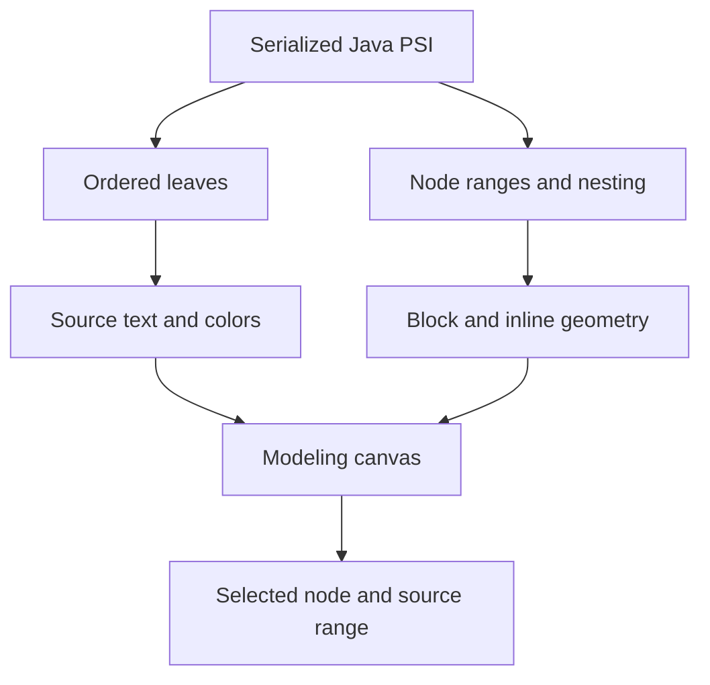
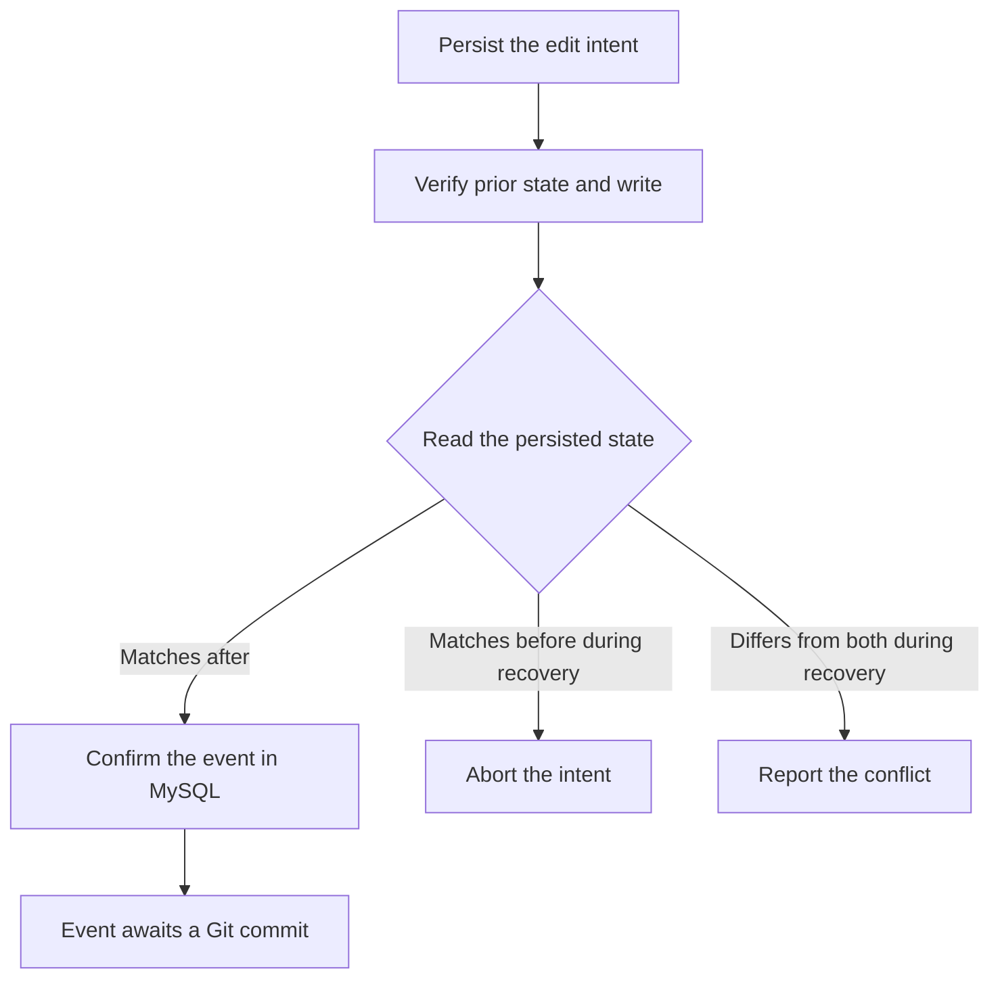
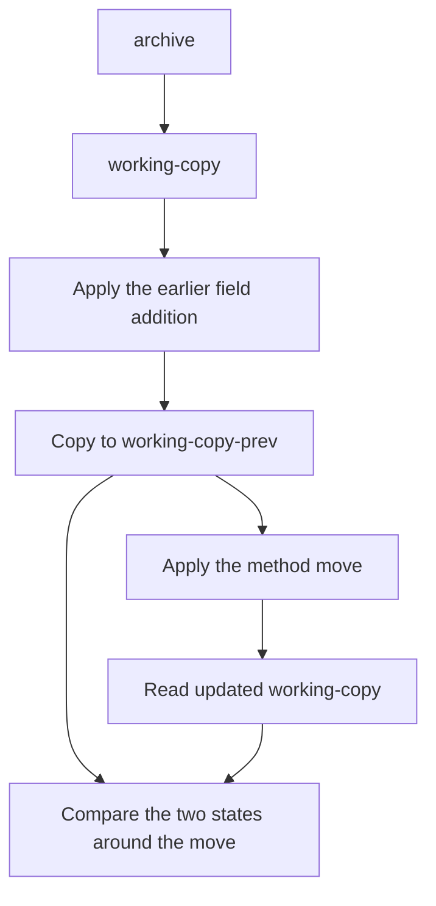

# `Lusiad` – Notable implementation elements

**🇺🇸 English** · [🇧🇷 Português (Brasil)](../pt-BR/elementos-notaveis-da-implementacao.md)

This page follows a method move from the modeling canvas to the reconstruction of that individual event. The same mechanisms also explain how Lusiad handles structured edits, identifies the affected Java element after formatting, and compares states that fall between Git commits.

### On this page

> [1. Representing the PSI as a model](#representing-the-psi-as-a-model)<br>
> [2. Representing and recording changes](#representing-and-recording-changes)<br>
> [3. Reconstructing and viewing changes](#reconstructing-and-viewing-changes)<br>
> [Documentation index](#documentation-index)

---

<a name="representing-the-psi-as-a-model"></a>
<a name="move-a-method"></a>

## 1. Representing the PSI as a model

### From a Java document to the canvas

The plugin serializes each IntelliJ PSI element using its implementation class name, such as `PsiMethodImpl`, and the range it occupies in the document. Character offsets count UTF-16 code units and use a zero-based, end-exclusive interval. Display positions use one-based lines and columns. For a nonempty range, the end line and column refer to the last character inside it. The web client receives the tree in a `JavaModel` alongside the file path and, for a live file, a revision of its source. [PSI serialization](../../lusiad-backend/src/main/java/com/lusiad/backend/service/psi/PsiService.java#L540) · [TypeScript types](../../lusiad-frontend/src/lib/types.ts#L1)

```ts
export interface PsiNode {
  type: string
  text?: string
  startOffset?: number
  endOffset?: number
  startLine: number
  startColumn: number
  endLine: number
  endColumn: number
  children?: PsiNode[]
}

export function renderLeafTextContent(node: PsiNode): string {
  const children = node.children ?? []

  if (children.length === 0) {
    return node.text ?? ""
  }

  return children.map(renderLeafTextContent).join("")
}
```

An internal node organizes descendants. A leaf contributes its own text, including punctuation or whitespace where those are represented as leaves. The recursion visits children in PSI order and adds no separators. The canvas uses these leaves for the source text and syntax coloring. It walks the same tree separately to calculate the boxes. Every `BoxOverlay` keeps a reference to its node, so the selection can go from the pixels on screen to the original Java range. [Leaf traversal](../../lusiad-frontend/src/lib/models/model-editor/model-tree.model.ts#L7) · [Canvas geometry and text segments](../../lusiad-frontend/src/lib/models/model-editor/model-canvas.model.ts)



### Visible blocks and selectable elements

| Source situation | Canvas treatment |
| --- | --- |
| A multiline node begins after indentation | A box starts at the node's opening column and spans its lines. Its width uses the occupied columns, with visual spacing applied to distinguish nested boxes. |
| A one-line component occupies the line | A component with a visible range can have a full box. Leaf comments and statements can qualify too. |
| A component shares a line with other syntax | An inline overlay can appear on hover. Independently selectable components keep their own ranges. |
| PSI wrappers cover the same characters | The interaction layer prefers a recognized component in that ancestor chain, then the deepest candidate among equally ranked nodes. |

This last rule matters when several PSI nodes describe the same span of characters. It gives the click or drag one owner while preserving distinct nested ranges. The node path used in the canvas is derived from child indices in the current tree. After the model reloads, the live selection must refer to a node in the new tree. [Box collection](../../lusiad-frontend/src/lib/models/model-editor/model-canvas.model.ts#L254) · [Interaction overlays](../../lusiad-frontend/src/lib/models/model-editor/component-overlays.model.ts)

### From a block interaction to a source edit

Suppose `Sessao.java` contains `iniciar()` followed by `encerrar()`. The user drags the box for `encerrar()` to the gap above `iniciar()`. The drag payload carries the source canvas identifier, the method's start and end offsets, and its node type. For a gap between lines, the canvas sends `line` and `lineEnd`. It can also resolve the start of a blank line, a column at the end of the file, or a column inside an empty one-line class or code block. The inline case requires braces belonging to an actual PSI container. An insertion point inside a comment or literal is rejected. [Drag payload and drop handling](../../lusiad-frontend/src/components/panels/model-editor/model-canvas.interactions.ts) · [Drop geometry](../../lusiad-frontend/src/lib/models/model-editor/canvas-drop.model.ts)

The plugin converts the destination to an offset in the original document and rejects a destination inside or on the boundary of the selected range. It removes the selected text and adjusts the insertion offset if the original destination was after that text. The edit is first prepared in a detached Java PSI document. The plugin can format the resulting source, and the expected source hash ties the request to the file revision the user saw. The editor reloads the model after the confirmed edit, so the new block positions come from the resulting Java file. [Move and edit preparation](../../lusiad-backend/src/main/java/com/lusiad/backend/service/psi/PsiService.java) · [Editor interactions](../../lusiad-frontend/src/components/panels/model-editor/model-editor.interactions.ts)

The component library and the properties editor also use source ranges. A library component can generate Java from validated attributes and offer that source for manual editing. For a supported component already in the file, the properties editor derives fields from the selected PSI and applies changes to their ranges in the draft. It can parse the resulting draft and verify that the returned leaves reproduce the proposed source. This lets a property edit preserve source outside its targeted fields. [Component creation](../../lusiad-frontend/src/lib/models/model-editor/component-creation.model.ts) · [Structured edits](../../lusiad-frontend/src/lib/models/model-editor/component-edit.model.ts) · [Draft PSI verification](../../lusiad-frontend/src/controllers/model-editor/component-edit.controller.ts)

<a name="representing-and-recording-changes"></a>
<a name="record-a-version"></a>

## 2. Representing and recording changes

### One event for the method move

After the edit is confirmed, `changes` stores the operation with its project, branch, type, scope, description, and JSON `req_body`. The example creates a `move` event with scope `file`. The row can appear in the history with `commit_id` still null. If the user edits another component before committing, both actions have their own events and can later belong to the same version. [Change persistence](../../lusiad-backend/src/main/java/com/lusiad/backend/repository/change/EditOperationStore.java) · [Data model](data-model.md)

The `changeMetadata` in `req_body` records what can be described to the user. These are the Java records used for code and path changes. [Change metadata records](../../lusiad-backend/src/main/java/com/lusiad/backend/service/change/ChangeMetadata.java#L14)

```java
public record Range(int start, int end, int startLine, int endLine, int startColumn, int endColumn) {}
public record Element(String kind, String name) {}
public record Side(String path, Range range, Element element, List<Element> context) {}
public record Difference(String field, String before, String after) {}
public record Facts(int version, String action, String kind, Side before, Side after, List<Difference> differences) {}
```

For the move, `before` can identify `encerrar()` below `iniciar()` and `after` can identify it above `iniciar()`. Both sides can carry `Sessao.java`, the method name and parameter types, and the enclosing class. A statement can also carry context such as its method, loop, `then` or `else` arm, or `switch` case. A creation has only a destination side, and a deletion has only a source side. When the affected range covers several elements, a fragment, or whitespace, the event can record that level of detail. The client validates the facts and generates the history text in the selected language. [Element and context extraction](../../lusiad-backend/src/main/java/com/lusiad/backend/service/change/ChangeMetadata.java#L99) · [Metadata validation](../../lusiad-frontend/src/lib/models/change-history/change-metadata.ts) · [Localized descriptions](../../lusiad-frontend/src/lib/i18n/change-text.ts)

### Finding the affected element after formatting

Lusiad works with three PSI trees for the move. The original tree identifies the source range. The tree immediately after insertion identifies the destination range as produced by the edit. If formatting changes the text, the backend compares the ordered non-whitespace tokens of the unformatted and formatted trees. When token count and text agree, it maps the first and last tokens intersecting the inserted span to the same positions in the formatted sequence, preserving the relevant offsets within those tokens. This preserves the occurrence selected by the edit even when the same expression appears several times in the file. If the correspondence cannot be established, the destination range remains unresolved. [Destination and token mapping](../../lusiad-backend/src/main/java/com/lusiad/backend/service/change/ChangeMetadata.java#L25) · [Formatting outcomes](../../lusiad-backend/src/main/java/com/lusiad/backend/service/psi/PsiEditPersistence.java)

For an update, the backend can also describe a change of name, type, signature, condition, or expression. It masks a candidate PSI property on each side and compares the remaining tokens of the affected element. It reports one property difference when that property accounts for the edit under this comparison. A method signature change can therefore be described specifically while a broader rewrite retains the general update description. These ranges and labels describe the two recorded states. They are local to the operation and its source revisions. [Property comparison](../../lusiad-backend/src/main/java/com/lusiad/backend/service/change/ChangeMetadata.java#L233)

### The payload that makes replay possible

The event producer records `operationId`, `operationOrder`, and `recordVersion` for current journaled edits. `operationOrder` identifies the journal order. Historical replay reads the scoped event rows in `changes.id` order. The version inside `changeMetadata` describes the presentation schema independently of `recordVersion`. [Event body](../../lusiad-backend/src/main/java/com/lusiad/backend/service/psi/EditCoordinator.java#L106) · [Replay queries](../../lusiad-backend/src/main/java/com/lusiad/backend/repository/restore/RestoreRepository.java)

| Event data | What it represents |
| --- | --- |
| `beforeText`, `afterText`, `beforeHash`, `afterHash` | The two document states with their SHA-256 hashes. A version 2 text event can be replayed directly from these fields. |
| `resources.before` and `resources.after` | Images of the affected roots with file bytes, directory entries, and absence represented by omitted entries under those roots. Replay gives this pair precedence whenever present, including on text edits that also carry it. |
| `changeMetadata` | The location and structural facts available for display. The replay branches use the recorded states and operation data. |

Resource images also let the system represent edits that affect paths, such as moving a directory, and preserve the bytes needed to undo or redo supported changes. An undo checks the current resources against the expected post-state and records a new operation with the prior state as its destination. Redo checks the corresponding state before reapplying the step. The original event and the later action can both be inspected in the resulting history. [Resource images](../../lusiad-backend/src/main/java/com/lusiad/backend/service/undo/ResourceImage.java) · [Undo and redo](../../lusiad-backend/src/main/java/com/lusiad/backend/service/undo/UndoService.java)

Edits made outside the canvas can enter the same history after review. Accepted file differences are grouped into an `external_bundle` event. The body describes the affected paths, and `external_sync_bundle_files` stores each path's prior and next kind and contents, where present. The bundle has a file-level comparison and can also participate in reconstruction. Its granularity reflects a reviewed batch of file differences. [External synchronization](../../lusiad-frontend/src/lib/services/external-sync/external-sync.service.ts) · [Bundle diff](../../lusiad-frontend/src/components/panels/external-sync/external-bundle-diff.tsx)

### Confirming the saved edit and linking it to Git

`EditCoordinator` prepares an operation in MySQL before writing the file. A stale expected revision stops the edit, and an unchanged result returns as a no-op. For a real edit, the coordinator verifies the prior file state again before writing, then reads the saved file independently. `EditOperationStore` confirms the event and marks the intent applied. If an acknowledgement is lost, the operation can be checked with the same identifier. A saved state equal to `after` allows confirmation, `before` allows the pending intent to be aborted, and any third state produces a conflict for inspection. [Edit coordinator](../../lusiad-backend/src/main/java/com/lusiad/backend/service/psi/EditCoordinator.java) · [Durable operation store](../../lusiad-backend/src/main/java/com/lusiad/backend/repository/change/EditOperationStore.java)



Creating the version is a second operation. The frontend server freezes the selected branch, Git plan, and exact set of pending events, then checks the state that will be committed. It stores the prepared operation in `lusiad_git_operations` before publishing the commit to the expected Git ref. A SQL transaction associates the Git identifier with `commits.git_id`, sets `changes.commit_id`, writes the corresponding `commit_change_sets` rows, and marks the Git operation applied. The receipt and the actual ref state allow recovery if publication succeeds before SQL finalization. Git stores the consolidated files. The event associations let Lusiad find the individual move even after additional edits enter the same commit. [Git recording](../../lusiad-frontend/src/lib/services/commit-menu/git-recording.service.ts) · [Git ref publication](../../lusiad-frontend/src/lib/services/commit-menu/git-operation.ts#L199)

<a name="reconstructing-and-viewing-changes"></a>
<a name="open-before-and-after"></a>

## 3. Reconstructing and viewing changes

### Choosing the base state

Suppose three events are recorded in one commit. The first adds a field, the second moves `encerrar()`, and the third edits that method's body. Opening the second event should display the field on both sides, the method at two different positions, and its body as it was before the third event. That comparison needs the two states adjacent to the move.

| History position | Base state |
| --- | --- |
| Commit with a parent | The frontend extracts the first parent's tree with `git archive`. |
| Root commit | The frontend starts with the root commit's files and walks its events backwards to recover the state that preceded them. It can reverse known path operations and restore recorded preimages. A missing preimage that cannot be resolved by an earlier event produces an error. |
| Pending change | The frontend extracts the branch's current committed `HEAD` and uses the pending events for that branch. The branch, base commit, and pending revision are checked during reconstruction. |

Each preview has its own temporary directory. `archive` stores the base state, `working-copy` is the mutable replay copy, and `working-copy-prev` captures the state just before the event being inspected. The source project and Git working tree remain available while the preview is generated. [Archive preparation](../../lusiad-frontend/src/lib/services/restore/change-archive.service.ts) · [Root baseline reconstruction](../../lusiad-frontend/src/lib/services/restore/initial-baseline.ts) · [Preview orchestration](../../lusiad-frontend/src/lib/services/restore/restore.service.ts)

### Replaying up to the selected event

The backend retrieves events in order within the relevant project, branch, and version or pending context. `HistoricalReplay` copies the archive to the working copy, applies earlier events, and copies the working copy to `working-copy-prev` when it reaches the target. The loop then applies the target and stops. The prefix below shows where the previous state is captured, immediately before dispatching the operation. [Historical replay](../../lusiad-backend/src/main/java/com/lusiad/backend/service/restore/HistoricalReplay.java#L28)

```java
String working = ContainedPaths.resolve(temp, "working-copy", false);
SnapshotFiles.reset(temp, ContainedPaths.resolve(temp, "archive", false), working);
boolean found = false;
for (ChangeRow row : rows) {
  if (row.id > target) break;
  Map<String, String> body = JsonUtil.parseSimpleJson(row.reqBody);
  ContainedPaths.legacy(body, project);
  if (row.id == target)
    SnapshotFiles.reset(
        temp, working, ContainedPaths.resolve(temp, "working-copy-prev", false));
  // The rest of the loop applies the event and stops after the target.
}
```



Replay with version 2 text checks both stored hashes and verifies the snapshot's normalized text against `beforeText` before writing `afterText`. It reads the written result to verify it. With resource images, replay checks the expected resource state and applies the recorded destination image. Other branches can apply recorded external bundles, file and directory operations, or supported legacy edits. A missing target, invalid hash, or incompatible prior state stops reconstruction. The frontend publishes a ready preview only after verifying the reply and rechecking the event context. [Replay dispatch and text checks](../../lusiad-backend/src/main/java/com/lusiad/backend/service/restore/HistoricalReplay.java) · [Resource image checks](../../lusiad-backend/src/main/java/com/lusiad/backend/service/undo/ResourceImage.java) · [Preview readiness](../../lusiad-frontend/src/lib/services/restore/preview-snapshot.ts)

### What the comparison can show

The ready preview provides the before and after file trees. For a Java change, the frontend reads the relevant source from each temporary state and sends the text to the plugin for parsing. The server checks that each PSI tree's serialized leaves reproduce that side's source. [Snapshot reader](../../lusiad-frontend/src/lib/services/restore/snapshot-reader.ts)

For current text records with stored states, the source in the preview must match those states before the resolver highlights a range. It can use recorded ranges for undo or redo events and derive the destination of an ordinary edit from its request and the two sources. If it needs to search for an occurrence, the candidate must explain the difference between the two texts and be unique. An ambiguous occurrence leaves the preview without that highlight. [Snapshot parsing](../../lusiad-frontend/src/lib/services/change-diff/change-diff.service.ts) · [Focus resolution](../../lusiad-frontend/src/lib/services/change-diff/change-focus.service.ts)

| View | What it reveals about the example |
| --- | --- |
| Java source | `encerrar()` appears at its old position on the left and its new position on the right. Changes in indentation and surrounding text are also visible. |
| PSI and model | Both trees are derived from the adjacent states. The corresponding method can be highlighted within the class on each side when its range is resolved. |
| Git diff in the comparison tool | Select the state after the preceding event and the state after the move to inspect the removed and inserted lines. |
| UML, when available | The class can retain the same members and relationships when the only change is the order of its methods. The diagram can report equivalent structure and show the origin and destination when it locates the element. |

The Java, PSI, and UML perspectives use the reconstructed state of the relevant side. For the diagram, the plugin extracts class structure from the supplied Java sources and renders it with PlantUML. A structural fingerprint compares sorted member labels and relationships, which explains why reordering the methods can leave the UML structure equivalent. [UML service](../../lusiad-backend/src/main/java/com/lusiad/backend/service/uml/UmlService.java) · [Structural fingerprint](../../lusiad-backend/src/main/java/com/lusiad/backend/service/uml/UmlDiagram.java#L20)

The separate comparison tool accepts committed events as well as commit references. A reference to an individual code change resolves to the state just after that event. The comparison can therefore use two intermediate points in the same commit. It compares Java PSI tokens for files present on both sides and generates Git diffs for the differences it retains. [Comparison service](../../lusiad-frontend/src/lib/services/model-comparison/model-comparison.service.ts) · [Git snapshot comparison](../../lusiad-frontend/src/lib/services/model-comparison/git-snapshot.ts)

<a name="scope"></a>

Restoring a historical point creates a new version. Selective removal of one event from an existing commit remains outside the tool's implemented operations. [Restoration flow](interaction-diagrams.md)

---

<table width="100%">
<tr>
<td align="left"><a href="design-decisions.md">⬅️ Previous page</a></td>
<td align="center"><a href="../../README.md#documentation-index">1️⃣7️⃣ Notable implementation elements</a></td>
<td align="right"><a href="evaluation.md">Next page ➡️</a></td>
</tr>
</table>

### Documentation index

**[📖 Overview](../../README.md)**

- [🖥️ User guide](manual.md)
- [🎬 Demo](demo.md)

**[⚙️ Installation](setup.md)**

- [🔧 Installation guide](installation.md)
- [🚀 First steps](first-steps.md)

**[📐 Project](project.md)**

- [📋 Requirements](requirements.md)
- [✏️ Prototyping](prototyping.md)

**[💻 Implementation](implementation.md)**

- [🏗️ Architecture](architecture.md)
- [📂 Directory structure](directory-structure.md)
- [🧰 Technology stack](technology-stack.md)
- [🗃️ Data model](data-model.md)
- [🔌 API reference](api-reference.md)
- [🔀 Interaction diagrams](interaction-diagrams.md)
- [🧭 Design decisions](design-decisions.md)
- [🔍 Notable implementation elements](notable-implementation-elements.md) 👈

**[📊 Evaluation](evaluation.md)**

- [📋 Planning](evaluation-planning.md)
- [🧪 Execution](evaluation-execution.md)
- [📈 Results](evaluation-results.md)
- [💬 Discussion](evaluation-discussion.md)
- [📂 Materials and data](evaluation-data.md)
