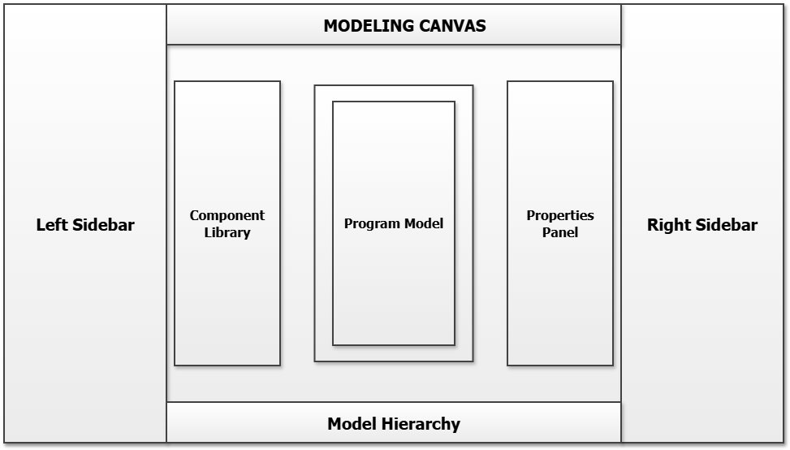
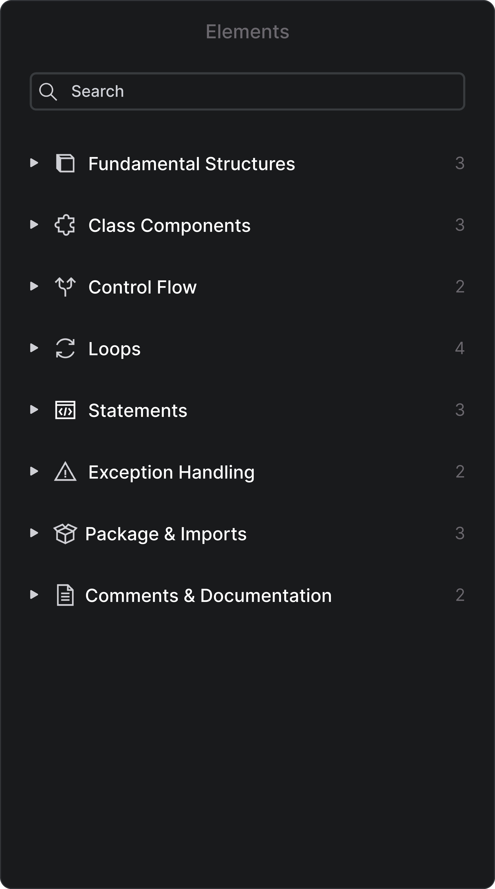
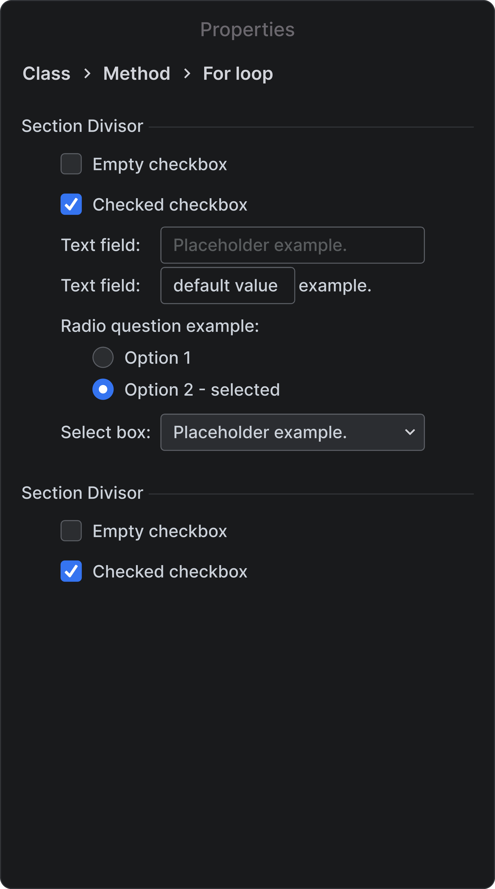
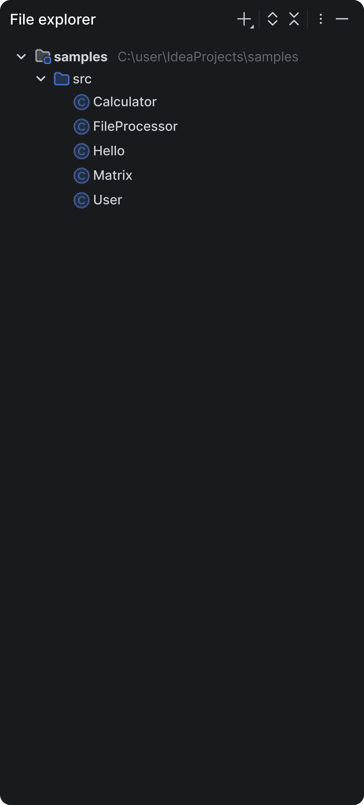
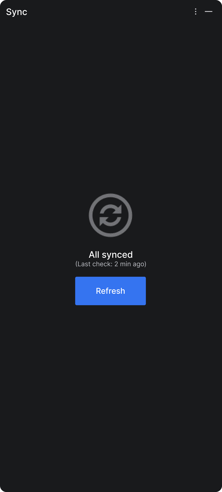
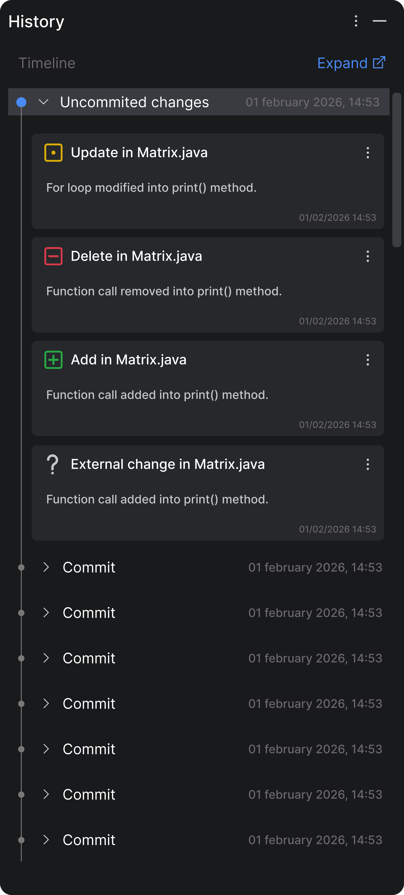
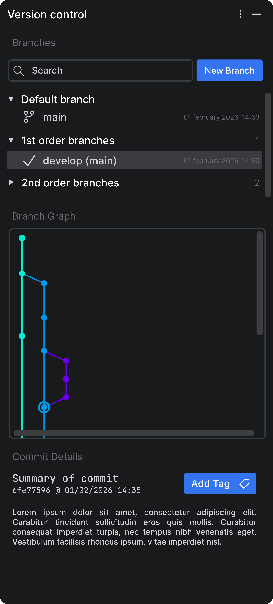
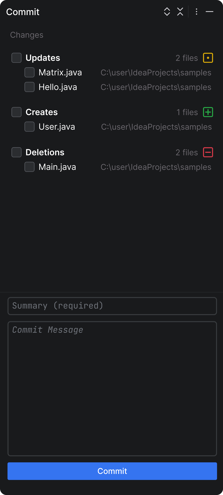
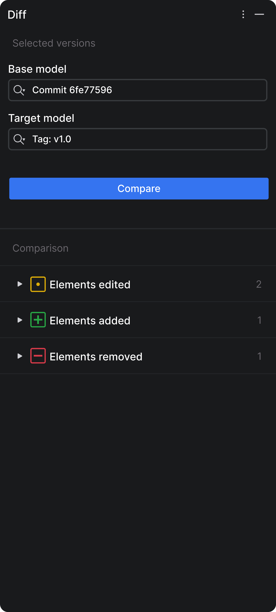

# `Lusiad` – Prototyping

**🇺🇸 English** · [🇧🇷 Português (Brasil)](../pt-BR/prototipacao.md)

Lusiad’s Figma prototype explored how a developer could move between editing a Java model and inspecting its history while keeping the relevant code in view. Designing these interactions before implementation helped establish which controls belonged beside the selected element and which needed more room. [Open the original Figma design](https://www.figma.com/design/kvy60Xjw35jHCevN5oPrJr/MBP-Java-Tool).

### On this page

> [1. Workspace layout](#-1-workspace-layout) 
> [2. Modeling panels](#-2-modeling-panels) 
> [3. Sidebar tools](#-3-sidebar-tools) 
> [4. Prototype walkthrough](#-4-prototype-walkthrough) 
> [Documentation index](#documentation-index)

---

## ✏️ 1. Workspace layout

The layout draws on Visual Studio Code and IntelliJ IDEA. Independent, collapsible panels surround a central modeling canvas, so the developer can open the tools needed for a task and give that space back to the model when finished.

The outer sidebars serve the whole project. The left sidebar provides access to files and synchronization, while the right sidebar brings together history and version control. Inside the canvas, the component library and properties panel flank the program model. A bar below the canvas shows the path to the open file.

## 🧩 2. Modeling panels

The two canvas panels support different moments in an edit. To add a block, the developer opens **Elements**, searches the library or browses categories such as *Loops* and *Control Flow*, and chooses a component to insert. Selecting a block already on the canvas gives **Properties** its context. Its breadcrumb locates the selection within the program, and the controls below expose the attributes available for editing.

| Elements · Component library | Properties · Selected element |
| :---: | :---: |
|  |  |

## 🗂️ 3. Sidebar tools

### Left sidebar

**File explorer** shows the project tree. In the example, expanding `samples/src` reveals classes including `Calculator` and `Matrix`. **Sync** addresses a different task by checking whether files have changed outside Lusiad. Its status shows when the last check took place and offers a way to refresh it.

| File explorer | Sync |
| :---: | :---: |
|  |  |

### Right sidebar

**History** follows individual operations. The timeline groups pending changes above earlier commits, with a card identifying the file and action for each entry. **Version control** places a commit in the wider project history. Its branch list and graph show where development paths diverge, and selecting a commit exposes its details and the option to add a tag.

| History | Version control |
| :---: | :---: |
|  |  |

**Commit** supports reviewing changes before recording a version. The mockup groups affected files by operation and provides fields for a summary and message. **Diff** starts with two existing versions. In the example, the base is commit `6fe77596` and the target is tag `v1.0`. The comparison groups elements by whether they were edited, added, or removed.

| Commit | Diff |
| :---: | :---: |
|  |  |

## 🖥️ 4. Prototype walkthrough

### Editing a call in `Matrix.java`

The file explorer stays open while the canvas displays `Matrix.print()`. The orange outline selects the call to `System.out.print` inside two nested loops. A floating toolbar places actions beside the selected block. In **Properties**, the breadcrumb follows the class, method, and loops down to the call, whose receiver, method name, and arguments can be edited separately. The bar at the bottom shows the file path.

### Reading the timeline alongside the model

Here the canvas shows `Calculator.java`, while **History** lists pending changes in `Matrix.java`. Keeping both visible illustrates the scope of the timeline. The developer can inspect activity elsewhere in the project while viewing the current file.

### Inspecting a change within a commit

Expanding **History** gives the lower half of the workspace to the selected commit. The horizontal sequence shows its individual operations. Selecting the middle operation displays its description in **Change Details** and highlights the affected method call in the model above. **Branch Graph** locates the version among the branches, **Commit Graph** marks the operation within the commit, and **Commit Details** shows the identifier, date, time, and message.

For the corresponding screens in the running application, see the [user guide](manual.md).

---

<table width="100%">
<tr>
<td align="left"><a href="requirements.md">⬅️ Previous page</a> | Requirements</td>
<td align="center"><a href="index.md">8️⃣ Prototyping</a></td>
<td align="right">Implementation | <a href="implementation.md">Next page ➡️</a></td>
</tr>
</table>

### Documentation index

**[📖 Overview](../../README.md)**

- [🖥️ User guide](manual.md)
- [🎬 Demo](demo.md)

**[⚙️ Installation](setup.md)**

- [🔧 Installation guide](installation.md)
- [🚀 First steps](first-steps.md)

**[📐 Project](project.md)**

- [📋 Requirements](requirements.md)
- [✏️ Prototyping](prototyping.md) 👈

**[💻 Implementation](implementation.md)**

- [🏗️ Architecture](architecture.md)
- [🔍 Notable implementation elements](notable-implementation-elements.md)
