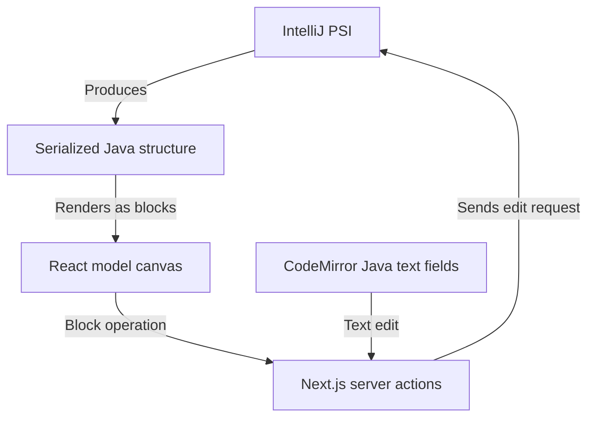
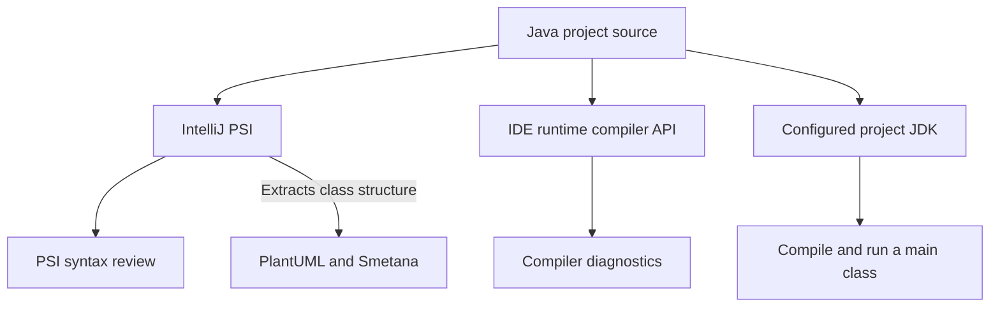
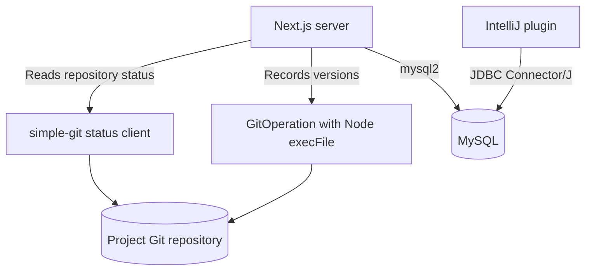

# `Lusiad` – Technology stack

**🇺🇸 English** · [🇧🇷 Português (Brasil)](../pt-BR/tecnologias-utilizadas.md)

Lusiad combines a Next.js web application with an IntelliJ IDEA plugin. The browser renders the modeling workspace, and the Next.js server handles integration with the plugin, Git, and MySQL. In the IDE, the plugin uses IntelliJ’s Java APIs to read and update source files. The versions below come from the repository’s manifests and lockfile. The [installation guide](installation.md) lists the environment required to run the application.

### On this page

> [1. Runtime and build versions](#runtime-and-build-versions)<br>
> [2. Web interface](#web-interface)<br>
> [3. IntelliJ plugin and Java tooling](#intellij-plugin-and-java-tooling)<br>
> [4. Git and MySQL](#git-and-mysql)<br>
> [5. Build, packaging, and verification](#build-packaging-and-verification)<br>
> [6. Documentation tools](#documentation-tools)<br>
> [Documentation index](#documentation-index)

---

## Runtime and build versions

| Technology | Version or constraint | Role in Lusiad |
| --- | --- | --- |
| Node.js | `>=24.12.0` in `engines` | Runs the Next.js server, launch scripts, and TypeScript tests. [Frontend manifest](../../lusiad-frontend/package.json) |
| Yarn Classic | `1.22.22` | Package manager declared for the frontend. [Frontend manifest](../../lusiad-frontend/package.json) |
| Next.js | `16.2.0` | App Router pages, server actions, and HTTP route handlers. [Frontend lockfile](../../lusiad-frontend/yarn.lock) |
| React and React DOM | `19.2.4` | Components and state for the modeling and history workspace. [Frontend lockfile](../../lusiad-frontend/yarn.lock) |
| TypeScript | `5.7.3` | Type checking for frontend and server modules and shared contracts. [TypeScript configuration](../../lusiad-frontend/tsconfig.json) |
| Java and IntelliJ IDEA | Java `21` source and bytecode target. IDEA `2025.2.4` as the Gradle target. | Compiles and runs the Java plugin against the IntelliJ Platform and its bundled Java plugin. [Plugin build](../../lusiad-backend/build.gradle.kts) |
| Gradle and IntelliJ Platform Gradle Plugin | Gradle Wrapper `9.0.0` and platform plugin `2.10.2` | Resolve dependencies, run tests, and package the installable plugin. [Wrapper](../../lusiad-backend/gradle/wrapper/gradle-wrapper.properties) · [Plugin build](../../lusiad-backend/build.gradle.kts) |
| MySQL Server | `8.0` in the installation guide. `8.0.44` in the checked-in schema export. | Stores project, branch, and commit records and the change history. [Schema](../../lusiad-backend/db/lusiad.sql) |
| Git | System executable | Maintains the versioned file trees for each project. [Git command wrapper](../../lusiad-frontend/src/lib/services/commit-menu/git-operation.ts) |

The manifest distinguishes exact dependency pins from version ranges. For example, it declares Tailwind CSS as `^4.2.0` and `react-resizable-panels` as `^2.1.7`. The lockfile resolves them to `4.2.2` and `2.1.9`, respectively. The Java 21 target applies to the plugin build. The Java release for diagnostics and the JDK for execution are part of that project’s configuration. [Frontend manifest](../../lusiad-frontend/package.json) · [Frontend lockfile](../../lusiad-frontend/yarn.lock) · [Project Java settings](../../lusiad-backend/src/main/java/com/lusiad/backend/service/project/ProjectJavaSettings.java)

## Web interface

Next.js serves pages and runs the TypeScript code that needs access to local services. React client components manage selection, drag-and-drop, panel visibility, and previews in the browser. The project route loads the registered project and initial file tree on the server. It then passes the data to `ProjectWorkspace`, which composes the interactive editor. [Project route](../../lusiad-frontend/src/app/project/%5BprojectId%5D/page.tsx) · [Project workspace](../../lusiad-frontend/src/components/project-workspace.tsx)

| Technology | Where it appears |
| --- | --- |
| Tailwind CSS `4.2.2` and PostCSS integration | `postcss.config.mjs` loads `@tailwindcss/postcss`. The app stylesheet imports Tailwind and defines the CSS variables used by themes and change indicators. [PostCSS configuration](../../lusiad-frontend/postcss.config.mjs) · [Global styles](../../lusiad-frontend/src/app/globals.css) |
| shadcn/ui conventions and Radix UI primitives | The repository keeps its reusable components in `src/components/ui/`. For example, `dialog.tsx` wraps `@radix-ui/react-dialog` `1.1.15` to apply the application’s styles. [Component configuration](../../lusiad-frontend/components.json) · [Dialog wrapper](../../lusiad-frontend/src/components/ui/dialog.tsx) |
| Lucide React `0.564.0` and React Resizable Panels `2.1.9` | Icons identify controls, and resizable panel primitives supply the group, pane, and drag handle for adjustable layouts. [Editor icons](../../lusiad-frontend/src/components/panels/model-editor/model-editor.tsx) · [Resizable wrappers](../../lusiad-frontend/src/components/ui/resizable.tsx) |
| CodeMirror 6 and the React wrapper `@uiw/react-codemirror` `4.25.9` | Text editing surfaces, including the code fields in the creation dialog and properties panel. Those fields load `@codemirror/lang-java` `6.0.2` for Java highlighting. [Creation dialog](../../lusiad-frontend/src/components/panels/model-editor/component-creation-dialog.tsx) · [Properties panel](../../lusiad-frontend/src/components/panels/model-editor/properties-panel.tsx) |
| `next-themes` `0.4.6` | Exposes the active light or dark theme. The shared code editor applies that theme to the mounted CodeMirror instance, preserving the draft when the theme changes. [Editor wrapper](../../lusiad-frontend/src/components/themed-code-editor.tsx) |

The modeling canvas uses React and Lusiad’s own rendering of serialized PSI nodes. CodeMirror edits text in the dialogs and property fields around the canvas. Both surfaces can initiate an edit, which goes through the server and is applied by the plugin. In this arrangement, CodeMirror supplies text-editing behavior and IntelliJ supplies the Java structure that the canvas displays. [Model canvas](../../lusiad-frontend/src/components/panels/model-editor/model-canvas.tsx) · [Model editor interactions](../../lusiad-frontend/src/components/panels/model-editor/model-editor.interactions.ts) · [PSI service](../../lusiad-backend/src/main/java/com/lusiad/backend/service/psi/PsiService.java)



The wrapper below shows where the web stack meets the editor library. It passes the active theme as a property, so a theme switch can update the existing editor instance. [`themed-code-editor.tsx`](../../lusiad-frontend/src/components/themed-code-editor.tsx#L7-L14)

```tsx
const subscribe = () => () => {}
/** Theme reconfiguration preserves the existing editor/draft; it never keys/remounts on theme. */
export function ThemedCodeEditor(props: ComponentProps<typeof CodeMirror>) {
  const { resolvedTheme } = useTheme()
  const hydrated = useSyncExternalStore(subscribe, () => true, () => false)
  const mode = hydrated && resolvedTheme === 'dark' ? 'dark' : 'light'
  return <CodeMirror {...props} theme={mode} data-color-mode={mode} />
}
```

## IntelliJ plugin and Java tooling

| Technology | Where it appears |
| --- | --- |
| IntelliJ Platform and Java PSI | The plugin declares the platform and Java modules. It reads Java PSI inside a read action and uses IntelliJ documents, write commands, and the Virtual File System to persist edits. [Plugin descriptor](../../lusiad-backend/src/main/resources/META-INF/plugin.xml) · [PSI service](../../lusiad-backend/src/main/java/com/lusiad/backend/service/psi/PsiService.java) · [Edit persistence](../../lusiad-backend/src/main/java/com/lusiad/backend/service/psi/PsiEditPersistence.java) |
| Swing and IntelliJ tool windows | The native Lusiad panel provides settings and service controls. Its factory registers the panel’s Swing content with the IntelliJ tool window. [Tool-window factory](../../lusiad-backend/src/main/java/com/lusiad/MyToolWindowFactory.java) · [Native panel](../../lusiad-backend/src/main/java/com/lusiad/toolwindow/LusiadToolWindowPanel.java) |
| JDK HTTP server and Gson | The plugin exposes HTTP on loopback using `com.sun.net.httpserver.HttpServer`. Gson encodes and decodes JSON for its routes, including PSI structures. [HTTP server](../../lusiad-backend/src/main/java/com/lusiad/backend/HttpServer.java) · [JSON handling](../../lusiad-backend/src/main/java/com/lusiad/backend/handler/ApiJson.java) |
| google-java-format `1.17.0` | Formats edited Java text as part of the PSI edit path. The Gradle build sets the JDK module exports used by the formatter for development IDE runs and tests. [Formatting in the PSI service](../../lusiad-backend/src/main/java/com/lusiad/backend/service/psi/PsiService.java#L677-L687) · [Plugin build](../../lusiad-backend/build.gradle.kts) |
| JDK compiler API and JDK tools | Compiler diagnostics use the IDE process’s `javax.tools.JavaCompiler` and the project’s configured release and dependency paths. The run service starts the project’s configured `javac` and `java` executables as subprocesses. [Compiler diagnostics](../../lusiad-backend/src/main/java/com/lusiad/backend/service/diagnostics/JavaCompilerDiagnostics.java) · [Run service](../../lusiad-backend/src/main/java/com/lusiad/backend/service/run/JavaRunService.java) |
| PlantUML MIT `1.2026.8` with Smetana | The plugin extracts UML structure from Java PSI, generates PlantUML source, and renders SVG using Smetana for layout. The comparison UI displays the returned SVG as an image. [Structure extraction](../../lusiad-backend/src/main/java/com/lusiad/backend/service/uml/UmlStructure.java) · [Diagram source](../../lusiad-backend/src/main/java/com/lusiad/backend/service/uml/UmlDiagram.java) · [SVG renderer](../../lusiad-backend/src/main/java/com/lusiad/backend/service/uml/PlantUmlRenderer.java) · [UML preview](../../lusiad-frontend/src/components/panels/model-editor/change-uml-preview.tsx) |

PSI syntax review, compiler diagnostics, Java execution, and UML each use the source in a different way. Syntax review uses IntelliJ’s Java parser. Compiler diagnostics parse and analyze source with `javac` in the IDE process. Running Java compiles and launches the program with the tools from the configured project JDK. UML uses the declared classes, members, and relationships extracted by the plugin. [PSI syntax checks](../../lusiad-backend/src/main/java/com/lusiad/backend/service/psi/SyntaxDiagnostics.java) · [Compiler diagnostics](../../lusiad-backend/src/main/java/com/lusiad/backend/service/diagnostics/JavaCompilerDiagnostics.java) · [Java execution](../../lusiad-backend/src/main/java/com/lusiad/backend/service/run/JavaRunService.java) · [UML service](../../lusiad-backend/src/main/java/com/lusiad/backend/service/uml/UmlService.java)



`RuntimeJavaCompiler` looks up the compiler through `ToolProvider` and falls back to the provider in the `jdk.compiler` module if IntelliJ’s class loader hides it. This code runs inside the plugin when obtaining a compiler for diagnostics. [`RuntimeJavaCompiler.java`](../../lusiad-backend/src/main/java/com/lusiad/backend/service/diagnostics/RuntimeJavaCompiler.java#L10-L16)

```java
public static JavaCompiler get() {
    JavaCompiler compiler = ToolProvider.getSystemJavaCompiler();
    if (compiler != null) return compiler;
    return ServiceLoader.load(ModuleLayer.boot(), JavaCompiler.class).stream()
            .filter(provider -> "jdk.compiler".equals(provider.type().getModule().getName()))
            .findFirst().map(ServiceLoader.Provider::get).orElse(null);
}
```

## Git and MySQL

| Technology | Responsibility |
| --- | --- |
| Git and `simple-git` `3.36.0` | Git stores snapshots and branch references in the project repository. Next.js uses `simple-git` for operations such as status. For version recording, `GitOperation` invokes the Git executable through Node’s `execFile` and controls how a prepared commit is published. [Git client](../../lusiad-frontend/src/lib/config/test-git.ts) · [Commit menu service](../../lusiad-frontend/src/lib/services/commit-menu/commit-menu.service.ts) · [Git command wrapper](../../lusiad-frontend/src/lib/services/commit-menu/git-operation.ts) |
| `mysql2` `3.22.3` | The Next.js repositories use the promise-based client and a connection pool. The pool is created by a server-only module. [Connection pool](../../lusiad-frontend/src/lib/repositories/database.ts) |
| MySQL Connector/J `8.4.0` | The plugin uses JDBC to resolve projects, record changes, and load replay data. The version is that of the Java driver. The MySQL server baseline is `8.0`. [Plugin build](../../lusiad-backend/build.gradle.kts) · [JDBC connections](../../lusiad-backend/src/main/java/com/lusiad/backend/repository/sql/SqlConnectionFactory.java) |
| MySQL InnoDB tables | The checked-in schema stores project and branch identities, change events, and their associations with Git commits. Git commit IDs connect these records to the versioned file trees. [SQL schema](../../lusiad-backend/db/lusiad.sql) · [Git recording service](../../lusiad-frontend/src/lib/services/commit-menu/git-recording.service.ts) |

Git also supplies the baseline tree used in historical previews. The archive service invokes `git archive` and, when starting from an archived commit, extracts that tree with the `tar` executable. It then uses the recorded MySQL events and the plugin’s replay service to reconstruct the selected states. [Archive preparation](../../lusiad-frontend/src/lib/services/restore/change-archive.service.ts) · [Historical replay](../../lusiad-backend/src/main/java/com/lusiad/backend/service/restore/HistoricalReplay.java)



## Build, packaging, and verification

The frontend has a separate production build and a script that starts the Next.js CLI with Lusiad’s configured host and port. The development and production launch commands go through `scripts/start-next.mjs`. The `verify` script checks TypeScript, runs ESLint `9.39.5`, runs the TypeScript tests through Node’s built-in test runner, and produces a Next.js build in that order. The lockfile records the frontend dependency resolutions used by the installation. [Frontend manifest](../../lusiad-frontend/package.json) · [Launch script](../../lusiad-frontend/scripts/start-next.mjs) · [ESLint configuration](../../lusiad-frontend/eslint.config.mjs) · [Frontend tests](../../lusiad-frontend/tests)

The IntelliJ plugin is a separate build. Its Gradle scripts are written in Kotlin DSL and declare the Kotlin JVM plugin `2.1.20`. The plugin implementation in `src/main/java/` is Java. Gradle’s `buildPlugin` task packages the plugin ZIP, including the descriptor and resource bundles. Tests use JUnit `4.13.2` and the IntelliJ Platform test framework. Database-backed frontend scripts and Java integration tests cover paths that use MySQL, including Git recording and edit persistence. The test lab can start a disposable MySQL process using the separate test schema. [Plugin build](../../lusiad-backend/build.gradle.kts) · [Plugin tests](../../lusiad-backend/src/test/java/com/lusiad) · [Git recording integration test](../../lusiad-frontend/scripts/test-git-recording.mjs) · [Test lab script](../../lusiad-frontend/scripts/lusiad-test-lab.mjs) · [Test schema](../../lusiad-backend/db/migrations/lusiad-test-schema.sql)

| Run from | Command | Coverage |
| --- | --- | --- |
| `lusiad-frontend/` | `yarn verify` | TypeScript, ESLint, unit and regression tests, and a production build. |
| `lusiad-frontend/` | `yarn test:git:db` | Git recording and external synchronization using a disposable MySQL instance. |
| `lusiad-frontend/` | `yarn test:tags:db` | History tags using a disposable MySQL instance. |
| `lusiad-backend/` | `.\gradlew.bat test` | Java and IntelliJ Platform tests. |
| `lusiad-backend/` | `.\gradlew.bat verifyPlugin` | Plugin compatibility checks through the IntelliJ Plugin Verifier. |

Both frontend database checks look for `mysqld` on the PATH by default. Set `LUSIAD_MYSQLD` to the executable path if MySQL is installed elsewhere. [Git recording checks](../../lusiad-frontend/scripts/test-git-recording.mjs) · [History tag checks](../../lusiad-frontend/scripts/test-history-tags.mjs)

## Documentation tools

The documentation is versioned as Markdown in English and Brazilian Portuguese. Its Mermaid diagrams describe source relationships and execution flows in the repository. The application’s UML previews are generated at runtime by PlantUML from Java source. [Documentation tree](directory-structure.md) · [Application UML service](../../lusiad-backend/src/main/java/com/lusiad/backend/service/uml/UmlService.java)

---

<table width="100%">
<tr>
<td align="left"><a href="directory-structure.md">⬅️ Previous page</a></td>
<td align="center"><a href="../../README.md#documentation-index">1️⃣1️⃣ Technology stack</a></td>
<td align="right"><a href="data-model.md">Next page ➡️</a></td>
</tr>
</table>

### Documentation index

**[📖 Overview](../../README.md)**

- [🖥️ User guide](manual.md)

**[⚙️ Installation](setup.md)**

- [🔧 Installation guide](installation.md)
- [🚀 First steps](first-steps.md)

**[📐 Project](project.md)**

- [📋 Requirements](requirements.md)
- [✏️ Prototyping](prototyping.md)

**[💻 Implementation](implementation.md)**

- [🏗️ Architecture](architecture.md)
- [📂 Directory structure](directory-structure.md)
- [🧰 Technology stack](technology-stack.md) 👈
- [🗃️ Data model](data-model.md)
- [🔌 API reference](api-reference.md)
- [🔀 Interaction diagrams](interaction-diagrams.md)
- [🧭 Design decisions](design-decisions.md)
- [🔍 Notable implementation elements](notable-implementation-elements.md)

**[📊 Evaluation](evaluation.md)**

- [📋 Planning](evaluation-planning.md)
- [🧪 Execution](evaluation-execution.md)
- [📈 Results](evaluation-results.md)
- [💬 Discussion](evaluation-discussion.md)
- [📂 Materials and data](evaluation-data.md)
- [🗂️ Evaluation files](../zenodo/)
