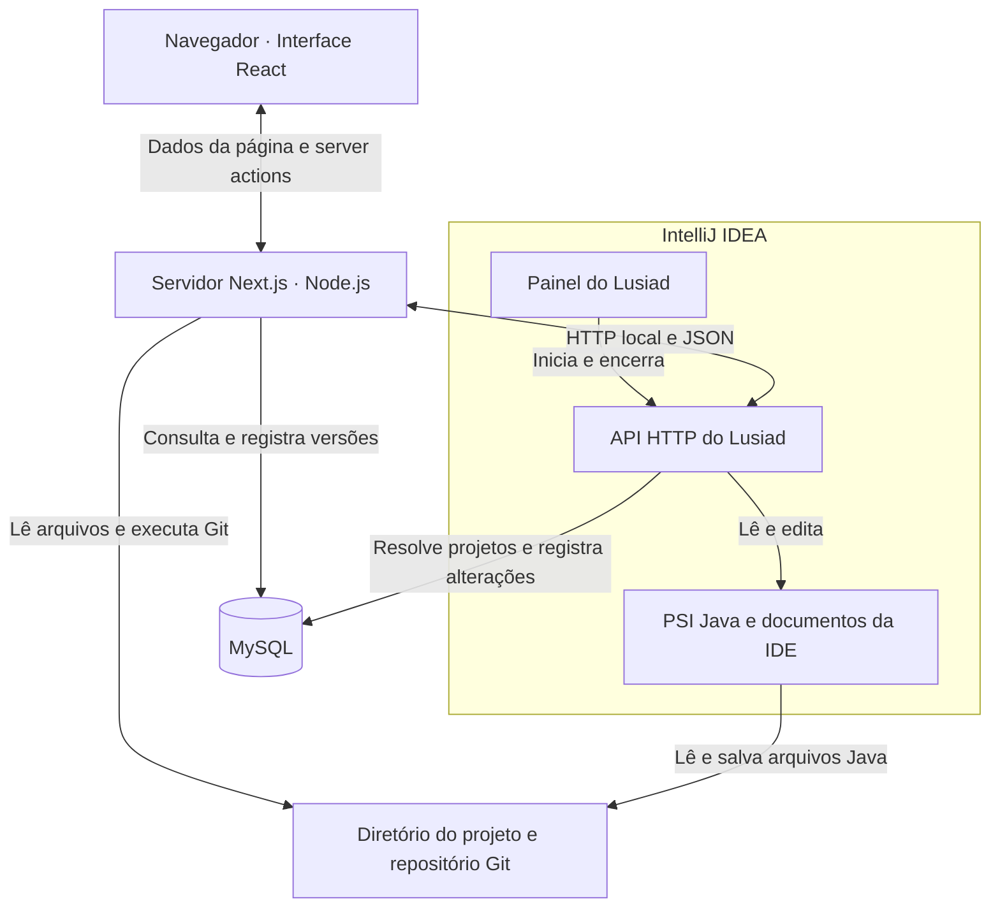
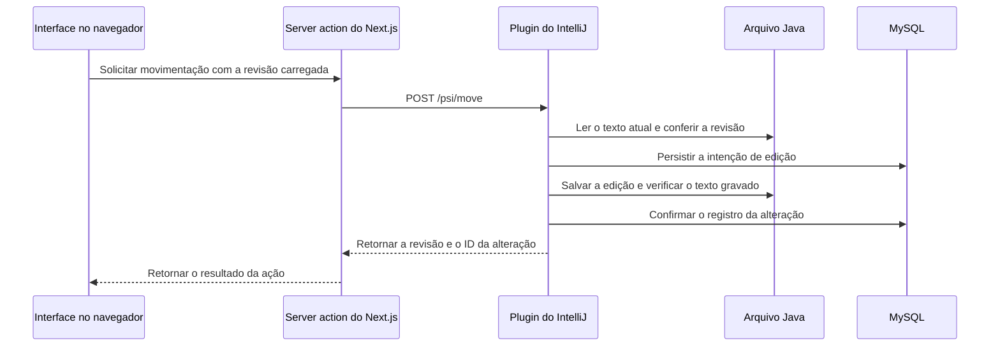
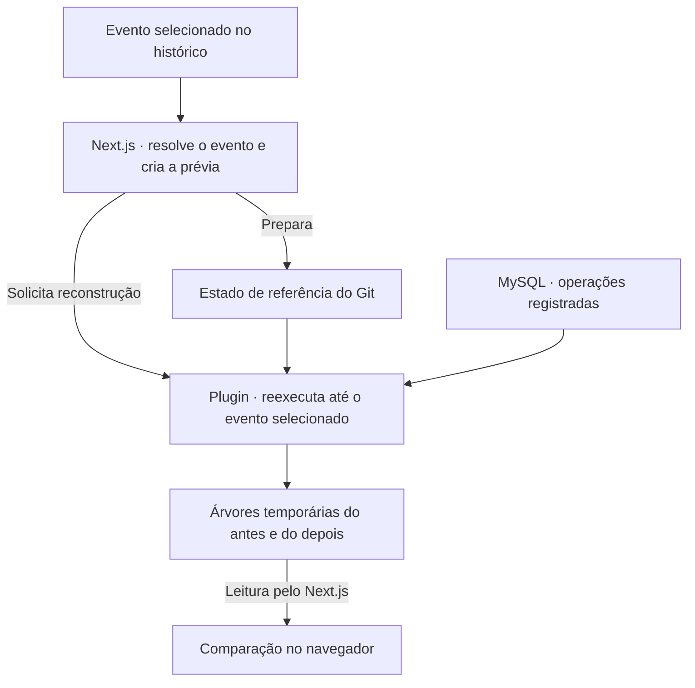

# `Lusiad` – Arquitetura

[🇺🇸 English](../en/architecture.md) · **🇧🇷 Português (Brasil)**

### Nesta página

> [1. Componentes em execução](#componentes-em-execução)<br>
> [2. Organização do frontend](#organização-do-frontend)<br>
> [3. Plugin do IntelliJ e API local](#plugin-do-intellij-e-api-local)<br>
> [4. Do arquivo Java à alteração registrada](#do-arquivo-java-à-alteração-registrada)<br>
> [5. Git, MySQL e prévias do histórico](#git-mysql-e-prévias-do-histórico)<br>
> [6. Leitura da figura do artigo](#leitura-da-figura-do-artigo)<br>
> [Índice da documentação](#índice-da-documentação)

---

<a name="componentes"></a>

## Componentes em execução

O Lusiad implementa a arquitetura cliente–servidor proposta na decisão de projeto DD2. O plugin do IntelliJ expõe as operações que exigem acesso à IDE e à PSI (Program Structure Interface) de Java. A aplicação Next.js apresenta o ambiente de modelagem e o histórico de alterações. Dentro dessa aplicação, o React trata as interações no navegador, e o servidor Next.js coordena o acesso ao plugin, ao Git, ao sistema de arquivos e ao MySQL. Na DD2, o Next.js é o cliente do plugin. Do ponto de vista do navegador, é o servidor web.



| Contexto de execução | Responsabilidade | Ponto de entrada |
| --- | --- | --- |
| Navegador | Exibe o explorador de arquivos, a área de modelagem, as propriedades e o histórico. Captura seleções e interações de arrastar e soltar. | [`ProjectWorkspace`](../../lusiad-frontend/src/components/project-workspace.tsx) |
| Servidor Next.js | Carrega o ambiente de trabalho, executa server actions, faz a intermediação com a API do plugin e coordena Git e SQL. | [`src/app`](../../lusiad-frontend/src/app) e [`src/controllers`](../../lusiad-frontend/src/controllers) |
| Plugin do IntelliJ | Hospeda a API local e o painel nativo. Localiza arquivos, gera a representação PSI, aplica edições e reexecuta alterações registradas para gerar prévias. | [`plugin.xml`](../../lusiad-backend/src/main/resources/META-INF/plugin.xml) e [`HttpServer.java`](../../lusiad-backend/src/main/java/com/lusiad/backend/HttpServer.java) |

Os dois componentes do lado servidor trabalham sobre o mesmo projeto cadastrado. Eles usam o diretório de trabalho para os arquivos em edição e um diretório temporário separado para as prévias do histórico. O servidor Next.js executa comandos Git no repositório do projeto. O plugin lê e salva fontes Java por meio dos arquivos virtuais, documentos e PSI do IntelliJ. Ambos se conectam ao MySQL, onde o cadastro do projeto vincula esses recursos aos registros do histórico.

## Organização do frontend

A página do App Router em `/project/[projectId]` roda no servidor Next.js. Ela interpreta o parâmetro da rota, carrega o cadastro com `findProjectById` e monta a árvore inicial do explorador com `loadFileTree`. Essa árvore vem da enumeração de arquivos em `directory-tree.ts`, que usa `node:fs/promises`. Selecionar um arquivo Java dispara uma segunda requisição, desta vez para obter sua árvore PSI. A página passa os dados do projeto e a árvore inicial ao componente cliente `ProjectWorkspace`. [Rota do projeto](../../lusiad-frontend/src/app/project/%5BprojectId%5D/page.tsx) · [Árvore de diretórios](../../lusiad-frontend/src/lib/services/file-explorer/directory-tree.ts)

| Diretório | Papel na implementação |
| --- | --- |
| [`src/app`](../../lusiad-frontend/src/app) | Pontos de entrada das páginas e rotas HTTP para recursos como configurações, presença no projeto, diagnósticos Java, execução e desfazer. |
| [`src/components`](../../lusiad-frontend/src/components) | Painéis React, estado do ambiente de trabalho e módulos de interação como `model-editor.interactions.ts`, que reúne os parâmetros das edições e atualiza a interface. |
| [`src/controllers`](../../lusiad-frontend/src/controllers) | Server actions para operações como carregar um modelo, mover um intervalo e criar um commit. Validam entradas e delegam a features ou diretamente a serviços do servidor, conforme a operação. |
| [`src/features`](../../lusiad-frontend/src/features) | Funções que implementam os casos de uso. No editor, delegam operações de PSI ao serviço de API e normalizam o resultado devolvido ao controlador. |
| [`src/lib/models`](../../lusiad-frontend/src/lib/models) | Dados e funções para interpretar a árvore do modelo, tratar seleções e destinos de arraste e navegar pelo histórico. |
| [`src/lib/services`](../../lusiad-frontend/src/lib/services) | Integração com a API do plugin, sistema de arquivos, Git, sincronização e reconstrução histórica. |
| [`src/lib/repositories`](../../lusiad-frontend/src/lib/repositories) | Consultas MySQL de projetos, branches, commits, alterações e outros dados do histórico, com um pool de conexões `mysql2` no servidor. |

O carregamento de um modelo mostra a passagem entre navegador e servidor. O componente chama `loadModelController` e recebe um resultado serializável. A diretiva `"use server"` faz a ação executar no servidor Next.js, onde o controlador pode chamar `readModelFeature` e, por essa via, o cliente da API do plugin. [Controlador do editor](../../lusiad-frontend/src/controllers/model-editor/model-editor.controller.ts#L1-L13) · [Ação de carregamento do modelo](../../lusiad-frontend/src/controllers/model-editor/model-editor.controller.ts#L130-L136)

```typescript
export async function loadModelController(projectId: number, path: string): Promise<BackendActionResult<JavaModel>> {
  return backendAction(async () => {
    const trimmedPath = requireValidPath(path, "Selecione um arquivo no explorador")
    return readModelFeature(projectId, trimmedPath)
  })
}
```

## Plugin do IntelliJ e API local

O descritor do plugin registra o painel nativo **Lusiad** por meio de `MyToolWindowFactory`. O painel oferece controles da API e das configurações, mostra o estado da aplicação web e da conexão ao banco e permite abrir o ambiente web no navegador. `LusiadPluginService` gerencia o ciclo de vida da API. O editor de modelos e as visualizações do histórico ficam no ambiente web. [Descritor do plugin](../../lusiad-backend/src/main/resources/META-INF/plugin.xml) · [Painel nativo](../../lusiad-backend/src/main/java/com/lusiad/toolwindow/LusiadToolWindowPanel.java) · [Serviço do plugin](../../lusiad-backend/src/main/java/com/lusiad/toolwindow/LusiadPluginService.java)

A classe `HttpServer` cria um servidor HTTP do JDK vinculado a `127.0.0.1`. Os roteadores registram os grupos de endpoints de PSI, arquivos, gerenciamento de projetos, diagnósticos, execução de Java, desfazer, UML e restauração. O servidor Next.js envia as requisições JSON por seu cliente HTTP, que inclui o cabeçalho compartilhado `X-Lusiad-Token`. O navegador envia as ações do ambiente de trabalho ao Next.js. [Servidor HTTP](../../lusiad-backend/src/main/java/com/lusiad/backend/HttpServer.java) · [Acesso à API](../../lusiad-backend/src/main/java/com/lusiad/backend/config/LocalApiAccess.java) · [Transporte HTTP](../../lusiad-frontend/src/lib/services/backend-transport.ts)

| Camada do plugin | Exemplo na movimentação de um bloco |
| --- | --- |
| Roteador | [`PsiRouter`](../../lusiad-backend/src/main/java/com/lusiad/backend/router/psi/PsiRouter.java) registra `/psi/move`, aplica os controles de acesso e encaminha para `handleMove`. |
| Handler | [`PsiGenericHandlers.handleMove`](../../lusiad-backend/src/main/java/com/lusiad/backend/handler/psi/PsiGenericHandlers.java#L182-L195) exige POST, interpreta o corpo da requisição, resolve o projeto cadastrado e valida o caminho em relação à raiz do projeto. |
| Serviço | [`PsiService`](../../lusiad-backend/src/main/java/com/lusiad/backend/service/psi/PsiService.java) calcula e aplica a alteração com as APIs Java e de documentos do IntelliJ. [`EditCoordinator`](../../lusiad-backend/src/main/java/com/lusiad/backend/service/psi/EditCoordinator.java) coordena o salvamento e o registro da operação. |
| Repositório | [`EditOperationStore`](../../lusiad-backend/src/main/java/com/lusiad/backend/repository/change/EditOperationStore.java) persiste a intenção de edição e confirma o evento no MySQL via JDBC. |

O roteador verifica o acesso antes de encaminhar a requisição. [`PsiRouter`](../../lusiad-backend/src/main/java/com/lusiad/backend/router/psi/PsiRouter.java#L48-L51)

```java
server.createContext("/psi/move", exchange -> {
    if (handleCors(exchange)) return;
    PsiGenericHandlers.handleMove(project, exchange);
});
```

<a name="fluxo-de-uma-alteração"></a>

## Do arquivo Java à alteração registrada

Na leitura do arquivo em edição, o serviço `readPsiModel` resolve o projeto e solicita ao plugin que reconcilie edições PSI pendentes antes de chamar `POST /psi/read`. O plugin sincroniza o arquivo com o disco e inicia uma ação de leitura. Em seguida, serializa a PSI Java como uma árvore com tipos de nó, posições no código e texto das folhas. A resposta também contém `revision`, um hash SHA-256 do texto do documento. O React usa a árvore para renderizar os blocos, e a revisão identifica a versão do código da qual foram obtidos os offsets desses blocos. [Serviço da API PSI](../../lusiad-frontend/src/lib/services/model-editor/psi-api.service.ts) · [Leitura e serialização da PSI](../../lusiad-backend/src/main/java/com/lusiad/backend/service/psi/PsiService.java)

Quando o usuário move um bloco dentro de um arquivo Java, a interação do editor transmite o intervalo de origem, a linha e a coluna opcional do destino e a revisão do modelo carregado como `expectedHash`. O controlador delega a `moveRangeFeature`, cujo serviço de API envia `POST /psi/move`. O plugin calcula a edição proposta, confere a revisão e rejeita os offsets desatualizados caso o texto do arquivo tenha mudado. [Interações do editor](../../lusiad-frontend/src/components/panels/model-editor/model-editor.interactions.ts#L576-L588) · [Feature do editor](../../lusiad-frontend/src/features/model-editor/model-editor.feature.ts)



A sequência mostra uma movimentação bem-sucedida que modifica o arquivo. `EditCoordinator` primeiro persiste uma intenção recuperável, depois aplica a edição preparada e confere o texto lido do disco antes de confirmar o evento. Uma operação que produz o mesmo texto termina antes de preparar a intenção. Se a confirmação for interrompida, a recuperação compara o arquivo com os estados preparados. Ela confirma o evento se o arquivo contém o estado posterior, cancela a intenção se contém o estado anterior ou relata um conflito se o conteúdo diverge dos dois. O salvamento do arquivo Java e a confirmação SQL ocorrem em mecanismos de armazenamento distintos. [Coordenação e recuperação de edições](../../lusiad-backend/src/main/java/com/lusiad/backend/service/psi/EditCoordinator.java#L40-L103)

## Git, MySQL e prévias do histórico

### Registro de uma versão

O Git armazena a árvore de arquivos de cada commit. O MySQL registra a identidade do projeto e das branches, os metadados dos commits, as alterações individuais e os vínculos usados para localizar uma alteração dentro de uma versão.

| Registro | O que identifica |
| --- | --- |
| `projects` e `branches` | O projeto cadastrado, seus caminhos e suas branches. |
| `commits` | Uma versão registrada. O campo `git_id` vincula o registro SQL ao commit no repositório do projeto. |
| `changes` | Os eventos individuais. Um evento com `commit_id` nulo fica pendente até ser associado a uma versão. |
| `commit_change_sets` | A associação entre o identificador do commit Git e as alterações incluídas na versão, com o contexto de projeto e branch. |
| `lusiad_edit_operations` e `lusiad_git_operations` | As intenções persistidas para reconciliar edições de arquivos e atualizações no Git com seus registros no banco. |

O menu de commit chama `commitChangesController` no servidor Next.js. O serviço de registro confere a branch selecionada e os eventos pendentes, prepara a árvore e o commit Git e grava a intenção antes de atualizar a referência Git. Em seguida, registra o commit e vincula os eventos capturados em uma transação SQL. Se a referência for atualizada e a confirmação SQL for interrompida, o plano salvo oferece ao serviço o estado Git e os identificadores dos eventos necessários para reconciliar a operação. O `simple-git` é usado em operações como a consulta de status. O fluxo de registro usa `GitOperation`, que chama o executável Git por meio de `execFile` do Node.js. [Esquema SQL](../../lusiad-backend/db/lusiad.sql) · [Controlador de commit](../../lusiad-frontend/src/controllers/commit-menu/commit-menu.controller.ts) · [Registro Git](../../lusiad-frontend/src/lib/services/commit-menu/git-recording.service.ts) · [Execução de comandos Git](../../lusiad-frontend/src/lib/services/commit-menu/git-operation.ts)

### Abertura do antes e do depois de um evento

A prévia do histórico precisa do estado imediatamente anterior e posterior a um evento, que pode estar entre dois commits. O Next.js consulta o contexto SQL do evento, cria um diretório para a requisição na raiz temporária do projeto e prepara um estado de referência a partir do Git. Para um evento versionado, a referência normalmente é o primeiro pai do commit registrado. Para um commit raiz, o serviço reconstrói o estado inicial a partir de sua árvore e dos eventos registrados. Para um evento pendente, usa o commit Git atual após verificá-lo. [Preparação do estado de referência](../../lusiad-frontend/src/lib/services/restore/change-archive.service.ts)



O `RestoreService` do plugin consulta as operações no MySQL e as encaminha a `HistoricalReplay`. A reexecução gera `working-copy-prev` e `working-copy` dentro do diretório da prévia, fora da árvore de trabalho do projeto. O Next.js verifica o contexto retornado e disponibiliza a prévia depois de ler as duas árvores. Ao abrir um arquivo Java da prévia, o Next.js manda o texto do snapshot a `/psi/parse` para o plugin montar a árvore PSI em memória a partir desse conteúdo. A página de [elementos notáveis da implementação](elementos-notaveis-da-implementacao.md) acompanha o registro de uma movimentação de método. [Preparação da prévia](../../lusiad-frontend/src/lib/services/restore/restore.service.ts) · [Serviço de reconstrução](../../lusiad-backend/src/main/java/com/lusiad/backend/service/restore/RestoreService.java) · [Leitura de snapshots](../../lusiad-frontend/src/lib/services/restore/snapshot-reader.ts)

<a name="onde-localizar-o-código"></a>

## Leitura da figura do artigo

A figura arquitetural do projeto de TCC mostra os componentes de interface e sua camada de interação, as camadas de roteamento e persistência da API Java e o banco de dados compartilhado.


| Rótulo ou relação da figura | Correspondência na implementação |
| --- | --- |
| `page.tsx` com o rótulo “Electron: Next.js” | A interface implementada é uma aplicação web Next.js com componentes React cliente executados no navegador. |
| Fronteira `Client [frontend]` | A figura agrupa React e Next.js. As server actions, as chamadas HTTP ao plugin, os comandos Git e o acesso ao banco rodam no processo servidor do Next.js. |
| `Feature.ts` instancia `Model.ts` | A feature de carregamento do modelo chama `readPsiModel` e retorna um `JavaModel` tipado. Os módulos em `src/lib/models` também incluem funções de navegação, apresentação e regras de edição. |
| `simple-git` e `fs-extra` | O frontend declara `simple-git`. As operações de arquivos descritas aqui usam `node:fs/promises`, e o registro de versões chama Git via `execFile`. [Dependências do frontend](../../lusiad-frontend/package.json) |
| MySQL conectado aos dois lados | O servidor Next.js usa `mysql2`, e o plugin usa JDBC. O repositório Git do projeto guarda os estados versionados dos arquivos. [Pool do Next.js](../../lusiad-frontend/src/lib/repositories/database.ts) · [Conexão do plugin](../../lusiad-backend/src/main/java/com/lusiad/backend/repository/sql/SqlConnectionFactory.java) |

---

<table width="100%">
<tr>
<td align="left"><a href="implementacao.md">⬅️ Página anterior</a></td>
<td align="center"><a href="../../README.pt-BR.md#índice-da-documentação">🔟 Arquitetura</a></td>
<td align="right"><a href="estrutura-de-diretorios.md">Próxima página ➡️</a></td>
</tr>
</table>

### Índice da documentação

**[📖 Visão geral](../../README.pt-BR.md)**

- [🖥️ Manual de uso](manual.md)
- [🎬 Demonstração](demonstracao.md)

**[⚙️ Instalação](preparacao.md)**

- [🔧 Guia de instalação](instalacao.md)
- [🚀 Primeiros passos](primeiros-passos.md)

**[📐 Projeto](projeto.md)**

- [📋 Requisitos](requisitos.md)
- [✏️ Prototipação](prototipacao.md)

**[💻 Implementação](implementacao.md)**

- [🏗️ Arquitetura](arquitetura.md) 👈
- [📂 Estrutura de diretórios](estrutura-de-diretorios.md)
- [🧰 Tecnologias utilizadas](tecnologias-utilizadas.md)
- [🗃️ Modelo de dados](modelo-de-dados.md)
- [🔌 Referência da API](referencia-da-api.md)
- [🔀 Diagramas de interação](diagramas-de-interacao.md)
- [🧭 Decisões de projeto](decisoes-de-projeto.md)
- [🔍 Elementos notáveis da implementação](elementos-notaveis-da-implementacao.md)

**[📊 Avaliação](avaliacao.md)**

- [📋 Planejamento](avaliacao-planejamento.md)
- [🧪 Execução](avaliacao-execucao.md)
- [📈 Resultados](avaliacao-resultados.md)
- [💬 Discussão](avaliacao-discussao.md)
- [📂 Materiais e dados](avaliacao-dados.md)
