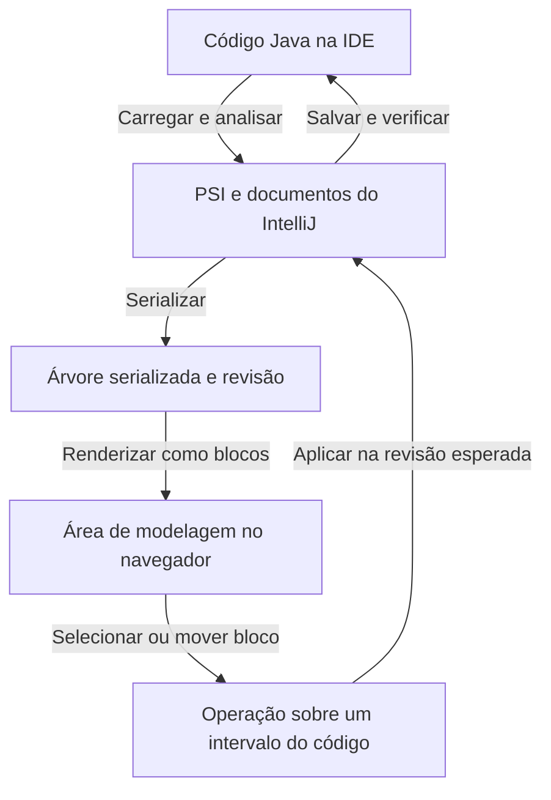
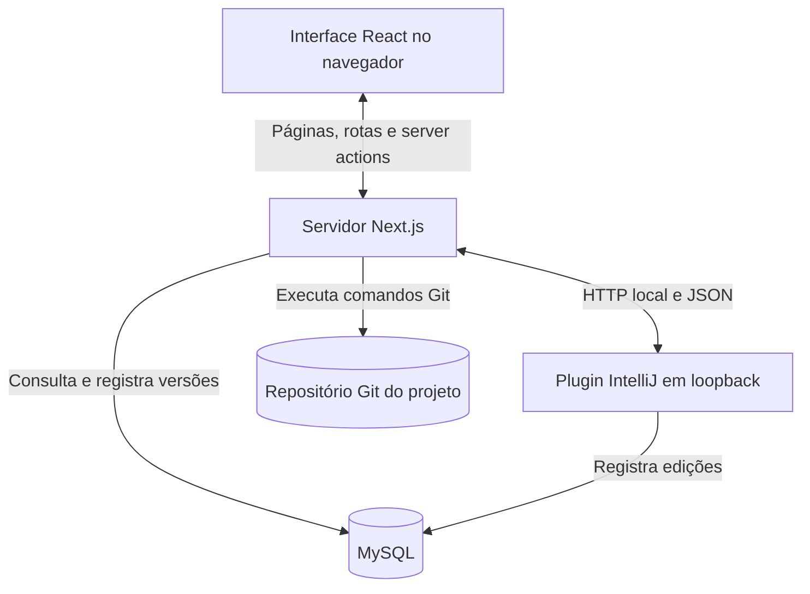
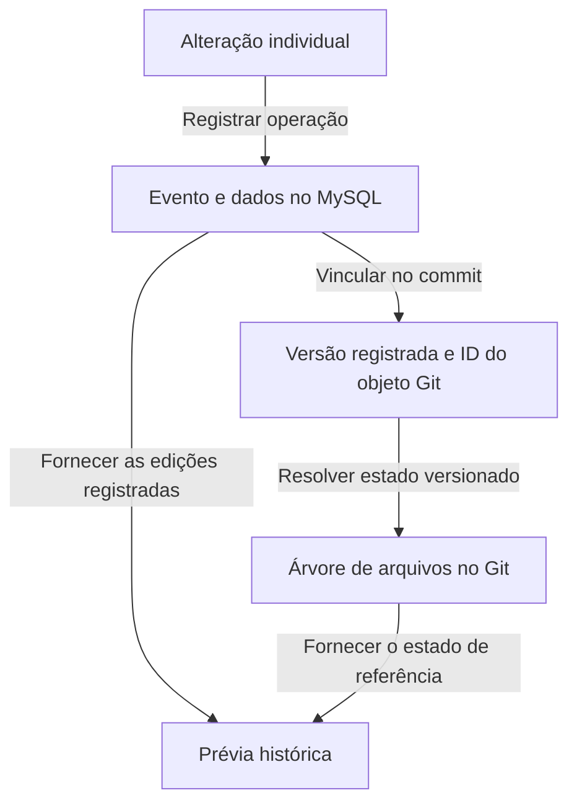

# `Lusiad` – Decisões de projeto

[🇺🇸 English](../en/design-decisions.md) · **🇧🇷 Português (Brasil)**

As seis decisões a seguir mantêm a numeração do artigo. Cada uma registra o motivo da escolha e mostra como ela aparece no sistema implementado. Os [requisitos](requisitos.md) descrevem as operações e os atributos de qualidade que orientaram o projeto.

### Nesta página

> [DD1. Plugin do IntelliJ IDEA como base do sistema](#dd1)<br>
> [DD2. Arquitetura cliente–servidor](#dd2)<br>
> [DD3. Linguagem do backend](#dd3)<br>
> [DD4. Linguagem do frontend](#dd4)<br>
> [DD5. Banco de dados](#dd5)<br>
> [DD6. Bibliotecas](#dd6)<br>
> [Índice da documentação](#índice-da-documentação)

<a name="dd1"></a>

## DD1. Plugin do IntelliJ IDEA como base do sistema

O Lusiad precisa exibir classes, métodos e instruções Java como blocos aninhados e permitir que o desenvolvedor os edite. O projeto usa a Program Structure Interface (PSI) do IntelliJ como metamodelo dessas operações. A PSI dá ao plugin acesso à representação sintática e semântica dos arquivos Java e associa os elementos a intervalos no código-fonte. O Lusiad usa o SDK de plugins para acessar essa estrutura e as APIs de documentos e arquivos da IDE. Essa decisão fundamenta os requisitos de visualização e edição US02–US05. [Documentação da PSI](https://plugins.jetbrains.com/docs/intellij/psi.html) · [Requisitos de modelagem](requisitos.md#12-tela-de-modelagem) · [Declaração do plugin](../../lusiad-backend/src/main/resources/META-INF/plugin.xml)

A implementação serializa a árvore PSI com tipos dos nós, textos, offsets e filhos. O frontend converte essa árvore na representação visual. Quando o usuário move ou altera um bloco, a operação se refere a um intervalo em uma revisão conhecida do código. O plugin prepara a alteração no documento e verifica o arquivo gravado. O painel dentro do IntelliJ controla o serviço e sua configuração, e o navegador hospeda o editor. [Serviço PSI](../../lusiad-backend/src/main/java/com/lusiad/backend/service/psi/PsiService.java) · [Coordenador de edição](../../lusiad-backend/src/main/java/com/lusiad/backend/service/psi/EditCoordinator.java) · [Área de modelagem](../../lusiad-frontend/src/components/panels/model-editor/model-canvas.tsx) · [Painel na IDE](../../lusiad-backend/src/main/java/com/lusiad/toolwindow/LusiadToolWindowPanel.java)



A mesma representação PSI permite editar o código em trabalho e inspecionar estados históricos. Para a inspeção, o plugin pode analisar o texto fornecido em memória e retornar a árvore. A escolha vincula os serviços de modelagem e edição Java à PSI, ao ciclo de vida de documentos e à versão compatível do IntelliJ. [Análise do código fornecido](../../lusiad-backend/src/main/java/com/lusiad/backend/service/psi/PsiService.java#L78-L94) · [Versão-alvo do IntelliJ](../../lusiad-backend/build.gradle.kts)

<a name="dd2"></a>

## DD2. Arquitetura cliente–servidor

O artigo identifica limitações no desenvolvimento de toda a interface de modelagem dentro de um plugin do IntelliJ. O Lusiad adota uma arquitetura cliente–servidor. O plugin expõe uma API para operações que exigem a plataforma IntelliJ, e uma aplicação web oferece o ambiente com a área de modelagem, as propriedades, o explorador e o histórico. A terminologia arquitetural segue Bass, Clements e Kazman. [Software Architecture in Practice, 3.ª ed.](https://www.sei.cmu.edu/library/software-architecture-in-practice-third-edition/) · [Prototipação da interface](prototipacao.md)

Na implementação, o servidor Next.js exerce dois papéis. Ele serve o navegador e atua como cliente do servidor HTTP local do plugin. Também coordena o Git e as consultas MySQL do frontend. O navegador chama rotas Next.js ou server actions. O cliente no servidor autentica as requisições à API de loopback, e o plugin usa a PSI para executar as operações sobre o modelo. [Arquitetura](arquitetura.md) · [Servidor HTTP](../../lusiad-backend/src/main/java/com/lusiad/backend/HttpServer.java) · [Cliente no servidor](../../lusiad-frontend/src/lib/services/backend-client.ts) · [Referência da API](referencia-da-api.md)



Essa divisão permite evoluir o ambiente de trabalho e a integração com a IDE por meio de um contrato de requisição e resposta. A interface depende do processo Next.js. As operações que usam a IDE exigem também o plugin em execução com configuração compatível. Cada lado valida os dados que recebe. Um timeout no cliente pode ocorrer enquanto o plugin ainda processa a requisição, por isso as intenções preparadas e os recibos permitem reconciliar uma operação quando se perde sua confirmação. [Transporte e timeout](../../lusiad-frontend/src/lib/services/backend-transport.ts) · [Validação de respostas](../../lusiad-frontend/src/lib/services/backend-response.ts) · [Diagramas de interação](diagramas-de-interacao.md)

<a name="dd3"></a>

## DD3. Linguagem do backend

O plugin do IntelliJ foi implementado em Java pela compatibilidade com o SDK da plataforma e pela familiaridade prévia do autor. O SDK permite desenvolver em Java e Kotlin. O Java é usado no código de execução do plugin, incluindo os handlers HTTP, os serviços PSI e os repositórios JDBC. [Requisitos do SDK da JetBrains](https://plugins.jetbrains.com/docs/intellij/plugin-required-experience.html) · [Código-fonte do plugin](../../lusiad-backend/src/main/java/com/lusiad)

O Gradle tem como alvo o IntelliJ IDEA 2025.2.4 com o plugin de Java incluído na IDE. Essa configuração define a plataforma usada para compilar e testar a integração do Lusiad. Os scripts em Kotlin DSL definem o build Gradle, incluindo a versão de código-fonte e bytecode do Java. O trecho abaixo vem do script de build. [Build do plugin](../../lusiad-backend/build.gradle.kts)

```kotlin
tasks {
    // Set the JVM compatibility versions
    withType<JavaCompile> {
        sourceCompatibility = "21"
        targetCompatibility = "21"
    }
}
```

O alvo Java se aplica ao plugin. Para o código de um projeto cadastrado, os diagnósticos do compilador usam a versão-alvo configurada no projeto, e a execução usa o JDK configurado para ele. [Diagnósticos do compilador](../../lusiad-backend/src/main/java/com/lusiad/backend/service/diagnostics/JavaCompilerDiagnostics.java) · [Execução Java](../../lusiad-backend/src/main/java/com/lusiad/backend/service/run/JavaRunService.java)

<a name="dd4"></a>

## DD4. Linguagem do frontend

O TypeScript foi escolhido para identificar inconsistências de tipos antes da execução e facilitar o acompanhamento dos contratos à medida que o cliente cresce. A discussão no artigo cita o estudo de Gao, Bird e Barr sobre erros detectáveis por sistemas de tipos estáticos em JavaScript. No Lusiad, a mesma base TypeScript contém os componentes do navegador e os serviços Next.js. A configuração habilita a checagem estrita de tipos, e o ambiente compartilha os tipos da árvore PSI, dos commits e das alterações. [Gao, Bird e Barr, ICSE 2017](https://discovery.ucl.ac.uk/id/eprint/10064729/) · [Configuração TypeScript](../../lusiad-frontend/tsconfig.json) · [Tipos compartilhados](../../lusiad-frontend/src/lib/types.ts)

A fronteira HTTP também exige verificações em tempo de execução. O cliente no servidor recebe um validador específico da operação e o passa ao transporte. O validador PSI confere a árvore retornada, e os validadores de edição e restauração verificam os campos necessários para aceitar o resultado. Assim, uma mudança no contrato pode afetar tanto os tipos compartilhados quanto os validadores que o consomem. [Cliente no servidor](../../lusiad-frontend/src/lib/services/backend-client.ts) · [Validação de respostas](../../lusiad-frontend/src/lib/services/backend-response.ts)

```typescript
export async function postBackendJson<T>(
  endpoint: string,
  body: unknown,
  context: string,
  validate: (body: Record<string, unknown>, context: string) => T,
): Promise<T> {
  return requestBackendJson(backendConnection(), endpoint, body, context, validate)
}
```

<a name="dd5"></a>

## DD5. Banco de dados

O histórico precisa relacionar dados heterogêneos. Uma alteração pertence a um projeto e pode ser vinculada a um commit registrado. Um commit tem contexto de branch, e uma tag do histórico aponta para um commit ou uma alteração. Esses relacionamentos motivaram o uso de um banco relacional. A familiaridade do autor orientou a escolha do MySQL. O desenho atende ao versionamento e à inspeção individual de alterações, em particular US10–US17, e à preservação das operações exigida em RNF05. [Requisitos de versionamento](requisitos.md#14-controle-de-versão) · [Requisitos do histórico](requisitos.md#15-histórico-de-mudanças) · [Requisitos de qualidade](requisitos.md#-2-requisitos-de-qualidade) · [Esquema MySQL](../../lusiad-backend/db/lusiad.sql)

A implementação usa chaves relacionais para identificar os registros e representar seus vínculos. Os dados específicos de cada operação ficam em JSON em `changes.req_body`. Conforme o formato, o conteúdo pode incluir caminhos afetados, metadados descritivos, texto antes e depois ou imagens de recursos. O Git guarda as árvores de arquivos versionadas, e `commits.git_id` liga a versão registrada ao objeto Git. Assim, o histórico pode mostrar uma edição específica mesmo quando várias edições foram agrupadas no mesmo commit. [Modelo de dados](modelo-de-dados.md) · [Serialização do evento](../../lusiad-backend/src/main/java/com/lusiad/backend/service/psi/EditCoordinator.java) · [Registro Git](../../lusiad-frontend/src/lib/services/commit-menu/git-recording.service.ts)



A confirmação de uma edição envolve o arquivo gravado e o evento SQL. O registro de uma versão envolve a referência Git e os vínculos SQL. A implementação persiste o plano da operação antes de aplicar essas mudanças e confirma os registros resultantes após a verificação. Isso exige coordenação nos fluxos de escrita e deixa disponível para recuperação o registro da operação pretendida. [Registro de operações de edição](../../lusiad-backend/src/main/java/com/lusiad/backend/repository/change/EditOperationStore.java) · [Registro de operações Git](../../lusiad-frontend/src/lib/services/commit-menu/git-recording.service.ts)

<a name="dd6"></a>

## DD6. Bibliotecas

O artigo identifica as bibliotecas usadas na interface, no Git, no acesso ao banco, na troca de mensagens, na formatação e nos diagramas. A tabela associa cada biblioteca à tarefa que ela desempenha no código atual. A página de [tecnologias utilizadas](tecnologias-utilizadas.md) detalha as versões, as ferramentas de build e as dependências adicionais.

| Biblioteca | Papel na implementação |
| --- | --- |
| React | Compõe a área de modelagem, as propriedades, o explorador, o histórico e os painéis de comparação. Gerencia o estado interativo no navegador. [Ambiente de trabalho](../../lusiad-frontend/src/components/project-workspace.tsx) |
| simple-git | Fornece um cliente Git para operações como a consulta de status. O serviço de registro de versões usa um módulo próprio de comandos Git para publicar um commit preparado e recuperar essa operação. [Cliente Git](../../lusiad-frontend/src/lib/config/test-git.ts) · [Execução de comandos para registro](../../lusiad-frontend/src/lib/services/commit-menu/git-operation.ts) |
| mysql2 | Fornece o pool de conexões no servidor usado pelos repositórios TypeScript. [Pool de conexões](../../lusiad-frontend/src/lib/repositories/database.ts) |
| Gson | Serializa respostas PSI e interpreta JSON no plugin. O adaptador HTTP valida campos e respostas na troca de mensagens. [Serialização da PSI](../../lusiad-backend/src/main/java/com/lusiad/backend/service/psi/PsiService.java) · [Adaptador JSON](../../lusiad-backend/src/main/java/com/lusiad/backend/handler/ApiJson.java) |
| MySQL Connector/J | Fornece as conexões JDBC para o plugin consultar projetos, registrar operações e carregar os dados de reconstrução histórica. [Fábrica de conexões](../../lusiad-backend/src/main/java/com/lusiad/backend/repository/sql/SqlConnectionFactory.java) |
| google-java-format | Formata o texto Java preparado. O resultado da formatação é informado separadamente da verificação de gravação, o que permite exibir uma rejeição do formatador junto de uma edição confirmada. [Formatação e verificação da gravação](../../lusiad-backend/src/main/java/com/lusiad/backend/service/psi/PsiEditPersistence.java) · [Preparação da edição](../../lusiad-backend/src/main/java/com/lusiad/backend/service/psi/PsiService.java) |
| PlantUML | Renderiza diagramas a partir da estrutura de classes Java extraída pela PSI. O Lusiad gera a descrição do diagrama e usa Smetana para calcular a disposição dos elementos no SVG exibido. [Extração da estrutura](../../lusiad-backend/src/main/java/com/lusiad/backend/service/uml/UmlStructure.java) · [Descrição do diagrama](../../lusiad-backend/src/main/java/com/lusiad/backend/service/uml/UmlDiagram.java) · [Renderizador SVG](../../lusiad-backend/src/main/java/com/lusiad/backend/service/uml/PlantUmlRenderer.java) |

A página de [elementos notáveis da implementação](elementos-notaveis-da-implementacao.md) acompanha a movimentação de um método, do intervalo PSI selecionado ao registro da alteração e à prévia histórica.

---

<table width="100%">
<tr>
<td align="left"><a href="diagramas-de-interacao.md">⬅️ Página anterior</a></td>
<td align="center"><a href="../../README.pt-BR.md#índice-da-documentação">1️⃣6️⃣ Decisões de projeto</a></td>
<td align="right"><a href="elementos-notaveis-da-implementacao.md">Próxima página ➡️</a></td>
</tr>
</table>

### Índice da documentação

**[📖 Visão geral](../../README.pt-BR.md)**

- [🖥️ Manual de uso](manual.md)
- [🎬 Demonstração](demonstracao.md)

**[⚙️ Instalação](preparacao.md)**

- [🔧 Guia de instalação](instalacao.md)
- [🚀 Primeiros passos](primeiros-passos.md)

**[📐 Projeto](projeto.md)**

- [📋 Requisitos](requisitos.md)
- [✏️ Prototipação](prototipacao.md)

**[💻 Implementação](implementacao.md)**

- [🏗️ Arquitetura](arquitetura.md)
- [📂 Estrutura de diretórios](estrutura-de-diretorios.md)
- [🧰 Tecnologias utilizadas](tecnologias-utilizadas.md)
- [🗃️ Modelo de dados](modelo-de-dados.md)
- [🔌 Referência da API](referencia-da-api.md)
- [🔀 Diagramas de interação](diagramas-de-interacao.md)
- [🧭 Decisões de projeto](decisoes-de-projeto.md) 👈
- [🔍 Elementos notáveis da implementação](elementos-notaveis-da-implementacao.md)

**[📊 Avaliação](avaliacao.md)**

- [📋 Planejamento](avaliacao-planejamento.md)
- [🧪 Execução](avaliacao-execucao.md)
- [📈 Resultados](avaliacao-resultados.md)
- [💬 Discussão](avaliacao-discussao.md)
- [📂 Materiais e dados](avaliacao-dados.md)
