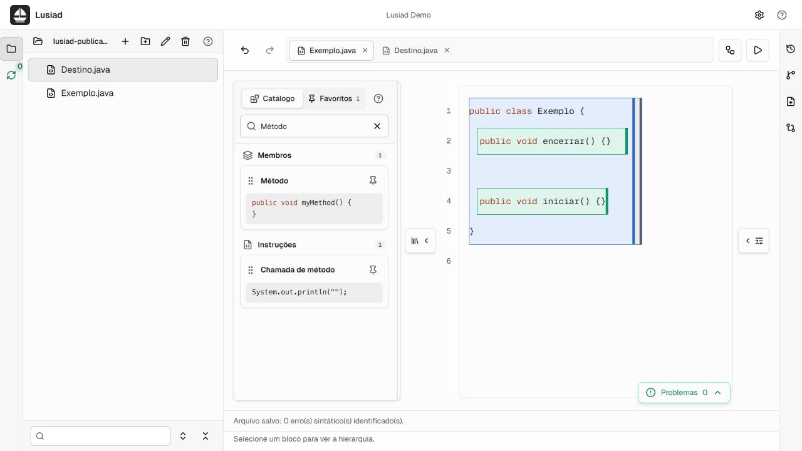

# `Lusiad` – Demonstração

[🇺🇸 English](../en/demo.md) · **🇧🇷 Português (Brasil)**

### Nesta página

> [1. Antes da movimentação](#-1-antes-da-movimentação) 
> [2. Movimentar o método](#-2-movimentar-o-método) 
> [3. Comparar os commits](#-3-comparar-os-commits) 
> [Índice da documentação](#índice-da-documentação)

---

## 🧩 1. Antes da movimentação

As capturas usam um projeto Java preparado para a demonstração. Em `Exemplo.java`, o canvas mostra `iniciar()` acima de `encerrar()` dentro da mesma classe.

*1. Estado anterior: biblioteca, modelo e código de `Exemplo.java`.*

## ↕️ 2. Movimentar o método

Selecione `encerrar()` e arraste-o pela alça de movimentação até o espaço acima de `iniciar()`. O código Java passa a refletir a nova ordem, e o Lusiad registra a movimentação como uma alteração individual.

*2. A posição dos métodos mudou no modelo e no arquivo Java.*

## 🔍 3. Comparar os commits

O commit registrado recebeu o título **Mover encerrar antes de iniciar**. No **Histórico de mudanças**, abra o evento de movimentação para consultar os estados logo antes e logo depois da operação. Para comparar versões completas, use **Preparar dois métodos** como base e **Mover encerrar antes de iniciar** como alvo em **Comparar versões**, depois selecione `Exemplo.java`.

*3. A comparação de versões mostra os estados anterior e posterior.*

---

### Índice da documentação

**[📖 Visão geral](../../README.pt-BR.md)**

- [🖥️ Manual de uso](manual.md)

**[⚙️ Instalação](preparacao.md)**

- [🔧 Guia de instalação](instalacao.md)
- [🚀 Primeiros passos](primeiros-passos.md)

**[📐 Projeto](projeto.md)**

- [📋 Requisitos](requisitos.md)
- [✏️ Prototipação](prototipacao.md)

**[💻 Implementação](implementacao.md)**

- [🏗️ Arquitetura](arquitetura.md)
- [📂 Estrutura de diretórios](estrutura-de-diretorios.md)
- [🧰 Tecnologias utilizadas](tecnologias-utilizadas.md)
- [🗃️ Modelo de dados](modelo-de-dados.md)
- [🔌 Referência da API](referencia-da-api.md)
- [🔀 Diagramas de interação](diagramas-de-interacao.md)
- [🧭 Decisões de projeto](decisoes-de-projeto.md)
- [🔍 Elementos notáveis da implementação](elementos-notaveis-da-implementacao.md)

**[📊 Avaliação](avaliacao.md)**

- [📋 Planejamento](avaliacao-planejamento.md)
- [🧪 Execução](avaliacao-execucao.md)
- [📈 Resultados](avaliacao-resultados.md)
- [💬 Discussão](avaliacao-discussao.md)
- [📂 Materiais e dados](avaliacao-dados.md)
- [🗂️ Arquivos da avaliação](../zenodo/)
