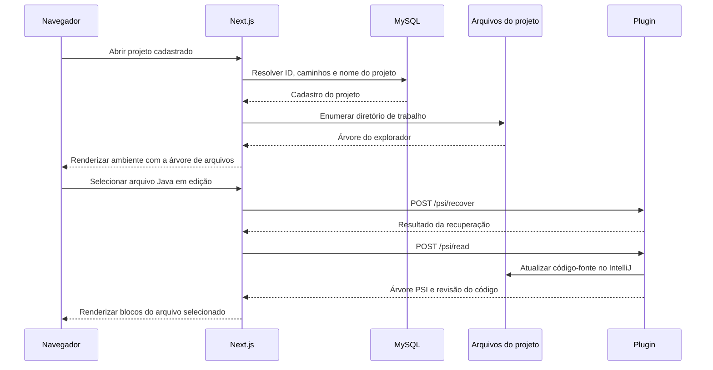
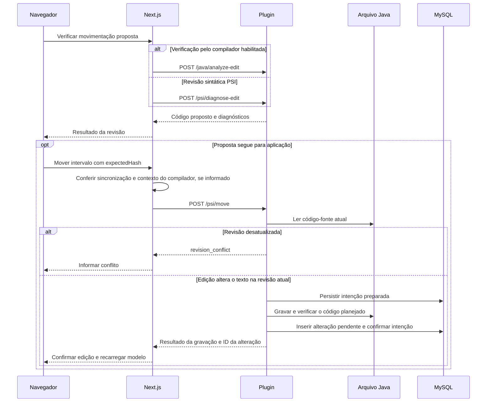
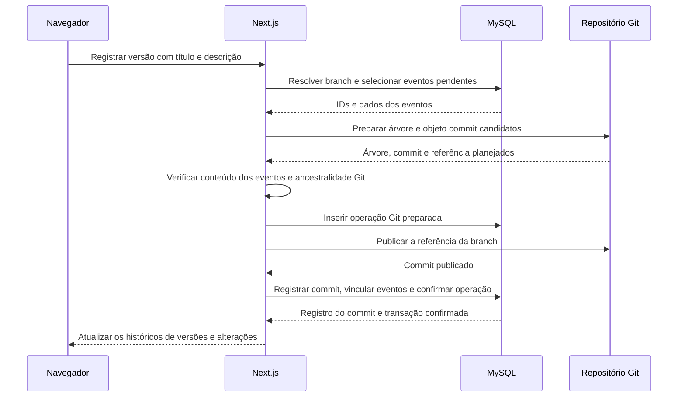
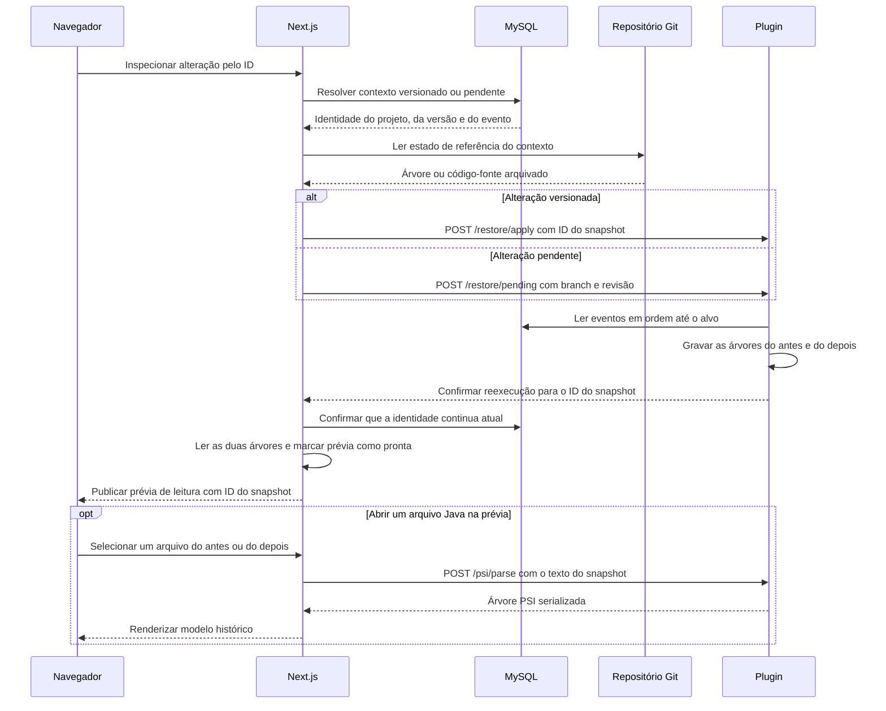
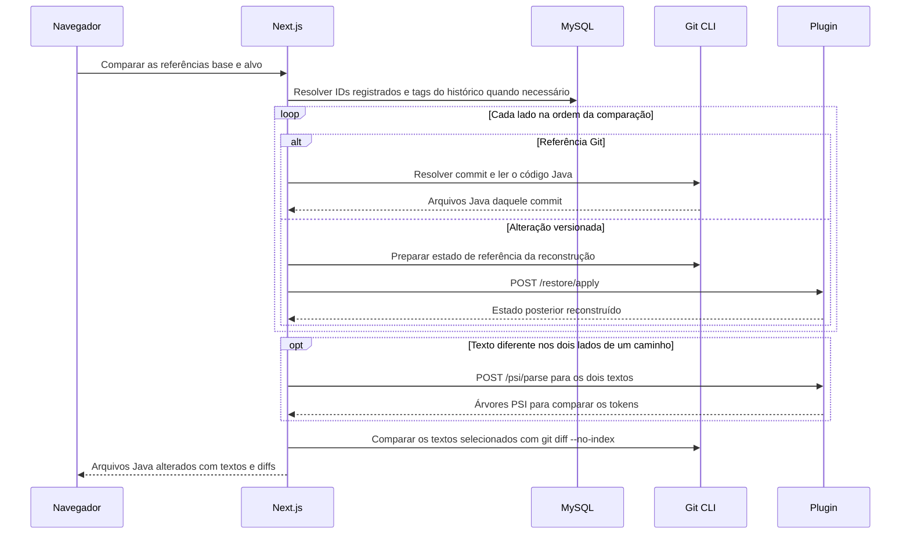
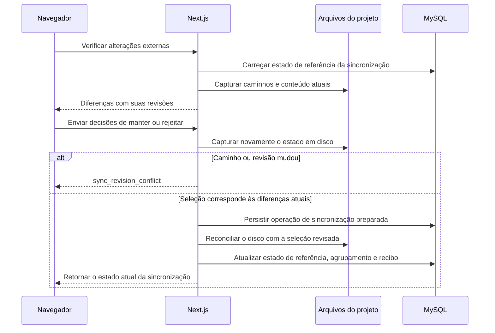
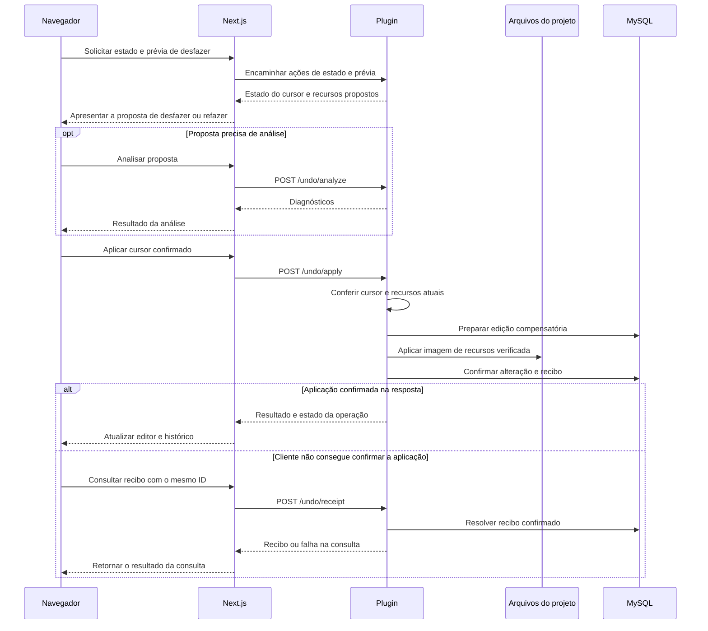
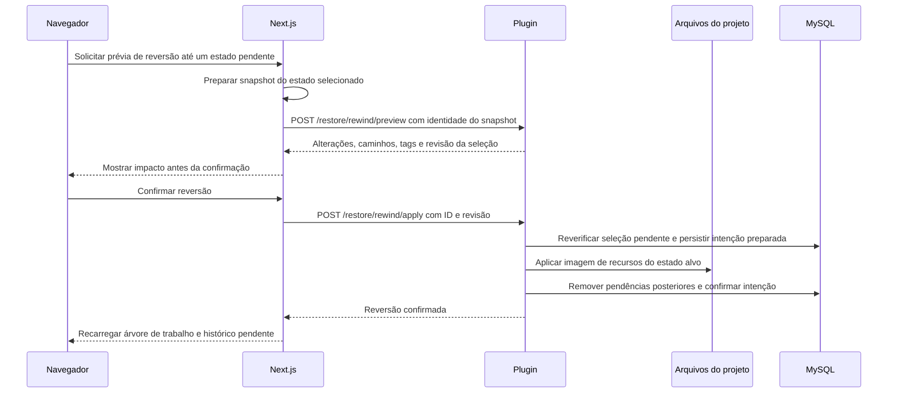
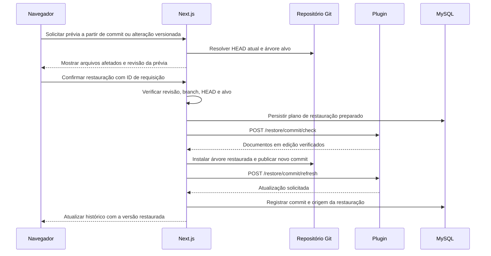
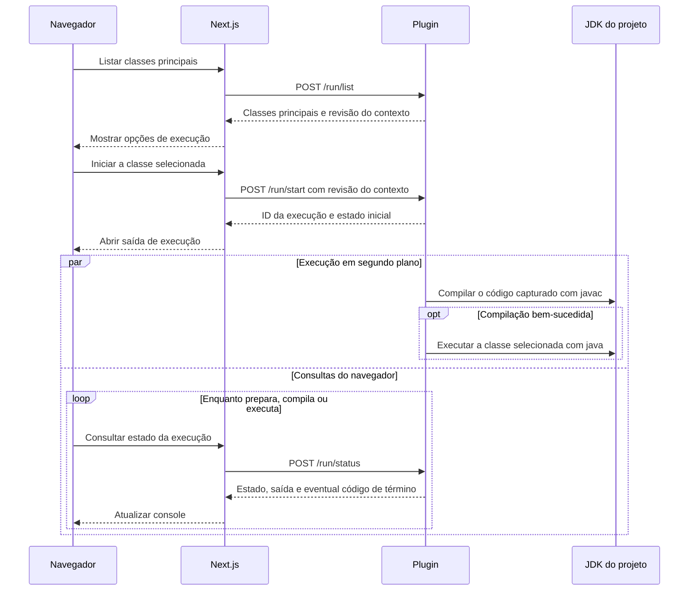

# `Lusiad` – Diagramas de interação

[🇺🇸 English](../en/interaction-diagrams.md) · **🇧🇷 Português (Brasil)**

Estes diagramas de sequência acompanham cada operação desde o navegador até o componente responsável por cada etapa. `Next.js` representa as server actions, as rotas HTTP e seus serviços. `Plugin` representa a API local e os serviços do IntelliJ. A [referência da API](referencia-da-api.md) detalha os campos e códigos de resposta, e o [modelo de dados](modelo-de-dados.md) descreve os identificadores e registros persistidos nos fluxos.

### Nesta página

> [1. Abrir um projeto e carregar seu modelo](#abrir-um-projeto-e-carregar-seu-modelo)<br>
> [2. Revisar e aplicar uma edição de código](#revisar-e-aplicar-uma-edição-de-código)<br>
> [3. Registrar uma versão Git](#registrar-uma-versão-git)<br>
> [4. Abrir uma alteração no histórico](#abrir-uma-alteração-no-histórico)<br>
> [5. Comparar duas referências](#comparar-duas-referências)<br>
> [6. Revisar alterações externas](#revisar-alterações-externas)<br>
> [7. Desfazer ou refazer uma edição](#desfazer-ou-refazer-uma-edição)<br>
> [8. Restaurar um estado do projeto](#restaurar-um-estado-do-projeto)<br>
> [9. Compilar e executar Java](#compilar-e-executar-java)<br>
> [Índice da documentação](#índice-da-documentação)

---

## Abrir um projeto e carregar seu modelo

A página do projeto carrega o cadastro e a árvore de arquivos. Ao selecionar um arquivo Java em edição, o navegador solicita sua árvore PSI por meio do plugin. O servidor pede ao plugin que reconcilie as edições preparadas antes de ler o arquivo atual. A `revision` devolvida identifica o texto ao qual os offsets do modelo se referem. [Página do projeto](../../lusiad-frontend/src/app/project/%5BprojectId%5D/page.tsx) · [Controlador do modelo](../../lusiad-frontend/src/controllers/model-editor/model-editor.controller.ts) · [Serviço de leitura PSI](../../lusiad-frontend/src/lib/services/model-editor/psi-api.service.ts)



## Revisar e aplicar uma edição de código

Mover um bloco produz um intervalo de origem e um destino. O editor verifica a proposta em memória por meio da análise sintática PSI ou do compilador, conforme as opções do projeto. Quando a proposta segue para aplicação, o controlador verifica a sincronização externa e confere novamente o contexto do compilador, se fornecido. O plugin valida a revisão do código antes de preparar a gravação. [Interações do editor](../../lusiad-frontend/src/components/panels/model-editor/model-editor.interactions.ts) · [Controlador de edição](../../lusiad-frontend/src/controllers/model-editor/model-editor.controller.ts) · [Coordenador de edição](../../lusiad-backend/src/main/java/com/lusiad/backend/service/psi/EditCoordinator.java)



O plugin registra a intenção antes de gravar o arquivo. Depois de verificar a gravação, insere a alteração pendente e marca a intenção como aplicada na mesma transação SQL. Uma edição que preserva o texto pode retornar `noOp` sem criar um evento. Se o processo for interrompido antes da confirmação, a recuperação compara o arquivo com os estados registrados para confirmar, cancelar ou sinalizar a intenção para inspeção. [Coordenação e recuperação de edições](../../lusiad-backend/src/main/java/com/lusiad/backend/service/psi/EditCoordinator.java) · [Confirmação SQL](../../lusiad-backend/src/main/java/com/lusiad/backend/repository/change/EditOperationStore.java)

## Registrar uma versão Git

A ação de commit verifica a branch selecionada e o estado da sincronização externa. O serviço captura os eventos pendentes e prepara uma árvore e um objeto commit Git. Ele registra o plano antes de publicar a referência da branch. A transação SQL que segue vincula o commit aos eventos capturados, atualiza o `commit_id` de cada evento e marca a operação como aplicada. [Controlador de commits](../../lusiad-frontend/src/controllers/commit-menu/commit-menu.controller.ts) · [Serviço de registro Git](../../lusiad-frontend/src/lib/services/commit-menu/git-recording.service.ts) · [Publicação da referência](../../lusiad-frontend/src/lib/services/commit-menu/git-operation.ts)



Se a publicação Git tiver ocorrido e a confirmação SQL for interrompida, o plano preparado continua disponível. A operação seguinte sob o bloqueio do projeto primeiro reconcilia os planos em aberto. A publicação confere a referência da branch com o plano, inclusive quando ela já aponta para o commit preparado. [Bloqueio e recuperação de operações Git](../../lusiad-frontend/src/lib/services/commit-menu/git-recording.service.ts#L224-L257) · [Verificações na publicação](../../lusiad-frontend/src/lib/services/commit-menu/git-operation.ts#L199-L219)

## Abrir uma alteração no histórico

A ação do histórico resolve a alteração e cria um diretório exclusivo para a prévia. Uma alteração versionada normalmente usa o primeiro pai Git de sua versão como estado de referência. Uma alteração pendente usa o HEAD verificado da branch. Para o commit raiz, o serviço deriva o estado de referência da árvore Git gravada e dos eventos registrados. O plugin reaplica os eventos em ordem até a alteração selecionada. O Next.js confere novamente a identidade, lê as duas árvores e marca a prévia como pronta. [Serviço de prévia](../../lusiad-frontend/src/lib/services/restore/restore.service.ts) · [Preparação do estado de referência](../../lusiad-frontend/src/lib/services/restore/change-archive.service.ts) · [Dados de entrada da reconstrução](../../lusiad-backend/src/main/java/com/lusiad/backend/repository/restore/RestoreRepository.java)



A árvore anterior é gravada imediatamente antes de o evento alvo ser aplicado. Nesse ponto, o laço de reexecução copia a árvore de trabalho da prévia para `working-copy-prev`. [Implementação da reexecução](../../lusiad-backend/src/main/java/com/lusiad/backend/service/restore/HistoricalReplay.java#L35-L42) · [Leitura do modelo histórico](../../lusiad-frontend/src/lib/services/restore/snapshot-reader.ts)

```java
if (row.id == target)
  SnapshotFiles.reset(
      temp, working, ContainedPaths.resolve(temp, "working-copy-prev", false));
```

## Comparar duas referências

Cada lado da comparação é resolvido de forma independente para um conjunto de arquivos Java. Commit, branch, tag Git e SHA podem ser resolvidos para um commit Git. Uma tag do histórico do Lusiad aponta para um commit ou uma alteração registrados. Quando a referência seleciona uma alteração versionada, o servidor reconstrói seu estado posterior em um diretório temporário. A comparação percorre a união dos caminhos Java dos dois lados. Quando o arquivo existe dos dois lados e o texto difere, o serviço compara os tokens PSI antes de incluir o diff Git. [Resolução das referências](../../lusiad-frontend/src/lib/services/model-comparison/comparison-reference.model.ts) · [Serviço de comparação](../../lusiad-frontend/src/lib/services/model-comparison/model-comparison.service.ts) · [Snapshots e diffs Git](../../lusiad-frontend/src/lib/services/model-comparison/git-snapshot.ts)



Uma referência vazia fornece um snapshot vazio. Arquivos adicionados ou removidos podem seguir diretamente para a comparação textual. As árvores PSI são comparadas quando ambos os lados têm texto diferente no mesmo caminho. [Serviço de comparação](../../lusiad-frontend/src/lib/services/model-comparison/model-comparison.service.ts)

## Revisar alterações externas

A verificação compara o projeto em disco com o estado de referência da sincronização. O usuário escolhe quais diferenças manter. A server action compara as revisões enviadas com um snapshot atualizado e prepara um plano. As alterações aceitas em relação ao estado de referência podem ser agrupadas em um `external_bundle` pendente, e as diferenças rejeitadas são reconciliadas em disco. [Serviço de sincronização](../../lusiad-frontend/src/lib/services/external-sync/external-sync.service.ts) · [Verificações de seleção e revisão](../../lusiad-frontend/src/lib/services/external-sync/sync-plan.ts)



A verificação pode recuperar operações em aberto antes de devolver o resultado. A confirmação SQL grava o estado de referência revisado e seu agrupamento juntos. O agrupamento mantido pode então ser incluído em uma versão registrada. [Registro de sincronização](../../lusiad-frontend/src/lib/services/external-sync/external-sync.service.ts) · [Vínculo do agrupamento no commit](../../lusiad-frontend/src/lib/services/commit-menu/git-recording.service.ts)

## Desfazer ou refazer uma edição

O navegador consulta o estado de desfazer e monta um cursor com `direction`, `epoch`, `revision` e `requestId`. O plugin gera uma prévia dos recursos afetados. O navegador pode solicitar verificação sintática ou do compilador antes de aplicar a proposta. A alteração aplicada é registrada pelo coordenador de edição e atualiza o estado de desfazer e refazer. [Controles de desfazer](../../lusiad-frontend/src/components/panels/model-editor/undo-controls.tsx) · [Serviço Next.js](../../lusiad-frontend/src/lib/services/undo/undo.service.ts) · [Serviço do plugin](../../lusiad-backend/src/main/java/com/lusiad/backend/service/undo/UndoService.java)



A recuperação do cliente consulta o recibo com o mesmo ID de requisição. Se a consulta falhar, o cliente apresenta o erro original. [`undo-client.ts`](../../lusiad-frontend/src/lib/services/undo/undo-client.ts#L13-L20)

```typescript
export async function undoApply(projectId: number, cursor: UndoCursor, contextRevision?: string) {
  try { return requireUndoResult(await call(projectId, 'apply', cursor, false, contextRevision), 'Undo/redo', cursor) }
  catch (original) {
    // A lost HTTP/SQL acknowledgement does not permit a second mutation. Query only its same-id receipt.
    try { return requireUndoReceipt(await call(projectId, 'receipt', cursor), 'Undo/redo recovery', cursor.requestId) }
    catch { throw original }
  }
}
```

## Restaurar um estado do projeto

| Operação | Efeito no projeto e no histórico |
| --- | --- |
| Inspecionar um estado histórico | Cria árvores isoladas do antes e do depois para a prévia. |
| Reverter alterações pendentes | Atualiza os arquivos em edição e remove as alterações pendentes posteriores ao ponto selecionado. A branch versionada permanece no mesmo HEAD. |
| Restaurar um estado versionado | Grava a árvore restaurada como um novo filho do HEAD Git atual e registra sua origem no histórico. |

### Reverter alterações pendentes

O Next.js prepara um snapshot para o evento pendente selecionado. O plugin retorna as alterações, caminhos e tags afetados pela reversão, além de uma `selectionRevision`. Ao receber a confirmação, o plugin compara a revisão com o plano atual, registra os recursos afetados, aplica o estado alvo e confirma a atualização do histórico. Descartar todas as pendências usa o HEAD versionado e verificado como alvo virtual. [Serviço de reversão de pendências](../../lusiad-frontend/src/lib/services/restore/pending-rewind.service.ts) · [Coordenador de reversão no plugin](../../lusiad-backend/src/main/java/com/lusiad/backend/service/restore/PendingRewindService.java)



### Restaurar um estado versionado como nova versão

Restaurar um commit usa sua árvore Git. Restaurar o estado posterior a uma alteração versionada usa o snapshot reconstruído. A prévia captura a árvore alvo, a branch e o HEAD atual. Na confirmação, o Next.js verifica esses valores novamente, pede ao plugin que confira os documentos não salvos no IntelliJ e publica o commit de restauração. O plugin atualiza a visão de arquivos da IDE, e a transação SQL registra a versão e sua origem. [Prévia e confirmação de restauração](../../lusiad-frontend/src/lib/services/restore/commit-restoration.service.ts) · [Registro Git da restauração](../../lusiad-frontend/src/lib/services/commit-menu/git-recording.service.ts) · [Verificação e atualização na IDE](../../lusiad-backend/src/main/java/com/lusiad/backend/handler/restore/RestoreHandlers.java)



## Compilar e executar Java

O navegador lista as classes principais pela rota de execução. A lista retorna uma revisão do contexto para o código salvo e a configuração Java. Ao iniciar a execução, a interface envia a revisão de volta com a classe selecionada. O plugin compila e executa o programa em segundo plano. O navegador consulta o estado da última execução do projeto e pode interrompê-la pelo ID devolvido. [Controles de execução](../../lusiad-frontend/src/components/panels/model-editor/java-run-controls.tsx) · [Rota Next.js](../../lusiad-frontend/src/app/api/lusiad/run/route.ts) · [Serviço de execução Java](../../lusiad-backend/src/main/java/com/lusiad/backend/service/run/JavaRunService.java)



---

<table width="100%">
<tr>
<td align="left"><a href="referencia-da-api.md">⬅️ Página anterior</a></td>
<td align="center"><a href="../../README.pt-BR.md#índice-da-documentação">1️⃣4️⃣ Diagramas de interação</a></td>
<td align="right"><a href="decisoes-de-projeto.md">Próxima página ➡️</a></td>
</tr>
</table>

### Índice da documentação

**[📖 Visão geral](../../README.pt-BR.md)**

- [🖥️ Manual de uso](manual.md)

**[⚙️ Instalação](preparacao.md)**

- [🔧 Guia de instalação](instalacao.md)
- [🚀 Primeiros passos](primeiros-passos.md)

**[📐 Projeto](projeto.md)**

- [📋 Requisitos](requisitos.md)
- [✏️ Prototipação](prototipacao.md)

**[💻 Implementação](implementacao.md)**

- [🏗️ Arquitetura](arquitetura.md)
- [📂 Estrutura de diretórios](estrutura-de-diretorios.md)
- [🧰 Tecnologias utilizadas](tecnologias-utilizadas.md)
- [🗃️ Modelo de dados](modelo-de-dados.md)
- [🔌 Referência da API](referencia-da-api.md)
- [🔀 Diagramas de interação](diagramas-de-interacao.md) 👈
- [🧭 Decisões de projeto](decisoes-de-projeto.md)
- [🔍 Elementos notáveis da implementação](elementos-notaveis-da-implementacao.md)

**[📊 Avaliação](avaliacao.md)**

- [📋 Planejamento](avaliacao-planejamento.md)
- [🧪 Execução](avaliacao-execucao.md)
- [📈 Resultados](avaliacao-resultados.md)
- [💬 Discussão](avaliacao-discussao.md)
- [📂 Materiais e dados](avaliacao-dados.md)
- [🗂️ Arquivos da avaliação](../zenodo/)
