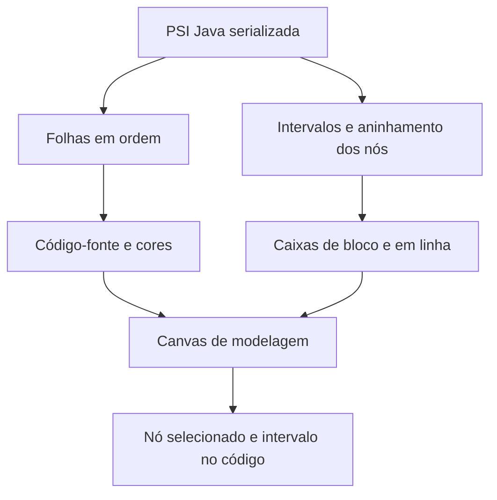
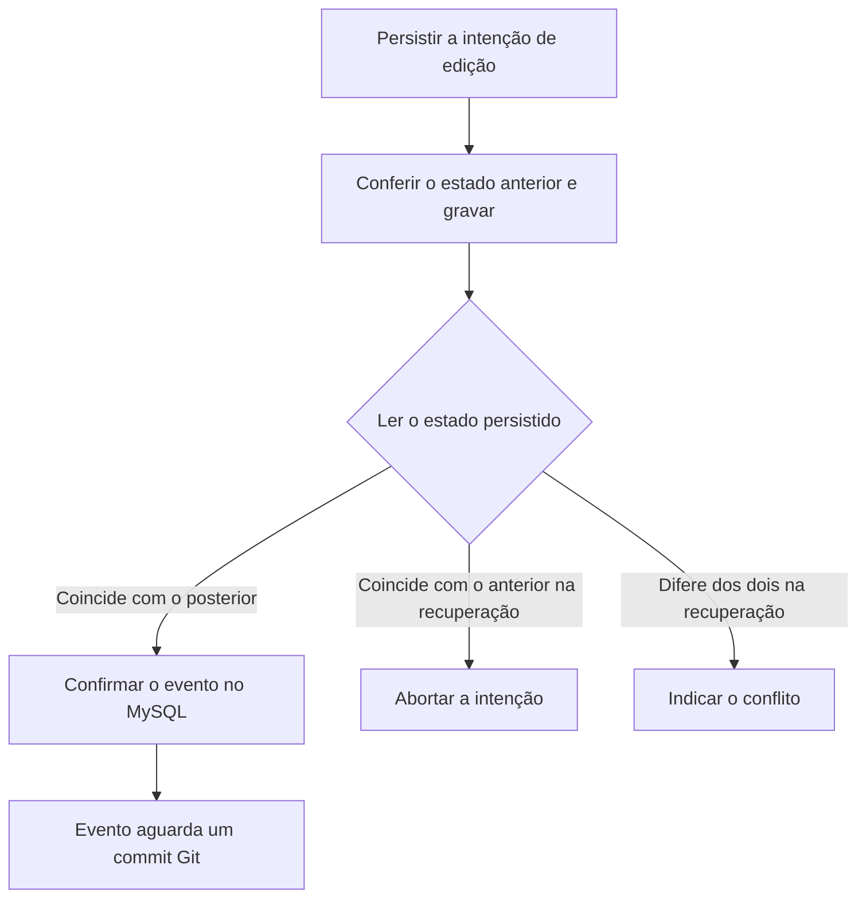
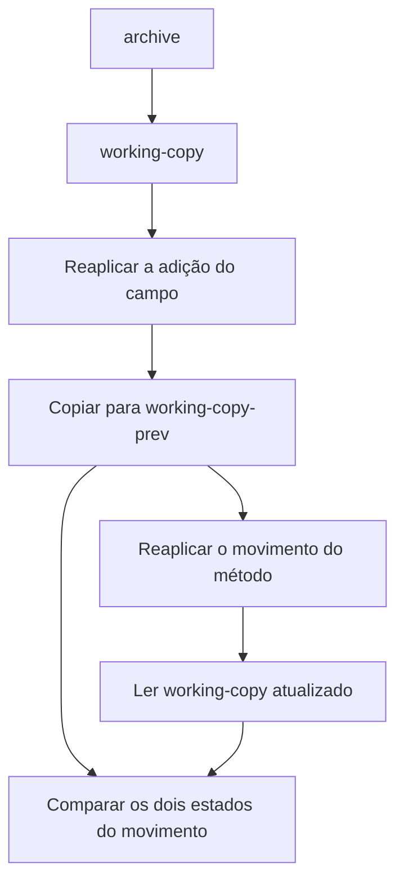

# `Lusiad` – Elementos notáveis da implementação

[🇺🇸 English](../en/notable-implementation-elements.md) · **🇧🇷 Português (Brasil)**

Esta página acompanha o movimento de um método no canvas de modelagem até a reconstrução desse evento individual. Os mesmos mecanismos explicam como o Lusiad trata edições estruturadas, identifica o elemento Java afetado após a formatação e compara estados intermediários de um commit Git.

### Nesta página

> [1. Representação da PSI como modelo](#representacao-da-psi-como-modelo)<br>
> [2. Representação e registro das alterações](#representacao-e-registro-das-alteracoes)<br>
> [3. Reconstrução e visualização das alterações](#reconstrucao-e-visualizacao-das-alteracoes)<br>
> [Índice da documentação](#índice-da-documentação)

---

<a name="representacao-da-psi-como-modelo"></a>
<a name="movimentar-um-método"></a>

## 1. Representação da PSI como modelo

### Do documento Java ao canvas

O plugin serializa cada elemento da PSI do IntelliJ com o nome da sua classe de implementação, como `PsiMethodImpl`, e o intervalo que ele ocupa no documento. Os offsets contam unidades de código UTF-16, começam em zero e excluem o limite final. Linhas e colunas de exibição começam em um. Em um intervalo não vazio, a linha e a coluna finais indicam o último caractere contido nele. O cliente web recebe a árvore em `JavaModel`, junto do caminho do arquivo e, no caso de um arquivo aberto para edição, da revisão do código-fonte. [Serialização da PSI](../../lusiad-backend/src/main/java/com/lusiad/backend/service/psi/PsiService.java#L540) · [Tipos TypeScript](../../lusiad-frontend/src/lib/types.ts#L1)

```ts
export interface PsiNode {
  type: string
  text?: string
  startOffset?: number
  endOffset?: number
  startLine: number
  startColumn: number
  endLine: number
  endColumn: number
  children?: PsiNode[]
}

export function renderLeafTextContent(node: PsiNode): string {
  const children = node.children ?? []

  if (children.length === 0) {
    return node.text ?? ""
  }

  return children.map(renderLeafTextContent).join("")
}
```

Um nó interno organiza seus descendentes. Cada folha fornece o próprio texto, inclusive pontuação e espaços em branco quando representados como folhas. A recursão visita os filhos na ordem da PSI e concatena os textos sem inserir separadores. O canvas usa as folhas para exibir e colorir o código-fonte. Em outro percurso da mesma árvore, ele calcula as caixas. Cada `BoxOverlay` guarda uma referência ao seu nó, de modo que a seleção de uma caixa leva ao intervalo correspondente no arquivo Java. [Percurso das folhas](../../lusiad-frontend/src/lib/models/model-editor/model-tree.model.ts#L7) · [Geometria e segmentos de texto](../../lusiad-frontend/src/lib/models/model-editor/model-canvas.model.ts)



### Caixas visíveis e elementos selecionáveis

| Situação no código | Tratamento no canvas |
| --- | --- |
| Nó de várias linhas começa após a indentação | A caixa parte da coluna inicial e abrange as linhas do nó. A largura usa as colunas ocupadas, com espaçamento visual para distinguir caixas aninhadas. |
| Componente de uma linha ocupa a linha | Um componente com intervalo visível pode ter uma caixa inteira. Comentários e instruções que são folhas também podem receber uma caixa. |
| Componente divide a linha com outros elementos sintáticos | Uma caixa em linha pode aparecer ao passar o cursor. Componentes selecionáveis de forma independente mantêm seus intervalos. |
| Nós da mesma cadeia de ancestrais cobrem os mesmos caracteres | A camada de interação prefere um componente reconhecido e, entre candidatos com a mesma prioridade, escolhe o nó mais profundo. |

Essa última regra resolve o caso em que vários nós da PSI descrevem o mesmo trecho. Uma única caixa recebe o clique ou arraste, enquanto os elementos aninhados com intervalos distintos continuam selecionáveis. O caminho de um nó no canvas é formado pelos índices dos filhos na árvore atual. Ao recarregar o modelo, a seleção precisa apontar para um nó dessa nova árvore. [Coleta de caixas](../../lusiad-frontend/src/lib/models/model-editor/model-canvas.model.ts#L254) · [Caixas de interação](../../lusiad-frontend/src/lib/models/model-editor/component-overlays.model.ts)

### Da interação com um bloco à edição do código

Suponha que `Sessao.java` contenha `iniciar()` seguido de `encerrar()`. O usuário arrasta a caixa de `encerrar()` até o espaço acima de `iniciar()`. O arraste leva o identificador do canvas de origem, os offsets inicial e final do método e o tipo do nó. Para um intervalo entre linhas, o canvas envia `line` e `lineEnd`. Ele também pode resolver o início de uma linha vazia, uma coluna no fim do arquivo ou uma coluna dentro de uma classe ou bloco de código vazio em uma única linha. Nesse último caso, as chaves precisam pertencer a um contêiner identificado pela PSI. Um destino dentro de um comentário ou literal é rejeitado. [Dados do arraste e tratamento da soltura](../../lusiad-frontend/src/components/panels/model-editor/model-canvas.interactions.ts) · [Resolução dos destinos](../../lusiad-frontend/src/lib/models/model-editor/canvas-drop.model.ts)

O plugin converte o destino em um offset no documento original e rejeita destinos dentro do intervalo selecionado ou em seus limites. Em seguida, remove o texto e ajusta o offset de inserção caso o destino original estivesse depois dele. A edição é preparada em um documento PSI Java desvinculado do arquivo do projeto. O plugin pode formatar o resultado, e o hash esperado do código vincula a solicitação à revisão que o usuário viu. Após a confirmação da edição, o canvas recarrega o modelo e calcula as posições das caixas a partir do arquivo Java resultante. [Movimento e preparação da edição](../../lusiad-backend/src/main/java/com/lusiad/backend/service/psi/PsiService.java) · [Interações do editor](../../lusiad-frontend/src/components/panels/model-editor/model-editor.interactions.ts)

A biblioteca de componentes e o painel de propriedades também trabalham com intervalos do código. Um componente da biblioteca pode gerar Java a partir de atributos validados e oferecer esse código para edição manual. Para um componente compatível já existente no arquivo, o painel deriva campos da PSI selecionada e aplica as alterações aos intervalos correspondentes no rascunho. O editor pode analisar o rascunho resultante e conferir se as folhas da PSI reproduzem o código proposto. Assim, a edição de uma propriedade preserva o texto fora dos campos que ela altera no rascunho. [Criação de componentes](../../lusiad-frontend/src/lib/models/model-editor/component-creation.model.ts) · [Edição estruturada](../../lusiad-frontend/src/lib/models/model-editor/component-edit.model.ts) · [Verificação da PSI do rascunho](../../lusiad-frontend/src/controllers/model-editor/component-edit.controller.ts)

<a name="representacao-e-registro-das-alteracoes"></a>
<a name="registrar-uma-versão"></a>

## 2. Representação e registro das alterações

### Um evento para o movimento do método

Após a confirmação da edição, `changes` guarda a operação com projeto, branch, tipo, escopo, descrição e corpo JSON em `req_body`. O exemplo gera um evento `move` com escopo `file`. A linha pode aparecer no histórico com `commit_id` ainda nulo. Se o usuário editar outro componente antes de fazer o commit, cada ação terá seu próprio evento e ambas poderão integrar a mesma versão. [Persistência da alteração](../../lusiad-backend/src/main/java/com/lusiad/backend/repository/change/EditOperationStore.java) · [Modelo de dados](modelo-de-dados.md)

O campo `changeMetadata` de `req_body` reúne os fatos que podem ser apresentados ao usuário. Os registros Java abaixo são usados para mudanças no código e nos caminhos. [Registros de metadados](../../lusiad-backend/src/main/java/com/lusiad/backend/service/change/ChangeMetadata.java#L14)

```java
public record Range(int start, int end, int startLine, int endLine, int startColumn, int endColumn) {}
public record Element(String kind, String name) {}
public record Side(String path, Range range, Element element, List<Element> context) {}
public record Difference(String field, String before, String after) {}
public record Facts(int version, String action, String kind, Side before, Side after, List<Difference> differences) {}
```

No movimento, `before` pode localizar `encerrar()` abaixo de `iniciar()` e `after` pode localizá-lo acima. Ambos podem carregar `Sessao.java`, o nome do método com os tipos dos parâmetros e a classe que o contém. Uma instrução também pode trazer o contexto do método, de um laço, do ramo `then` ou `else` ou de um caso do `switch`. Uma criação tem apenas o lado de destino, e uma exclusão tem apenas o lado de origem. Quando o intervalo cobre vários elementos, um fragmento ou espaço em branco, o evento pode registrar esse nível de detalhe. O cliente valida os metadados e gera o texto do histórico no idioma selecionado. [Extração do elemento e do contexto](../../lusiad-backend/src/main/java/com/lusiad/backend/service/change/ChangeMetadata.java#L99) · [Validação dos metadados](../../lusiad-frontend/src/lib/models/change-history/change-metadata.ts) · [Descrições localizadas](../../lusiad-frontend/src/lib/i18n/change-text.ts)

### Localização do elemento após a formatação

O Lusiad trabalha com três árvores PSI no movimento. A original identifica o intervalo de origem. A árvore imediatamente após a inserção identifica o intervalo de destino produzido pela edição. Se a formatação altera o texto, o backend compara as sequências de tokens das árvores anterior e posterior à formatação, desconsiderando os nós de espaço em branco. Quando quantidade e texto dos tokens coincidem, ele encontra o primeiro e o último token que cruzam o trecho inserido e usa os tokens de mesma posição na sequência formatada, preservando os deslocamentos relevantes dentro deles. Isso mantém a ocorrência escolhida pela edição mesmo quando a mesma expressão aparece várias vezes no arquivo. Quando o código não consegue estabelecer essa correspondência, o intervalo de destino fica sem localização. [Cálculo do destino e correspondência dos tokens](../../lusiad-backend/src/main/java/com/lusiad/backend/service/change/ChangeMetadata.java#L25) · [Resultados da formatação](../../lusiad-backend/src/main/java/com/lusiad/backend/service/psi/PsiEditPersistence.java)

Para uma atualização, o backend também pode descrever uma mudança de nome, tipo, assinatura, condição ou expressão. Ele mascara uma propriedade candidata em cada lado e compara os tokens restantes do elemento afetado. Uma diferença é registrada quando aquela propriedade explica a edição segundo essa comparação. Assim, uma mudança na assinatura de um método pode receber uma descrição específica, enquanto uma reescrita mais ampla mantém a descrição geral de atualização. Esses intervalos e rótulos descrevem os dois estados registrados e têm validade no contexto da operação e das suas revisões do código. [Comparação de propriedades](../../lusiad-backend/src/main/java/com/lusiad/backend/service/change/ChangeMetadata.java#L233)

### Os dados que permitem reaplicar o evento

O registro das edições atuais inclui `operationId`, `operationOrder` e `recordVersion`. O `operationOrder` indica a ordem no registro de operações. A reconstrução histórica lê os eventos do contexto selecionado na ordem de `changes.id`. O campo de versão em `changeMetadata` descreve o esquema de apresentação e tem numeração independente de `recordVersion`. [Corpo do evento](../../lusiad-backend/src/main/java/com/lusiad/backend/service/psi/EditCoordinator.java#L106) · [Consultas para reconstrução](../../lusiad-backend/src/main/java/com/lusiad/backend/repository/restore/RestoreRepository.java)

| Dado do evento | O que representa |
| --- | --- |
| `beforeText`, `afterText`, `beforeHash`, `afterHash` | Os dois estados do documento e seus hashes SHA-256. Um evento textual de versão 2 pode ser reaplicado a partir desses campos. |
| `resources.before` e `resources.after` | Imagens das raízes afetadas com bytes dos arquivos, entradas de diretório e ausências representadas por entradas omitidas sob essas raízes. A reconstrução dá prioridade a esse par quando ele está presente, inclusive em edições que também carregam texto. |
| `changeMetadata` | A localização e os fatos estruturais disponíveis para exibição. A reaplicação usa os estados e os dados operacionais registrados. |

As imagens de recursos também permitem representar operações sobre caminhos, como a movimentação de um diretório, e preservar os bytes necessários para desfazer ou refazer ações compatíveis. Ao desfazer, o sistema confere os recursos atuais com o estado posterior esperado e grava uma nova operação que leva ao estado anterior. Ao refazer, verifica o estado correspondente antes de reaplicar a ação. O evento original e a ação posterior podem ser inspecionados no histórico resultante. [Imagens de recursos](../../lusiad-backend/src/main/java/com/lusiad/backend/service/undo/ResourceImage.java) · [Desfazer e refazer](../../lusiad-backend/src/main/java/com/lusiad/backend/service/undo/UndoService.java)

Edições feitas fora do canvas podem entrar no mesmo histórico após revisão. As diferenças de arquivo aceitas são agrupadas em um evento `external_bundle`. O corpo descreve os caminhos afetados, e `external_sync_bundle_files` guarda o tipo e o conteúdo anterior e posterior de cada caminho, quando presentes. O lote tem uma comparação por arquivo e também pode participar da reconstrução. Sua granularidade é a do conjunto de diferenças revisado. [Sincronização externa](../../lusiad-frontend/src/lib/services/external-sync/external-sync.service.ts) · [Diff do lote](../../lusiad-frontend/src/components/panels/external-sync/external-bundle-diff.tsx)

### Confirmação da edição e vínculo com o Git

O `EditCoordinator` prepara uma operação no MySQL antes de gravar o arquivo. Uma revisão desatualizada interrompe a edição, e um resultado idêntico ao original é tratado como operação sem efeito. Para uma alteração efetiva, o coordenador confere de novo o estado anterior antes da escrita e depois lê o arquivo salvo de forma independente. O `EditOperationStore` confirma o evento e marca a intenção como aplicada. Se a confirmação se perde, a operação pode ser verificada com o mesmo identificador. Se o arquivo já estiver em `after`, o evento pode ser confirmado. Se estiver em `before`, a intenção pendente pode ser abortada. Qualquer terceiro estado gera um conflito para inspeção. [Coordenação da edição](../../lusiad-backend/src/main/java/com/lusiad/backend/service/psi/EditCoordinator.java) · [Persistência da intenção](../../lusiad-backend/src/main/java/com/lusiad/backend/repository/change/EditOperationStore.java)



A criação da versão é uma segunda operação. O servidor do frontend fixa a branch selecionada, o plano Git e o conjunto exato de eventos pendentes, e confere o estado que entrará na versão. Ele grava a operação preparada em `lusiad_git_operations` antes de publicar o commit na referência Git esperada. Uma transação SQL associa o identificador Git a `commits.git_id`, preenche `changes.commit_id`, grava as linhas correspondentes em `commit_change_sets` e marca a operação Git como aplicada. O registro da operação e o estado da referência permitem recuperar a associação caso a publicação ocorra antes da finalização no banco. O Git guarda os arquivos consolidados. Os vínculos permitem encontrar o movimento mesmo depois que outras edições entram no mesmo commit. [Registro no Git](../../lusiad-frontend/src/lib/services/commit-menu/git-recording.service.ts) · [Publicação da referência Git](../../lusiad-frontend/src/lib/services/commit-menu/git-operation.ts#L199)

<a name="reconstrucao-e-visualizacao-das-alteracoes"></a>
<a name="abrir-o-antes-e-depois"></a>

## 3. Reconstrução e visualização das alterações

### Escolha do estado de base

Imagine três eventos registrados no mesmo commit. O primeiro adiciona um campo, o segundo move `encerrar()` e o terceiro edita o corpo desse método. Abrir o segundo evento deve mostrar o campo nos dois lados, o método em posições diferentes e o corpo como ele estava antes do terceiro evento. Essa comparação depende dos dois estados imediatamente adjacentes ao movimento.

| Posição no histórico | Estado de base |
| --- | --- |
| Commit com pai | O frontend extrai a árvore do primeiro pai com `git archive`. |
| Commit raiz | O frontend parte dos arquivos do commit raiz e percorre seus eventos em ordem inversa para recuperar o estado que os antecedeu. Pode inverter operações conhecidas sobre caminhos e restaurar estados anteriores gravados. Um estado anterior ausente que nenhum evento mais antigo permita recuperar gera erro. |
| Alteração pendente | O frontend extrai o `HEAD` consolidado da branch e usa os eventos pendentes dessa branch. A branch, o commit de base e a revisão dos pendentes são conferidos durante a reconstrução. |

Cada prévia tem seu próprio diretório temporário. `archive` guarda a base, `working-copy` é a cópia que recebe os eventos e `working-copy-prev` captura o estado imediatamente anterior ao evento inspecionado. O projeto e a árvore de trabalho Git continuam disponíveis durante a geração da prévia. [Preparação do archive](../../lusiad-frontend/src/lib/services/restore/change-archive.service.ts) · [Reconstrução da base do commit raiz](../../lusiad-frontend/src/lib/services/restore/initial-baseline.ts) · [Preparação da prévia](../../lusiad-frontend/src/lib/services/restore/restore.service.ts)

### Reaplicação até o evento selecionado

O backend recupera os eventos em ordem, considerando o projeto, a branch e a versão ou o contexto pendente relevante. O `HistoricalReplay` copia o estado de base para `working-copy`, reaplica os eventos anteriores e copia `working-copy` para `working-copy-prev` ao chegar ao alvo. O laço então reaplica o evento selecionado e encerra. O trecho abaixo mostra onde a cópia do estado anterior é capturada, imediatamente antes de encaminhar a operação para execução. [Reconstrução histórica](../../lusiad-backend/src/main/java/com/lusiad/backend/service/restore/HistoricalReplay.java#L28)

```java
String working = ContainedPaths.resolve(temp, "working-copy", false);
SnapshotFiles.reset(temp, ContainedPaths.resolve(temp, "archive", false), working);
boolean found = false;
for (ChangeRow row : rows) {
  if (row.id > target) break;
  Map<String, String> body = JsonUtil.parseSimpleJson(row.reqBody);
  ContainedPaths.legacy(body, project);
  if (row.id == target)
    SnapshotFiles.reset(
        temp, working, ContainedPaths.resolve(temp, "working-copy-prev", false));
  // O restante do laço reaplica o evento e encerra após o alvo.
}
```



Na reaplicação textual de versão 2, o backend confere os dois hashes e verifica se o texto normalizado na cópia corresponde a `beforeText` antes de escrever `afterText`. Ele lê de volta o resultado para verificá-lo. Com imagens de recursos, a reconstrução verifica o estado de origem e aplica a imagem de destino. Outros caminhos tratam lotes de alterações externas gravados, operações de arquivo e diretório ou edições legadas compatíveis. A falta do evento alvo, um hash inválido ou um estado anterior incompatível interrompe a reconstrução. O frontend só marca a prévia como pronta depois de conferir a resposta e verificar novamente o contexto do evento. [Seleção do formato e verificação textual](../../lusiad-backend/src/main/java/com/lusiad/backend/service/restore/HistoricalReplay.java) · [Verificação das imagens de recursos](../../lusiad-backend/src/main/java/com/lusiad/backend/service/undo/ResourceImage.java) · [Confirmação da prévia](../../lusiad-frontend/src/lib/services/restore/preview-snapshot.ts)

### O que a comparação mostra

A prévia retorna as árvores de arquivos anterior e posterior. Para uma alteração Java, o frontend lê o código relevante de cada estado temporário e envia o texto ao plugin para análise. O servidor confere se as folhas serializadas de cada árvore PSI reproduzem o código daquele lado. [Leitura do snapshot](../../lusiad-frontend/src/lib/services/restore/snapshot-reader.ts)

Nos registros textuais atuais com os estados armazenados, o código da prévia precisa corresponder a esses estados antes que o componente destaque um intervalo. Para eventos de desfazer ou refazer, o componente pode usar os intervalos gravados. Em uma edição comum, pode deduzir o destino a partir da solicitação e dos dois textos. Se precisar buscar uma ocorrência, o candidato precisa explicar a diferença entre os dois textos e ser único. Se o resultado for ambíguo, a prévia fica sem aquele destaque. [Leitura da PSI dos snapshots](../../lusiad-frontend/src/lib/services/change-diff/change-diff.service.ts) · [Localização dos destaques](../../lusiad-frontend/src/lib/services/change-diff/change-focus.service.ts)

| Visão | O que revela no exemplo |
| --- | --- |
| Código Java | `encerrar()` aparece na posição anterior à esquerda e na nova à direita. Mudanças de indentação e do texto ao redor também ficam visíveis. |
| PSI e modelo | As duas árvores são derivadas dos estados adjacentes. Quando o intervalo é determinado, o método pode ser destacado dentro da classe em cada lado. |
| Diff Git na ferramenta de comparação | Selecione o estado após o evento anterior e o estado após o movimento para inspecionar as linhas removidas e inseridas. |
| UML, quando disponível | A classe pode manter os mesmos membros e relacionamentos quando só a ordem dos métodos muda. O diagrama pode indicar a equivalência estrutural e mostrar origem e destino quando localiza o elemento. |

As visões de Java, PSI e UML usam o estado reconstruído do lado correspondente. Para o diagrama, o plugin extrai a estrutura das classes a partir do código Java recebido e a renderiza com PlantUML. A estrutura é comparada a partir dos rótulos ordenados dos membros e relacionamentos, o que explica por que reordenar os métodos pode manter a equivalência na UML. [Serviço UML](../../lusiad-backend/src/main/java/com/lusiad/backend/service/uml/UmlService.java) · [Comparação da estrutura](../../lusiad-backend/src/main/java/com/lusiad/backend/service/uml/UmlDiagram.java#L20)

A ferramenta de comparação aceita eventos consolidados além de referências a commits. Uma referência a uma alteração de código individual leva ao estado logo após o evento. A comparação pode, assim, usar dois pontos intermediários do mesmo commit. Ela compara os tokens da PSI dos arquivos Java presentes nos dois lados e gera os diffs Git para as diferenças que inclui no resultado. [Serviço de comparação](../../lusiad-frontend/src/lib/services/model-comparison/model-comparison.service.ts) · [Comparação Git entre snapshots](../../lusiad-frontend/src/lib/services/model-comparison/git-snapshot.ts)

<a name="alcance"></a>

Restaurar um ponto histórico cria uma nova versão. A remoção seletiva de um evento de um commit existente permanece fora das operações implementadas. [Fluxo de restauração](diagramas-de-interacao.md)

---

<table width="100%">
<tr>
<td align="left"><a href="decisoes-de-projeto.md">⬅️ Página anterior</a></td>
<td align="center"><a href="../../README.pt-BR.md#índice-da-documentação">1️⃣7️⃣ Elementos notáveis da implementação</a></td>
<td align="right"><a href="avaliacao.md">Próxima página ➡️</a></td>
</tr>
</table>

### Índice da documentação

**[📖 Visão geral](../../README.pt-BR.md)**

- [🖥️ Manual de uso](manual.md)
- [🎬 Demonstração](demonstracao.md)

**[⚙️ Instalação](preparacao.md)**

- [🔧 Guia de instalação](instalacao.md)
- [🚀 Primeiros passos](primeiros-passos.md)

**[📐 Projeto](projeto.md)**

- [📋 Requisitos](requisitos.md)
- [✏️ Prototipação](prototipacao.md)

**[💻 Implementação](implementacao.md)**

- [🏗️ Arquitetura](arquitetura.md)
- [📂 Estrutura de diretórios](estrutura-de-diretorios.md)
- [🧰 Tecnologias utilizadas](tecnologias-utilizadas.md)
- [🗃️ Modelo de dados](modelo-de-dados.md)
- [🔌 Referência da API](referencia-da-api.md)
- [🔀 Diagramas de interação](diagramas-de-interacao.md)
- [🧭 Decisões de projeto](decisoes-de-projeto.md)
- [🔍 Elementos notáveis da implementação](elementos-notaveis-da-implementacao.md) 👈

**[📊 Avaliação](avaliacao.md)**

- [📋 Planejamento](avaliacao-planejamento.md)
- [🧪 Execução](avaliacao-execucao.md)
- [📈 Resultados](avaliacao-resultados.md)
- [💬 Discussão](avaliacao-discussao.md)
- [📂 Materiais e dados](avaliacao-dados.md)
