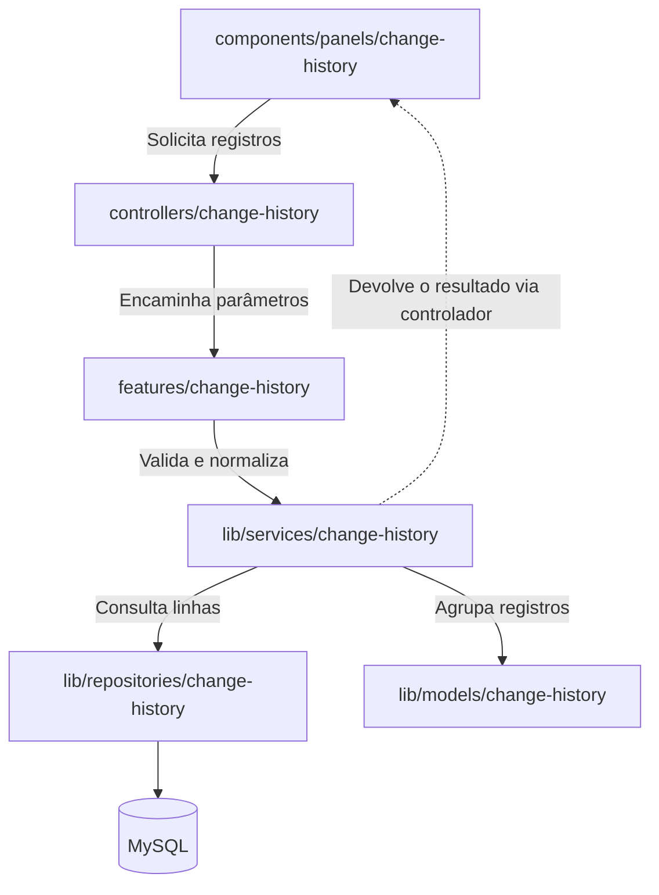
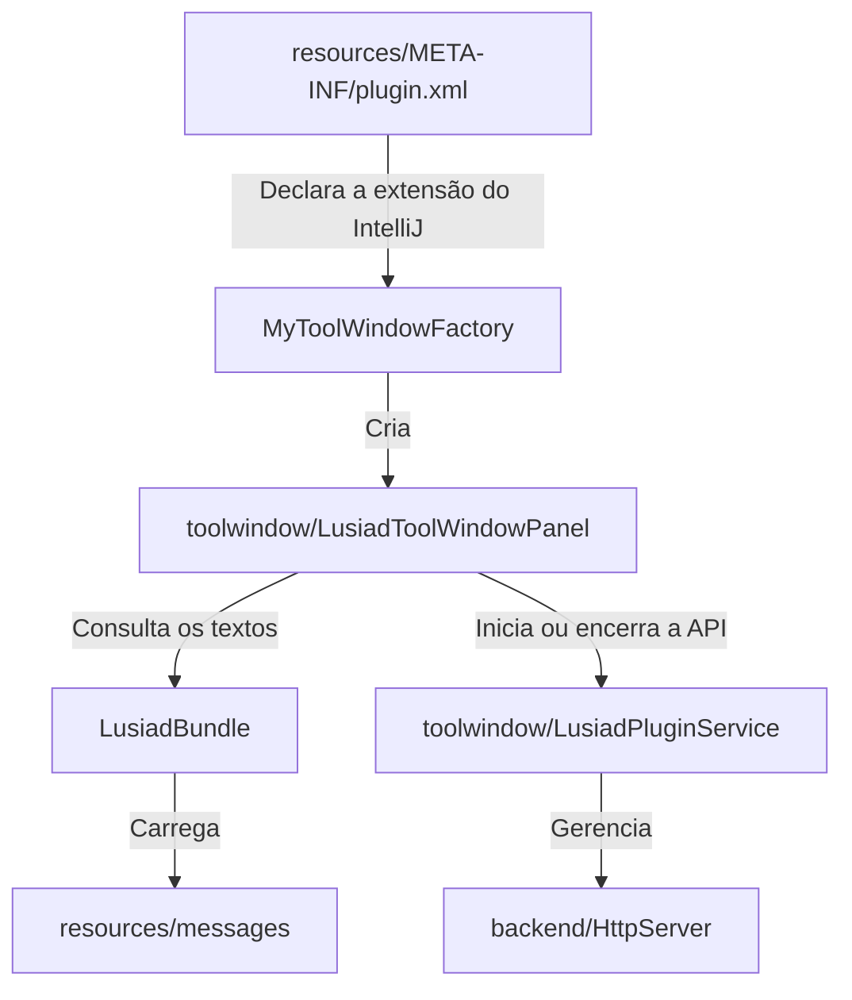
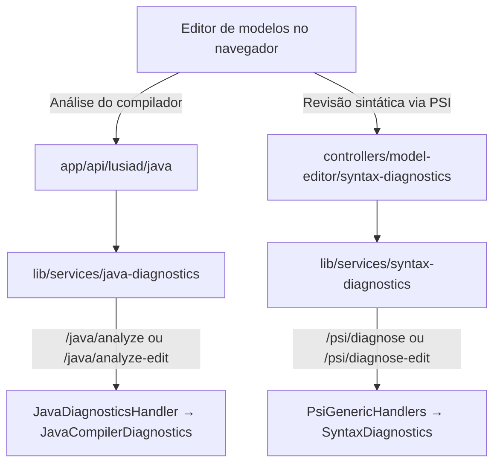

# `Lusiad` – Estrutura de diretórios

[🇺🇸 English](../en/directory-structure.md) · **🇧🇷 Português (Brasil)**

### Nesta página

> [1. Árvore de diretórios](#árvore-de-diretórios)<br>
> [2. Raiz do repositório e documentação](#raiz-do-repositório-e-documentação)<br>
> [3. Aplicação Next.js](#aplicação-nextjs)<br>
> [4. Plugin do IntelliJ](#plugin-do-intellij)<br>
> [5. Banco de dados, build e testes](#banco-de-dados-build-e-testes)<br>
> [6. Onde começar uma alteração](#onde-começar-uma-alteração)<br>
> [Índice da documentação](#índice-da-documentação)

---

## Árvore de diretórios

A árvore mostra os diretórios com arquivos versionados neste repositório. Os caminhos partem da raiz do repositório. Diretórios gerados, como `node_modules/`, `.next/` e o `build/` do Gradle, são criados localmente. Os projetos Java abertos no Lusiad e seus diretórios de trabalho e temporários são configurados à parte.

```text
📦 lusiad/
├── 📚 docs/
│   ├── 🖼️ assets/
│   │   ├── 🎨 prototyping/
│   │   └── 📖 user-guide/
│   │       └── 🖼️ panels/
│   ├── 🇺🇸 en/
│   ├── 🇧🇷 pt-BR/
│   └── 📊 zenodo/
├── 🔌 lusiad-backend/
│   ├── 🗃️ db/
│   │   └── 🧾 migrations/
│   ├── 🛠️ gradle/
│   │   └── ⚙️ wrapper/
│   └── 💻 src/
│       ├── 📁 main/
│       │   ├── ☕ java/
│       │   │   └── 📁 com/
│       │   │       └── 📦 lusiad/
│       │   │           ├── 📁 backend/
│       │   │           │   ├── ⚙️ config/
│       │   │           │   ├── 📨 handler/
│       │   │           │   │   ├── 📁 diagnostics/
│       │   │           │   │   ├── 📁 fs/
│       │   │           │   │   ├── 📁 psi/
│       │   │           │   │   ├── 📁 restore/
│       │   │           │   │   └── 📁 uml/
│       │   │           │   ├── 🗄️ repository/
│       │   │           │   │   ├── 📁 change/
│       │   │           │   │   ├── 📁 project/
│       │   │           │   │   ├── 📁 restore/
│       │   │           │   │   └── 📁 sql/
│       │   │           │   ├── 🧭 router/
│       │   │           │   │   ├── 📁 diagnostics/
│       │   │           │   │   ├── 📁 fs/
│       │   │           │   │   ├── 📁 project/
│       │   │           │   │   ├── 📁 psi/
│       │   │           │   │   ├── 📁 restore/
│       │   │           │   │   ├── 📁 run/
│       │   │           │   │   ├── 📁 uml/
│       │   │           │   │   └── 📁 undo/
│       │   │           │   ├── ⚙️ service/
│       │   │           │   │   ├── 📁 change/
│       │   │           │   │   ├── 📁 diagnostics/
│       │   │           │   │   ├── 📁 fs/
│       │   │           │   │   ├── 📁 project/
│       │   │           │   │   ├── 📁 psi/
│       │   │           │   │   ├── 📁 restore/
│       │   │           │   │   ├── 📁 run/
│       │   │           │   │   ├── 📁 uml/
│       │   │           │   │   └── 📁 undo/
│       │   │           │   └── 📁 util/
│       │   │           └── 🪟 toolwindow/
│       │   └── 📦 resources/
│       │       ├── 📜 licenses/
│       │       ├── 💬 messages/
│       │       └── 📋 META-INF/
│       └── 🧪 test/
│           └── ☕ java/
│               └── 📁 com/
│                   └── 📦 lusiad/
│                       ├── 📁 backend/
│                       │   ├── ⚙️ config/
│                       │   ├── 📨 handler/
│                       │   ├── ⚙️ service/
│                       │   │   ├── 📁 change/
│                       │   │   ├── 📁 diagnostics/
│                       │   │   ├── 📁 fs/
│                       │   │   ├── 📁 project/
│                       │   │   ├── 📁 psi/
│                       │   │   ├── 📁 restore/
│                       │   │   ├── 📁 run/
│                       │   │   ├── 📁 uml/
│                       │   │   └── 📁 undo/
│                       │   └── 📁 util/
│                       └── 🪟 toolwindow/
└── 🖥️ lusiad-frontend/
    ├── 📚 docs/
    ├── 🌐 public/
    ├── 🛠️ scripts/
    ├── 💻 src/
    │   ├── 🌐 app/
    │   │   ├── 🔌 api/
    │   │   │   └── 📦 lusiad/
    │   │   │       ├── ☕ java/
    │   │   │       ├── 📁 projects/
    │   │   │       │   └── 📁 presence/
    │   │   │       ├── 📁 run/
    │   │   │       ├── 📁 runtime/
    │   │   │       ├── 📁 settings/
    │   │   │       ├── 📁 test-context/
    │   │   │       └── 📁 undo/
    │   │   ├── 🔤 fonts/
    │   │   └── 📁 project/
    │   │       └── 📁 [projectId]/
    │   ├── 🧩 components/
    │   │   ├── 🖼️ panels/
    │   │   │   ├── 🕒 change-history/
    │   │   │   ├── 📁 commit-menu/
    │   │   │   ├── 📁 diff-menu/
    │   │   │   ├── 📁 external-sync/
    │   │   │   ├── 📂 file-explorer/
    │   │   │   ├── 🔎 model-comparison/
    │   │   │   ├── ✏️ model-editor/
    │   │   │   └── 📁 track-control/
    │   │   ├── 📁 projects/
    │   │   ├── 📁 tutorials/
    │   │   └── 📁 ui/
    │   ├── 🧭 controllers/
    │   │   ├── 📁 change-diff/
    │   │   ├── 🕒 change-history/
    │   │   ├── 🕒 commit-history/
    │   │   ├── 📁 commit-menu/
    │   │   ├── 📁 current-uml/
    │   │   ├── 📁 external-sync/
    │   │   ├── 📂 file-explorer/
    │   │   ├── 📁 history-tags/
    │   │   ├── 🔎 model-comparison/
    │   │   ├── ✏️ model-editor/
    │   │   ├── 📁 projects/
    │   │   ├── 📁 restore/
    │   │   ├── 📁 settings/
    │   │   └── 📁 track-control/
    │   ├── 🧩 features/
    │   │   ├── 📁 change-diff/
    │   │   ├── 🕒 change-history/
    │   │   ├── 📂 file-explorer/
    │   │   ├── ✏️ model-editor/
    │   │   └── 📁 restore/
    │   ├── 📁 hooks/
    │   ├── 📁 lib/
    │   │   ├── ⚙️ config/
    │   │   ├── 📁 data-example/
    │   │   ├── 🌐 i18n/
    │   │   ├── 🧱 models/
    │   │   │   ├── 📁 change-diff/
    │   │   │   ├── 🕒 change-history/
    │   │   │   ├── 📂 file-explorer/
    │   │   │   ├── 📁 history-tags/
    │   │   │   ├── ✏️ model-editor/
    │   │   │   └── 📁 projects/
    │   │   ├── 🗄️ repositories/
    │   │   │   ├── 🕒 change-history/
    │   │   │   ├── 🕒 commit-history/
    │   │   │   ├── 📁 history-tags/
    │   │   │   ├── 🔎 model-comparison/
    │   │   │   ├── 📁 restore/
    │   │   │   └── 📁 track-control/
    │   │   └── ⚙️ services/
    │   │       ├── 📁 change-diff/
    │   │       ├── 🕒 change-history/
    │   │       ├── 🕒 commit-history/
    │   │       ├── 📁 commit-menu/
    │   │       ├── 📁 external-sync/
    │   │       ├── 📂 file-explorer/
    │   │       ├── 📁 java-diagnostics/
    │   │       ├── 📁 java-run/
    │   │       ├── 🔎 model-comparison/
    │   │       ├── ✏️ model-editor/
    │   │       ├── 📁 project-management/
    │   │       ├── 📁 project-temp/
    │   │       ├── 📁 project-workspace/
    │   │       ├── 📁 restore/
    │   │       ├── 📁 syntax-diagnostics/
    │   │       └── 📁 undo/
    │   └── 🎨 styles/
    └── 🧪 tests/
        └── 📋 fixtures/
            └── ☕ java/
                └── 📁 basic/
                    └── 💻 src/
                        └── 📁 main/
                            └── ☕ java/
                                └── 📁 example/
```

## Raiz do repositório e documentação

| Diretório | Conteúdo |
| --- | --- |
| [`docs/`](..) | Documentação para instalar, usar e entender o Lusiad. Os READMEs na raiz apresentam o projeto em [inglês](../../README.md) e [português](../../README.pt-BR.md). |
| [`docs/en/`](../en) e [`docs/pt-BR/`](.) | As versões em inglês e português brasileiro. A página de arquitetura descreve as responsabilidades em execução. Esta página aponta os caminhos que implementam essas responsabilidades. |
| [`docs/assets/`](../assets) | Figuras e capturas de tela compartilhadas. [`prototyping/`](../assets/prototyping) contém as telas da prototipação. [`user-guide/panels/`](../assets/user-guide/panels) contém as capturas do navegador e do IntelliJ usadas no manual. |
| [`docs/zenodo/`](../zenodo/) | Instrumentos de avaliação, respostas anonimizadas e transcrições das sessões. A página de [materiais e dados](avaliacao-dados.md) explica o que pode ser analisado com cada arquivo. |
| [`lusiad-frontend/`](../../lusiad-frontend) | Aplicação Next.js, interface no navegador, integração no servidor e testes TypeScript. |
| [`lusiad-backend/`](../../lusiad-backend) | Plugin do IntelliJ, API HTTP, testes Java e arquivos do esquema MySQL. |

## Aplicação Next.js

### Rotas e interface

| Diretório | Conteúdo |
| --- | --- |
| [`src/app/`](../../lusiad-frontend/src/app) | App Router do Next.js. `page.tsx` é a tela inicial de projetos, `layout.tsx` instala os providers e estilos globais, e [`project/[projectId]/page.tsx`](../../lusiad-frontend/src/app/project/%5BprojectId%5D/page.tsx) carrega o cadastro do projeto e sua árvore inicial de arquivos. |
| [`src/app/fonts/`](../../lusiad-frontend/src/app/fonts) | Fontes Geist carregadas localmente pelo layout da aplicação. |
| [`src/app/api/lusiad/`](../../lusiad-frontend/src/app/api/lusiad) | Rotas HTTP do Next.js. `java/` e `run/` tratam diagnósticos e execução de Java. `projects/presence/` registra ou consulta a presença no ambiente web. `settings/` serve preferências compartilhadas da interface, `runtime/` verifica a configuração dos serviços, `test-context/` informa o contexto de testes e `undo/` trata operações de desfazer. |
| [`src/components/`](../../lusiad-frontend/src/components) | Compõe o ambiente do projeto e os providers e controles React compartilhados. `projects/` reúne a tela inicial e o gerenciamento de projetos. `tutorials/` contém a ajuda guiada e seu estado. `ui/` agrupa controles reutilizáveis como diálogos, abas e menus. |
| [`src/components/panels/`](../../lusiad-frontend/src/components/panels) | Painéis do ambiente de trabalho, vários com módulos `*.interactions.ts`. `file-explorer/` navega pelos arquivos, e `model-editor/` reúne a área de modelagem, a paleta de componentes, o painel de propriedades e os controles Java. `change-history/` lista alterações e tags. `track-control/`, `commit-menu/`, `diff-menu/` e `model-comparison/` oferecem controles de versão e comparação. `external-sync/` apresenta e permite revisar edições feitas fora do Lusiad. |
| [`src/hooks/`](../../lusiad-frontend/src/hooks) e [`src/styles/`](../../lusiad-frontend/src/styles) | Hooks React compartilhados e uma folha de estilos separada. A folha global carregada pela aplicação fica em `src/app/` e é importada por [`layout.tsx`](../../lusiad-frontend/src/app/layout.tsx). |
| [`public/`](../../lusiad-frontend/public) | Recursos estáticos servidos pelo Next.js, incluindo os ícones do navegador e de dispositivos Apple. |

### Controladores, features e módulos compartilhados

| Diretório | Conteúdo |
| --- | --- |
| [`src/controllers/`](../../lusiad-frontend/src/controllers) | Server actions agrupadas por operação. `file-explorer/`, `model-editor/`, `projects/` e `settings/` atendem às interações do ambiente de trabalho. `change-history/`, `commit-history/`, `history-tags/`, `commit-menu/` e `track-control/` expõem operações de histórico e versionamento. `change-diff/`, `current-uml/`, `model-comparison/`, `restore/` e `external-sync/` expõem inspeção, comparação, recuperação e sincronização. |
| [`src/features/`](../../lusiad-frontend/src/features) | Funções de caso de uso em `change-diff/`, `change-history/`, `file-explorer/`, `model-editor/` e `restore/`. Uma feature pode validar parâmetros, aplicar valores padrão e preparar dados para um serviço. Os controladores também podem chamar serviços diretamente, como ocorre no fluxo de commit. |
| [`src/lib/config/`](../../lusiad-frontend/src/lib/config), [`i18n/`](../../lusiad-frontend/src/lib/i18n) e [`data-example/`](../../lusiad-frontend/src/lib/data-example) | Configuração da conexão com o plugin, do banco, do armazenamento temporário e do ambiente de testes. A localização reúne mensagens e o tratamento do idioma no navegador e no servidor. A pasta de exemplos contém árvores de modelo para consulta. |
| [`src/lib/models/`](../../lusiad-frontend/src/lib/models) | Tipos e transformações de dados. `model-editor/` trata navegação na árvore PSI, contexto da edição e destinos de arraste. `file-explorer/` e `projects/` descrevem as visualizações do explorador e a seleção de diretórios. `change-history/`, `change-diff/` e `history-tags/` preparam os registros do histórico, comparações e tags. |
| [`src/lib/repositories/`](../../lusiad-frontend/src/lib/repositories) | Consultas SQL apoiadas em `database.ts`. `change-history/`, `commit-history/` e `history-tags/` leem ou atualizam dados do histórico. `model-comparison/` fornece as referências disponíveis para comparação, `restore/` busca o contexto da reconstrução e `track-control/` trata os registros de projetos e branches. |
| [`src/lib/services/`](../../lusiad-frontend/src/lib/services) | Integração com o sistema de arquivos, o Git, o MySQL e a API do plugin. Os módulos diretamente nesse diretório incluem o transporte HTTP compartilhado e o tratamento de erros. |

As pastas de serviço são agrupadas pela tarefa que executam. Vários painéis, controladores e serviços têm o mesmo nome porque participam da mesma funcionalidade em pontos diferentes da execução.

| Pastas em `src/lib/services/` | Responsabilidade |
| --- | --- |
| `file-explorer/`, `model-editor/` | Montam o explorador e as prévias de texto, encaminham requisições PSI e recuperam edições PSI pendentes. |
| `change-history/`, `commit-history/`, `change-diff/` | Montam as listas de alterações e commits e geram prévias para uma alteração selecionada. |
| `commit-menu/`, `external-sync/` | Coordenam o registro das versões Git e a reconciliação das edições externas com o histórico do projeto. |
| `model-comparison/`, `restore/` | Resolvem as referências de comparação, preparam snapshots Git e PSI, e coordenam a reconstrução de estados históricos e a restauração. |
| `java-diagnostics/`, `syntax-diagnostics/`, `java-run/` | Encaminham requisições de diagnóstico do compilador, verificação sintática via PSI e execução de Java. Cada serviço tem seu contrato de requisição. |
| `project-management/`, `project-temp/`, `project-workspace/`, `undo/` | Definem contratos de gerenciamento de projetos, localizam ou preparam diretórios temporários, carregam dados do ambiente de trabalho e coordenam operações de desfazer. |

### Exemplo de carregamento do histórico

O painel chama `loadChangeHistoryController` para carregar registros de alterações. Nesse caminho, o controlador encaminha os parâmetros e a feature valida o ID do projeto e ajusta o tamanho da página. O serviço escolhe quais consultas executar e converte as linhas retornadas pelo repositório no resultado agrupado que o painel usa. Essa leitura usa os registros SQL do histórico e pode ocorrer sem abrir os arquivos Java no plugin. [Interação do histórico](../../lusiad-frontend/src/components/panels/change-history/change-history.interactions.ts) · [Controlador](../../lusiad-frontend/src/controllers/change-history/change-history.controller.ts) · [Serviço](../../lusiad-frontend/src/lib/services/change-history/change-history.service.ts) · [Repositório](../../lusiad-frontend/src/lib/repositories/change-history/change-history.repository.ts)



A feature centraliza a regra de paginação. O tamanho padrão é de 250 registros, e os limites informados são ajustados para o intervalo de 1 a 2.000. [`change-history.feature.ts`](../../lusiad-frontend/src/features/change-history/change-history.feature.ts#L4-L23)

```typescript
function normalizeLimit(limit?: number): number {
  if (typeof limit !== "number" || !Number.isFinite(limit)) {
    return DEFAULT_LIMIT
  }

  return Math.max(1, Math.min(MAX_LIMIT, Math.trunc(limit)))
}
```

## Plugin do IntelliJ

### Pacotes Java e recursos do plugin

| Diretório | Conteúdo |
| --- | --- |
| [`src/main/java/com/lusiad/`](../../lusiad-backend/src/main/java/com/lusiad) | Classes de entrada do plugin. `MyToolWindowFactory` cria o painel da IDE, e `LusiadBundle` carrega as mensagens localizadas. |
| [`toolwindow/`](../../lusiad-backend/src/main/java/com/lusiad/toolwindow) | Painel nativo, ciclo de vida da API, configurações e preferências da IDE e informações de presença nos projetos. |
| [`backend/`](../../lusiad-backend/src/main/java/com/lusiad/backend) | O `HttpServer` embutido e os pacotes que ele registra. `config/` contém configuração operacional, de execução e da API local. `util/` reúne funções JSON usadas pelo plugin. |
| [`backend/router/`](../../lusiad-backend/src/main/java/com/lusiad/backend/router) | Registra os grupos de endpoints em `diagnostics/`, `fs/`, `project/`, `psi/`, `restore/`, `run/`, `uml/` e `undo/`. O roteador é o ponto de partida para localizar um endpoint do plugin. |
| [`backend/handler/`](../../lusiad-backend/src/main/java/com/lusiad/backend/handler) | Reúne o tratamento comum de requisições e respostas em `BaseHandler` e `ApiJson` e os handlers de `diagnostics/`, `fs/`, `psi/`, `restore/` e `uml/`. Alguns roteadores, como o de execução de Java, tratam a requisição na própria classe. |
| [`backend/repository/`](../../lusiad-backend/src/main/java/com/lusiad/backend/repository) | Operações JDBC. `change/` trata registros de alterações e intenções de edição. `project/` resolve ou atualiza cadastros, `restore/` lê dados para a reexecução e `sql/` configura e cria conexões. |
| [`src/main/resources/`](../../lusiad-backend/src/main/resources) | Recursos empacotados com o plugin. `META-INF/` declara o plugin e o painel, `messages/` contém os catálogos de mensagens e `licenses/` contém as licenças e os avisos de terceiros. |

Os pacotes abaixo de `backend/service/` concentram as operações solicitadas pelos roteadores e handlers.

| Pacote | Responsabilidade |
| --- | --- |
| `psi/` e `change/` | Leem e editam PSI e documentos Java, coordenam a persistência das edições e montam os registros de alterações e seus metadados descritivos. |
| `fs/` e `project/` | Tratam caminhos, arquivos e seleção nativa de arquivos ou diretórios. Gerenciam o ciclo de vida do projeto e sua configuração Java. |
| `diagnostics/` e `run/` | Executam a análise do compilador Java, gerenciam as requisições de análise, localizam classes de entrada e executam os programas Java suportados. As verificações de sintaxe baseadas em PSI ficam em `psi/`. |
| `restore/` e `undo/` | Reexecutam alterações registradas para reconstruir estados anteriores, tratam a reversão de alterações pendentes e gerenciam as imagens de recursos e o estado de sessão usados pelo recurso de desfazer. |
| `uml/` | Extrai a estrutura UML e renderiza os diagramas com PlantUML. |

### Exemplo de registro do painel nativo

O descritor em `resources/META-INF/` associa a extensão de painel do IntelliJ à classe `MyToolWindowFactory`. A fábrica cria o painel Swing em `toolwindow/`. Esse painel chama `LusiadPluginService` para iniciar ou encerrar a API e consulta os catálogos em `resources/messages/` para exibir os textos no idioma escolhido. [Descritor do plugin](../../lusiad-backend/src/main/resources/META-INF/plugin.xml#L28-L33) · [Fábrica](../../lusiad-backend/src/main/java/com/lusiad/MyToolWindowFactory.java) · [Painel](../../lusiad-backend/src/main/java/com/lusiad/toolwindow/LusiadToolWindowPanel.java) · [Serviço de ciclo de vida](../../lusiad-backend/src/main/java/com/lusiad/toolwindow/LusiadPluginService.java)

```xml
<toolWindow id="Lusiad"
            anchor="right"
            icon="AllIcons.Webreferences.Server"
            factoryClass="com.lusiad.MyToolWindowFactory"/>
```



### Exemplo de diagnóstico Java entre as duas aplicações

O navegador usa uma rota HTTP do Next.js para solicitar diagnósticos do compilador. A requisição a `/api/lusiad/java` passa por `java-diagnostics.service.ts` e chega a uma rota registrada por `JavaDiagnosticsRouter`. O handler analisa o código salvo ou sobrepõe o texto de uma edição proposta durante a análise. Para a revisão sintática via PSI, o editor chama uma server action em `syntax-diagnostics.controller.ts`, que delega ao serviço de sintaxe. As requisições chegam a `PsiRouter` e ao analisador sintático em `backend/service/psi/`. [Cliente no navegador](../../lusiad-frontend/src/lib/services/java-diagnostics/java-client.ts) · [Rota Next.js](../../lusiad-frontend/src/app/api/lusiad/java/route.ts) · [Handler do compilador](../../lusiad-backend/src/main/java/com/lusiad/backend/handler/diagnostics/JavaDiagnosticsHandler.java) · [Controlador de sintaxe PSI](../../lusiad-frontend/src/controllers/model-editor/syntax-diagnostics.controller.ts) · [Serviço de sintaxe PSI](../../lusiad-frontend/src/lib/services/syntax-diagnostics/syntax-diagnostics.service.ts)



## Banco de dados, build e testes

| Diretório ou arquivo de entrada | Conteúdo |
| --- | --- |
| [`lusiad-backend/db/`](../../lusiad-backend/db) | `lusiad.sql` define o esquema da aplicação. `migrations/` inclui mudanças para os registros de operações de edição e Git, tags, sincronização, gerenciamento de projetos e restauração. Também contém o esquema separado usado no ambiente isolado de testes. |
| [`lusiad-backend/gradle/wrapper/`](../../lusiad-backend/gradle/wrapper) | Arquivos do wrapper da versão do Gradle usada pelo plugin. `gradlew` e `gradlew.bat` ficam na raiz do plugin. [`build.gradle.kts`](../../lusiad-backend/build.gradle.kts) define dependências da plataforma, a versão-alvo do Java e as configurações de teste. |
| [`lusiad-backend/src/test/java/com/lusiad/`](../../lusiad-backend/src/test/java/com/lusiad) | Testes JUnit e da plataforma IntelliJ. `toolwindow/` cobre os serviços do painel nativo e suas configurações. Dentro de `backend/`, `config/`, `handler/` e `util/` cobrem configuração, contratos HTTP e JSON. Os pacotes de teste em `service/` cobrem metadados, diagnósticos, operações de arquivos e projetos, PSI, reexecução de alterações, execução de Java, UML e desfazer. |
| [`lusiad-frontend/package.json`](../../lusiad-frontend/package.json) e [`lusiad-frontend/scripts/`](../../lusiad-frontend/scripts) | Comandos para executar, compilar e verificar o frontend. Os scripts iniciam o Next.js, exercitam a sincronização e operações de histórico com banco e gerenciam uma instância descartável do MySQL para os testes. |
| [`lusiad-frontend/tests/`](../../lusiad-frontend/tests) | Testes Node dos módulos TypeScript e dos contratos de integração. `fixtures/` contém árvores PSI salvas e um projeto Java mínimo em `java/basic/`. Nesse projeto, `src/main/java/example/` contém o exemplo `Calculator.java`. |
| [`lusiad-frontend/docs/`](../../lusiad-frontend/docs) | Notas de desenvolvimento sobre sincronização externa e a linha de base de verificação do frontend e do plugin. |

Os testes também servem de ponto de partida para entender o comportamento de cada área. [`history-pagination.test.ts`](../../lusiad-frontend/tests/history-pagination.test.ts), por exemplo, exercita os vínculos reais entre commits no grafo e os limites da paginação. [`EditCoordinatorTest.java`](../../lusiad-backend/src/test/java/com/lusiad/backend/service/psi/EditCoordinatorTest.java) cobre a coordenação das edições no plugin, e [`EditSqlIntegrationTest.java`](../../lusiad-backend/src/test/java/com/lusiad/backend/service/psi/EditSqlIntegrationTest.java) cobre sua integração com o banco.

## Onde começar uma alteração

| Tarefa | Ponto de partida |
| --- | --- |
| Mudar a disposição dos painéis na tela do projeto | [`project-workspace.tsx`](../../lusiad-frontend/src/components/project-workspace.tsx). |
| Mudar o cálculo do destino de arraste de um bloco | [`canvas-drop.model.ts`](../../lusiad-frontend/src/lib/models/model-editor/canvas-drop.model.ts) e seus [testes de regressão](../../lusiad-frontend/tests/canvas-drop.test.ts). |
| Rastrear o salvamento de um arquivo Java no IntelliJ | [`PsiService.java`](../../lusiad-backend/src/main/java/com/lusiad/backend/service/psi/PsiService.java) e [`PsiEditPersistence.java`](../../lusiad-backend/src/main/java/com/lusiad/backend/service/psi/PsiEditPersistence.java). |
| Rastrear o registro de um commit e seu vínculo com as alterações | [`git-recording.service.ts`](../../lusiad-frontend/src/lib/services/commit-menu/git-recording.service.ts) e a [migração de operações Git](../../lusiad-backend/db/migrations/lusiad-git-operations-migration.sql). |
| Rastrear como uma prévia histórica é reconstruída | O [serviço de restauração](../../lusiad-frontend/src/lib/services/restore/restore.service.ts) do Next.js e a [implementação da reexecução](../../lusiad-backend/src/main/java/com/lusiad/backend/service/restore/HistoricalReplay.java) em Java. |

A [Arquitetura](arquitetura.md) explica a divisão de responsabilidades entre esses componentes. A página de [Elementos notáveis da implementação](elementos-notaveis-da-implementacao.md) acompanha o registro e a reconstrução histórica de uma movimentação de método.

---

<table width="100%">
<tr>
<td align="left"><a href="arquitetura.md">⬅️ Página anterior</a></td>
<td align="center"><a href="../../README.pt-BR.md#índice-da-documentação">🔟 Estrutura de diretórios</a></td>
<td align="right"><a href="tecnologias-utilizadas.md">Próxima página ➡️</a></td>
</tr>
</table>


### Índice da documentação

**[📖 Visão geral](../../README.pt-BR.md)**

- [🖥️ Manual de uso](manual.md)

**[⚙️ Instalação](preparacao.md)**

- [🔧 Guia de instalação](instalacao.md)
- [🚀 Primeiros passos](primeiros-passos.md)

**[📐 Projeto](projeto.md)**

- [📋 Requisitos](requisitos.md)
- [✏️ Prototipação](prototipacao.md)

**[💻 Implementação](implementacao.md)**

- [🏗️ Arquitetura](arquitetura.md)
- [📂 Estrutura de diretórios](estrutura-de-diretorios.md) 👈
- [🧰 Tecnologias utilizadas](tecnologias-utilizadas.md)
- [🗃️ Modelo de dados](modelo-de-dados.md)
- [🔌 Referência da API](referencia-da-api.md)
- [🔀 Diagramas de interação](diagramas-de-interacao.md)
- [🧭 Decisões de projeto](decisoes-de-projeto.md)
- [🔍 Elementos notáveis da implementação](elementos-notaveis-da-implementacao.md)

**[📊 Avaliação](avaliacao.md)**

- [📋 Planejamento](avaliacao-planejamento.md)
- [🧪 Execução](avaliacao-execucao.md)
- [📈 Resultados](avaliacao-resultados.md)
- [💬 Discussão](avaliacao-discussao.md)
- [📂 Materiais e dados](avaliacao-dados.md)
- [🗂️ Arquivos da avaliação](../zenodo/)
