# `Lusiad` – Manual de uso

[🇺🇸 English](../en/manual.md) · **🇧🇷 Português (Brasil)**

Use este manual para encontrar um controle ou realizar uma tarefa no Lusiad. Para preparar o ambiente, siga o [guia de instalação](instalacao.md). Para um percurso curto da edição ao histórico, consulte [Primeiros passos](primeiros-passos.md).

As capturas mostram o Lusiad nos dois idiomas da interface. As instruções usam os nomes dos controles em português.

### Nesta página

> [1. Plugin do IntelliJ](#painel-do-plugin) 
> [2. Projetos](#projetos) 
> [3. Ambiente de modelagem e explorador de arquivos](#ambiente-de-modelagem) 
> [4. Canvas e controles dos blocos](#canvas) 
> [5. Biblioteca e criação de componentes](#biblioteca) 
> [6. Propriedades e confirmação de edições](#propriedades) 
> [7. Desfazer e refazer](#desfazer-e-refazer) 
> [8. Configuração, verificação e execução Java](#java) 
> [9. Commit](#commit) 
> [10. Histórico, tags e UML](#historico) 
> [11. Branches e merge](#branches) 
> [12. Comparação de versões](#comparacao) 
> [13. Sincronização externa](#sincronizacao) 
> [14. Retorno e restauração](#restauracao) 
> [15. Preferências e solução de problemas](#configuracoes) 
> [Índice da documentação](#índice-da-documentação)

---

## 1. Plugin do IntelliJ

No IntelliJ IDEA, abra **View → Tool Windows → Lusiad**. Mantenha a IDE em execução enquanto usa a interface web. É o plugin que fornece a API local para ler os arquivos Java, construir o modelo e aplicar as alterações.

| Aba no IntelliJ | O que você pode fazer |
| --- | --- |
| **Execução** | Use **Iniciar servidor** ou **Parar servidor**. Em **Banco de dados**, use **Verificar conexão**. Em **Interface web**, use **Verificar interface** ou **Abrir no navegador**. Os três indicadores ajudam a distinguir um servidor parado, falha na conexão ao banco e um frontend ainda indisponível. |
| **Projetos** | Atualize a lista de cadastros e selecione um projeto, ou deixe o lançador na página de projetos. O painel indica quais projetos estão abertos no IntelliJ ou no Lusiad e permite abrir uma pasta cadastrada na IDE. |
| **Configurações** | Defina a URL da interface e a pasta do frontend quando forem configuráveis. Use **Salvar URL e pasta** para manter as opções do lançador. Use as preferências compartilhadas para idioma e aparência. |
| **Ambiente** | Consulte ou edite opções operacionais como os endereços locais, a conexão ao banco e o armazenamento temporário. As opções do processo e da configuração de Run da IDE têm precedência. Reinicie a sessão da IDE e o frontend após alterar o banco ou a API. |
| **Tutoriais** | **Copiar comando de início** fica disponível quando uma pasta válida do frontend é definida em **Configurações**. O painel mistura instruções de `npm` e Yarn. Use o [guia de instalação](instalacao.md) para seguir a sequência completa com Yarn e o lockfile do repositório. No navegador, abra **?** para ver os tutoriais guiados. |

### Capturas do painel no IntelliJ

Execução (Running)

Projetos (Projects)

Configurações (Settings)

Ambiente (Environment)

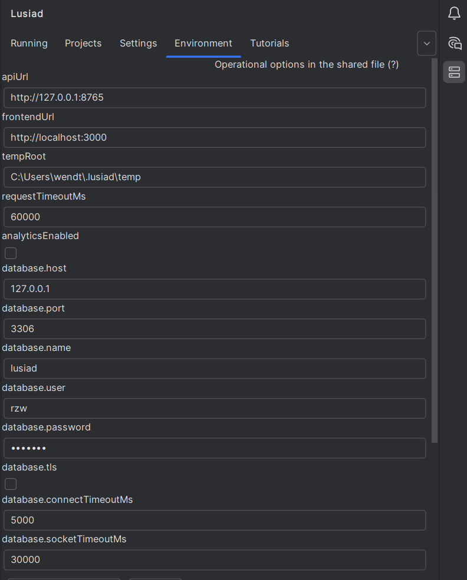

Tutoriais (Tutorials)

## 2. Projetos

A tela inicial lista as pastas cadastradas no Lusiad. Busque por nome, descrição ou caminho. Clique em um projeto para ver o resumo à direita e, depois, em **Abrir projeto** para entrar no ambiente de modelagem. Passe o cursor sobre o nome no cabeçalho do ambiente para ver sua descrição. Use o logotipo do Lusiad para voltar à lista.

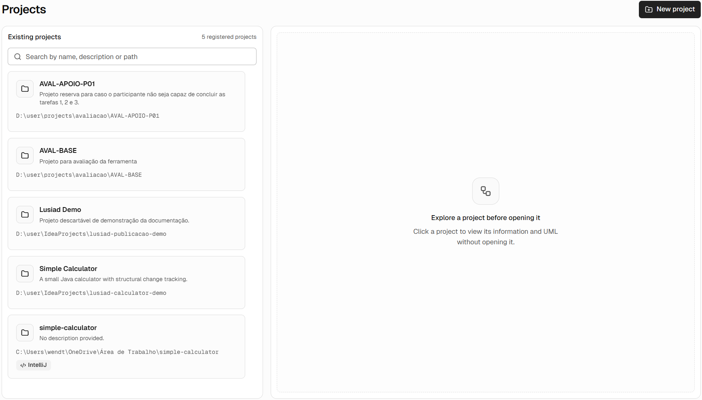

### Cadastrar uma pasta

1. Escolha **Novo projeto** e informe um nome.
2. Digite o caminho da pasta do projeto Java ou use **Selecionar pasta**. O seletor de pastas abre por meio do plugin do IntelliJ. Conclua ou cancele essa janela antes de abrir outra seleção.
3. Se quiser, inclua uma descrição. Escolha **Criar projeto**, selecione o cadastro e verifique o caminho. Projetos abertos no IntelliJ sem cadastro no Lusiad podem aparecer em um aviso separado.

### Consultar ou gerenciar um cadastro

O resumo mostra o caminho e os totais de commits, mudanças, pendências e tags. A **UML do projeto** mostra a estrutura dos arquivos Java salvos. Use os controles de zoom ou role o diagrama. Use **Atualizar** para consultar uma versão mais recente do resumo e do código.

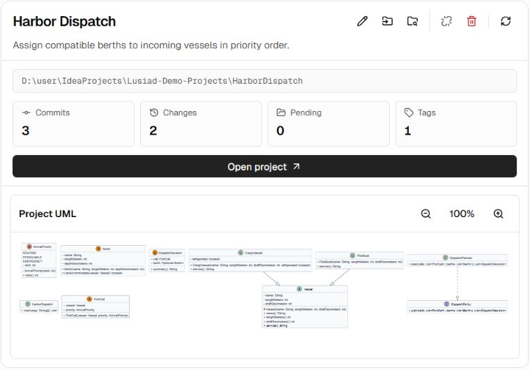

| Ação no resumo | Efeito |
| --- | --- |
| **Editar cadastro** | Altera o nome e a descrição do cadastro. |
| **Mover pasta do projeto** | Move a pasta com o repositório Git e preserva histórico e tags no Lusiad. Resolva as pendências, escolha um diretório na mesma unidade sem pasta de destino conflitante e confira caminho e quantidade de arquivos. |
| **Localizar pasta movida** | Vincula o cadastro e o histórico existentes a uma pasta compatível que você já moveu. Confira os caminhos de origem e destino. |
| **Remover cadastro** | Remove o cadastro, o histórico, as tags e as referências do Lusiad. Os arquivos e o Git permanecem no disco. Um novo cadastro inicia outro histórico no Lusiad. |
| **Excluir pasta e cadastro** | Apaga permanentemente a pasta, incluindo arquivos ignorados e `.git`, e remove o cadastro. Revise o caminho e a prévia antes de digitar o nome exato do projeto para confirmar. |

Se o Lusiad indicar uma movimentação ou remoção interrompida, volte à tela de projetos e consulte o registro de recuperação da operação antes de tentar novamente. A prévia também informa onde ficaram as cópias temporárias que foram preservadas.

## 3. Ambiente de modelagem e explorador de arquivos

Abra um arquivo `.java` no explorador para carregar o modelo. As barras externas abrem os painéis de projeto e histórico. Os controles internos ao lado do canvas mostram ou recolhem a biblioteca e as propriedades.

| Onde | Controles |
| --- | --- |
| Cabeçalho | Logotipo para voltar à tela de projetos, nome do projeto atual, engrenagem de configurações e ajuda. |
| Barra esquerda | **Explorador de arquivos** e **Sincronização externa**. O contador da sincronização indica as mudanças detectadas. |
| Barra de ferramentas central | Desfazer e refazer, abas de arquivos e prévias, UML atual e execução Java. |
| Centro e borda inferior | Canvas Java, botões da biblioteca e das propriedades, **Problemas** e caminho hierárquico do bloco selecionado. |
| Barra direita, de cima para baixo | **Histórico de mudanças**, **Branches**, **Commit** e **Comparar versões**. |

### Explorador de arquivos

- **Abrir.** Expanda uma pasta e dê duplo clique em um arquivo, ou selecione-o e pressione **Enter**. O modelo abre para Java. Outros arquivos com prévia textual abrem em modo de leitura. Alterne ou feche as visualizações pelas abas. O explorador fica em modo de leitura nas prévias históricas.
- **Criar.** Selecione a pasta de destino e use **Novo arquivo** ou **Nova pasta**. Informe o nome. A extensão `.java` é acrescentada automaticamente quando omitida em um novo arquivo Java. Limpe a seleção para criar na raiz do projeto.
- **Renomear, mover ou excluir.** Use os controles do topo, o botão direito ou o menu de três pontos do item. Arraste uma entrada para uma pasta de destino para movê-la. Para excluir, confira o item indicado e confirme. Operações sobre caminhos podem aparecer nas consultas posteriores ao histórico.
- **Buscar e navegar.** Use o campo de busca e os botões **Expandir tudo** e **Recolher tudo**. Passe sobre o nome da pasta do projeto para ver o caminho, clique no nome para copiá-lo ou use o ícone de pasta para abrir o explorador do sistema.

## 4. Canvas e controles dos blocos

O canvas exibe o código Java salvo com caixas aninhadas sobre classes, métodos, atributos, instruções e outros elementos. Clique em uma caixa para selecionar o elemento. O caminho hierárquico no rodapé mostra os elementos que o contêm. Clique em um deles para selecionar um ancestral.

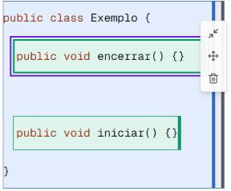

| Ação | Como usar |
| --- | --- |
| **Navegar com o teclado** | Com foco no canvas, use **↑** e **↓** para navegar, **Home** e **End** para chegar ao primeiro ou último bloco, **Enter** ou **Espaço** para selecionar e **Esc** para limpar a seleção. |
| **Recolher ou expandir** | Use o controle do bloco selecionado para ocultar ou exibir seus descendentes durante a leitura. |
| **Mover** | Arraste a alça de quatro setas junto ao bloco selecionado. Siga o indicador de inserção até um local válido e solte. O movimento ocorre no arquivo aberto. Confira o código resultante e o evento no histórico. |
| **Excluir** | Selecione o bloco desejado e use a lixeira. Confira seu intervalo antes de confirmar. O canvas também permite selecionar e excluir uma linha em branco. |
| **Editar** | Abra as propriedades para editar os atributos ou o código Java do trecho selecionado. |

O marcador de inserção pode indicar uma linha em branco, um espaço entre linhas, uma coluna válida dentro de um corpo vazio em uma única linha ou o fim do arquivo. Se o destino não aparecer, tente um limite adequado ao elemento, como a região dentro da classe para um método ou dentro de um método para uma instrução. Uma edição em andamento ou uma alteração feita em outro editor pode exigir recarregar o arquivo ou concluir a sincronização.

## 5. Biblioteca e criação de componentes

Abra a biblioteca à esquerda do canvas. O **Catálogo** organiza os modelos por grupo. Busque pelo nome ou por termos relacionados, e use o pino para adicionar um modelo a **Favoritos**. Os favoritos são guardados no navegador.

| Grupo | Componentes |
| --- | --- |
| Tipos | Classe, interface, enum, record e declaração de anotação. |
| Membros | Atributo, construtor, método, inicializador estático e inicializador de instância. |
| Instruções | Variável local, chamada de método e expressão ou atribuição. |
| Condições e controle | `if` / `else`, `switch` / `case`, `synchronized` e `assert`. |
| Laços | `for`, `for-each`, `while` e `do` / `while`. |
| Retorno e desvios | `return`, `break`, `continue` e `yield`. |
| Exceções | `try` / `catch` / `finally` e `throw`. |
| Pacotes e imports | Declaração de pacote, import individual e import com curinga. |
| Comentários e espaçamento | Comentário de linha, comentário de bloco, Javadoc e linha em branco. |

1. Abra um arquivo Java e arraste o card para o contêiner pretendido. A prévia indica onde o código seria inserido. Um contexto incompatível impede a inserção.
2. Na janela de criação, preencha os atributos. Para um método, confira nome, retorno, modificadores, parâmetros e corpo. Para um atributo, confira tipo, nome e valor inicial. Os campos disponíveis dependem do componente.
3. Confira o **Código Java** gerado e edite-o diretamente se necessário. Use **Criar componente**, examine os diagnósticos quando aparecerem e confirme. **Cancelar** encerra a criação sem aplicar o rascunho.

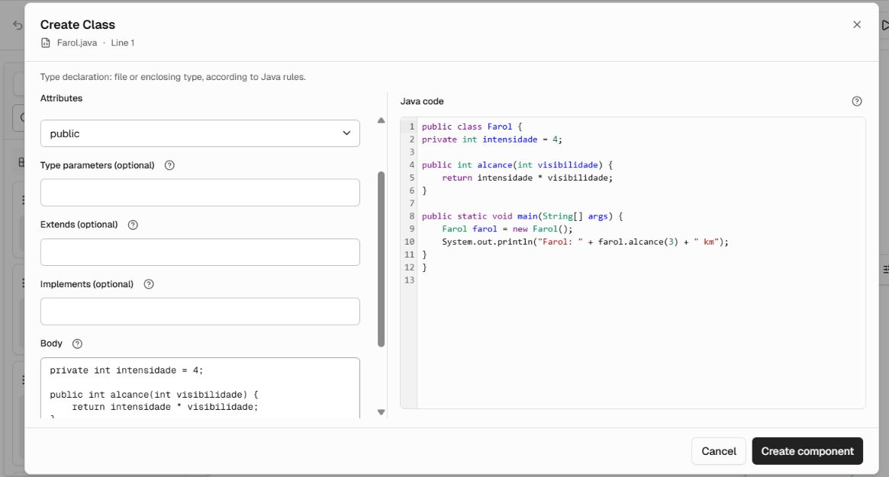

## 6. Propriedades e confirmação de edições

Selecione um bloco e abra **Propriedades** à direita. O rodapé identifica o tipo do elemento, as linhas e o intervalo no código. Se precisar mudar de elemento, selecione a caixa correta ou use o caminho hierárquico antes de editar.

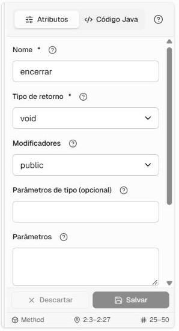

| Aba ou ação | Uso |
| --- | --- |
| **Atributos** | Edite os campos disponíveis para o elemento. Alterar o nome de uma declaração aqui edita o intervalo selecionado. Atualize as referências separadamente quando necessário. |
| **Código Java** | Edite o trecho selecionado como rascunho. Após uma edição manual, use a opção de inspecionar o rascunho quando disponível, para que o Lusiad tente recuperar os atributos. Se a leitura estruturada não for possível, o texto continua disponível no editor de código. |
| **Descartar** | Abandona as edições ainda não salvas no formulário. |
| **Salvar** | Verifica a proposta no contexto do arquivo inteiro e aplica a edição após as confirmações necessárias. Uma alteração aplicada é gravada no disco e aparece no histórico pendente. |

Se a confirmação mostrar erros sintáticos, **Corrigir** retorna ao rascunho, **Cancelar** interrompe a aplicação e **Continuar mesmo assim** aplica explicitamente a proposta com os problemas indicados. A lista pode incluir diagnósticos que já existiam no arquivo. Quando a verificação Java de propostas estiver ativa, confira também as mensagens do compilador ou o motivo de a análise não ter sido concluída.

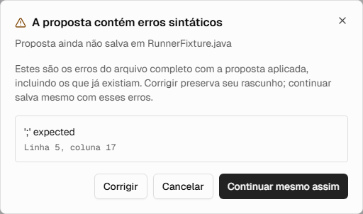

## 7. Desfazer e refazer

Use as setas curvas ao lado das abas para operações confirmadas no projeto. Fora de campos editáveis, **Ctrl/⌘+Z** desfaz e **Ctrl/⌘+Shift+Z** refaz. **Ctrl+Y** também refaz. Dentro de um campo ou editor de código, os atalhos agem sobre o rascunho local.

Desfazer recupera o estado anterior de uma operação compatível. Refazer reaplica a operação. Cada ação confirmada aparece no histórico. Conclua ou feche a edição em andamento antes de usar esses controles no projeto. Se a proposta de desfazer ou refazer introduzir erros, verifique os diagnósticos e use **Corrigir** para conferir ou ajustar o estado proposto quando a opção aparecer.

A pilha pertence à sessão atual do plugin. Operações como commit, criação de branch, merge e aceitação de mudanças externas encerram essa pilha. Alterações grandes podem exceder a capacidade de armazenamento. Se o Lusiad oferecer **Operação sem desfazer**, prosseguir aplica a operação sem uma entrada correspondente na pilha.

## 8. Configuração, verificação e execução Java

### Configurar o contexto Java

Abra **Configurações → Java** e selecione um projeto cadastrado, ou abra o botão de configuração em **Execução Java** ou **Verificação Java**. Escolha a pasta do JDK ou use **Usar o JDK do Run**. Confira a versão Java e informe um caminho por linha para as raízes de produção, raízes de teste, dependências do classpath e dependências modulares, conforme o projeto. Salve. A interface informa o compilador usado pelo plugin e a disponibilidade do contexto.

### Verificar um arquivo ou o projeto

1. Abra **Problemas** no rodapé do canvas. Escolha **Arquivo atual** ou **Projeto**. **Sintaxe (PSI)** indica problemas sintáticos e suas localizações. No escopo de projeto, examine os diagnósticos dos arquivos e selecione um para navegar até ele.
2. Escolha **Verificar Java com o compilador** para analisar as fontes configuradas com `javac`. Confira quantos arquivos foram analisados, em que posição ficam os diagnósticos e se o resultado está parcial ou desatualizado. Uma contagem de zero erros vale para o escopo, JDK e dependências configurados.
3. Para verificar propostas antes de salvar, marque **Verificar Java ao confirmar alterações (nesta sessão)** no painel ou em **Configurações → Java**. A revisão pode analisar o código que seria produzido antes de gravá-lo.

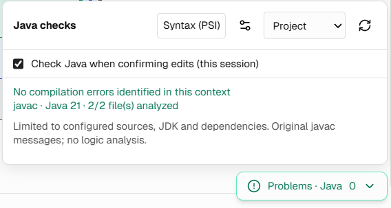

### Compilar e executar

1. Clique no triângulo **Executar código Java** ao lado das abas. Se a interface pedir, selecione a classe principal. O Lusiad busca `public static void main(String[] args)` nas fontes configuradas.
2. Inicie a execução. O Lusiad compila e executa uma cópia do código salvo, inclusive edições pendentes já gravadas. Salve primeiro os rascunhos que deseja executar.
3. Confira **Saída**, **Erros** e o código de saída. **Interromper** encerra uma execução ativa. **Executar novamente** usa a entrada salva atual. **Atualizar classes executáveis** repete a busca após mudanças nos arquivos ou na configuração.

Se nenhuma classe principal aparecer, confira as raízes de produção e a assinatura do método. Caso o compilador informe pacotes ausentes, confira os caminhos das dependências. Um erro de compilação interrompe o processo antes da execução. Uma exceção em tempo de execução pode vir acompanhada da saída impressa até o momento da falha. No exemplo da calculadora, quatro operações geram saída antes de uma divisão por zero aparecer em **Erros**, com código de saída `1`. [Captura do erro em tempo de execução](../assets/user-guide/run-runtime-error.png)

## 9. Commit

Abra **Commit** na barra direita. Se o Git ainda não estiver inicializado, use **Inicializar repositório**. Se o Git já existir e aparecer **Concluir inicialização**, finalize o registro da versão inicial usada como base pelo histórico e pela sincronização.

1. Use **Atualizar** se a lista estiver desatualizada. Confira os arquivos agrupados por tipo de mudança e filtre pelo nome quando necessário. Se o painel pedir revisão externa, conclua a [sincronização](#sincronizacao).
2. Informe o **Título do commit** e, se quiser, uma **Descrição**. Confira a branch em **Branches**.
3. Clique em **Commit** e aguarde a confirmação. A versão aparece no histórico e no grafo, com os eventos individuais agrupados. O commit encerra a pilha atual de desfazer e refazer.

Quando houver pendências, o painel pode oferecer uma lixeira para descartá-las. Leia a confirmação antes de prosseguir. Veja [Retorno e restauração](#restauracao) para escolher a ação que atende ao seu objetivo.

## 10. Histórico, tags e UML

### Encontrar uma versão ou evento

Abra **Histórico de mudanças**. **Mudanças não commitadas** lista os eventos pendentes. **Versões salvas** lista os commits. Use **Recarregar**, busque por resumo, arquivo ou tag e filtre por merges, criação de branches ou versões com tags. Use as setas, a quantidade por página ou o campo com o número da página para navegar.

Expanda um card de commit para ver seus eventos. Selecione um evento para abrir a prévia de **Antes/Depois** e escolha **Expandir** para consultar os detalhes. A visão ampliada reúne código ou UML, linha do tempo, metadados e explorador do estado reconstruído. As cores distinguem adições, exclusões, alterações e movimentos. Use **Antes** ou **Depois** no explorador para consultar os arquivos e caminhos daquele estado.

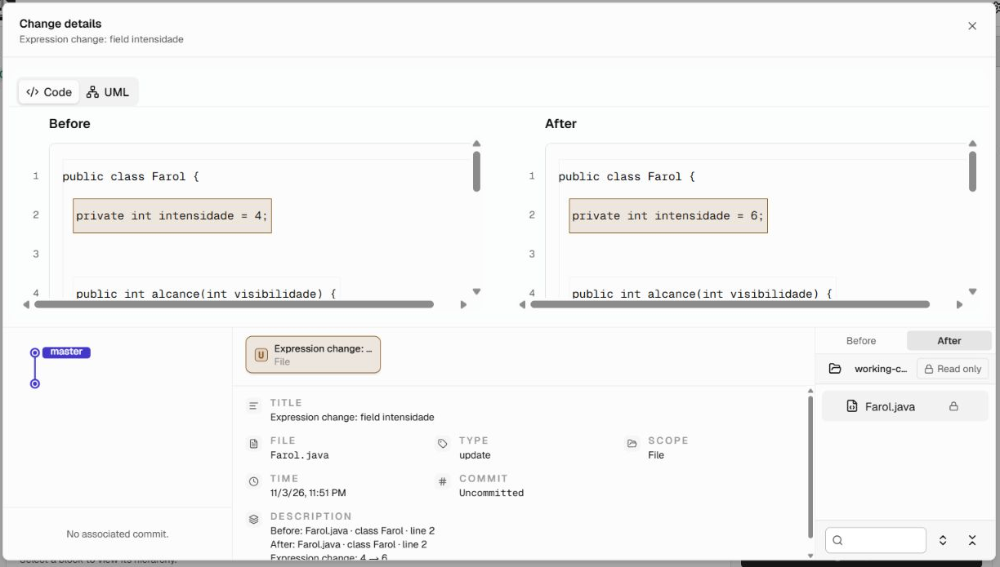

A prévia é somente leitura. Se uma nova operação invalidar uma prévia pendente, reabra o evento pelo histórico atualizado. Lotes de mudanças externas já commitados podem mostrar os arquivos afetados e o texto anterior e posterior dos arquivos Java.

### Marcar ou reutilizar uma referência

Use os três pontos ou o menu de contexto de um commit ou evento para **Gerenciar tags**. Adicione um nome, renomeie uma tag ou confirme sua remoção. O nome começa com letra ou número e pode conter letras, números, espaços, pontos, sublinhados, barras e hífens, com até 80 caracteres. Use as tags para filtrar o histórico, localizar referências no grafo ou selecionar pontos de comparação. Use **Copiar referência** nos itens em que a ação estiver disponível.

### Consultar a estrutura de classes

| Onde abrir a UML | Escopo |
| --- | --- |
| **Projetos → UML do projeto** | Estrutura salva do projeto selecionado antes de abrir o ambiente. |
| **UML atual** ao lado das abas | Estrutura salva do arquivo Java aberto ou visão geral do projeto. Alterne o escopo e use o zoom ou a rolagem do diagrama. |
| **Histórico → Expandir → UML** | Diagramas de classes anterior e posterior ao evento. Use **Arquivo** ou **Visão geral** quando disponíveis. O histórico pode mostrar origem e destino de um movimento ou indicar equivalência estrutural. |

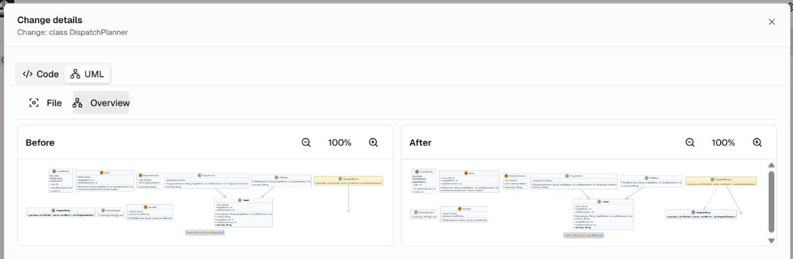

Para uma alteração restrita ao corpo ou à ordem dos métodos, consulte a visão de código. O diagrama de classes apresenta declarações e relacionamentos.

## 11. Branches e merge

Abra **Branches**. O cabeçalho identifica a branch atual. Clique no nome de uma branch ou no nó de um commit para ver os detalhes no rodapé. Selecione o marcador de uma tag de mudança para consultar o evento correspondente. **Ver no histórico** abre o commit ou a mudança. Se a origem de um vínculo estiver fora do trecho atual do grafo, atualize ou carregue mais registros.

1. **Criar branch.** Resolva as pendências. Preencha **Nova branch** e clique no botão de adição. A branch começa a partir da atual e se torna a linha de trabalho.
2. **Consultar sua evolução.** O grafo indica a criação de branches, commits comuns, merges e restaurações. O vínculo de restauração aponta para a versão ou o evento usado como origem.
3. **Integrar na base.** Registre o trabalho da branch atual em um commit e confira a base nos detalhes da branch. Clique em **Integrar na base** quando disponível. Após a integração, consulte o resultado e a branch ativa no grafo. Se a integração for bloqueada, leia a mensagem do painel antes de tentar novamente.

Clicar no nome de uma branch no grafo abre seus detalhes. Para saber em qual branch um commit ou uma restauração será registrado, consulte o indicador no cabeçalho.

## 12. Comparação de versões

Abra **Comparar versões** na barra direita. Use **Base** para o estado de partida e **Alvo** para o estado que será comparado com ele. O botão de inversão troca os lados e, com isso, o significado de linhas adicionadas e removidas.

1. Abra o seletor de referência dos dois lados. Busque ou filtre por commits salvos, mudanças commitadas, tags do Lusiad ou referências Git. Você também pode digitar uma referência aceita, como `sha:...`, `branch:...` ou `tag:...`. Use **Estado vazio do projeto** para comparar com uma base sem arquivos. Uma mudança commitada aponta para o estado imediatamente posterior ao evento. Um lote externo aponta para seu commit completo.
2. Use **Comparar**. Confira as contagens, filtre a lista de arquivos afetados e clique em um arquivo para abrir a diferença.
3. Alterne entre **Canvas**, **PSI** e **Git diff**. Para voltar ao editor, feche a prévia central pelo **×**.

| Visão | Uso |
| --- | --- |
| **Canvas** | Compare Antes e Depois com caixas e destaques no código. Isso ajuda a localizar a mudança dentro do elemento Java correspondente. |
| **PSI** | Expanda os nós sintáticos de cada lado para inspecionar declarações, instruções e seus descendentes. |
| **Git diff** | Leia as linhas removidas e adicionadas e seu contexto. Use a contagem por arquivo para localizar diferenças maiores. |

Capturas de Canvas, PSI e Git diff

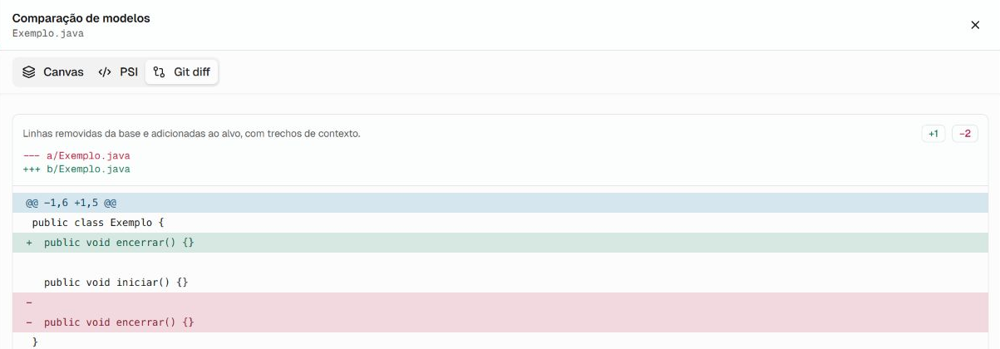

A comparação abre as referências em modo de consulta e mantém o projeto no disco. Use a [restauração](#restauracao) quando quiser aplicar um estado histórico ao projeto.

## 13. Sincronização externa

Após o primeiro commit, alterações feitas no IntelliJ, em outro editor ou no explorador do sistema podem aparecer em **Sincronização externa**. Abra o painel das setas circulares na esquerda e use **Atualizar**. A edição no Lusiad pode ficar pausada enquanto houver diferenças externas para revisar.

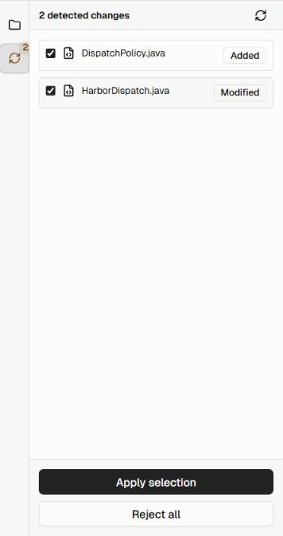

1. Abra um caminho afetado para ver a prévia. Para arquivos Java compatíveis, as linhas são comparadas com o estado registrado. Diretórios, arquivos binários e outros caminhos sem prévia textual continuam na lista para revisão.
2. Marque cada caminho que deseja manter. **Aplicar seleção** aceita os marcados e restaura os demais ao estado registrado. **Rejeitar tudo** restaura esse estado para a lista inteira. Confira a seleção antes de aplicar.
3. Se aceitou mudanças, abra **Commit** e registre o lote de mudanças externas para voltar a editar. Antes do commit, **Cancelar mudanças aceitas** permite descartar o lote. Atualize e revise novamente se outra edição no disco invalidar a seleção.

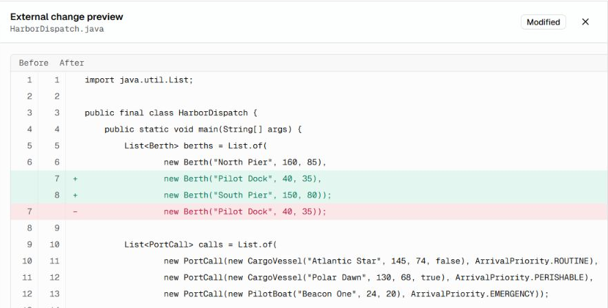

O histórico agrupa as alterações externas aceitas em um lote. Após o commit, consulte o lote para encontrar os arquivos afetados.

## 14. Retorno e restauração

Use o [histórico](#historico) para localizar o evento ou a versão. Escolha a ação conforme o trabalho que deseja preservar.

| Objetivo | Ação e efeito |
| --- | --- |
| Preservar as pendências até determinado evento | Em **Mudanças não commitadas**, abra o menu do evento e escolha **Voltar a esta mudança**. Confira os eventos posteriores, caminhos e tags que serão removidos. Confirme **Descartar e voltar**. O estado logo após o evento selecionado se torna o atual. |
| Abandonar todas as pendências | Escolha **Descartar todas as pendências** no histórico ou a ação disponível em **Commit**. Revise e confirme. Os arquivos retornam ao último commit e os eventos pendentes são removidos. |
| Restaurar uma versão salva | No menu do commit, escolha **Restaurar projeto a este commit**. Confira a branch atual e as alterações nos arquivos, então escolha **Restaurar e criar commit**. |
| Restaurar o estado após uma mudança individual já commitada | No menu do evento, escolha **Restaurar projeto após esta mudança**. Confira o evento, seu commit e os arquivos afetados, depois escolha **Restaurar e criar commit**. |

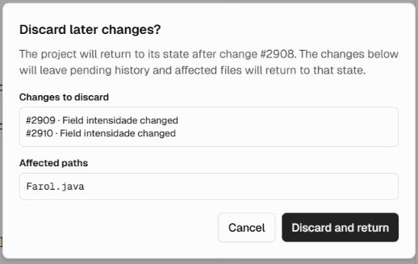

O retorno e o descarte removem pendências sem criar uma versão. A restauração cria **um novo commit na branch atual** com um vínculo ao commit ou evento que serviu de origem. Resolva as pendências e as mudanças externas antes de restaurar. Depois de confirmar, localize o novo commit no histórico ou no grafo e abra os arquivos relevantes para verificar o resultado.

## 15. Preferências e solução de problemas

Use a engrenagem no canto superior direito da tela de projetos ou do ambiente de modelagem.

| Aba da interface web | Controles |
| --- | --- |
| **Interface** | Selecione português brasileiro ou inglês e escolha separadamente o idioma dos textos de mudança gerados pelo Lusiad. Ajuste o tema para claro, escuro ou seguir o sistema. Selecione ou personalize a paleta dos blocos e use o botão de redefinição para voltar ao padrão. Títulos e descrições digitados mantêm o texto original. |
| **Java** | Escolha o projeto para configurar JDK, versão, raízes de código e dependências. Se necessário, ative a verificação com o compilador nas propostas da sessão. |
| **Ambiente** | Confira o perfil operacional, os endereços, as informações do banco e a raiz temporária padrão. Salvar uma nova raiz afeta os novos cadastros. Projetos existentes mantêm suas pastas. As opções fornecidas pelo processo ou pelo perfil de teste podem aparecer como somente leitura. |

Preferências compartilhadas de idioma e aparência podem se sincronizar com o plugin. Favoritos e algumas opções da sessão ficam no navegador ou na sessão atual. Use o **?** principal para conhecer o ambiente e o **?** de um painel para consultar seus próprios controles.

| Se acontecer isto | Onde verificar |
| --- | --- |
| A página abre, mas projetos ou arquivos não carregam | Em **IntelliJ → Lusiad → Execução**, confira o servidor, o banco e a interface. Verifique se o frontend usa a configuração da mesma instalação. |
| O arquivo abre sem blocos editáveis | Confira a extensão, se é uma visão histórica e se mudanças externas bloquearam a edição. |
| O arraste ou a gravação é recusado | Confira o nó, o contêiner de destino e a revisão do arquivo. Leia a mensagem, resolva alterações externas se solicitado e reabra ou recarregue o arquivo antes de repetir a operação. |
| Commit, operação de branch ou restauração indisponível | Confira as pendências, a branch Git e a existência de um lote externo. Conclua ou cancele a operação que estiver aguardando confirmação. |
| A visão histórica está ausente ou desatualizada | Recarregue o histórico e reabra o evento correspondente. Se a origem de um vínculo estiver fora do grafo atual, carregue mais commits. |
| O compilador não encontra fontes ou a execução não encontra a classe principal | Confira o [contexto Java](#java), incluindo raízes de produção, dependências e projeto ativo. Atualize a lista de classes executáveis. |

---

<table width="100%">
<tr>
<td align="left"><a href="../../README.pt-BR.md">⬅️ Página anterior</a></td>
<td align="center"><a href="../../README.pt-BR.md#índice-da-documentação">1️⃣ Manual de uso</a></td>
<td align="right"><a href="preparacao.md">Próxima página ➡️</a></td>
</tr>
</table>

### Índice da documentação

**[📖 Visão geral](../../README.pt-BR.md)**

- [🖥️ Manual de uso](manual.md) 👈

**[⚙️ Instalação](preparacao.md)**

- [🔧 Guia de instalação](instalacao.md)
- [🚀 Primeiros passos](primeiros-passos.md)

**[📐 Projeto](projeto.md)**

- [📋 Requisitos](requisitos.md)
- [✏️ Prototipação](prototipacao.md)

**[💻 Implementação](implementacao.md)**

- [🏗️ Arquitetura](arquitetura.md)
- [📂 Estrutura de diretórios](estrutura-de-diretorios.md)
- [🧰 Tecnologias utilizadas](tecnologias-utilizadas.md)
- [🗃️ Modelo de dados](modelo-de-dados.md)
- [🔌 Referência da API](referencia-da-api.md)
- [🔀 Diagramas de interação](diagramas-de-interacao.md)
- [🧭 Decisões de projeto](decisoes-de-projeto.md)
- [🔍 Elementos notáveis da implementação](elementos-notaveis-da-implementacao.md)

**[📊 Avaliação](avaliacao.md)**

- [📋 Planejamento](avaliacao-planejamento.md)
- [🧪 Execução](avaliacao-execucao.md)
- [📈 Resultados](avaliacao-resultados.md)
- [💬 Discussão](avaliacao-discussao.md)
- [📂 Materiais e dados](avaliacao-dados.md)
- [🗂️ Arquivos da avaliação](../zenodo/)
