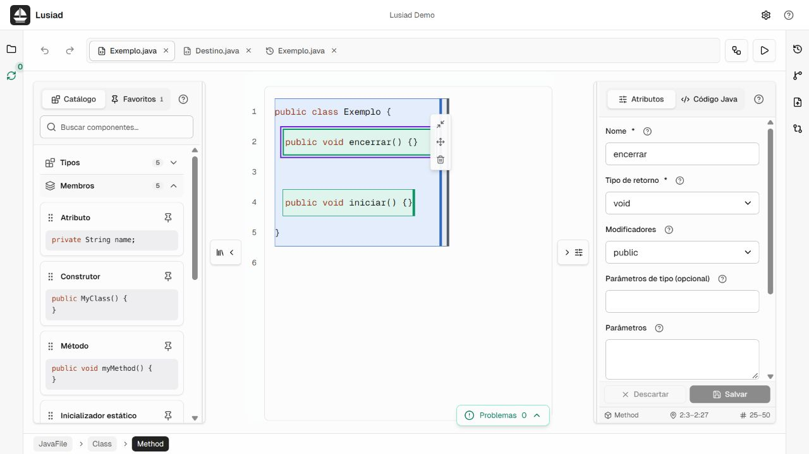
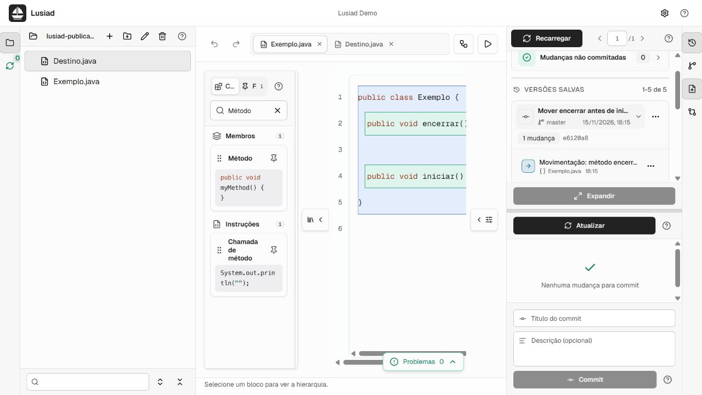
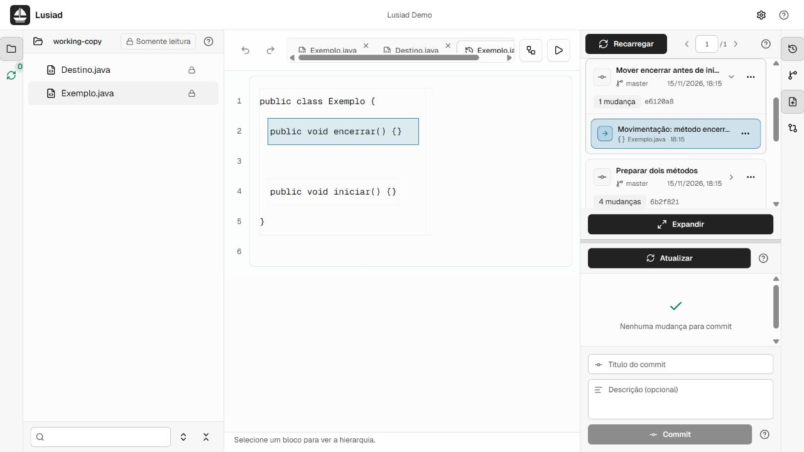
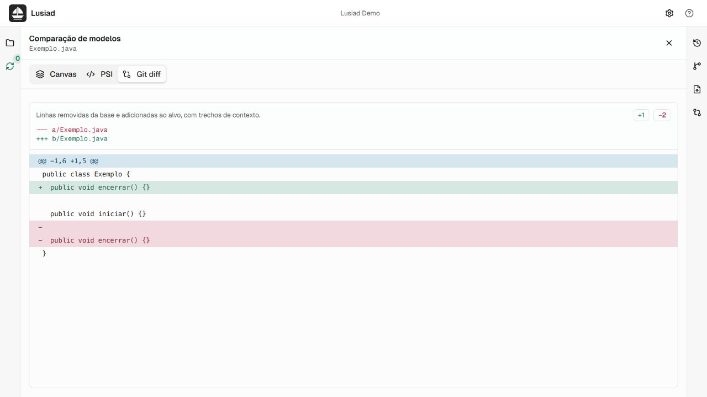

# Manual de uso

## Nesta página

- [Painel do plugin](#painel-do-plugin)
- [Projetos e editor](#projetos-e-editor)
- [Histórico e comparação](#histórico-e-comparação)
- [Telas](#telas)

## Painel do plugin

Abra **Lusiad** na janela de ferramentas do IntelliJ. O painel permite iniciar e parar o servidor local, verificar a ligação com o MySQL, configurar o endereço do frontend, ajustar preferências e consultar tutoriais. Mantenha a IDE aberta enquanto usa a interface web.

## Projetos e editor

A página de projetos cadastra uma pasta, seleciona um projeto e abre o ambiente de trabalho. No explorador, abra um arquivo Java. A área central mostra a estrutura editável e o código correspondente. A biblioteca oferece componentes para inserção. Selecione um elemento para editar seus atributos no painel de propriedades. As ações de desfazer e refazer ficam junto às abas. Os ícones de ajuda oferecem orientação guiada para as áreas principais.

## Histórico e comparação

Inicie Git no projeto pela interface e registre uma versão pelo menu de commit. No histórico, escolha a branch e o commit. Abra uma mudança individual para consultar o evento registrado. A comparação de versões permite escolher base e alvo. Antes de restaurar um estado, confirme a branch e a versão indicadas na interface. O [guia de primeiros passos](primeiros-passos.md) apresenta uma sequência curta dessas ações.

## Telas

As imagens abaixo foram capturadas na interface real com um projeto descartável. O backend demonstrado corresponde a `851120d` e o frontend a `d2f9326`; a correspondência com a versão avaliada permanece incerta.

*Modelo e biblioteca antes da movimentação.*

*Modelo e Java depois da movimentação.*

*Biblioteca, modelo e propriedades na mesma tela.*

*Commit e evento individual no histórico.*

*Consulta do evento selecionado.*

*Comparação das versões no canvas.*

*Diff Git da mesma operação.*

*Representação estrutural antes e depois.*

O painel do plugin IntelliJ não estava aberto durante a captura. Para completá-la, instale o ZIP da release em uma IDE descartável, abra o projeto de demonstração, exiba **View → Tool Windows → Lusiad**, oculte caminhos e credenciais e salve uma captura em `docs/assets/08-painel-plugin.png`. Insira-a nesta seção após revisão visual.

---

[← Primeiros passos](primeiros-passos.md) · [Índice](index.md) · [Arquitetura →](arquitetura.md) · [English](../en/manual.md)
