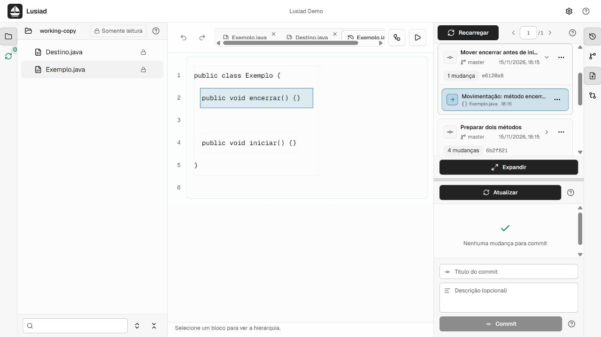
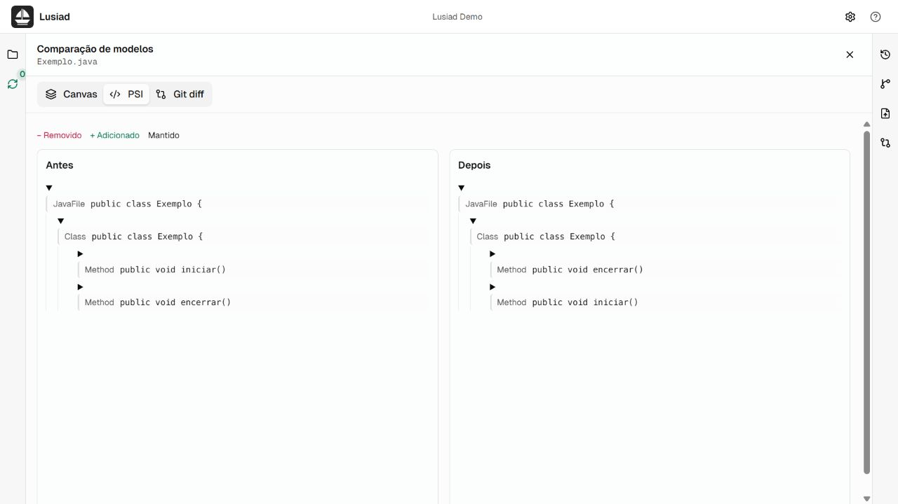

# `Lusiad` – Manual de uso

[🇺🇸 English](../en/manual.md) · **🇧🇷 Português (Brasil)**

### Nesta página

> [1. Painel do plugin](#-1-painel-do-plugin) 
> [2. Projetos e editor](#-2-projetos-e-editor) 
> [3. Histórico e comparação](#-3-histórico-e-comparação) 
> [4. Telas](#-4-telas) 
> [Índice da documentação](#índice-da-documentação)

---

## 🔌 1. Painel do plugin

Abra **Lusiad** na janela de ferramentas do IntelliJ. O painel permite iniciar e parar o servidor local, verificar a ligação com o MySQL, configurar o endereço do frontend, ajustar preferências e consultar tutoriais. Mantenha a IDE aberta enquanto usa a interface web.

## 🗂️ 2. Projetos e editor

A página de projetos cadastra uma pasta, seleciona um projeto e abre o ambiente de trabalho. No explorador, abra um arquivo Java. A área central mostra a estrutura editável e o código correspondente. A biblioteca oferece componentes para inserção. Selecione um elemento para editar seus atributos no painel de propriedades. As ações de desfazer e refazer ficam junto às abas. Os ícones de ajuda oferecem orientação guiada para as áreas principais.

## 🕘 3. Histórico e comparação

Inicie Git no projeto pela interface e registre uma versão pelo menu de commit. No histórico, escolha a branch e o commit. Abra uma mudança individual para consultar o evento registrado. A comparação de versões permite escolher base e alvo. Antes de restaurar um estado, confirme a branch e a versão indicadas na interface. O [guia de primeiros passos](primeiros-passos.md) apresenta uma sequência curta dessas ações.

## 🖼️ 4. Telas

As imagens abaixo foram capturadas na interface real com um projeto descartável. O backend demonstrado corresponde a `851120d` e o frontend a `d2f9326`.

*Modelo e biblioteca antes da movimentação.*

*Modelo e Java depois da movimentação.*

*Biblioteca, modelo e propriedades na mesma tela.*

*Commit e evento individual no histórico.*

*Consulta do evento selecionado.*

*Comparação das versões no canvas.*

*Diff Git da mesma operação.*

*Representação estrutural antes e depois.*

O painel do plugin IntelliJ não estava aberto durante a captura. Para completá-la, instale o ZIP da release em uma IDE descartável, abra o projeto de demonstração, exiba **View → Tool Windows → Lusiad**, oculte caminhos e credenciais e salve uma captura em `docs/assets/08-painel-plugin.png`. Insira-a nesta seção após revisão visual.

---

<table width="100%">
<tr>
<td align="left"><a href="../../README.pt-BR.md">⬅️ Página anterior</a></td>
<td align="center"><a href="index.md">1️⃣ Manual de uso</a></td>
<td align="right"><a href="demonstracao.md">Próxima página ➡️</a></td>
</tr>
</table>

### Índice da documentação

**[📖 Visão geral](../../README.pt-BR.md)**

- [🖥️ Manual de uso](manual.md) 👈
- [🎬 Demonstração](demonstracao.md)

**[⚙️ Instalação](preparacao.md)**

- [🔧 Guia de instalação](instalacao.md)
- [🚀 Primeiros passos](primeiros-passos.md)

**[📐 Projeto](projeto.md)**

- [📋 Requisitos](requisitos.md)
- [✏️ Prototipação](prototipacao.md)

**[💻 Implementação](implementacao.md)**

- [🏗️ Arquitetura](arquitetura.md)
- [📂 Estrutura de diretórios](estrutura-de-diretorios.md)
- [🧰 Tecnologias utilizadas](tecnologias-utilizadas.md)
- [🗃️ Modelo de dados](modelo-de-dados.md)
- [🔌 Referência da API](referencia-da-api.md)
- [🔀 Diagramas de interação](diagramas-de-interacao.md)
- [🧭 Decisões de projeto](decisoes-de-projeto.md)
- [🔍 Elementos notáveis da implementação](elementos-notaveis-da-implementacao.md)
