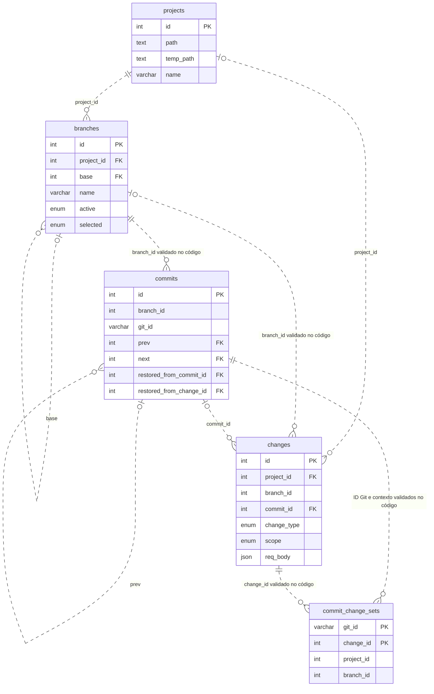
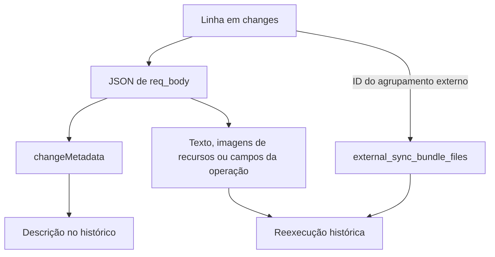
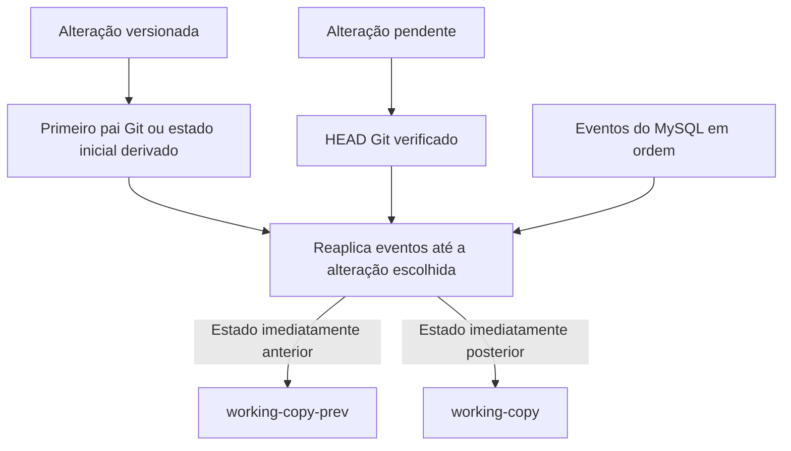

# `Lusiad` – Modelo de dados

[🇺🇸 English](../en/data-model.md) · **🇧🇷 Português (Brasil)**

O modelo de dados do Lusiad conecta os arquivos-fonte, os estados versionados no Git e os eventos registrados no MySQL. O plugin do IntelliJ deriva o modelo visual do código Java em edição. O Git guarda árvores de arquivos versionadas, e o MySQL guarda os identificadores, eventos e registros de operação que permitem rastrear cada alteração. Uma prévia histórica combina um estado de referência do Git com os eventos registrados no banco.

### Nesta página

> [1. Representações e identificadores](#representações-e-identificadores)<br>
> [2. Modelo relacional](#modelo-relacional)<br>
> [3. Registros de alteração](#registros-de-alteração)<br>
> [4. Sincronização, tags e registros de operações](#sincronização-tags-e-registros-de-operações)<br>
> [5. Dados usados nas prévias históricas](#dados-usados-nas-prévias-históricas)<br>
> [Índice da documentação](#índice-da-documentação)

---

## Representações e identificadores

| Representação | O que contém | Onde fica |
| --- | --- | --- |
| Código em edição | O estado atual dos arquivos e diretórios de um projeto Java cadastrado. | No diretório de trabalho indicado por `projects.path`. |
| Modelo visual | O caminho do arquivo, uma revisão opcional do código-fonte e uma árvore recursiva de nós PSI de Java. | É produzido pelo plugin e renderizado como blocos pelo frontend. |
| Estado versionado | Commits Git com árvores de arquivos e referências aos pais. | No repositório Git do projeto cadastrado. |
| Histórico de alterações | Cadastros de projetos e branches, versões registradas, alterações individuais e seus vínculos. | No MySQL. |
| Prévia histórica | Um estado de referência e os estados imediatamente anterior e posterior ao evento selecionado. | Em um diretório específico da requisição sob `projects.temp_path`. |

O `JavaModel` do frontend contém a árvore serializada de `PsiNode`. Os nós internos contêm filhos, e as folhas contêm o texto do código. Quando a leitura usa um documento, o serializador inclui offsets em unidades UTF-16 e posições de linha e coluna contadas a partir de 1. O offset inicial é inclusivo e o final é exclusivo. Para intervalos não vazios, a linha e a coluna finais indicam o último caractere. As posições só têm significado na revisão correspondente. A leitura do arquivo em edição fornece `revision` como o hash SHA-256 do texto do documento no IntelliJ. A requisição de edição pode enviar essa revisão de volta como `expectedHash`. [Serialização da PSI](../../lusiad-backend/src/main/java/com/lusiad/backend/service/psi/PsiService.java#L540-L580) · [Verificação da revisão](../../lusiad-backend/src/main/java/com/lusiad/backend/service/psi/EditCoordinator.java#L40-L46)

```typescript
export interface PsiNode {
  type: string
  text?: string
  startOffset?: number
  endOffset?: number
  startLine: number
  startColumn: number
  endLine: number
  endColumn: number
  children?: PsiNode[]
}

export interface JavaModel {
  revision?: string
  file: string
  tree: PsiNode
}
```

Os tipos TypeScript descrevem o que o editor recebe. Para recuperar o texto correspondente a um nó, a interface pode concatenar o texto das folhas na ordem da árvore. [Tipos do frontend](../../lusiad-frontend/src/lib/types.ts#L1-L17) · [Reconstrução do texto pelas folhas](../../lusiad-frontend/src/lib/models/model-editor/model-tree.model.ts#L1-L14)

O ID SQL de um commit identifica uma linha no histórico. Seu `git_id` identifica o objeto commit no repositório Git do projeto. O `operationId` de uma edição identifica o registro da operação, e o `changes.id` atribuído na confirmação identifica o evento exibido no histórico. O `snapshotId` identifica uma reconstrução temporária. [Esquema SQL](../../lusiad-backend/db/lusiad.sql) · [Registro de operações de edição](../../lusiad-backend/src/main/java/com/lusiad/backend/repository/change/EditOperationStore.java) · [Identidade da prévia](../../lusiad-frontend/src/lib/services/restore/preview-snapshot.ts)

## Modelo relacional

O diagrama mostra as tabelas centrais do histórico. As linhas rotuladas como “validado no código” representam vínculos lógicos. As chaves marcadas como `FK` correspondem a restrições declaradas no esquema MySQL do repositório. [Esquema](../../lusiad-backend/db/lusiad.sql) · [Serviço de registro Git](../../lusiad-frontend/src/lib/services/commit-menu/git-recording.service.ts)



| Tabela | Identidade e relacionamentos |
| --- | --- |
| `projects` | Cada cadastro tem um `id` interno, o caminho de trabalho `path`, um `temp_path` opcional, nome e descrição. |
| `branches` | Cada linha pertence a um projeto. `base` referencia a branch de origem, e `active` e `selected` indicam o estado da branch no Lusiad. |
| `commits` | A linha guarda o ID do objeto Git, o ID da branch, campos descritivos e a data. Para os commits gravados pelo serviço atual, `prev` referencia o primeiro pai. `next` indica um sucessor na mesma branch e cobre apenas parte das relações no grafo Git. |
| `changes` | Um evento tem um `change_type`, como `move`, `dir_rename` ou `external_bundle`, e um `scope` de `file`, `dir` ou `project`. Um `commit_id` nulo indica um evento pendente. O esquema também admite IDs nulos de projeto e branch. As consultas do histórico restringem os eventos ao projeto e aceitam branch nula em caminhos específicos de compatibilidade. |
| `commit_change_sets` | Associa um identificador de commit Git a cada alteração incluída e registra o contexto de projeto e branch. A chave primária composta é `(git_id, change_id)`. O serviço verifica o vínculo e grava a associação na transação que vincula o evento ao commit SQL. |

Os campos `commits.branch_id` e `changes.branch_id` guardam IDs de branch sem chaves estrangeiras SQL no esquema do repositório. A aplicação verifica a correspondência entre projeto e branch ao registrar e consultar o histórico. Para merges registrados pelo Lusiad, a consulta do grafo lê o segundo pai do plano da operação Git confirmada. Em um commit de restauração, `restored_from_commit_id` e, quando presente, `restored_from_change_id` indicam a origem do conteúdo restaurado. O pai Git do novo commit segue o histórico da branch. [Consulta do grafo de commits](../../lusiad-frontend/src/lib/repositories/commit-history/commit-history.repository.ts) · [Registro de versões e restauração](../../lusiad-frontend/src/lib/services/commit-menu/git-recording.service.ts) · [Preenchimento de branch em registros legados](../../lusiad-backend/db/migrations/lusiad-change-branch-backfill.sql)

## Registros de alteração

Uma alteração combina campos SQL com um corpo JSON. `summary`, `description` e `date_time` fornecem os textos e a data da entrada de histórico. `req_body` guarda os campos que variam com a operação e o formato de registro. Nas edições gravadas por `EditOperationStore`, `operationOrder` vem do ID autogerado do registro de operação. A consulta de reconstrução de uma alteração versionada percorre os eventos do commit na ordem de `changes.id`. [Registro de edições](../../lusiad-backend/src/main/java/com/lusiad/backend/repository/change/EditOperationStore.java) · [Serialização do evento](../../lusiad-backend/src/main/java/com/lusiad/backend/service/psi/EditCoordinator.java#L106-L143) · [Consulta de reconstrução](../../lusiad-backend/src/main/java/com/lusiad/backend/repository/restore/RestoreRepository.java)

| Formato | Dados usados para reconstruir a alteração |
| --- | --- |
| Edição textual, `recordVersion: 2` | `beforeText` e `afterText` contêm o texto completo do documento antes e depois. `beforeHash` e `afterHash` verificam esses valores. Para esses registros textuais, a reexecução confere se o arquivo de referência contém o texto anterior esperado. |
| Edição com imagens de recursos | `resources.before` e `resources.after` contêm as raízes afetadas e suas entradas por caminho relativo. Arquivos guardam os bytes codificados em Base64, diretórios têm entradas explícitas e uma raiz afetada pode estar ausente em um dos estados. Registros baseados em recursos são gravados na versão 3, e edições de versão 2 também podem conter imagens de recursos. A reexecução usa o par de imagens quando está disponível. |
| Agrupamento de alterações externas | O JSON do evento descreve o grupo de caminhos. `external_sync_bundle_files` guarda os tipos de recurso e os bytes antes e depois para cada caminho. |
| Operação legada | Quando nenhum formato mais recente se aplica, a reexecução aceita os campos antigos de operações no sistema de arquivos e encaminha as edições de código compatíveis a um adaptador PSI. |

O exemplo traz os campos de reexecução de uma edição textual de versão 2. Os valores descrevem uma alteração no retorno de `Counter.value()`. Os dois hashes correspondem aos textos completos exibidos, incluindo a quebra de linha final. [Serialização do evento](../../lusiad-backend/src/main/java/com/lusiad/backend/service/psi/EditCoordinator.java#L106-L143) · [Seleção do formato para reexecução](../../lusiad-backend/src/main/java/com/lusiad/backend/service/restore/HistoricalReplay.java) · [Imagem de recursos](../../lusiad-backend/src/main/java/com/lusiad/backend/service/undo/ResourceImage.java)

```json
{
  "path": "src/Counter.java",
  "recordVersion": 2,
  "operationId": "3afe2909-30bc-4824-a98e-c40be5588291",
  "operationOrder": 28,
  "beforeHash": "8d13cf56c189f6e6d10a7c5cf19e38d057ed0be2a5363577a7ded0d20e05258d",
  "afterHash": "f81aaaac8e30a4e1dbc14b7a8846c6b05b6befa5e1580dd09204e2d9c1875956",
  "beforeText": "class Counter {\n  int value() {\n    return 1;\n  }\n}\n",
  "afterText": "class Counter {\n  int value() {\n    return 2;\n  }\n}\n"
}
```

`req_body.changeMetadata` tem versão própria. Esse campo descreve o elemento afetado para exibição, com ação, tipo, lados opcionais de antes e depois e uma lista de diferenças detectadas. Cada lado pode descrever um caminho relativo, um intervalo, um elemento como um método e os elementos que o contêm. Uma criação pode ter apenas o lado posterior, e uma remoção pode ter apenas o anterior. O intervalo localiza o elemento no estado correspondente do código. A reexecução obtém o conteúdo dos arquivos dos dados registrados para a edição. [Produção dos metadados](../../lusiad-backend/src/main/java/com/lusiad/backend/service/change/ChangeMetadata.java) · [Contrato de metadados do frontend](../../lusiad-frontend/src/lib/models/change-history/change-metadata.ts)



## Sincronização, tags e registros de operações

| Tabela | Finalidade |
| --- | --- |
| `external_sync_projects` | Indica se a sincronização externa foi inicializada para um projeto e identifica seu agrupamento pendente, quando há um. |
| `external_sync_files` | Guarda o estado de referência da sincronização, identificado por `(project_id, path)`, com o tipo de recurso, conteúdo quando aplicável e hash SHA-256. |
| `external_sync_bundle_files` | Guarda as alterações externas aceitas, identificadas por `(change_id, path)`. Um tipo anterior nulo identifica um recurso que ainda não existia, e um tipo posterior nulo indica um recurso removido. |
| `lusiad_history_tags` | Guarda o nome exibido e uma chave normalizada `name_key` única por projeto. Uma restrição exige exatamente um alvo, que pode ser um commit ou uma alteração. |
| `lusiad_edit_operations` | Guarda o estado preparado e os dados da edição antes da escrita do arquivo. A confirmação associa a operação a `changes.id` e limpa o corpo preparado. Assim, a mesma operação pode ser reconhecida em uma tentativa posterior. |
| `lusiad_git_operations` | Guarda o plano da operação Git preparada ou aplicada e o ID SQL do commit após a confirmação. O plano aplicado também identifica a origem dos merges. |
| `lusiad_sync_operations` | Registra a preparação e a confirmação de decisões de sincronização externa entre o disco e o SQL. |
| `lusiad_project_operations` | Registra remoção de cadastro, exclusão, alteração de vínculo e movimentação de projetos cadastrados. A tabela dispensa a chave estrangeira de projeto para que o recibo possa permanecer após a exclusão do cadastro. |

Esses registros acompanham operações que gravam no sistema de arquivos ou no Git e confirmam o resultado no SQL. Em uma edição, o serviço primeiro persiste a intenção preparada. Depois de verificar a escrita, o repositório insere a alteração pendente e marca a intenção como aplicada na mesma transação SQL. O ID da alteração exibida no histórico só é atribuído nessa confirmação. [Coordenador de edição](../../lusiad-backend/src/main/java/com/lusiad/backend/service/psi/EditCoordinator.java) · [Confirmação da edição](../../lusiad-backend/src/main/java/com/lusiad/backend/repository/change/EditOperationStore.java)

O esquema do repositório define as tabelas de um banco novo. O diretório de migrações contém atualizações individuais para bancos existentes, incluindo referências de restauração, tags e registros de operações. [Esquema-base](../../lusiad-backend/db/lusiad.sql) · [Migrações](../../lusiad-backend/db/migrations) · [Sincronização externa](../../lusiad-frontend/src/lib/services/external-sync/external-sync.service.ts) · [Nomes e alvos das tags](../../lusiad-frontend/src/lib/models/history-tags/history-tags.model.ts)

## Dados usados nas prévias históricas

O estado de referência depende do evento selecionado. Para uma alteração versionada, a reconstrução normalmente parte do primeiro pai Git de seu commit. Para um commit raiz, o serviço deriva o estado inicial a partir da árvore Git gravada e dos eventos registrados. Para uma alteração pendente, parte do commit Git atual e verificado da branch. Cada caminho prepara um estado de referência no diretório da prévia, e a consulta fornece os eventos em ordem até o evento selecionado. [Preparação do estado de referência](../../lusiad-frontend/src/lib/services/restore/change-archive.service.ts) · [Dados de entrada da reconstrução](../../lusiad-backend/src/main/java/com/lusiad/backend/repository/restore/RestoreRepository.java)



A reexecução copia a árvore de trabalho da prévia para `working-copy-prev` imediatamente antes de aplicar o evento selecionado. O resultado fica em `working-copy`. Os metadados da prévia identificam o projeto e a alteração e, para uma prévia pendente, também a branch, o commit Git e a revisão das alterações pendentes. O frontend usa essa identidade para verificar que a prévia ainda corresponde ao estado selecionado. [Reexecução no snapshot](../../lusiad-backend/src/main/java/com/lusiad/backend/service/restore/HistoricalReplay.java) · [Metadados da prévia](../../lusiad-frontend/src/lib/services/restore/preview-snapshot.ts)

---

<table width="100%">
<tr>
<td align="left"><a href="tecnologias-utilizadas.md">⬅️ Página anterior</a></td>
<td align="center"><a href="../../README.pt-BR.md#índice-da-documentação">1️⃣2️⃣ Modelo de dados</a></td>
<td align="right"><a href="referencia-da-api.md">Próxima página ➡️</a></td>
</tr>
</table>

### Índice da documentação

**[📖 Visão geral](../../README.pt-BR.md)**

- [🖥️ Manual de uso](manual.md)

**[⚙️ Instalação](preparacao.md)**

- [🔧 Guia de instalação](instalacao.md)
- [🚀 Primeiros passos](primeiros-passos.md)

**[📐 Projeto](projeto.md)**

- [📋 Requisitos](requisitos.md)
- [✏️ Prototipação](prototipacao.md)

**[💻 Implementação](implementacao.md)**

- [🏗️ Arquitetura](arquitetura.md)
- [📂 Estrutura de diretórios](estrutura-de-diretorios.md)
- [🧰 Tecnologias utilizadas](tecnologias-utilizadas.md)
- [🗃️ Modelo de dados](modelo-de-dados.md) 👈
- [🔌 Referência da API](referencia-da-api.md)
- [🔀 Diagramas de interação](diagramas-de-interacao.md)
- [🧭 Decisões de projeto](decisoes-de-projeto.md)
- [🔍 Elementos notáveis da implementação](elementos-notaveis-da-implementacao.md)

**[📊 Avaliação](avaliacao.md)**

- [📋 Planejamento](avaliacao-planejamento.md)
- [🧪 Execução](avaliacao-execucao.md)
- [📈 Resultados](avaliacao-resultados.md)
- [💬 Discussão](avaliacao-discussao.md)
- [📂 Materiais e dados](avaliacao-dados.md)
- [🗂️ Arquivos da avaliação](../zenodo/)
