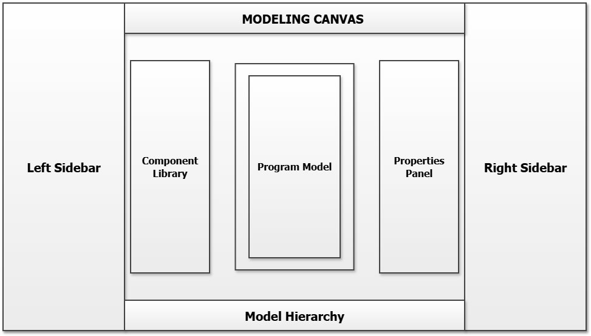
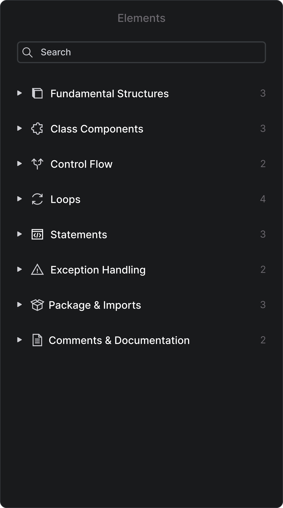
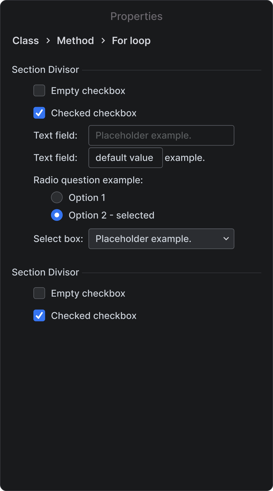
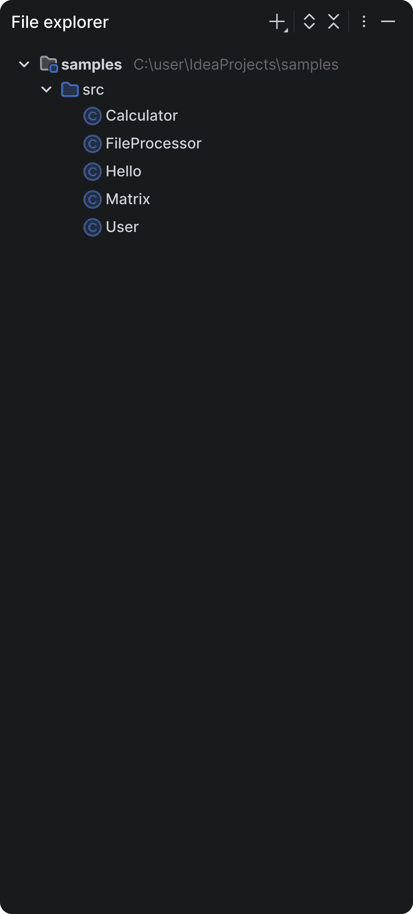
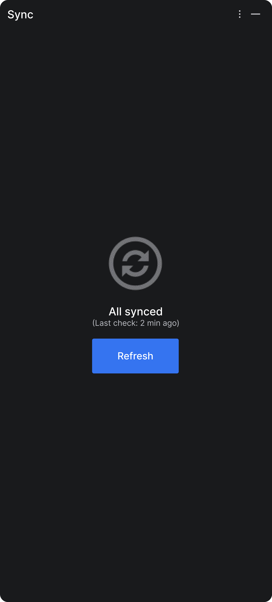
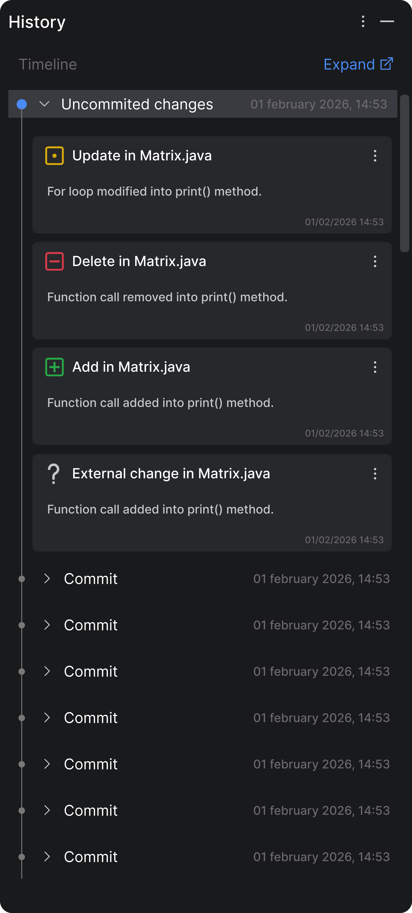
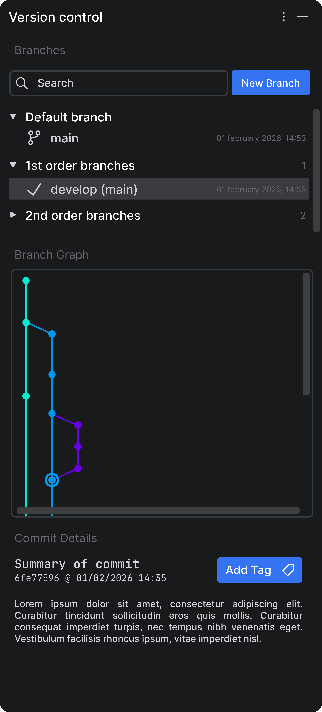
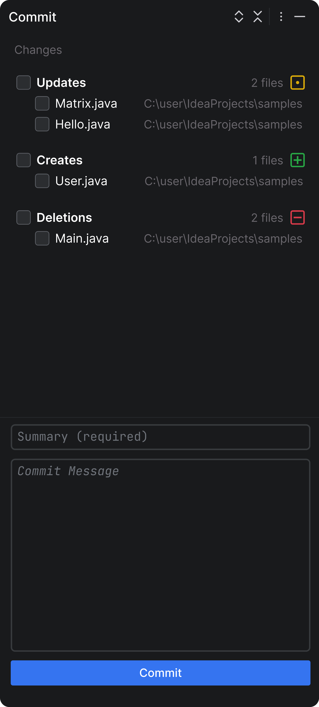
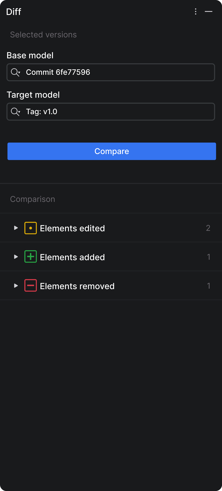

# `Lusiad` – Prototipação

[🇺🇸 English](../en/prototyping.md) · **🇧🇷 Português (Brasil)**

O protótipo do Lusiad no Figma explorou como o desenvolvedor poderia alternar entre a edição de um modelo Java e a consulta ao histórico mantendo o código relevante à vista. Desenhar essas interações antes da implementação ajudou a definir quais controles deveriam ficar junto ao elemento selecionado e quais precisariam de mais espaço. [Abrir o protótipo original no Figma](https://www.figma.com/design/kvy60Xjw35jHCevN5oPrJr/MBP-Java-Tool).

### Nesta página

> [1. Organização da interface](#-1-organização-da-interface) 
> [2. Painéis de modelagem](#-2-painéis-de-modelagem) 
> [3. Menus laterais](#-3-menus-laterais) 
> [4. Exemplos de uso do protótipo](#-4-exemplos-de-uso-do-protótipo) 
> [Índice da documentação](#índice-da-documentação)

---

## ✏️ 1. Organização da interface

O arranjo segue um padrão de ambientes como o Visual Studio Code e o IntelliJ IDEA. Painéis independentes e retráteis cercam a tela de modelagem. O desenvolvedor pode abrir as ferramentas necessárias para uma tarefa e recolhê-las para devolver espaço ao modelo.

Os menus laterais reúnem funções que abrangem o projeto. À esquerda ficam os arquivos e a sincronização. À direita ficam o histórico e o controle de versão. Dentro da tela de modelagem, a biblioteca de componentes e o painel de propriedades ficam de cada lado do modelo do programa. Na base, uma barra indica o caminho do arquivo aberto.

## 🧩 2. Painéis de modelagem

Os dois painéis atendem a momentos distintos da edição. Para acrescentar um bloco, o desenvolvedor abre a biblioteca **Elements**, pesquisa um componente ou percorre categorias como *Loops* e *Control Flow*, e escolhe o que deseja inserir. Ao selecionar um bloco que já está no modelo, o painel **Properties** passa a mostrar sua posição na hierarquia do programa e os campos disponíveis para editar seus atributos.

| Elements · Biblioteca de componentes | Properties · Propriedades do elemento |
| :---: | :---: |
|  |  |

## 🗂️ 3. Menus laterais

### Menu lateral esquerdo

O **File explorer** exibe a árvore do projeto. No exemplo, ao expandir `samples/src`, aparecem classes como `Calculator` e `Matrix`. O **Sync** permite verificar se os arquivos foram alterados fora do Lusiad. O painel informa o estado da sincronização, indica quando ocorreu a última verificação e oferece um botão para repeti-la.

| File explorer · Explorador de arquivos | Sync · Sincronização |
| :---: | :---: |
|  |  |

### Menu lateral direito

O **History** apresenta as operações individuais em uma linha do tempo. As mudanças pendentes ficam agrupadas acima dos commits anteriores, e cada registro identifica o arquivo e a operação. O **Version control** situa o commit no histórico do projeto. A lista e o grafo de branches mostram onde as linhas de desenvolvimento se ramificam. Ao selecionar um commit, é possível consultar seus detalhes e associar uma tag.

| History · Histórico | Version control · Controle de versão |
| :---: | :---: |
|  |  |

O **Commit** permite revisar as mudanças antes de registrar uma versão. No protótipo, os arquivos aparecem agrupados por operação, acima dos campos de resumo e mensagem. O **Diff** compara duas versões existentes. A figura usa o commit `6fe77596` como base e a tag `v1.0` como destino. O resultado agrupa os elementos editados, adicionados e removidos.

| Commit · Registro de versão | Diff · Comparação de versões |
| :---: | :---: |
|  |  |

## 🖥️ 4. Exemplos de uso do protótipo

### Edição de uma chamada em `Matrix.java`

O explorador permanece aberto enquanto a tela de modelagem exibe `Matrix.print()`. O contorno laranja marca a chamada a `System.out.print` no interior de dois laços. Uma barra flutuante reúne as ações do bloco selecionado. Em **Properties**, o caminho passa pela classe, pelo método e pelos dois laços até chegar à chamada. Ali é possível editar separadamente o objeto que recebe a chamada, o nome do método e os argumentos. Na base da tela aparece o caminho do arquivo.

### Consulta ao histórico durante a modelagem

Nesta configuração, a tela de modelagem exibe `Calculator.java`, enquanto o **History** lista mudanças pendentes em `Matrix.java`. A combinação ilustra o alcance da linha do tempo. O desenvolvedor pode acompanhar alterações em outros arquivos do projeto enquanto mantém o arquivo atual à vista.

### Inspeção de uma mudança dentro de um commit

Ao expandir o **History**, a metade inferior da interface passa a detalhar o commit selecionado. A sequência horizontal apresenta suas operações individuais. Na figura, selecionar a operação do meio exibe sua descrição em **Change Details** e destaca a chamada de método afetada no modelo acima. O **Branch Graph** situa a versão entre as ramificações, o **Commit Graph** marca a operação dentro do commit e o **Commit Details** reúne identificador, data, hora e mensagem.

As telas correspondentes na aplicação em execução estão no [manual de uso](manual.md).

---

<table width="100%">
<tr>
<td align="left"><a href="requisitos.md">⬅️ Página anterior</a></td>
<td align="center"><a href="index.md">8️⃣ Prototipação</a></td>
<td align="right"><a href="implementacao.md">Próxima página ➡️</a></td>
</tr>
</table>

### Índice da documentação

**[📖 Visão geral](../../README.pt-BR.md)**

- [🖥️ Manual de uso](manual.md)
- [🎬 Demonstração](demonstracao.md)

**[⚙️ Instalação](preparacao.md)**

- [🔧 Guia de instalação](instalacao.md)
- [🚀 Primeiros passos](primeiros-passos.md)

**[📐 Projeto](projeto.md)**

- [📋 Requisitos](requisitos.md)
- [✏️ Prototipação](prototipacao.md) 👈

**[💻 Implementação](implementacao.md)**

- [🏗️ Arquitetura](arquitetura.md)
- [📂 Estrutura de diretórios](estrutura-de-diretorios.md)
- [🧰 Tecnologias utilizadas](tecnologias-utilizadas.md)
- [🗃️ Modelo de dados](modelo-de-dados.md)
- [🔌 Referência da API](referencia-da-api.md)
- [🔀 Diagramas de interação](diagramas-de-interacao.md)
- [🧭 Decisões de projeto](decisoes-de-projeto.md)
- [🔍 Elementos notáveis da implementação](elementos-notaveis-da-implementacao.md)
