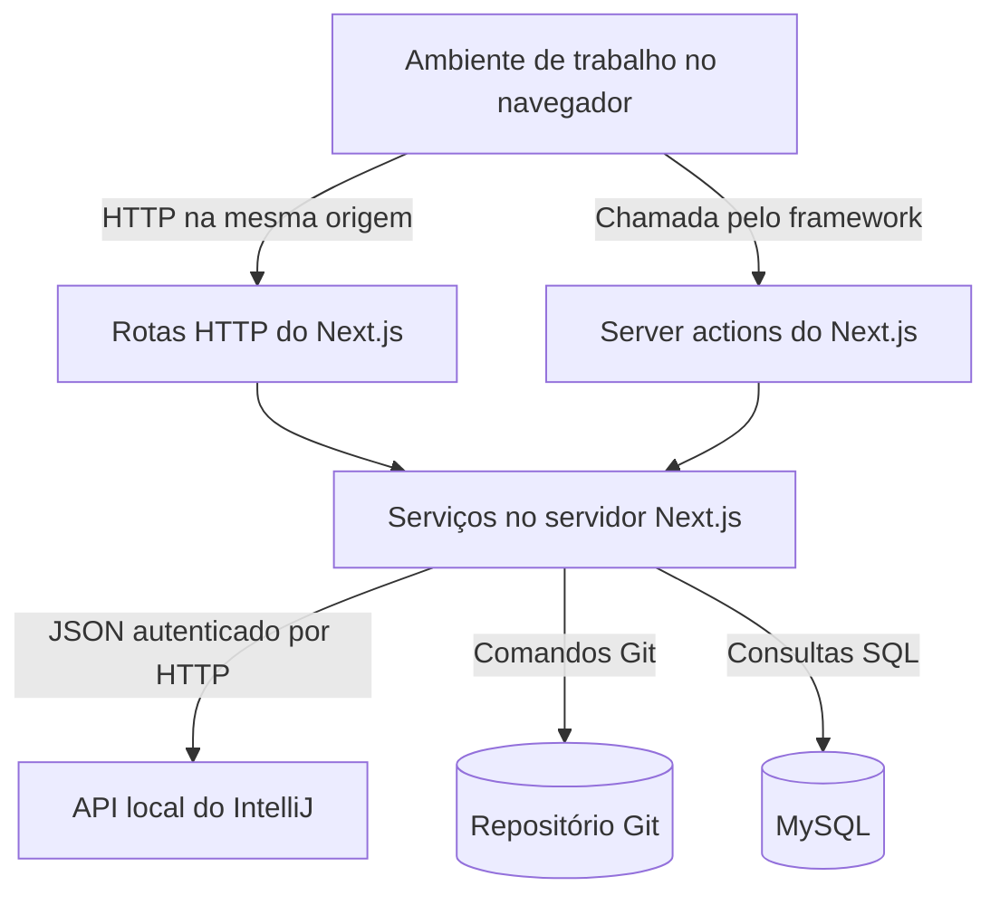
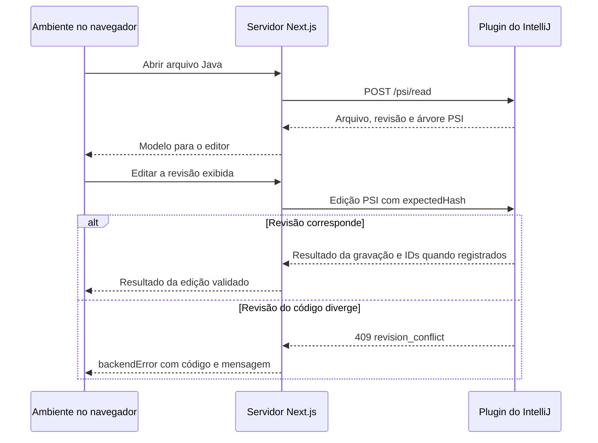
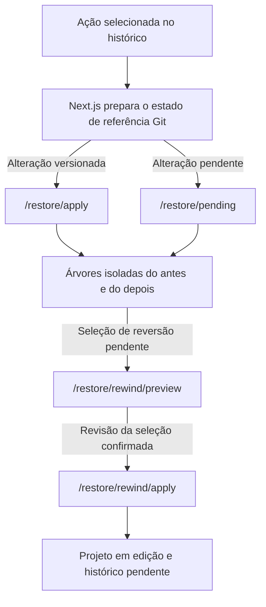

# `Lusiad` – Referência da API

[🇺🇸 English](../en/api-reference.md) · **🇧🇷 Português (Brasil)**

O Lusiad oferece interfaces HTTP em dois pontos. O navegador chama a aplicação Next.js, que fornece rotas HTTP e server actions. O servidor Next.js chama a API local do plugin IntelliJ para operações que dependem da IDE, do projeto Java ou de seus arquivos. Operações Git e SQL também podem ser executadas diretamente no servidor Next.js. As tabelas abaixo seguem as rotas registradas no repositório.

### Nesta página

> [1. Endereços e convenções de requisição](#endereços-e-convenções-de-requisição)<br>
> [2. Rotas e server actions do Next.js](#rotas-e-server-actions-do-nextjs)<br>
> [3. PSI e edição de código-fonte](#psi-e-edição-de-código-fonte)<br>
> [4. Arquivos e diretórios](#arquivos-e-diretórios)<br>
> [5. Diagnósticos Java, execução e UML](#diagnósticos-java-execução-e-uml)<br>
> [6. Desfazer e refazer](#desfazer-e-refazer)<br>
> [7. Prévias históricas e restauração](#prévias-históricas-e-restauração)<br>
> [8. Cadastro de projetos e verificações de execução](#cadastro-de-projetos-e-verificações-de-execução)<br>
> [9. Respostas e erros](#respostas-e-erros)<br>
> [Índice da documentação](#índice-da-documentação)

## Endereços e convenções de requisição

| Interface | URL base padrão | Chamadores e convenções |
| --- | --- | --- |
| Next.js | `http://localhost:3000` | O navegador usa as rotas `/api/lusiad/` da mesma origem. Componentes React também chamam as server actions do Next.js. |
| Plugin do IntelliJ | `http://127.0.0.1:8765` | O servidor escuta na interface de loopback. O Next.js envia `X-Lusiad-Token` a partir da configuração no servidor. As requisições POST usam `Content-Type: application/json`. |

O plugin verifica o host local e a porta configurada. Quando recebe o cabeçalho `Origin`, também verifica a origem do frontend. Os handlers POST do plugin interpretam objetos JSON em UTF-8 com limite de 4 MiB para o corpo. No perfil de testes, o cliente Next.js também envia os cabeçalhos de identificação da execução e da configuração às rotas operacionais do plugin. O plugin responde com HTTP 204 às requisições de preflight CORS aceitas. As tabelas listam os métodos usados para chamar cada operação. As duas URLs base são configuráveis. O [guia de instalação](instalacao.md) descreve a configuração local. [Configuração operacional](../../lusiad-frontend/src/lib/config/operational-config.ts) · [Verificação de acesso do plugin](../../lusiad-backend/src/main/java/com/lusiad/backend/config/LocalApiAccess.java) · [Handler HTTP compartilhado](../../lusiad-backend/src/main/java/com/lusiad/backend/handler/BaseHandler.java) · [Configuração do cliente Next.js](../../lusiad-frontend/src/lib/config/backend.ts)



`projectId`, `changeId` e `branchId` identificam registros SQL. As rotas operacionais geralmente usam `projectId` positivo. O plugin aceita os campos de tipo inteiro como números inteiros JSON ou strings com números inteiros. Os caminhos usados em operações sobre o projeto cadastrado costumam ser relativos ao seu diretório de trabalho. Os handlers resolvem e validam esses caminhos nas raízes permitidas. As linhas e colunas das requisições PSI começam em 1, e os offsets são unidades UTF-16 contadas a partir de 0. O [modelo de dados](modelo-de-dados.md) explica as revisões e os identificadores. [Validação da requisição](../../lusiad-backend/src/main/java/com/lusiad/backend/handler/ApiJson.java) · [Resolução de caminhos](../../lusiad-backend/src/main/java/com/lusiad/backend/handler/BaseHandler.java)

## Rotas e server actions do Next.js

| Método | Rota | Campos da requisição | Comportamento |
| --- | --- | --- | --- |
| `GET` | `/api/lusiad/settings` | — | Lê as preferências compartilhadas da interface. Retorna `status` e `preferences`. |
| `POST` | `/api/lusiad/settings` | `language`, `changeTextLanguage`, `theme`, or `palette` | Mescla as preferências fornecidas na raiz do objeto JSON. Retorna as `preferences` resultantes. Limite de 16 KiB. |
| `GET` | `/api/lusiad/projects/presence` | — | Lê o estado de presença na IDE e no ambiente web. |
| `POST` | `/api/lusiad/projects/presence` | `projectId`, `tabId` | Renova a presença da aba. Use `close: true` para remover essa aba. Limite de 4 KiB. |
| `POST` | `/api/lusiad/java` | `projectId`, `action` | Encaminha consultas de contexto, diagnósticos, verificações de revisão e cancelamentos. Limite de 4 MiB. |
| `POST` | `/api/lusiad/run` | `projectId`, `action` | Lista classes principais ou inicia, consulta e encerra uma execução Java. Limite de 4 KiB. |
| `POST` | `/api/lusiad/undo` | `projectId`, `action` | Encaminha operações de desfazer e refazer. As ações além de `status` usam campos de `cursor`. Limite de 4 MiB. |
| `GET` | `/api/lusiad/runtime` | — | Verifica o banco e a conexão com o plugin no modo normal. Retorna `version`, `apiAccessVersion`, `apiPort` e `databaseId`. |
| `GET` | `/api/lusiad/test-context` | — | Informa a prontidão do frontend em modo de teste, em uma operação de leitura. Retorna 404 fora desse perfil. |

A rota Java aceita `context`, `analyze`, `proposal`, `check` e `cancel`. Ela encaminha essas ações a `/java/context`, `/java/analyze`, `/java/analyze-edit`, `/java/check` e `/java/cancel`, respectivamente. Na requisição do navegador, `proposal` recebe `path`, `content`, `revision`, `requestId` e um objeto `operation` com a edição. O serviço Next.js encaminha `content` como `sourceContent`, `revision` como `expectedHash` e os campos da edição na raiz do JSON. A ação `check` recebe `revision` e a encaminha como `contextRevision`. A rota de execução encaminha `list`, `start`, `status` e `stop` às rotas correspondentes em `/run/`. [Rota Java do Next.js](../../lusiad-frontend/src/app/api/lusiad/java/route.ts) · [Serviço de diagnóstico Java](../../lusiad-frontend/src/lib/services/java-diagnostics/java-diagnostics.service.ts) · [Rota de execução](../../lusiad-frontend/src/app/api/lusiad/run/route.ts) · [Código das rotas](../../lusiad-frontend/src/app/api/lusiad)

O exemplo consulta o estado da última execução do projeto `1` pelo navegador. A resposta abaixo corresponde ao caso em que o serviço ainda não tem uma execução para esse projeto.

```http
POST /api/lusiad/run
Content-Type: application/json

{"projectId":1,"action":"status"}
```

```json
{"status":"ok","state":"idle"}
```

Outras operações do navegador usam server actions. `loadModelController` obtém o modelo PSI, `loadWorkspaceTreeController` carrega a árvore do explorador e `loadChangeHistoryController` consulta o histórico registrado. `commitChangesController` coordena as operações Git e SQL para registrar uma versão. Esses pontos de entrada TypeScript são chamados pela aplicação. [Contrato da resposta de execução](../../lusiad-frontend/src/lib/services/java-run/java-run-contract.ts) · [Controlador do modelo](../../lusiad-frontend/src/controllers/model-editor/model-editor.controller.ts) · [Controlador do explorador](../../lusiad-frontend/src/controllers/file-explorer/file-explorer.controller.ts) · [Controlador do histórico](../../lusiad-frontend/src/controllers/change-history/change-history.controller.ts) · [Controlador de commits](../../lusiad-frontend/src/controllers/commit-menu/commit-menu.controller.ts)

## PSI e edição de código-fonte

Cada rota deste grupo exige `projectId` além dos campos tabelados.

| Método | Rota | Campos da requisição | Comportamento |
| --- | --- | --- | --- |
| `POST` | `/psi/read` | `path` | Lê um arquivo Java e retorna `file`, `revision` e sua árvore PSI em `tree`. |
| `POST` | `/psi/parse` | `fileName`, `content` | Analisa em memória o texto Java fornecido. Retorna `file` e `tree`. |
| `POST` | `/psi/diagnose` | `path`, `content` | Verifica a sintaxe via PSI. Para verificar uma substituição proposta, envie `startOffset`, `endOffset` e `newContent` juntos. |
| `POST` | `/psi/diagnose-edit` | `path`, `sourceContent`, `expectedHash`, `operation` + campos da edição | Simula uma inserção, atualização, movimentação ou remoção em memória. Retorna diagnósticos sintáticos e `proposedContent`. |
| `POST` | `/psi/create` | `path`, `expectedHash`, `line`, `content` | Insere texto Java no destino. |
| `POST` | `/psi/update` | `path`, `expectedHash`, `startOffset`, `endOffset`, `newContent` | Substitui um intervalo no código-fonte. |
| `POST` | `/psi/move` | `path`, `expectedHash`, `startOffset`, `endOffset`, `line` | Move um intervalo dentro do arquivo para o destino. |
| `POST` | `/psi/delete` | `path`, `expectedHash`, offset range or line and column range | Remove um intervalo. A forma alternativa aos offsets usa `startLine`, `startColumn`, `endLine` e `endColumn`. |
| `POST` | `/psi/recover` | — | Reconcilia as intenções de edição preparadas com os arquivos gravados. Retorna `status` e a contagem em `recovered`. |

Em `create` e `move`, `column` e `lineEnd` são formas alternativas de especificar o destino. Quando informado, `lineEnd` deve ser igual a `line + 1`. Edições no código em trabalho exigem `expectedHash`, a revisão do código-fonte com 64 caracteres hexadecimais minúsculos. Uma gravação bem-sucedida retorna `saved: true` e `formatting.status`. Uma alteração registrada também retorna `revision`, `operationId`, `operationOrder`, `changeId` e `recordVersion`. Uma operação que preserva o texto pode retornar `noOp: true` e a revisão atual sem criar um evento de histórico. [Roteador PSI](../../lusiad-backend/src/main/java/com/lusiad/backend/router/psi/PsiRouter.java) · [Handlers PSI](../../lusiad-backend/src/main/java/com/lusiad/backend/handler/psi/PsiGenericHandlers.java) · [Validação da resposta de edição](../../lusiad-frontend/src/lib/services/backend-response.ts)

O exemplo abaixo envia código Java para o parser em memória do plugin. Use o token local configurado no cabeçalho. A resposta contém o nome do arquivo e a árvore PSI serializada para o texto fornecido.

```http
POST /psi/parse
Host: 127.0.0.1:8765
Content-Type: application/json
X-Lusiad-Token: <token-local>

{"projectId":1,"fileName":"Counter.java","content":"class Counter {}"}
```



## Arquivos e diretórios

| Método | Rota | Campos da requisição | Comportamento |
| --- | --- | --- | --- |
| `POST` | `/fs/directory-picker` | `requestId`, `operation`, `locale` | Abre, consulta ou cancela o seletor nativo com `start`, `status` ou `cancel`. O campo opcional `path` indica a pasta inicial. Retorna `requestId`, `state` e, quando disponível, o `path` escolhido. |
| `POST` | `/fs/reveal` | `projectId`, `path` | Mostra um item autorizado no explorador do sistema. Retorna `status` e `mode`. |
| `POST` | `/fs/file/create` | `projectId`, `path`, `name` | Cria um arquivo `.java` no diretório pai indicado em `path`. O campo opcional `content` fornece o texto inicial. |
| `POST` | `/fs/file/delete` | `projectId`, `path` | Exclui o arquivo. A opção `safe` participa da captura de recursos usada para desfazer. |
| `POST` | `/fs/file/rename` | `projectId`, `path`, `name` | Renomeia o arquivo em seu diretório atual. |
| `POST` | `/fs/file/move` | `projectId`, `sourcePath`, `destPath` | Move o arquivo para o diretório de destino. Aceita `overwrite` quando a substituição é intencional. |
| `POST` | `/fs/dir/create` | `projectId`, `path`, `name` | Cria um diretório dentro do pai indicado em `path`. |
| `POST` | `/fs/dir/delete` | `projectId`, `path` | Exclui um diretório. A opção `recursive` permite remover seu conteúdo. |
| `POST` | `/fs/dir/rename` | `projectId`, `path`, `name` | Renomeia um diretório dentro do pai atual. |
| `POST` | `/fs/dir/move` | `projectId`, `sourcePath`, `destPath` | Move um diretório para um novo diretório pai. |

Nas operações de criação, `path` identifica o diretório pai. Nas operações de movimentação, `destPath` identifica o diretório de destino. Um caminho vazio representa a raiz do projeto nos campos de pai e destino que o aceitam. O próprio servidor Next.js carrega a árvore do explorador. [Roteador de arquivos e diretórios](../../lusiad-backend/src/main/java/com/lusiad/backend/router/fs/FsRouter.java) · [Handlers de arquivos](../../lusiad-backend/src/main/java/com/lusiad/backend/handler/fs/FsFileHandlers.java) · [Handlers de diretórios](../../lusiad-backend/src/main/java/com/lusiad/backend/handler/fs/FsDirHandlers.java) · [Explorador do ambiente de trabalho](../../lusiad-frontend/src/controllers/file-explorer/file-explorer.controller.ts)

## Diagnósticos Java, execução e UML

Cada rota deste grupo também exige `projectId`.

| Método | Rota | Campos da requisição | Comportamento |
| --- | --- | --- | --- |
| `POST` | `/java/context` | — | Retorna a configuração Java do projeto, a prontidão e as revisões. Para atualizar a configuração, envie `settings` com `configurationRevision`. |
| `POST` | `/java/analyze` | `requestId` | Analisa o código-fonte salvo do projeto com `javac`. |
| `POST` | `/java/analyze-edit` | `requestId`, `path`, `sourceContent`, `expectedHash`, `operation` + campos da edição | Analisa uma proposta em memória no contexto do projeto salvo. Retorna diagnósticos e o texto proposto. |
| `POST` | `/java/check` | `contextRevision` | Verifica se o código-fonte, as dependências e a configuração Java ainda correspondem ao contexto da análise. |
| `POST` | `/java/cancel` | `requestId`, `channel` | Cancela a análise correspondente no canal `saved` ou `proposal`. |
| `POST` | `/run/list` | — | Retorna `mains` e a `contextRevision` do projeto salvo. |
| `POST` | `/run/start` | `main`, `contextRevision` | Inicia a compilação e a execução da classe principal selecionada. Retorna o estado da execução e seu `id`. |
| `POST` | `/run/status` | — | Retorna o estado da última execução do projeto ou `idle`. Os demais estados incluem a identidade da execução e os campos de saída. |
| `POST` | `/run/stop` | `runId` | Encerra a execução identificada. Envie o `id` retornado pelo serviço como `runId`. |
| `POST` | `/uml/current` | `files`, `locale` | Renderiza um diagrama UML a partir dos arquivos Java fornecidos. Retorna `engine`, `diagram` e `fileCount`. |
| `POST` | `/uml/render` | `beforeFiles`, `afterFiles`, `operation`, `locale` | Renderiza uma comparação UML. Os campos opcionais `beforeFocus` e `afterFocus` indicam os locais afetados. |

A resposta de sintaxe PSI identifica a fonte como `psi-syntax` e inclui o arquivo, a revisão de base, a revisão resultante e os diagnósticos. As respostas do compilador identificam a fonte como `javac` e incluem `requestId`, `contextRevision`, arquivos e diagnósticos. Uma lista com diagnósticos é um resultado válido de análise. A execução Java expõe estados como `compiling`, `running`, `succeeded` e `failed`. A UML aceita entradas com `path` e `content` e o idioma `en` ou `pt-BR`. O plugin deriva os diagramas e retorna dados SVG. [Resposta de sintaxe](../../lusiad-frontend/src/lib/services/syntax-diagnostics/syntax-contract.ts) · [Handler do compilador](../../lusiad-backend/src/main/java/com/lusiad/backend/handler/diagnostics/JavaDiagnosticsHandler.java) · [Roteador de execução Java](../../lusiad-backend/src/main/java/com/lusiad/backend/router/run/JavaRunRouter.java) · [Serviço UML](../../lusiad-backend/src/main/java/com/lusiad/backend/service/uml/UmlService.java)

## Desfazer e refazer

As rotas do plugin neste grupo exigem `projectId`. O cursor usa `direction` (`undo` ou `redo`), `epoch`, `revision` e `requestId`. O navegador envia o cursor dentro do campo `cursor` a `/api/lusiad/undo`. O Next.js envia seus campos na raiz do JSON para o plugin. [Rota de desfazer e refazer](../../lusiad-frontend/src/app/api/lusiad/undo/route.ts) · [Cursor e respostas](../../lusiad-frontend/src/lib/services/undo/undo-contract.ts) · [Roteador do plugin](../../lusiad-backend/src/main/java/com/lusiad/backend/router/undo/UndoRouter.java)

| Método | Rota | Campos da requisição | Comportamento |
| --- | --- | --- | --- |
| `POST` | `/undo/status` | — | Retorna os passos disponíveis, as contagens, `epoch` e `revision`. |
| `POST` | `/undo/preview` | `direction`, `epoch`, `revision`, `requestId` | Retorna os arquivos afetados e seus estados propostos. |
| `POST` | `/undo/analyze` | Mesmo cursor de `/undo/preview` | Verifica a proposta via PSI ou, com `semantic: true`, pelo compilador Java. |
| `POST` | `/undo/apply` | Mesmo cursor de `/undo/preview` | Aplica a proposta atual. Aceita `corrections` por caminho e uma `contextRevision` opcional. |
| `POST` | `/undo/receipt` | Mesmo cursor de `/undo/preview` | Consulta o recibo confirmado da operação para a requisição. |
| `POST` | `/undo/cancel` | `requestId` | Cancela a análise associada à requisição. |

## Prévias históricas e restauração

| Método | Rota | Campos da requisição | Comportamento |
| --- | --- | --- | --- |
| `POST` | `/restore/apply` | `changeId`, `snapshotId` | Reconstrói os estados anterior e posterior a uma alteração versionada em um diretório de prévia já preparado. |
| `POST` | `/restore/pending` | `projectId`, `changeId`, `snapshotId`, `branchId`, `gitId`, `pendingRevision` | Reconstrói uma alteração pendente a partir do estado versionado de referência da branch selecionada. |
| `POST` | `/restore/rewind/preview` | Mesma identidade de `/restore/pending` | Lista as alterações pendentes e os caminhos a descartar e retorna `selectionRevision`. |
| `POST` | `/restore/rewind/apply` | Mesma identidade de `/restore/pending`, mais `requestId` e `selectionRevision` | Aplica a reversão verificada ao projeto em edição e descarta as alterações pendentes posteriores. |
| `POST` | `/restore/commit/check` | `projectId` | Verifica se há documentos do IntelliJ ainda não salvos antes de uma restauração via Git. |
| `POST` | `/restore/commit/refresh` | `projectId` | Atualiza o Virtual File System do IntelliJ após a restauração. |

O Next.js resolve a alteração selecionada e prepara seu estado de referência Git no diretório temporário da comparação. O `snapshotId` assume a forma `compare-<UUID>`. O plugin reaplica os eventos para produzir `working-copy-prev` e `working-copy`. Para uma prévia pendente, `branchId`, `gitId` e `pendingRevision` identificam o estado de histórico selecionado. Aplicar a reversão exige a `selectionRevision` retornada na prévia. [Roteador de restauração](../../lusiad-backend/src/main/java/com/lusiad/backend/router/restore/RestoreRouter.java) · [Preparação da prévia](../../lusiad-frontend/src/lib/services/restore/restore.service.ts) · [Reversão de alterações pendentes](../../lusiad-backend/src/main/java/com/lusiad/backend/service/restore/PendingRewindService.java)



## Cadastro de projetos e verificações de execução

| Método | Rota | Campos da requisição | Comportamento |
| --- | --- | --- | --- |
| `POST` | `/projects/read` | `projectId` | Lê o cadastro e sua `revision`. Envie esse valor como `registryRevision` para atualizar o cadastro. |
| `POST` | `/projects/update` | `projectId`, `registryRevision`, `name` | Atualiza o nome do cadastro e a `description` opcional. |
| `POST` | `/projects/preview` | `projectId`, `adminAction` | Gera a prévia de `remove`, `delete`, `relink` ou `move`. As ações `relink` e `move` exigem `newPath`. |
| `POST` | `/projects/apply` | Campos da prévia, `registryRevision`, `confirmation` e `requestId` | Aplica a operação confirmada de gerenciamento do projeto. |
| `POST` | `/projects/operations` | — | Lista os registros de operações de projeto em aberto. |
| `POST` | `/projects/recover` | `projectId`, `requestId` | Recupera ou confirma a operação de projeto identificada. |
| `POST` | `/ide/projects` | `action` | `status` retorna o estado de presença. `presence` usa `projectId`, `tabId` e `close` opcional. |
| `GET` | `/_lusiad/runtime` | — | Retorna a identidade da API e do banco no modo normal após verificar a conexão com o banco. |
| `GET` | `/_lusiad/test-context` | — | Retorna a prontidão do plugin e o contexto no perfil de testes. |

Para aplicar uma operação de gerenciamento de projeto, envie a `revision` retornada por `/projects/preview` como `registryRevision` e o nome cadastrado do projeto como `confirmation`. A rota de runtime do Next.js verifica a identidade do plugin e se ambos os serviços usam o mesmo banco. As rotas de contexto de testes informam a prontidão para uma execução isolada. [Roteador de gerenciamento](../../lusiad-backend/src/main/java/com/lusiad/backend/router/project/ProjectManagementRouter.java) · [Serviço de gerenciamento de projetos](../../lusiad-backend/src/main/java/com/lusiad/backend/service/project/ProjectManagementService.java) · [Roteador de presença](../../lusiad-backend/src/main/java/com/lusiad/backend/router/project/ProjectPresenceRouter.java) · [Servidor HTTP do plugin](../../lusiad-backend/src/main/java/com/lusiad/backend/HttpServer.java) · [Rota de runtime do Next.js](../../lusiad-frontend/src/app/api/lusiad/runtime/route.ts)

## Respostas e erros

Respostas do plugin a operações de escrita normalmente incluem `status: "ok"`. As rotas de leitura e análise da PSI que retornam uma árvore entregam o objeto do modelo diretamente. O corpo JSON de erro compartilhado contém `status: "error"`, um `code` que identifica a falha e uma mensagem em `error`. Algumas respostas de prontidão e testes têm formato próprio. [Contrato JSON do plugin](../../lusiad-backend/src/main/java/com/lusiad/backend/handler/ApiJson.java) · [Decodificação no Next.js](../../lusiad-frontend/src/lib/services/backend-response.ts)

| Status HTTP do plugin | Exemplos |
| --- | --- |
| 400 | `invalid_request` para campos ou JSON malformados, e `path_not_authorized` para um caminho fora das raízes permitidas. |
| 403 | `client_not_authorized` quando a requisição é rejeitada na verificação de acesso. |
| 404 | `psi_file_not_found` para um arquivo Java ausente em `/psi/read`. |
| 405 | `method_not_allowed` quando um handler POST recebe outro método HTTP. |
| 409 | `revision_conflict`, `operation_pending` e outros conflitos específicos da operação. |
| 413 / 415 | `body_too_large` ou `unsupported_media_type`. |
| 422 | Erros do serviço que o adaptador comum classifica como falha de operação. |
| 500 / 503 | Resposta inválida ou falha interna, ou indisponibilidade de um serviço ou configuração exigida. |

Os handlers Next.js para diagnóstico Java, execução e desfazer podem retornar uma falha esperada da operação como `backendError` em uma resposta HTTP 200. O chamador lê esse campo para obter o código e a mensagem localizada. Erros no próprio handler podem produzir HTTP 400, 413 ou 503. O transporte usa um único prazo para receber os cabeçalhos e o corpo da resposta do plugin. Um timeout pode ocorrer enquanto o plugin ainda processa a requisição. O fluxo de recuperação ou consulta do recibo da operação permite reconciliar o estado antes de uma nova tentativa. [Resultado de server action](../../lusiad-frontend/src/lib/services/backend-action-result.ts) · [Transporte para o plugin](../../lusiad-frontend/src/lib/services/backend-transport.ts)

```typescript
export interface BackendActionFailure { backendError: { code: string; message: string } }
export type BackendActionResult<T> = T | BackendActionFailure
```

---

<table width="100%">
<tr>
<td align="left"><a href="modelo-de-dados.md">⬅️ Página anterior</a></td>
<td align="center"><a href="../../README.pt-BR.md#índice-da-documentação">1️⃣4️⃣ Referência da API</a></td>
<td align="right"><a href="diagramas-de-interacao.md">Próxima página ➡️</a></td>
</tr>
</table>

### Índice da documentação

**[📖 Visão geral](../../README.pt-BR.md)**

- [🖥️ Manual de uso](manual.md)
- [🎬 Demonstração](demonstracao.md)

**[⚙️ Instalação](preparacao.md)**

- [🔧 Guia de instalação](instalacao.md)
- [🚀 Primeiros passos](primeiros-passos.md)

**[📐 Projeto](projeto.md)**

- [📋 Requisitos](requisitos.md)
- [✏️ Prototipação](prototipacao.md)

**[💻 Implementação](implementacao.md)**

- [🏗️ Arquitetura](arquitetura.md)
- [📂 Estrutura de diretórios](estrutura-de-diretorios.md)
- [🧰 Tecnologias utilizadas](tecnologias-utilizadas.md)
- [🗃️ Modelo de dados](modelo-de-dados.md)
- [🔌 Referência da API](referencia-da-api.md) 👈
- [🔀 Diagramas de interação](diagramas-de-interacao.md)
- [🧭 Decisões de projeto](decisoes-de-projeto.md)
- [🔍 Elementos notáveis da implementação](elementos-notaveis-da-implementacao.md)

**[📊 Avaliação](avaliacao.md)**

- [📋 Planejamento](avaliacao-planejamento.md)
- [🧪 Execução](avaliacao-execucao.md)
- [📈 Resultados](avaliacao-resultados.md)
- [💬 Discussão](avaliacao-discussao.md)
- [📂 Materiais e dados](avaliacao-dados.md)
