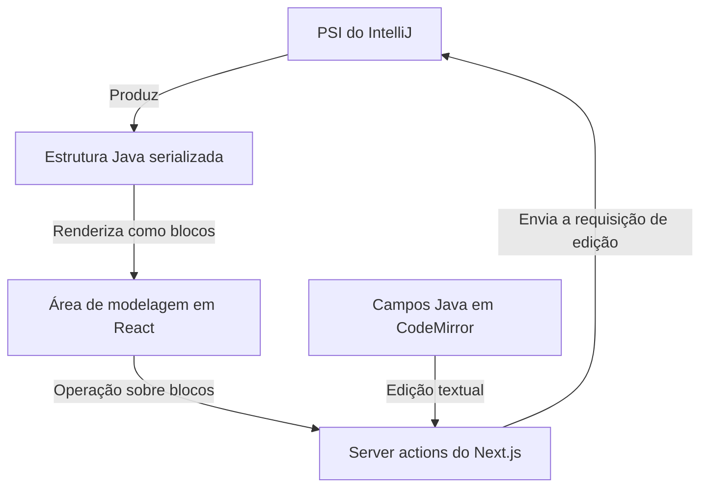
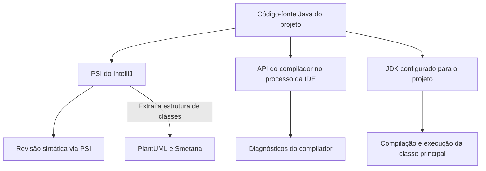
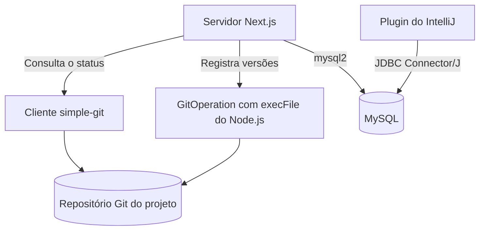

# `Lusiad` – Tecnologias utilizadas

[🇺🇸 English](../en/technology-stack.md) · **🇧🇷 Português (Brasil)**

O Lusiad combina uma aplicação web Next.js com um plugin do IntelliJ IDEA. O navegador renderiza o ambiente de modelagem, e o servidor Next.js faz a integração com o plugin, o Git e o MySQL. Dentro da IDE, o plugin usa as APIs de Java do IntelliJ para ler e atualizar os arquivos-fonte. As versões abaixo vêm dos manifestos e do lockfile do repositório. O [guia de instalação](instalacao.md) reúne os requisitos para executar a aplicação.

### Nesta página

> [1. Versões de execução e build](#versões-de-execução-e-build)<br>
> [2. Interface web](#interface-web)<br>
> [3. Plugin do IntelliJ e ferramentas Java](#plugin-do-intellij-e-ferramentas-java)<br>
> [4. Git e MySQL](#git-e-mysql)<br>
> [5. Build, empacotamento e verificação](#build-empacotamento-e-verificação)<br>
> [6. Ferramentas de documentação](#ferramentas-de-documentação)<br>
> [Índice da documentação](#índice-da-documentação)

---

## Versões de execução e build

| Tecnologia | Versão ou requisito | Papel no Lusiad |
| --- | --- | --- |
| Node.js | `>=24.12.0` em `engines` | Executa o servidor Next.js, os scripts de inicialização e os testes TypeScript. [Manifesto do frontend](../../lusiad-frontend/package.json) |
| Yarn Classic | `1.22.22` | Gerenciador de dependências declarado para o frontend. [Manifesto do frontend](../../lusiad-frontend/package.json) |
| Next.js | `16.2.0` | Páginas do App Router, server actions e rotas HTTP. [Lockfile do frontend](../../lusiad-frontend/yarn.lock) |
| React e React DOM | `19.2.4` | Componentes e estado do ambiente de modelagem e do histórico. [Lockfile do frontend](../../lusiad-frontend/yarn.lock) |
| TypeScript | `5.7.3` | Checagem de tipos dos módulos no navegador e no servidor, incluindo os contratos compartilhados. [Configuração TypeScript](../../lusiad-frontend/tsconfig.json) |
| Java e IntelliJ IDEA | Java `21` para código-fonte e bytecode. IDEA `2025.2.4` como alvo no Gradle. | Compila e executa o plugin Java com a plataforma IntelliJ e o plugin de Java incluído na IDE. [Build do plugin](../../lusiad-backend/build.gradle.kts) |
| Gradle e IntelliJ Platform Gradle Plugin | Gradle Wrapper `9.0.0` e plugin de plataforma `2.10.2` | Resolvem dependências, executam testes e empacotam o plugin instalável. [Wrapper](../../lusiad-backend/gradle/wrapper/gradle-wrapper.properties) · [Build do plugin](../../lusiad-backend/build.gradle.kts) |
| MySQL Server | `8.0` no guia de instalação. `8.0.44` na exportação do esquema incluída no repositório. | Armazena os cadastros, os commits e o histórico de alterações. [Esquema](../../lusiad-backend/db/lusiad.sql) |
| Git | Executável do sistema | Mantém as árvores de arquivos versionadas de cada projeto. [Execução de comandos Git](../../lusiad-frontend/src/lib/services/commit-menu/git-operation.ts) |

O manifesto distingue versões exatas de faixas. Por exemplo, declara Tailwind CSS como `^4.2.0` e `react-resizable-panels` como `^2.1.7`. O lockfile resolve essas dependências para `4.2.2` e `2.1.9`, respectivamente. O alvo Java 21 vale para o build do plugin. A configuração do projeto define a versão-alvo usada nos diagnósticos e o JDK usado na execução. [Manifesto do frontend](../../lusiad-frontend/package.json) · [Lockfile do frontend](../../lusiad-frontend/yarn.lock) · [Configuração Java do projeto](../../lusiad-backend/src/main/java/com/lusiad/backend/service/project/ProjectJavaSettings.java)

## Interface web

O Next.js serve as páginas e executa o código TypeScript que precisa acessar os serviços locais. Os componentes cliente do React gerenciam seleção, arraste, visibilidade dos painéis e prévias no navegador. A rota de projeto carrega o cadastro e a árvore inicial de arquivos no servidor. Em seguida, passa esses dados a `ProjectWorkspace`, que compõe o editor interativo. [Rota de projeto](../../lusiad-frontend/src/app/project/%5BprojectId%5D/page.tsx) · [Ambiente de trabalho](../../lusiad-frontend/src/components/project-workspace.tsx)

| Tecnologia | Onde aparece |
| --- | --- |
| Tailwind CSS `4.2.2` e integração com PostCSS | O arquivo `postcss.config.mjs` carrega `@tailwindcss/postcss`. A folha de estilos da aplicação importa Tailwind e define variáveis CSS usadas pelos temas e pelos indicadores de alteração. [Configuração PostCSS](../../lusiad-frontend/postcss.config.mjs) · [Estilos globais](../../lusiad-frontend/src/app/globals.css) |
| Convenções do shadcn/ui e componentes primitivos do Radix UI | O repositório mantém seus componentes reutilizáveis em `src/components/ui/`. Por exemplo, `dialog.tsx` encapsula `@radix-ui/react-dialog` `1.1.15` para aplicar os estilos da aplicação. [Configuração dos componentes](../../lusiad-frontend/components.json) · [Componente de diálogo](../../lusiad-frontend/src/components/ui/dialog.tsx) |
| Lucide React `0.564.0` e React Resizable Panels `2.1.9` | Os ícones identificam controles. Os componentes de redimensionamento fornecem o grupo, o painel e a alça de arraste para as disposições ajustáveis. [Ícones do editor](../../lusiad-frontend/src/components/panels/model-editor/model-editor.tsx) · [Componentes redimensionáveis](../../lusiad-frontend/src/components/ui/resizable.tsx) |
| CodeMirror 6 e integração React `@uiw/react-codemirror` `4.25.9` | Campos de edição textual, como os do formulário de criação e do painel de propriedades. Esses campos carregam `@codemirror/lang-java` `6.0.2` para o realce da sintaxe Java. [Formulário de criação](../../lusiad-frontend/src/components/panels/model-editor/component-creation-dialog.tsx) · [Painel de propriedades](../../lusiad-frontend/src/components/panels/model-editor/properties-panel.tsx) |
| `next-themes` `0.4.6` | Informa o tema claro ou escuro ativo. O editor de código compartilhado aplica esse tema à instância já montada do CodeMirror e preserva o rascunho na troca de tema. [Componente de edição](../../lusiad-frontend/src/components/themed-code-editor.tsx) |

A área de modelagem usa React e a renderização de nós PSI serializados implementada no Lusiad. O CodeMirror edita texto nos formulários e nos campos de propriedades ao redor da área de modelagem. As duas interfaces podem iniciar uma edição, que passa pelo servidor e é aplicada pelo plugin. O CodeMirror fornece os controles de edição textual, e o IntelliJ fornece a estrutura Java que a área de modelagem exibe. [Área de modelagem](../../lusiad-frontend/src/components/panels/model-editor/model-canvas.tsx) · [Interações do editor](../../lusiad-frontend/src/components/panels/model-editor/model-editor.interactions.ts) · [Serviço PSI](../../lusiad-backend/src/main/java/com/lusiad/backend/service/psi/PsiService.java)



O componente abaixo integra o tema da interface à biblioteca de edição. Ele passa o tema ativo como propriedade para que a troca de tema atualize a instância existente. [`themed-code-editor.tsx`](../../lusiad-frontend/src/components/themed-code-editor.tsx#L7-L14)

```tsx
const subscribe = () => () => {}
/** Theme reconfiguration preserves the existing editor/draft; it never keys/remounts on theme. */
export function ThemedCodeEditor(props: ComponentProps<typeof CodeMirror>) {
  const { resolvedTheme } = useTheme()
  const hydrated = useSyncExternalStore(subscribe, () => true, () => false)
  const mode = hydrated && resolvedTheme === 'dark' ? 'dark' : 'light'
  return <CodeMirror {...props} theme={mode} data-color-mode={mode} />
}
```

## Plugin do IntelliJ e ferramentas Java

| Tecnologia | Onde aparece |
| --- | --- |
| IntelliJ Platform e PSI de Java | O plugin declara os módulos da plataforma e de Java. Lê a PSI em ações de leitura e usa documentos do IntelliJ, comandos de escrita e o Virtual File System para persistir edições. [Descritor do plugin](../../lusiad-backend/src/main/resources/META-INF/plugin.xml) · [Serviço PSI](../../lusiad-backend/src/main/java/com/lusiad/backend/service/psi/PsiService.java) · [Persistência de edições](../../lusiad-backend/src/main/java/com/lusiad/backend/service/psi/PsiEditPersistence.java) |
| Swing e painéis do IntelliJ | O painel nativo do Lusiad oferece configurações e controles dos serviços. A fábrica registra o conteúdo Swing no painel do IntelliJ. [Fábrica do painel](../../lusiad-backend/src/main/java/com/lusiad/MyToolWindowFactory.java) · [Painel nativo](../../lusiad-backend/src/main/java/com/lusiad/toolwindow/LusiadToolWindowPanel.java) |
| Servidor HTTP do JDK e Gson | O plugin disponibiliza HTTP na interface de loopback com `com.sun.net.httpserver.HttpServer`. O Gson lê e produz JSON para as rotas, incluindo as estruturas PSI. [Servidor HTTP](../../lusiad-backend/src/main/java/com/lusiad/backend/HttpServer.java) · [Tratamento de JSON](../../lusiad-backend/src/main/java/com/lusiad/backend/handler/ApiJson.java) |
| google-java-format `1.17.0` | Formata o texto Java editado durante a edição via PSI. O build Gradle configura os exports dos módulos do JDK usados pelo formatador nos testes e na execução da IDE de desenvolvimento. [Formatação no serviço PSI](../../lusiad-backend/src/main/java/com/lusiad/backend/service/psi/PsiService.java#L677-L687) · [Build do plugin](../../lusiad-backend/build.gradle.kts) |
| API de compilação e ferramentas do JDK | Os diagnósticos usam `javax.tools.JavaCompiler` no processo da IDE e consideram a versão-alvo e os caminhos de dependências do projeto. O serviço de execução inicia os executáveis `javac` e `java` do JDK configurado para o projeto em subprocessos. [Diagnósticos do compilador](../../lusiad-backend/src/main/java/com/lusiad/backend/service/diagnostics/JavaCompilerDiagnostics.java) · [Serviço de execução](../../lusiad-backend/src/main/java/com/lusiad/backend/service/run/JavaRunService.java) |
| PlantUML MIT `1.2026.8` com Smetana | O plugin extrai a estrutura UML da PSI Java, gera a descrição PlantUML e renderiza o SVG com o Smetana para calcular a disposição dos elementos. A interface de comparação exibe o SVG como imagem. [Extração da estrutura](../../lusiad-backend/src/main/java/com/lusiad/backend/service/uml/UmlStructure.java) · [Descrição do diagrama](../../lusiad-backend/src/main/java/com/lusiad/backend/service/uml/UmlDiagram.java) · [Renderizador SVG](../../lusiad-backend/src/main/java/com/lusiad/backend/service/uml/PlantUmlRenderer.java) · [Prévia UML](../../lusiad-frontend/src/components/panels/model-editor/change-uml-preview.tsx) |

A revisão sintática, o diagnóstico do compilador, a execução e a UML usam o código-fonte de maneiras diferentes. A revisão sintática usa o parser Java do IntelliJ. Os diagnósticos analisam o código com `javac` no processo da IDE. A execução compila e inicia o programa com as ferramentas do JDK configurado para o projeto. A UML usa as classes, os membros e as relações declaradas que o plugin extrai. [Verificação sintática PSI](../../lusiad-backend/src/main/java/com/lusiad/backend/service/psi/SyntaxDiagnostics.java) · [Diagnósticos do compilador](../../lusiad-backend/src/main/java/com/lusiad/backend/service/diagnostics/JavaCompilerDiagnostics.java) · [Execução Java](../../lusiad-backend/src/main/java/com/lusiad/backend/service/run/JavaRunService.java) · [Serviço UML](../../lusiad-backend/src/main/java/com/lusiad/backend/service/uml/UmlService.java)



`RuntimeJavaCompiler` procura o compilador com `ToolProvider` e recorre ao provedor do módulo `jdk.compiler` se o carregador de classes do IntelliJ impedir a primeira forma de acesso. Esse código roda no plugin quando os diagnósticos precisam obter um compilador. [`RuntimeJavaCompiler.java`](../../lusiad-backend/src/main/java/com/lusiad/backend/service/diagnostics/RuntimeJavaCompiler.java#L10-L16)

```java
public static JavaCompiler get() {
    JavaCompiler compiler = ToolProvider.getSystemJavaCompiler();
    if (compiler != null) return compiler;
    return ServiceLoader.load(ModuleLayer.boot(), JavaCompiler.class).stream()
            .filter(provider -> "jdk.compiler".equals(provider.type().getModule().getName()))
            .findFirst().map(ServiceLoader.Provider::get).orElse(null);
}
```

## Git e MySQL

| Tecnologia | Responsabilidade |
| --- | --- |
| Git e `simple-git` `3.36.0` | O Git guarda snapshots e referências de branches no repositório do projeto. O Next.js usa `simple-git` em operações como a leitura de status. No registro de versões, `GitOperation` chama o executável Git por `execFile` do Node.js e controla a publicação do commit preparado. [Cliente Git](../../lusiad-frontend/src/lib/config/test-git.ts) · [Serviço do menu de commit](../../lusiad-frontend/src/lib/services/commit-menu/commit-menu.service.ts) · [Execução de comandos Git](../../lusiad-frontend/src/lib/services/commit-menu/git-operation.ts) |
| `mysql2` `3.22.3` | Os repositórios do Next.js usam o cliente baseado em promises e um pool de conexões. Um módulo exclusivo do servidor cria esse pool. [Pool de conexões](../../lusiad-frontend/src/lib/repositories/database.ts) |
| MySQL Connector/J `8.4.0` | O plugin usa JDBC para resolver projetos, registrar alterações e carregar dados de reconstrução. Essa é a versão do driver Java. A versão de referência do servidor MySQL é `8.0`. [Build do plugin](../../lusiad-backend/build.gradle.kts) · [Conexões JDBC](../../lusiad-backend/src/main/java/com/lusiad/backend/repository/sql/SqlConnectionFactory.java) |
| Tabelas MySQL com InnoDB | O esquema registra projetos, branches, eventos de alteração e seus vínculos com commits. Os identificadores dos commits Git conectam esses registros às árvores de arquivos versionadas. [Esquema SQL](../../lusiad-backend/db/lusiad.sql) · [Registro Git](../../lusiad-frontend/src/lib/services/commit-menu/git-recording.service.ts) |

O Git também fornece a árvore de referência para as prévias históricas. O serviço de preparação chama `git archive` e, quando parte de um commit arquivado, extrai a árvore com o executável `tar`. Os eventos registrados no MySQL e o serviço de reexecução do plugin permitem reconstruir os estados selecionados. [Preparação do arquivo](../../lusiad-frontend/src/lib/services/restore/change-archive.service.ts) · [Reexecução histórica](../../lusiad-backend/src/main/java/com/lusiad/backend/service/restore/HistoricalReplay.java)



## Build, empacotamento e verificação

O frontend tem um build de produção e um script que inicia a CLI do Next.js com o host e a porta configurados no Lusiad. Os comandos de inicialização de desenvolvimento e de produção passam por `scripts/start-next.mjs`. O script `verify` verifica os tipos TypeScript, roda o ESLint `9.39.5`, executa os testes TypeScript com o executor nativo do Node.js e gera um build Next.js, nessa ordem. O lockfile registra as versões resolvidas usadas na instalação das dependências. [Manifesto do frontend](../../lusiad-frontend/package.json) · [Script de inicialização](../../lusiad-frontend/scripts/start-next.mjs) · [Configuração do ESLint](../../lusiad-frontend/eslint.config.mjs) · [Testes do frontend](../../lusiad-frontend/tests)

O plugin do IntelliJ tem um build separado. Os scripts Gradle são escritos em Kotlin DSL e declaram o plugin Kotlin JVM `2.1.20`. A implementação em `src/main/java/` é escrita em Java. A tarefa `buildPlugin` do Gradle empacota o ZIP instalável, com o descritor e os catálogos de mensagens. Os testes usam JUnit `4.13.2` e o framework de testes da plataforma IntelliJ. Os scripts de integração do frontend e os testes Java cobrem operações com MySQL, como o registro Git e a persistência de edições. O ambiente de testes pode iniciar um processo descartável do MySQL usando o esquema de testes separado. [Build do plugin](../../lusiad-backend/build.gradle.kts) · [Testes do plugin](../../lusiad-backend/src/test/java/com/lusiad) · [Teste de integração do registro Git](../../lusiad-frontend/scripts/test-git-recording.mjs) · [Script do ambiente de testes](../../lusiad-frontend/scripts/lusiad-test-lab.mjs) · [Esquema de testes](../../lusiad-backend/db/migrations/lusiad-test-schema.sql)

| Diretório | Comando | Cobertura |
| --- | --- | --- |
| `lusiad-frontend/` | `yarn verify` | TypeScript, ESLint, testes unitários e de regressão e build de produção. |
| `lusiad-frontend/` | `yarn test:git:db` | Registro Git e sincronização externa com uma instância descartável do MySQL. |
| `lusiad-frontend/` | `yarn test:tags:db` | Etiquetas do histórico com uma instância descartável do MySQL. |
| `lusiad-backend/` | `.\gradlew.bat test` | Testes Java e da plataforma IntelliJ. |
| `lusiad-backend/` | `.\gradlew.bat verifyPlugin` | Verificação de compatibilidade do plugin com o IntelliJ Plugin Verifier. |

As duas verificações do frontend com banco procuram `mysqld` no PATH por padrão. Se o MySQL estiver instalado em outro local, defina `LUSIAD_MYSQLD` com o caminho do executável. [Verificações do registro Git](../../lusiad-frontend/scripts/test-git-recording.mjs) · [Verificações das etiquetas do histórico](../../lusiad-frontend/scripts/test-history-tags.mjs)

## Ferramentas de documentação

A documentação é versionada em Markdown em português brasileiro e inglês. Seus diagramas Mermaid descrevem relações entre módulos e fluxos de execução do repositório. As prévias UML na aplicação são geradas em tempo de execução pelo PlantUML a partir de código Java. [Estrutura de diretórios](estrutura-de-diretorios.md) · [Serviço UML da aplicação](../../lusiad-backend/src/main/java/com/lusiad/backend/service/uml/UmlService.java)

---

<table width="100%">
<tr>
<td align="left"><a href="estrutura-de-diretorios.md">⬅️ Página anterior</a></td>
<td align="center"><a href="../../README.pt-BR.md#índice-da-documentação">1️⃣1️⃣ Tecnologias utilizadas</a></td>
<td align="right"><a href="modelo-de-dados.md">Próxima página ➡️</a></td>
</tr>
</table>

### Índice da documentação

**[📖 Visão geral](../../README.pt-BR.md)**

- [🖥️ Manual de uso](manual.md)

**[⚙️ Instalação](preparacao.md)**

- [🔧 Guia de instalação](instalacao.md)
- [🚀 Primeiros passos](primeiros-passos.md)

**[📐 Projeto](projeto.md)**

- [📋 Requisitos](requisitos.md)
- [✏️ Prototipação](prototipacao.md)

**[💻 Implementação](implementacao.md)**

- [🏗️ Arquitetura](arquitetura.md)
- [📂 Estrutura de diretórios](estrutura-de-diretorios.md)
- [🧰 Tecnologias utilizadas](tecnologias-utilizadas.md) 👈
- [🗃️ Modelo de dados](modelo-de-dados.md)
- [🔌 Referência da API](referencia-da-api.md)
- [🔀 Diagramas de interação](diagramas-de-interacao.md)
- [🧭 Decisões de projeto](decisoes-de-projeto.md)
- [🔍 Elementos notáveis da implementação](elementos-notaveis-da-implementacao.md)

**[📊 Avaliação](avaliacao.md)**

- [📋 Planejamento](avaliacao-planejamento.md)
- [🧪 Execução](avaliacao-execucao.md)
- [📈 Resultados](avaliacao-resultados.md)
- [💬 Discussão](avaliacao-discussao.md)
- [📂 Materiais e dados](avaliacao-dados.md)
- [🗂️ Arquivos da avaliação](../zenodo/)
